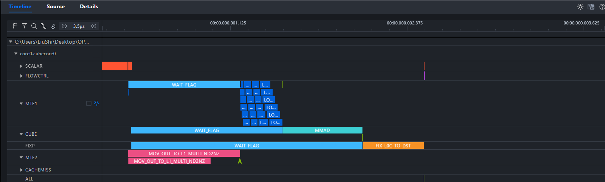
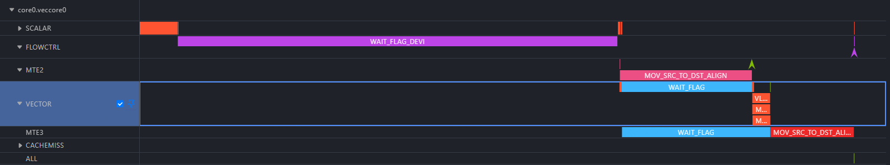
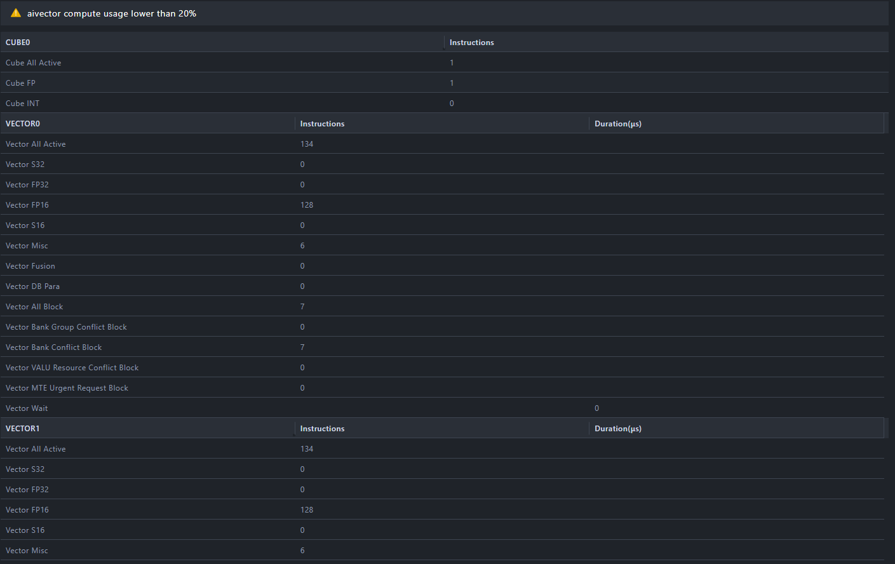
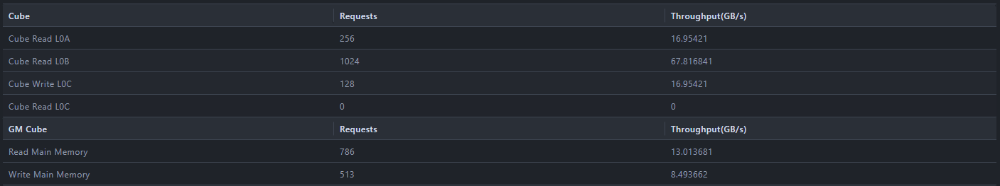
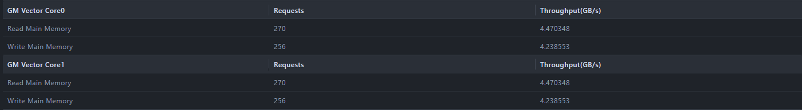
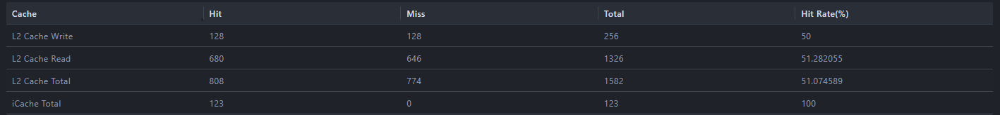
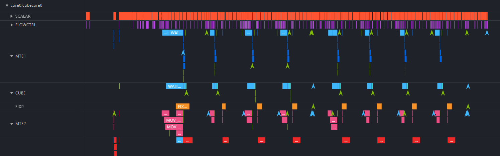
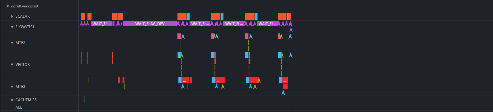
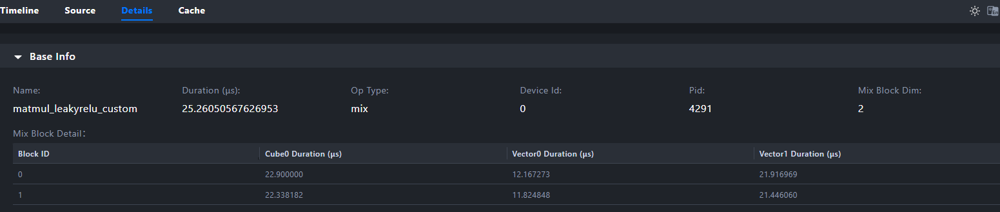
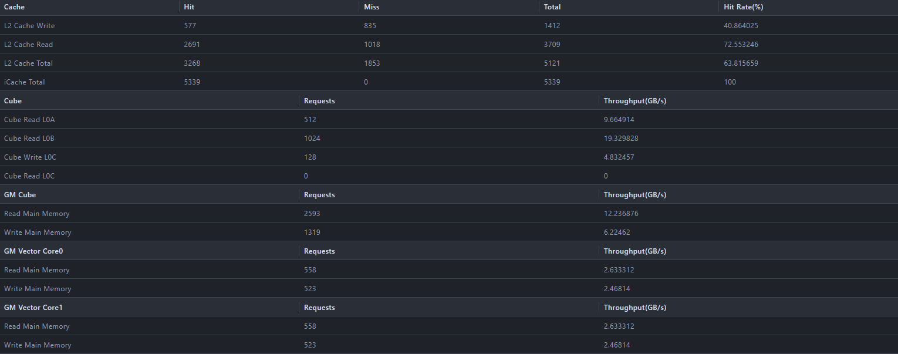

# Analyzing Cube-Vector Fusion Operator Performance with MindStudio Insight

## Case Background

On Ascend AI processors, operator fusion is an important performance optimization method. By merging multiple computation operations into a single Kernel for execution, the number of data transfers between Global Memory (GM) and the AI Core on-chip cache can be significantly reduced, which lowers the memory bandwidth pressure and improves the overall computing efficiency.

Common fusion patterns include Cube-Vector fusion (CV fusion), which merges matrix computation (Cube unit) with vector activation computation (Vector unit) into one Kernel. For fusion operators such as Matmul + LeakyRelu and Matmul + GELU, the computation result does not need to be written out to GM and then read back, but is passed directly to the next computing stage through the on-chip data path.

However, a fusion operator involves the cooperation of the Cube and Vector computing units and the coordination of the cross-core synchronization mechanism (CrossCoreSetFlag/CrossCoreWaitFlag), so its performance is affected by multiple factors: whether the computing load is balanced, whether the data transfer is hidden, and whether the synchronization overhead is too large. With the operator tuning function of MindStudio Insight, the computing load and memory bandwidth of a fusion operator can be visualized intuitively, helping developers quickly locate the performance bottleneck of the fusion operator.

This case takes the official Ascend C example [MatmulLeakyRelu fusion operator](https://gitcode.com/cann/asc-devkit/tree/master/examples/01_simd_cpp_api/00_introduction/03_fusion_operation) as an example to describe how to use MindStudio Insight to analyze the performance of a Cube-Vector fusion operator.

Ascend C provides two programming styles of the MatmulLeakyRelu fusion operator implementation:

- **Basic API (static template programming)**: developers write the data transfer, tiling, PIPE synchronization, and cross-core communication by hand, exposing all hardware details, which suits fine-grained tuning.
- **Advanced API (Matmul high-level API)**: uses the `matmul::Matmul` high-level API to encapsulate the matrix computation details and manages cross-core data transfer with TQue queues. The code is more concise, but there is extra API scheduling overhead in small-scale scenarios.

This case first introduces the basic concepts and analysis methodology of fusion operators, then performs Insight performance analysis on the two API versions respectively, and finally gives a comparison and selection suggestions based on the measured on-board data, helping developers understand the progressive path from "being able to use fusion" to "using fusion well".

## Analysis Methodology

Fusion operator performance analysis is recommended to be carried out in the following order:

1. **Write and run the fusion operator example**: write the fusion operator based on Ascend C, collect hardware performance data with msOpProf, and collect simulation tracing data with `msprof op simulator`.
2. **Analyze the operator pipeline graph (PIPE pipeline analysis)**: restore the end-to-end pipeline graph of the operator from the simulation data and identify the idle areas of each PIPE (MTE2/MTE1/CUBE/FIXP/VECTOR/MTE3). This guides where to look in the subsequent computing load, memory bandwidth, and inter-core load analysis.
3. **Analyze the computing workload**: with the understanding gained from the pipeline graph, view the instruction distribution and blocking of the Cube and Vector computing units on the details page. If CUBE has a high idle proportion in the pipeline graph, focus on why the computing utilization is low; if VECTOR has a high idle proportion, focus on what the Vector cores are waiting for.
4. **Analyze the memory workload**: with the understanding gained from the pipeline graph, view the memory bandwidth and transfer efficiency on the details page. If MTE2 has a high active proportion in the pipeline graph, focus on whether the GM bandwidth is saturated; if MTE1/FIXP has a lot of waiting, focus on whether there is a synchronization bottleneck in the on-chip transfer.
5. **Analyze the inter-core load balance**: compare the duration distribution of each Block and, combined with the CrossCoreWaitFlag waiting time in the pipeline graph, determine whether the core splitting strategy and cross-core synchronization are reasonable.

## Compiling and Running the Fusion Operator and Collecting Data

### Environment Preparation

|Item|Verification Environment|
| --- | --- |
|NPU|Ascend 910C|
|CANN version|9.0.0|
|MindStudio Insight|26.0.0|

- Install the CANN development kit package and configure the environment variables:

  ```bash
  source ${install_path}/cann/set_env.sh
  ```

- Install the msOpProf operator tuning tool. For detailed steps, see the [msOpProf Installation Guide](https://gitcode.com/Ascend/msopprof/blob/master/docs/en/install_guide/msopprof_install_guide.md).
- Install MindStudio Insight. For detailed steps, see the [MindStudio Insight Installation Guide](../install_guide/mindstudio_insight_install_guide.md).

### Obtaining and Compiling the Example Code

This case uses the MatmulLeakyRelu fusion operator from the official Ascend C examples. The code is located in the `examples/01_simd_cpp_api/00_introduction/03_fusion_operation/` directory of the [asc-devkit repository](https://gitcode.com/cann/asc-devkit).

Both examples implement the Cube-Vector fusion computation of Matmul and LeakyRelu. The Basic API formula is:

$$C = A \times B$$
$$C_{ij} = \begin{cases} C_{ij} & \text{if } C_{ij} \geq 0 \\ C_{ij} \times 0.001 & \text{if } C_{ij} < 0 \end{cases}$$

The Advanced API adds triple fusion with Bias on this basis: `C = LeakyRelu(A x B + Bias)`.

The A matrix has the shape `[M, K]`, the B matrix has the shape `[K, N]`, and the output C matrix has the shape `[M, N]`. In this example, M=512, K=128, and N=128.

#### Basic API: Compilation and Collection

The Basic API is located in the `matmul_leakyrelu_basic_api/` directory. The operator uses the `__mix__(1, 2)` kernel function declaration, and each logical core consists of 1 AIC (Cube core) and 2 AIVs (Vector cores), with Block Dim=2 (2 Cube cores + 4 Vector cores in total). After completing the matrix multiplication, the Cube core notifies the Vector cores through CrossCoreSetFlag, and the Vector cores read the result from GM, perform the LeakyRelu activation, and write it back.

```bash
cd asc-devkit/examples/01_simd_cpp_api/00_introduction/03_fusion_operation/matmul_leakyrelu_basic_api

# Compile
mkdir -p build && cd build
cmake .. && make -j

# Generate test data
python3 ../scripts/gen_data.py

# Collect hardware performance data (for analysis on the Insight Details page)
msprof op --output=./prof_output ./demo

# Collect simulation tracing data (for PIPE pipeline graph analysis)
msprof op simulator ./demo
```

#### Advanced API: Compilation and Collection

> **Note**: the default configuration of the Advanced API example is Block Dim = 1 (1 AIC + 2 AIVs, only half the number of cores of the Basic API). To rule out the interference of the core count difference on the performance comparison, this example changes `numBlocks` of the Advanced API to 2 and `SetDim` to 4, keeping the same 2 AIC + 4 AIV core count as the Basic API, with each AIV logical core handling a 512x32 output area.

The Advanced API is located in the `matmul_leakyrelu_advanced_api/` directory. Compared with the Basic API, the core architecture changes are: the Matmul result is output to VECIN (eliminating the GM round trip), Bias triple fusion is added, the output keeps FP32 precision, the N axis is split across cores, and TQue queues are used for synchronization.

```bash
cd asc-devkit/examples/01_simd_cpp_api/00_introduction/03_fusion_operation/matmul_leakyrelu_advanced_api

# Compile
mkdir -p build && cd build
cmake .. && make -j

# Generate test data
python3 ../scripts/gen_data.py

# Collect hardware performance data (for analysis on the Insight Details page)
msprof op --output=./prof_output ./demo

# Collect simulation tracing data (for PIPE pipeline graph analysis)
msprof op simulator ./demo
```

After collection is complete, a `visualize_data.bin` file is generated in the `prof_output` directory. After it is imported into MindStudio Insight, the operator basic information, computing workload, and memory workload can be viewed on the Details page. After the simulation is complete, an `OPPROF_<timestamp>/simulator/` directory is generated in the current directory, which is the core data source for building the PIPE pipeline graph.

## Basic API

### Operator Pipeline Graph Analysis

An Ascend AI Core has multiple internal hardware pipelines (PIPEs), including:

- **MTE2**: handles data transfer between GM and L1 (DataCopy)
- **MTE1**: handles data transfer between L1 and L0A/L0B (LoadData)
- **CUBE (M pipeline)**: handles matrix multiplication (Mmad)
- **FIXP (FIX pipeline)**: handles the transfer of results out of L0C to GM (Fixpipe)
- **VECTOR (V pipeline)**: handles vector computation (LeakyRelu and so on)
- **MTE3**: handles data transfer between GM and UB on the Vector side (DataCopyPad)

These PIPEs are synchronized with each other through the SetFlag / WaitFlag mechanism. **The goal of instruction reordering is to make the working time of these PIPEs cover each other**, compressing the idle areas of each PIPE and thereby reducing the end-to-end duration. The pipeline graph tells you **when each PIPE is idle and how long it stays idle**:

#### Cube Core Pipeline Graph Analysis

> **Note**: this operator has 2 logical Blocks, and each Block contains 1 Cube core. The two Blocks execute exactly the same instruction sequence and their durations are almost the same. The following analysis takes **the Cube core of Block 0 (core0.cubecore0)** as an example.

**Step 1: Obtain the duration of each PIPE**

Extract the key instruction durations from the PIPE Tracing of `core0.cubecore0` in the simulation output.



|PIPE|Instruction|Duration (ns)|Description|
|:-----|:-----|:--------:|:-----|
|**MTE2**|`MOV_OUT_TO_L1_MULTI_ND2NZ`|~580|A matrix GM->L1, ND->Nz format conversion|
|**MTE2**|`MOV_OUT_TO_L1_MULTI_ND2NZ`|~790|B matrix GM->L1, ND->Nz format conversion|
|**MTE1**|`LOAD_2D` x 16 (L1->L0A)|~770|16 A matrix fractals, about 50ns each|
|**MTE1**|`LOAD_2D` x 8 (L1->L0B)|~740|8 B matrix fractals, about 90ns each (including the Nz->Zn transpose)|
|**CUBE**|`MMAD`|~560|Matrix multiply-add: 256x128x128, fp16->fp32|
|**FIXP**|`FIX_L0C_TO_DST`|~430|L0C->GM, Nz->ND + fp32->fp16|
|**FIXP**|`SET_CROSS_CORE`|~2|Cross-core synchronization notification to the Vector cores|

From the active instruction durations of each PIPE, it is clear that MTE2 transfers data (about 1370ns in total), more than twice the CUBE computation (about 560ns), while the FIXP Fixpipe (about 430ns) is the shortest of all active work. MTE1 can transfer only after MTE2 finishes, CUBE can compute only after MTE1 finishes, and FIXP can write only after CUBE computes. No PIPE can be utilized while another PIPE is working, so there is room for instruction reordering. **Core conclusions of the Cube core pipeline graph**:

1. **All PIPEs work strictly in series**: MTE2 -> MTE1 -> CUBE -> FIXP, and no two PIPEs are active at the same time. The end-to-end ~2600ns is entirely the sum of the durations of the stages.
2. **CUBE is the computing bottleneck at this problem scale**: the Mmad takes only ~560ns, and the computing power is far from fully used. However, the ~1000ns wait before CUBE cannot be eliminated; it is the rigid overhead of MTE1 transferring data.
3. **FIXP has the largest idle gap**: a wait of ~1640ns, far exceeding the ~430ns of the Fixpipe itself. This provides a clear direction for the subsequent instruction reordering of "fine-grained parallelism between Mmad and Fixpipe".
4. **MTE2 is the busiest PIPE**: DataCopy A + B totals ~1370ns (~50%), which indicates that the Cube side of this fusion operator is actually **transfer-intensive** rather than compute-intensive, with the data transfer taking far longer than the computation.

#### Vector Core Pipeline Graph Analysis

> **Note**: each Block contains 2 Vector cores (`veccore0` and `veccore1`), which equally divide the output result of one Cube core: `veccore0` reads the first half of the result through the `GetBlockIdx() % 2 * (baseM / 2 * N)` offset, and `veccore1` reads the second half. The two Vector cores execute exactly the same instruction sequence and differ only in the GM offset address (`veccore0` has offset 0 and `veccore1` has offset 0x8000), and their durations are almost the same (in Block 0, veccore0 takes 4023ns and veccore1 takes 4288ns). The following analysis takes **Vector core 0 of Block 0 (core0.veccore0)** as an example.

Extract the key instruction durations from the PIPE Tracing of `core0.veccore0` in the simulation output.



**Active instructions of each PIPE**

|PIPE|Instruction|Duration (ns)|Description|
|:-----|:-----|:--------:|:-----|
|**FLOWCTRL**|`WAIT_FLAG_DEVI` (CrossCoreWaitFlag)|~2100|Waits for CrossCoreSetFlag of the Cube core|
|**MTE2**|`MOV_SRC_TO_DST_ALIGN` (GM->UB)|~630|Reads half of the Matmul result into UB|
|**VECTOR**|`VLRELU` (LeakyRelu)|~80|Vector activation computation|
|**MTE3**|`MOV_SRC_TO_DST_ALIGN` (UB->GM)|~400|Writes the activation result back to GM|

CrossCoreWaitFlag is **26 times** the LeakyRelu computation (80ns). In other words, the time the Vector core spends "waiting for the Cube core" is enough for it to execute LeakyRelu 26 times. This indicates that the Vector core idles away most of its time and that the room for optimization is very limited. **Core conclusions of the Vector core pipeline graph**:

1. **CrossCoreWaitFlag accounts for a large proportion**: of the ~4000ns total duration of the Vector core, ~2100ns is spent waiting for the Cube core to finish. The bottleneck of the Vector core is not itself but the production speed of the Cube side. This means that optimizing the Vector core is of limited value unless the production latency of the Cube core is reduced.
2. **The VECTOR computation proportion is low**: the LeakyRelu computation takes only ~80ns. The Vector side is indeed not fully fed.
3. **The Vector core is also purely serial**: CrossCoreWaitFlag -> MTE2 -> VECTOR -> MTE3, with no parallelism.

### Computing Workload Analysis

> **From the pipeline graph to here**: the pipeline graph shows that the Cube core is idle and the Vector core proportion is low. Next, view the computing workload (Compute Workload Analysis) on the Insight details page to verify the instruction distribution and blocking of each computing unit.

In MindStudio Insight, import the `visualize_data.bin` file collected in step 1 (for details, see [Importing Data](../user_guide/basic_operations.md#importing-data)) and view it on the Details page.



On the details page, the Base Info area displays the operator basic information, and Mix Block Detail displays the duration distribution of each core:

- **Mix Block Dim = 2**: indicates 2 logical Blocks in total, consistent with the `__mix__(1, 2)` declaration (each Block contains 1 AIC + 2 AIVs), totaling 2 Cube cores + 4 Vector cores.

The correspondence between the metrics in the computing load analysis panel and the pipeline graph:

- **Top prompt**: if a prompt such as "compute usage lower than 20%" appears, the utilization of the corresponding computing unit is low. From the pipeline graph, this prompt is expected.
- **Cube core instruction distribution**: in the fusion operator, the Cube core performs the matrix multiplication, and the pipeline graph shows only 1 Mmad instruction (~560ns). The Cube All Active / Cube FP counts on the panel should be very small, which is consistent with a single Mmad completing the whole matrix multiplication because of the small problem scale (M=512, K=128, N=128) shown in the pipeline graph.
- **Vector core instruction distribution**: the pipeline graph shows that VECTOR has only 1 VLRELU instruction (80ns). Vector FP16 should account for the main proportion on the panel (128 FP16 instructions); the Misc instructions come from synchronization and configuration operations such as SetFlag and MOVEMASK, and the BAR and SET_FLAG instructions of VECTOR in the pipeline graph confirm these overheads.
- **Blocking/stall metrics**: Vector All Block indicates the total number of Vector core blocks, and Vector Wait indicates the idle time spent waiting for data or synchronization. From the pipeline graph it is known that the WAIT_FLAG of VECTOR waits for MTE2 for 630ns, which can be cross-verified with the Vector Wait value on the panel.

In the `__mix__(1, 2)` mode, 2 Vector cores equally divide the output result of one Cube core. The instruction counts and durations of the Cube and Vector cores can be compared: if the Vector core has far more instructions than the Cube core but its overall utilization is still low, the computation amount on the Vector side is not enough to match the computation output of the Cube side, and the Vector core may be idle and waiting. The pipeline graph has already quantified this wait precisely: CrossCoreWaitFlag = 2100ns.

> **Why does the MatmulLeakyRelu fusion operator produce "compute usage lower than 20%"?**
>
> Taking this case as an example, the Cube core executes only 1 Mmad instruction to complete the whole matrix multiplication (512x128x128, about 16.77 million MACs), which takes about 560ns. Each Vector core handles only 32,768 elements of LeakyRelu (256x128; each element needs 1 comparison and at most 1 multiplication, about 65,000 operations), which can be completed with 128 FP16 instructions, and the actual computation time is only 80ns.
>
> Of the ~4000ns duration of the Vector core, most of the time is spent on:
>
> - **Waiting for the Cube core**: CrossCoreWaitFlag blocks and waits for the Cube core to complete the Fixpipe write-back (quantified by the pipeline graph: 2100ns)
> - **Data transfer**: DataCopyPad reads the Cube result from GM (quantified by the pipeline graph: MTE2 630ns) and writes the result back (quantified by the pipeline graph: MTE3 400ns)
> - **Storage conflict**: in the data, Vector Bank Conflict Block = 7, indicating bank conflicts in UB access
>
> In short, **the computation amount of Matmul is 256 times that of LeakyRelu, so it is normal that the Vector side is not fully fed**. The core benefit of fusion is saving the GM round trip, not keeping the Vector cores fully busy.

### Memory Workload Analysis

> **From the pipeline graph to here**: the pipeline graph shows that MTE2 of the Cube core is 52.1% active (the busiest PIPE) and that FIXP has a 1640ns waiting gap. Next, view the memory workload (Memory Workload Analysis) on the Insight details page to verify the DDR bandwidth usage and L2 Cache hits and to confirm "whether the 52.1% activity of MTE2 means the DDR bandwidth is saturated".

#### Cube Core Memory Bandwidth



|Metric|Value|Correspondence with the Pipeline Graph|
|------|------|------|
|Cube Read L0A|16.95 GB/s|Corresponds to the 16 LOAD_2D instructions of MTE1 (L1->L0A, ~770ns)|
|Cube Read L0B|67.82 GB/s|Corresponds to the 8 LOAD_2D instructions of MTE1 (L1->L0B, ~740ns, including the Nz->Zn transpose)|
|Cube Write L0C|16.95 GB/s|Corresponds to the MMAD of CUBE (L0C write, 560ns)|
|Read Main Memory|13.01 GB/s|Corresponds to DataCopy A+B of MTE2 (GM->L1, 1370ns)|
|Write Main Memory|8.49 GB/s|Corresponds to FIX_L0C_TO_DST of FIXP (L0C->GM, 430ns)|

#### Vector Core Memory Bandwidth



|Metric|Value|Correspondence with the Pipeline Graph|
|------|------|------|
|Read Main Memory|4.47 GB/s|Corresponds to MOV_SRC_TO_DST_ALIGN of MTE2 (GM->UB, 630ns)|
|Write Main Memory|4.24 GB/s|Corresponds to MOV_SRC_TO_DST_ALIGN of MTE3 (UB->GM, 400ns)|

#### L2 Cache Hit Rate



|Cache|Hit|Miss|Total|Hit Rate|
|------|:---:|:---:|:---:|:---:|
|L2 Cache Write|128|128|256|50%|
|L2 Cache Read|680|646|1,326|51.28%|
|L2 Cache Total|808|774|1,582|51.07%|
|iCache Total|123|0|123|100%|

#### Analysis Highlights

- **Balanced DDR read and write of the Cube core**: DDR read 13.01 GB/s (corresponding to MTE2, the busiest PIPE in the pipeline graph, active for 1370ns) and write 8.49 GB/s (corresponding to FIXP active for 430ns in the pipeline graph). The L0B read bandwidth (67.82 GB/s) is significantly higher than that of the other channels, because the B matrix needs to be transposed (Nz->Zn) in the LoadData stage of MTE1, which generates extra on-chip transfer overhead.
- **Symmetric DDR read and write of the Vector core**: DDR read 4.47 GB/s and write 4.24 GB/s, symmetric with low bandwidth, which indicates that the data transfer volume of the Vector core is small (each core handles only 32 KB of data), consistent with MTE2 630ns + MTE3 400ns in the pipeline graph.
- **The L2 Cache hit rate reflects fusion data reuse**: the total L2 Cache hit rate is 51.07%, with a write hit rate of 50% and a read hit rate of 51.28%. This aggregate value mixes the access patterns of the Cube and Vector cores: the Cube core accesses the A/B matrices in large volumes and in sequence, so its hit rate is low; the Vector core handles a small data volume, and the data just written by the Cube core is still in the Cache, so its hit rate is close to 100%. This reflects the advantage of the fusion operator: **the result written back by the Cube core is read directly from the L2 Cache by the Vector core, avoiding the GM round trip**. From the perspective of the pipeline graph, after the Fixpipe (FIXP) of the Cube core writes GM, the data resides in the L2 Cache, and the MTE2 of the Vector core (DataCopyPad reading GM) can hit the Cache directly, reducing the DDR access latency; this is the PIPE-level reason behind the 51.07% hit rate. The iCache hit rate is 100%, indicating that there is no instruction cache miss.

### Inter-Core Load Analysis

> **From the pipeline graph to here**: the pipeline graph shows that CrossCoreWaitFlag of the Vector core accounts for 2100ns (52.4%) and that the total duration of the Vector core, 4010ns, is far longer than the 2630ns of the Cube core. Next, view the Mix Block Detail panel on the Insight details page to verify the duration differences and load balance of each core.

On the details page, view the duration distribution of each Core (Block):

- If the execution time of each Block is close, the core splitting strategy is reasonable and the load is balanced.
- If the execution time of some Blocks is obviously longer than that of other Blocks, the load is unbalanced, and the core splitting logic needs to be checked (for example, when splitting along the M axis, whether M can be divided exactly by singleCoreM).

For a fusion operator, also pay attention to the cooperation between the Cube and Vector cores: whether the Vector core waits too long for the CrossCoreSetFlag of the Cube core, and whether the Vector core has idle time "waiting for data". The pipeline graph has already quantified this wait precisely.

> In this case, Block Dim = 2 and Mix Block Dim = 4, corresponding to 2 logical Blocks (each containing 1 Cube core + 2 Vector cores), totaling 2 Cube cores + 4 Vector cores.
>
> The duration of each core can be read from the Mix Block Detail table:
>
> |Block|Cube0 Duration|Vector0 Duration|Vector1 Duration|
> |:-----:|:----------:|:------------:|:------------:|
> |0|3202ns|4023ns|4288ns|
> |1|3165ns|4125ns|3923ns|
>
> Cross-verify with the pipeline graph data:
>
> - **Load balance between Blocks**: the Cube core durations of Block 0 and Block 1 are close (~3202ns vs the 2630ns in the pipeline graph), and their Vector core durations are also close (~4023ns vs the 4010ns in the pipeline graph), indicating that the core splitting along the M axis is even and the load balance is good.
> - **Difference between the Cube and Vector cores**: within each Block, the Cube core (~3200ns) is obviously shorter than the Vector cores (~4000ns), with a difference of about 800ns. From the pipeline graph, the source of this difference is that **the Vector core can start only after the Cube core completes the Fixpipe** (CrossCoreWaitFlag = 2100ns), and the serial execution of MTE2 + VLRELU + MTE3 of the Vector core itself (1110ns in total) also takes time. The total Cube core time of 2630ns roughly matches the start time of CrossCoreWaitFlag of the Vector core (CrossCoreSetFlag occurs at the end of the Cube core pipeline graph) plus the execution time of the Vector core itself.
> - **Difference between the Vector cores**: within the same Block, Vector0 and Vector1 have close durations, which indicates that the strategy of equally dividing the Cube output between the two Vector cores is reasonable: in the pipeline graph, Vector0 (blockIdx%2=0) and Vector1 (blockIdx%2=1) have different GM offsets but execute the same instructions.
>
> If the number of cores increases to 4 or 8, the M axis is divided more finely, singleCoreM becomes smaller, the number of elements handled by each core decreases, and the transfer proportion rises further. In that case, pay attention to whether the core splitting granularity is too fine, which would make the transfer overhead exceed the computing benefit.

### Analysis Summary

Through the analysis of the above four dimensions, the following list of performance bottlenecks of the MatmulLeakyRelu fusion operator implemented with the Basic API is formed:

- **Pipeline graph**: all PIPEs are strictly serial with no parallel coverage; the Vector core spends ~52.4% of its time waiting for the Cube core (CrossCoreWaitFlag=2100ns); MTE2 is the busiest PIPE
- **Computing load**: CUBE and VECTOR utilization is extremely low (the problem scale M=512, K=128, N=128 is too small)
- **Memory load**: data goes through a GM round trip (FIXP writes GM + MTE2 reads GM, 1060ns in total); the L2 Cache has fusion data reuse, but the Cube-side hit rate is only ~10%
- **Inter-core load**: the load is well balanced between Blocks; the duration difference between the Cube and Vector cores is ~800ns, and the cross-core synchronization wait is the largest bottleneck

## Advanced API

The Advanced API uses the Matmul high-level API to encapsulate the matrix multiplication. Compared with the Basic API, it achieves architectural changes in 6 directions:

1. Elimination of the GM round trip: the Matmul result is output to VECIN (on-chip)
2. Triple fusion: Bias addition is added
3. Full-precision output: FP32 precision is kept
4. N-axis core splitting: SetDim(4) splits the N axis into 4 parts (singleCoreN=32)
5. Queue-based synchronization: TQue replaces CrossCoreSetFlag/WaitFlag
6. Dynamic Tiling: the tiling and core splitting strategy is calculated automatically at runtime through `MultiCoreMatmulTiling`

### Pipeline Graph Analysis

The following data all comes from the `msprof op simulator` simulation tracing results, using the same data source as the Basic API simulation pipeline graph analysis in step 2, for easy comparison.

#### Cube Core Pipeline Graph Analysis

**Advanced API Cube core** (core0.cubecore0) simulation data.



**Key instruction timing** (8 Iterates, each processing baseM x baseN x baseK = 128x32x128).

|PIPE|Key Instruction|Duration|Description|
|:-----|:-----|:--------:|:-----|
|**MTE2**|`MOV_OUT_TO_L1_MULTI_ND2NZ` and others|7.64 us|A/B/Bias matrices GM->L1 inside the Matmul API: A 8x375ns (128x128 half), B 8x371ns (128x32 half), Bias 2x835ns|
|**MTE1**|`LOAD_L1_TO_DST_3DV2` (L1->L0A/L0B)|1.75 us|16 loads: L0A 8x92ns + L0B 8x126ns, loading the A/B fractals of each tile|
|**CUBE**|`MMAD` x 8|0.64 us|128x32x128 each time (about 80ns); the total computation is half of the single 256x128x128 of the Basic API|
|**FIXP**|`FIX_L0C_TO_DST` (L0C->**VECIN**)|2.80 us|8 Fixpipe writes to the on-chip VECIN (350ns per call, 128x32 float=16KB), eliminating the format conversion overhead of the GM write-back|
|**MTE3**|`MOV_L1_TO_OUT` x25|7.04 us|L1->GM transfer-out inside the Matmul API: 8 main loops (3.88us) + 17 internal management operations (3.16us)|
|**SCALAR**|API scheduling + iteration control|~83.17 us|Scheduling overhead of the Matmul high-level API, including 1742 LD/ST address calculations, tiling traversal, and queue management|

**Core conclusions of the Cube core pipeline graph**:

1. **The FIXP target changes from GM to VECIN and the single-transfer volume is halved**: the Fixpipe of the Basic API writes L0C->GM (requiring float->half + Nz->ND), while that of the Advanced API writes L0C->VECIN (on-chip), eliminating the type and format conversion. Together with baseN decreasing from 64 to 32, the single Fixpipe data volume drops from 32KB to 16KB, and the total FIXP duration drops from 7.50us to 2.80us (down 63%).
2. **MMAD becomes fine-grained and the computation is halved**: 1 large MMAD (Basic API 256x128x128, 560ns) becomes 8 small MMADs (128x32x128, 80ns per call). The total MMAD computation of each Cube core drops from 256x128x128 in the Basic API to 8x128x32x128 (equivalent work but divided between 2 Cube cores).
3. **The SCALAR unit is still the absolute bottleneck**: the tiling scheduling, iteration control, and queue management overhead of the Matmul high-level API accounts for ~97% of the Cube core time (CUBE accounts for only ~0.5%). The SCALAR duration is as high as 83.17 us: although SetDim(4) halves the data volume per Iterate, the scheduling complexity of the tiling API increases, and the fixed SCALAR overhead is extremely high. This is the root cause of the Advanced API performing worse than the Basic API in small-scale scenarios: **the fixed overhead far exceeds the computing benefit**.

#### Vector Core Pipeline Graph Analysis

**Advanced API Vector core** (core0.veccore0) simulation data.



**Key instruction timing**

|PIPE|Key Instruction|Duration|Description|
|:-----|:-----|:--------:|:-----|
|**FLOWCTRL**|`WAIT_FLAG_DEV` x 4|8.02 us|**CrossCoreWaitFlag is eliminated**; instead, the hardware queue synchronously waits for the VECIN data to be ready (about 2.0us per Iterate)|
|**MTE2**|`MOV_OUT_TO_UB` (**VECIN**->UB)|0.89 us|The data source changes from GM to the on-chip VECIN, transferring 128x32 float=16KB per Iterate (~222ns per call)|
|**VECTOR**|`VLRELU` x 4|0.19 us|LeakyRelu of the 4 Iterates (about 48ns each, 4096 float elements), with the computation halved along with singleCoreN|
|**MTE3**|`MOV_UB_TO_OUT` (UB->GM)|2.85 us|FP32 output write-back, 13 DataCopy operations (4 main loop write-backs + 9 internal management operations), 64KB total output per core|
|**SCALAR**|Scheduling + waiting|~11.75 us|Scalar operations such as queue management and synchronization waiting|

**Core conclusions of the Vector core pipeline graph**:

1. **CrossCoreWaitFlag is completely eliminated and replaced by WAIT_FLAG_DEV**: this is the biggest architectural benefit. The Vector core no longer blocks waiting for the Cube core to write the Fixpipe result to GM but synchronously waits for the VECIN data to be ready through the hardware queue. WAIT_FLAG_DEV takes 8.02us (4 Iterates), corresponding to the data arrival latency after the Cube core completes the FIXP write to VECIN in each Iterate.
2. **The MTE2 transfer volume is halved**: the data source changes from external DDR (GM->UB in the Basic API) to the on-chip VECIN (VECIN->UB in the Advanced API). Together with singleCoreN decreasing from 64 to 32, the transfer volume per Iterate drops from 32KB to 16KB, and the total MTE2 duration drops from 1.09us to 0.89us.
3. **The VECTOR computation proportion is still extremely low**: the 4 VLRELU operations total ~0.19us (~0.6% of the total time), processing 4096 float elements per Iterate. The inherent characteristic that the per-element computation of LeakyRelu is small remains unchanged.
4. **The MTE3 write-back volume is halved along with singleCoreN**: the output per core drops from 512x64x4=128KB to 512x32x4=64KB, and the MTE3 duration drops slightly from 2.89us to 2.85us.

### Computing Workload Analysis

Import the `visualize_data.bin` file of the Advanced API into the Insight details page and observe the following metrics.



- **Mix Block Dim = 2**: Block Dim=2, totaling 2 Cube cores + 4 Vector cores, consistent with the Basic API core count, which eliminates the interference of the core count difference
- **Task Duration ~25.26 us**: about 3.6 times that of the Basic API (7.04 us); the main expansion comes from the API scheduling overhead of the SCALAR unit of the Cube core, and the fixed overhead of tiling scheduling cannot be amortized with the same number of cores

#### Inter-Core Load Analysis

View the duration distribution of the 6 cores in the 2 Blocks in the Mix Block Detail panel of the details page:

- **Cube core duration**: Block 0 Cube core 22.90 us and Block 1 Cube core 22.34 us. The durations of the two Cube cores are close (difference only ~0.56 us), and **the load balance is good**. The main time is consumed by the Scalar scheduling of the Matmul API (SCALAR active proportion ~87-89%)
- **Vector0 duration**: Block 0 Vector0 12.17 us and Block 1 Vector0 11.82 us. The durations of the two Vector0 cores are close, mainly waiting for WAIT_FLAG_DEV (wait_id0 ~7.0-7.3 us) and MTE3 write-back
- **Vector1 duration**: Block 0 Vector1 21.92 us and Block 1 Vector1 21.45 us. The durations of the two Vector1 cores are close but **far longer than Vector0**. The main wait of Vector1 is WAIT_FLAG_DEVI (wait_id1 ~17 us), which indicates that the two Vector cores in the same Block wait for different events to complete

**Analysis of the uneven durations of Vector0 and Vector1**:

With the N axis split into 4 cores, `singleCoreN = 32`, the 2 Vector cores of Block 0 handle columns [0, 32) and [32, 64) of the C matrix respectively, and the 2 Vector cores of Block 1 handle columns [64, 96) and [96, 128) respectively. After the tiling of the Matmul high-level API splits the cores along the N axis, **the timing of the Iterate initiated by each Vector core differs**: the later-started Vector1 needs to wait for the preceding Iterate to release tiling resources, which is shown as a WAIT_FLAG_DEVI (wait_id1 ~17 us) wait far longer than the WAIT_FLAG_DEV of Vector0 (wait_id0 ~7 us).

### Memory Workload Analysis

After importing the on-board data, observe the key changes in the memory workload panel.



- **Cube core GM bandwidth**: DDR read ~12.2 GB/s and DDR write ~6.2 GB/s.
- **Vector core GM bandwidth**: DDR read ~2.6 GB/s (VECIN->UB, float) and DDR write ~2.5 GB/s (UB->GM, float).
- **L2 Cache hit rate**: the overall hit rate is improved compared with the Basic API, and the data reuse of tile-based iteration reduces repeated GM access. Because the Vector core bypasses the L2 Cache through the on-chip VECIN path, the related measurements are not directly comparable with the GM path of the Basic API.

## On-Board Data Comparison

### End-to-End Duration Comparison

|Metric|Basic API|Advanced API|Difference|
|------|:--------:|:--------:|:----:|
|**Task Duration (us)**|7.04|25.26|Up 3.6x|
|Block Dim / Mix Block Dim|2 / 4|2 / 4|Same number of cores|
|Cube core duration (us)|3.09-3.13|22.34-22.90|Up 7.2x|
|Vector core duration (us)|4.11-4.22|11.82-12.17 / 21.45-21.92|Up 2.8x-5.2x|

**Interpretation**: the end-to-end duration of the Advanced API is 3.6 times that of the Basic API, and the gap is still significant with the same number of cores (2 Cube + 4 Vector). After aligning the core counts, the remaining gap comes entirely from the fixed SCALAR overhead of the Matmul high-level API (SCALAR active proportion ~87-89%), which is the structural cost of the Advanced API in small-scale scenarios.

### PIPE Utilization Comparison

|PIPE Metric|Basic API|Advanced API|Change|
|------|:--------:|:--------:|:----:|
|AIC CUBE active proportion|9.2%|3.3%|Down: crowded out by API scheduling; halving baseN shortens a single MMAD|
|AIC MTE2 active proportion|14.6%-16.1%|15.5%-17.4%|About the same: the fine-grained tile transfer proportion is basically unchanged|
|AIC FIXP active proportion|6.8%-7.1% (writing GM)|11.7%-13.6% (writing VECIN)|Up: the data volume drops after baseN is halved, but the proportion of the VECIN write path rises|
|AIC SCALAR active proportion|43.4%-43.9%|**87.2%-89.2%**|Sharply up: inherent API overhead|
|AIV VEC active proportion|1.6%|1.1%|About the same: the computation proportion is always very low, and halving baseN lowers it further|
|AIV MTE2 active proportion|7.7%-8.1%|2.8%-2.9%|Down: the VECIN path has lower latency; the data volume per core is 64KB (halved)|
|AIV MTE3 active proportion|6.0%-6.5%|10.6%-12.8%|Sharply up: the FP32 output write-back (float vs half) accounts for a significantly larger proportion|
|AIV synchronization wait|2.7-2.9 us CrossCoreWaitFlag|**7.0-17.0 us** WAIT_FLAG_DEV/DEVI|Up: the waiting time increases (the cost of replacing cross-core synchronization with queue pipeline synchronization)|

**Interpretation**: CrossCoreWaitFlag changes from cross-core synchronization to hardware queue synchronization (WAIT_FLAG_DEV/DEVI), eliminating the cross-core dependency but introducing a new waiting pattern. The SCALAR proportion is as high as 87-89%, far exceeding the 43% of the Basic API; the "scheduling-intensive" characteristic of the Matmul high-level API at small scale is unchanged.

### Precision and Data Volume Comparison

|Metric|Basic API|Advanced API|Description|
|------|:--------:|:--------:|:----:|
|Fusion operator combination|Matmul + LeakyRelu|Matmul + Bias + LeakyRelu|Triple fusion|
|Output precision|**FP16**|**FP32**|Precision doubled|
|Number of MMADs x cores|1 x 2 = 2|8 x 2 = 16|Fine-grained iteration x dual cores|
|Cube FOPS (per core)|8,192|73,728|Equivalent total computation (128x32x128 requires more instructions)|
|GM->L1 data volume (KB/core)|96|298|3x tile reuse transfer|
|L0C output path|-> GM (64 KB)|-> **VECIN** (128 KB)|On-chip path; the data volume also drops after baseN is halved|
|VECIN->UB / GM->UB (KB/core)|32 (half)|64 (float)|The FP32 data volume doubles (but halving baseN offsets part of it)|
|UB->GM write-back (KB/core)|32 (half)|65.1 (float)|The FP32 output precision doubles|

### Why Is the Advanced API Slower End to End?

For the problem scale M=512, K=128, N=128, the end-to-end duration of the Advanced API (2 Cube + 4 Vector configuration) is 3.6 times that of the Basic API (25.26 us vs 7.04 us). There are two main reasons:

**1. Fixed overhead of the Matmul high-level API**

The SCALAR unit active proportion of the Advanced API is as high as 87.2%-89.2% (the SCALAR proportion of the Basic API is only 43.4%-43.9%), mainly because:

- **TQue queue management**: the `EnQue`/`DeQue` of each Iterate needs Scalar core coordination, and 4 Iterates x 2 Blocks generate a large number of queue operations
- **Dynamic Tiling scheduling**: `MultiCoreMatmulTiling` needs to calculate the tile range and check boundary conditions in each Iterate, and SetDim(4) increases the complexity of the core splitting decision
- **Bias fusion**: `EnableBias(true)` adds branch decision and data preparation overhead to the Scalar core
- **N-axis core splitting address calculation**: the `nCoreOffset` offset calculation of the B/C/Bias matrices is on the hot path, and splitting into 4 cores makes the address calculation logic more complex

Of the 22+ us total time of the Cube core, the actual CUBE computation is only ~0.83 us (3.3%); **the overhead is 27 times the computation**. With the two cores running in parallel, the SCALAR scheduling overhead becomes the decisive factor in the end-to-end duration expansion: **the fixed overhead of the API abstraction layer (~20+ us per Cube core) is a constant that does not change with the matrix size**, and cannot be amortized at small scale.

**2. The Vector core has new synchronization waits**

The Advanced API replaces the CrossCoreWaitFlag of the Basic API (2.7-2.9 us) with TQue queue synchronization, eliminating the cross-core blocking. The cost, however, is the introduction of two different levels of waiting:

- **WAIT_FLAG_DEV** (Vector0, ~7.0-7.3 us): waits for the Cube core to write the Matmul intermediate result into VECIN
- **WAIT_FLAG_DEVI** (Vector1, ~16.9-17.0 us): waits for the Matmul tiling to release iteration resources internally, because the N-axis slice handled by Vector1 starts later

The ~9 us gap between Vector0 (~12 us) and Vector1 (~21.5 us) indicates that the N-axis splitting of SetDim(4) causes the two Vector cores in the same Block to start their pipelines at different times; this is an inherent characteristic of N-axis core splitting: the more cores it is split into, the longer the later-started cores wait.

**3. The problem scale is too small**

512x128x128 is only about 16.77 million MACs (about 8.4 GFLOPS), which is a very small computation amount for an AI Core. The Matmul high-level API is designed for tile-based iteration of large matrices: when the matrix size reaches thousands or tens of thousands, the fixed overhead of the API is amortized and the iterative computation dominates the time. With the same number of cores, the 3.6x duration of the Advanced API is reasonable at the 512 scale, because **the fixed overhead of the API abstraction layer (~20+ us per Cube core) is a constant that does not change with the matrix size**.

## Selection Suggestions

Based on the above analysis and measured data, the following selection suggestions are given for different application scenarios.

|Dimension|Recommended Basic API|Recommended Advanced API|
|------|:-------------|:-------------|
|**Matrix scale**|Small matrices with M/N/K < 1024|Medium and large matrices with M/N/K >= 1024|
|**Precision requirement**|FP16 output is acceptable, with no sensitivity to the intermediate precision|FP32 full-precision output is required, or the subsequent operator is FP32|
|**Number of fusion operators**|Binary fusion (Matmul+Act)|Triple or more fusion (+Bias, +GELU, and so on), with good scalability|
|**Development efficiency**|Fine-grained tuning is required and time is sufficient|Fast prototype verification with less code|
|**Maintainability**|Fixed scale with no cross-architecture requirement|Cross-NPU-architecture porting is required (`#if __NPU_ARCH__` has a high cost)|
|**Cross-core synchronization**|Handwritten CrossCoreSetFlag/WaitFlag is acceptable|TQue manages it automatically, reducing the risk of errors|
|**Core splitting granularity**|Fine control of the M-axis splitting strategy is required|Automatic core splitting (`SetDim`), with flexible runtime Tiling adjustment|
|**Scalability**|New fusion operations need to be added manually (rewriting the tiling)|New Stages can be added after the Matmul output according to the Pipeline|

## Summary

This case takes the MatmulLeakyRelu fusion operator as an example to fully demonstrate the operator performance analysis path of **"basic analysis -> optimization exploration -> comparison and verification -> selection guidance"**, all based on performance data from MindStudio Insight:

1. **Basic analysis stage (Basic API + Insight)**: based on the four dimensions of the PIPE pipeline graph, computing load, memory bandwidth, and inter-core load, the performance characteristics of the Basic API implementation were systematically analyzed. The pipeline graph precisely quantified the active/idle distribution of each PIPE and revealed that **the GM round trip** (FIXP 430ns + MTE2 630ns = 1060ns) and **the CrossCoreWaitFlag wait** (2100ns, 52.4%) are the two core bottlenecks.

2. **Optimization exploration stage**: 6 optimization directions were extracted from the analysis results: eliminating the GM round trip (VECIN), adding Bias fusion, keeping FP32 precision, N-axis core splitting, TQue queue synchronization, and dynamic Tiling. These optimization directions have been implemented to varying degrees in the Advanced API.

3. **Comparison and verification stage**: simulation data and on-board data were collected for the two APIs respectively, and a comprehensive comparison was made from the four dimensions of PIPE utilization, computation precision, L2 Cache hit rate, and end-to-end duration. The simulation data confirmed the effectiveness of the architectural optimization (CrossCoreWaitFlag eliminated and replaced by WAIT_FLAG_DEV, the L2 Cache hit rate increased to the 55-86% tile reuse advantage, and the on-chip VECIN path eliminating the GM round trip), while the on-board data objectively presents the performance disadvantage of the Advanced API in small-scale scenarios (SCALAR proportion ~88%, end-to-end duration 3.6x that of Basic, and the uneven wait between Vector cores introducing a new synchronization cost under N-axis slicing).

4. **Selection guidance stage**: the selection considerations of 7 dimensions, including matrix scale, precision requirement, and development efficiency, were comprehensively analyzed, and clear usage suggestions were given: use the Basic API for debugging small matrices and the Advanced API for production with large matrices.

For the complete code and detailed description of the two examples, see the official Ascend C example repository:

- [MatmulLeakyRelu Basic API example](https://gitcode.com/cann/asc-devkit/tree/master/examples/01_simd_cpp_api/00_introduction/03_fusion_operation/matmul_leakyrelu_basic_api)
- [MatmulLeakyRelu Advanced API example](https://gitcode.com/cann/asc-devkit/tree/master/examples/01_simd_cpp_api/00_introduction/03_fusion_operation/matmul_leakyrelu_advanced_api)

## References

- [Operator Tuning](../user_guide/operator_tuning.md)
- [Ascend C MatmulLeakyRelu fusion operator example (Basic API)](https://gitcode.com/cann/asc-devkit/tree/master/examples/01_simd_cpp_api/00_introduction/03_fusion_operation/matmul_leakyrelu_basic_api)
- [Ascend C MatmulLeakyRelu fusion operator example (Advanced API)](https://gitcode.com/cann/asc-devkit/tree/master/examples/01_simd_cpp_api/00_introduction/03_fusion_operation/matmul_leakyrelu_advanced_api)
- [Ascend C Fusion Operator Programming Guide (CV Fusion)](https://gitcode.com/cann/asc-devkit/tree/master/docs/en/guide/operator_practice/simd_operator_impl/fusion_operator_programming/cv_fusion)
- [msOpProf User Guide](https://gitcode.com/Ascend/msopprof/blob/master/docs/en/user_guide/msopprof_user_guide.md)
- [CANN Profiling Data Collection Guide](https://www.hiascend.com/document/detail/en/canncommercial/82RC1/devaids/Profilling/atlasprofiling_16_0010.html)
