# Host Bound Issue Analysis Based on Linux Kernel Trace

## Background

In large models, the CPU is primarily responsible for task dispatch, while the NPU handles task execution. In live network issues, Host Bound is a frequently occurring issue in both inference and training domains. In profiling, a Host Bound model often manifests as prolonged dispatch time, with corresponding large bubbles appearing on both the device and host, as shown in the following figure:

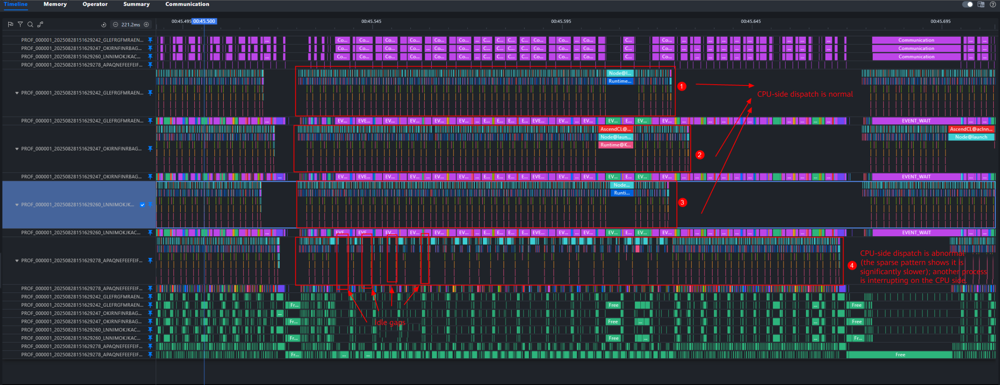

When analyzing Host Bound issues, Linux kernel ftrace data usually needs to be collected to observe process scheduling on the CPU. MindStudio Insight provides [`ftrace_tools`](https://gitcode.com/Ascend/msinsight/blob/26.2.0/scripts/ftrace_tools/ReadMe.md), in which `trace_record.py` collects ftrace data, `trace_convert.py` converts the data format, and `trace_analyze.py` performs offline statistical analysis. These scripts support importing ftrace data and profiling data into the same project for joint analysis.

## Identification Approach

1. Try general scheduling optimization methods such as core binding, pipeline optimization, and memory allocation library replacement. For scheduling optimization methods of Ascend Extension for PyTorch, see [Scheduling Optimization](https://www.hiascend.com/document/detail/en/Pytorch/latest/ptmoddevg/trainingmigrguide/FrameworkPTAdapter/26.0.0/en/pytorch_model_migration_fine_tuning/pipeline_opt.md).
2. If the general optimization does not achieve the expected effect, collect ftrace data and profiling data within the same service running period.
3. Convert the raw ftrace data to an SQLite DB that MindStudio Insight can import, with priority; use the JSON format only when JSON data already exists, Chrome Trace JSON is required, or an external tool supports only JSON.
4. Import the converted ftrace data and the profiling data into the same project, and analyze task scheduling with the CPU Scheduling, Process Scheduling, and profiling views.

> In container scenarios, it is recommended to collect ftrace on the host and profiling in the service container; the two types of data do not need to be collected in the same container. An ordinary unprivileged container usually cannot collect ftrace directly; if collection inside a container is required, additional permission and tracing file system mount requirements must be met. For details, see [FAQ 8.5 in the `ftrace_tools` README](https://gitcode.com/Ascend/msinsight/blob/26.2.0/scripts/ftrace_tools/ReadMe.md#85-can-ftrace-collection-be-used-directly-inside-a-container). If the service container does not use the host PID namespace, PID mapping must also be completed as described in [In-Container Collection](#4-in-container-collection).

## Model Profiling Data Collection

For profiling data collection methods, see the following documents:

- [MindStudio Profiler Tool Guide](https://gitcode.com/Ascend/msprof/blob/26.2.0/README.md)
- [msprof General Collection Commands](https://www.hiascend.com/document/detail/en/canncommercial/latest/devaids/Profiling/atlasprofiling_16_0010.html)
- [PyTorch Training/Online Inference Scenario Performance Analysis](https://www.hiascend.com/document/detail/en/canncommercial/latest/devaids/Profiling/atlasprofiling_16_0006.html)

> It is recommended to make the profiling and ftrace collection periods overlap as much as possible; for multi-rank scenarios, you can specify the upper-level directory containing multi-rank data, or any single-rank data directory.

## Linux Kernel ftrace Data Collection

### 1. Introduction to ftrace Data

The Linux kernel has various built-in tracing tools. ftrace has been merged into the mainline kernel since Linux 2.6.27 and is a framework for tracing and debugging kernel runtime behavior, helping developers analyze the internal state of the system at runtime. ftrace supports function call tracing, process scheduling tracing, interrupt latency analysis, and other capabilities, which helps locate kernel-mode performance problems and scheduling exceptions. The `trace_record.py` described above collects scheduling events and interrupt/soft interrupt events by default; the following excerpt shows only the sched events related to CPU task scheduling as an example.

```text
# tracer: nop
#
# entries-in-buffer/entries-written: 112246/112246   #P:192
#
#                                _-----=> irqs-off
#                               / _----=> need-resched
#                              | / _---=> hardirq/softirq
#                              || / _--=> preempt-depth
#                              ||| / _-=> migrate-disable
#                              |||| /     delay
#           TASK-PID     CPU#  |||||  TIMESTAMP  FUNCTION
#              | |         |   |||||     |         |
   kworker/145:1-1023940 [145] d.... 1725926.126419: sched_stat_runtime: comm=kworker/145:1 pid=1023940 runtime=23230 [ns] vruntime=3450824076020452 [ns]
   kworker/145:1-1023940 [145] d.... 1725926.126423: sched_switch: prev_comm=kworker/145:1 prev_pid=1023940 prev_prio=120 prev_state=I ==> next_comm=release_thread next_pid=2813514 next_prio=120
  release_thread-2813514 [145] d.... 1725926.126427: sched_stat_runtime: comm=release_thread pid=2813514 runtime=8880 [ns] vruntime=468045121382 [ns]
  release_thread-2813514 [145] d.... 1725926.126429: sched_switch: prev_comm=release_thread prev_pid=2813514 prev_prio=120 prev_state=S ==> next_comm=swapper/145 next_pid=0 next_prio=120
          <idle>-0       [145] d.h.. 1725926.126478: sched_waking: comm=release_thread pid=2813514 prio=120 target_cpu=145
          <idle>-0       [145] dNh.. 1725926.126480: sched_wakeup: comm=release_thread pid=2813514 prio=120 target_cpu=145
          <idle>-0       [145] d.... 1725926.126485: sched_switch: prev_comm=swapper/145 prev_pid=0 prev_prio=120 prev_state=R ==> next_comm=release_thread next_pid=2813514 next_prio=120
```

This document uses `trace_record.py` provided by `ftrace_tools` to collect ftrace data. By default, the script collects scheduling events and interrupt/soft interrupt events. Common events include:

- `sched_switch`: Records task context switches, including switching out the previous task and switching in the next task.
- `sched_waking`, `sched_wakeup`: Record the task wake-up process.
- `sched_wakeup_new`: Records the first wake-up of a newly created task.
- `sched_migrate_task`: Records task migration between CPU cores.
- `sched_stat_runtime`: Records runtime statistics of tasks.
- `sched_process_fork`, `sched_process_exec`, `sched_process_exit`: Record task creation, execution of a new program, and exit, respectively.
- `irq_handler_entry`, `irq_handler_exit`, `softirq_raise`, `softirq_entry`, `softirq_exit`: Record hard interrupt and soft interrupt behavior.

ftrace usually provides control interfaces and trace data through the tracefs virtual file system, with the common mount path `/sys/kernel/tracing/`; in some environments these interfaces can also be accessed through `/sys/kernel/debug/tracing/`. [`trace-cmd`](https://www.trace-cmd.org/Documentation/trace-cmd/) is a front-end command-line tool for ftrace that encapsulates read and write operations on these tracefs interfaces and trace data and provides easier-to-use collection and parsing commands. **For ftrace collection, `trace-cmd` is recommended.**

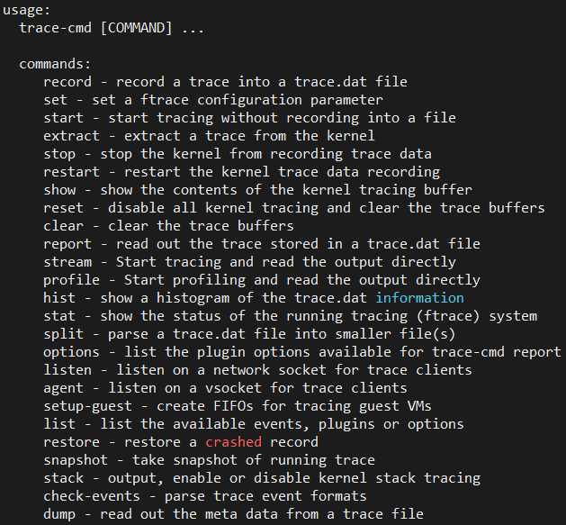

### 2. Prerequisites

- Use Python 3.10 or later.
- Run the collection script as the `root` user with ftrace control permissions.
- Obtain the scripts in the [`scripts/ftrace_tools`](https://gitcode.com/Ascend/msinsight/tree/26.2.0/scripts/ftrace_tools) directory from the MindStudio Insight repository.
- `trace-cmd` is an optional dependency, but it is strongly recommended for this case. The script has a built-in fallback: it prefers `trace-cmd` by default and falls back to reading and writing the tracing file system directly when `trace-cmd` is unavailable. For the collection and conversion methods of the fallback, see the [`ftrace_tools` README](https://gitcode.com/Ascend/msinsight/blob/26.2.0/scripts/ftrace_tools/ReadMe.md).

To install `trace-cmd`, run:

```bash
# Ubuntu
sudo apt-get install trace-cmd

# CentOS
sudo yum install trace-cmd
```

### 3. Command-Line Collection

Go to the `scripts/ftrace_tools` directory and start ftrace collection. The following command is a general example; the CPU range must be adjusted according to the CPUs actually used by the service:

```bash
sudo python trace_record.py --record_time=30 --cpu=0-15 --output=trace.dat
```

Start the service and collect profiling data within this collection window to ensure that the time periods of the two types of data overlap. If the service runtime is uncertain, you can set `--record_time=-1` for continuous collection and press `Ctrl+C` to stop after the service and profiling collection are finished.

For complete parameters, backend differences, and event loss handling, see the ["Collecting ftrace Data" chapter in the `ftrace_tools` README](https://gitcode.com/Ascend/msinsight/blob/26.2.0/scripts/ftrace_tools/ReadMe.md#3-collecting-ftrace-data).

### 4. In-Container Collection

It is recommended to collect ftrace on the host and profiling in the service container. If the container does not use the host PID namespace, after the service process is started, the collection side that can access the host `/proc` must use `--NSpid` to generate the PID mapping and pass `pid_mapping.json` through `--pid_mapping` during conversion. The command-line parameter `--NSpid` scans only once at the start of collection, so make sure that the service processes to be mapped already exist before starting ftrace; if service processes are created dynamically during collection, use the programmatic continuous mapping API. For details, see the README link below.

For the permission and mount requirements, PID mapping commands, and usage restrictions of in-container collection, see the ["Container PID Mapping" section in the `ftrace_tools` README](https://gitcode.com/Ascend/msinsight/blob/26.2.0/scripts/ftrace_tools/ReadMe.md#43-container-pid-mapping) and [FAQ 8.5](https://gitcode.com/Ascend/msinsight/blob/26.2.0/scripts/ftrace_tools/ReadMe.md#85-can-ftrace-be-collected-directly-in-a-container).

## ftrace Data Conversion

`trace_convert.py` parses the raw ftrace data and exports an SQLite DB or Chrome Trace JSON. For joint analysis in MindStudio Insight, the default SQLite DB is recommended; JSON is mainly used for compatibility with existing JSON data, Chrome Trace JSON, or external tools that support only JSON. For complete parameters and format constraints, see the ["Converting ftrace Data" chapter in the `ftrace_tools` README](https://gitcode.com/Ascend/msinsight/blob/26.2.0/scripts/ftrace_tools/ReadMe.md#4-converting-ftrace-data).

For example, if the profiling data is located in `result_dir/ctl_1418857_20251025030529768_ascend_pt` and the `trace-cmd` output is located in `result_dir/trace.dat`, the recommended DB conversion command is as follows:

```bash
python trace_convert.py \
  --input=result_dir/trace.dat \
  --output=result_dir/ftrace_data.db \
  --format=db \
  --profiling_data=result_dir/ctl_1418857_20251025030529768_ascend_pt
```

## Joint Analysis Case: Locating Host Bound Caused by CPU Contention

This case demonstrates a scheduling contention scenario in which the CPU-intensive task `hb_hog*` and a key vLLM task run on the same core. The problem data (Fault) records the scheduling delay of the key vLLM task caused by same-core contention; the optimized data (Fixed) verifies the optimization effect by separating the CPU affinity of the two types of tasks.

### 1. Scenario and Data Collection

This experiment runs vLLM inference and starts 32 periodic CPU-intensive tasks named `hb_hog00` to `hb_hog31`. Each `hb_hog*` has a period of 500 ms, in which about 400 ms is spent on integer computation and about 100 ms on waiting, forming repeated CPU busy intervals. For the complete Fault/Fixed construction, vLLM profiling start and stop, PID/TID metadata recording, and `trace_marker` marking logic, see [`host_bound_fault_lab.py`](https://gitcode.com/Ascend/msinsight/blob/26.2.0/scripts/ftrace_tools/examples/host_bound_fault_lab.py).

Before importing vLLM and initializing the model, the Python main process calls `os.sched_setaffinity(0, set(workload_cpus))` to restrict the current main thread to the CPU set specified by `--workload-cpus`. `--workload-cpus` and `--hog-cpus` accept Linux CPU-list notation, for example `120-127` or `120-123,128-131`, with both interval endpoints included. vLLM processes and threads created afterwards usually inherit this CPU affinity initially.

Although the `hb_hog*` worker processes are created by the same main process, each process sets its process name at the `cpu_hog_worker()` entry and then calls `os.sched_setaffinity(0, set(cpus))`; the `cpus` passed here is the `hog_cpus` parsed from `--hog-cpus`. At startup, the worker processes briefly inherit the `workload_cpus` of the main process, but they are re-bound before the experimental workload is created. After the binding succeeds, a worker process reports readiness to the main process and waits for the unified start signal. In the busy phase, the process continuously performs integer operations that allocate no memory and remains runnable; in the waiting phase, it waits for the next period. All `hb_hog*` processes share the same `hog_cpus` allowed set instead of each of the 32 processes being pinned to one CPU, so they can migrate within the set and compete with each other.

This example selects CPUs 120 to 135 in the same local NUMA node as the NPU. When reproducing it, you can first use `lscpu | grep -i numa` or `numactl --hardware` to view the online CPUs and their NUMA affinity, and then replace the example core numbers according to the NUMA node of the device. The CPU settings of the Fault and Fixed experiments are as follows.

| Data | Python/vLLM Process Tree | `hb_hog*` | Expected Relationship |
| --- | --- | --- | --- |
| Fault | CPU 120-127 | CPU 120-127 | The CPU sets overlap |
| Fixed | CPU 120-127 | CPU 128-135 | The CPU sets do not overlap |

`--workload-cpus` is the allowed CPU set usually inherited initially by the Python main process and the subsequent vLLM processes and threads, and `--hog-cpus` is the allowed CPU set used by each `hb_hog*` worker process. The script verifies that the two CPU sets of Fault intersect and that the two CPU sets of Fixed are completely disjoint; this example uses fully overlapping sets in Fault to reliably reproduce same-core contention.

Run the complete script from the repository root to construct the Fault and Fixed data respectively:

```bash
# Fault
python3 scripts/ftrace_tools/examples/host_bound_fault_lab.py \
  --mode fault \
  --workload-cpus 120-127 \
  --hog-cpus 120-127 \
  --hog-count 32 \
  --batch-size 2 \
  --max-tokens 64 \
  --request-seed 2026 \
  --rounds 1 \
  --profile-dir profiling_fault \
  --state-dir host_bound_state_fault

# Fixed
python3 scripts/ftrace_tools/examples/host_bound_fault_lab.py \
  --mode fixed \
  --workload-cpus 120-127 \
  --hog-cpus 128-135 \
  --hog-count 32 \
  --batch-size 2 \
  --max-tokens 64 \
  --request-seed 2026 \
  --rounds 1 \
  --profile-dir profiling_fixed \
  --state-dir host_bound_state_fixed
```

Except for CPU affinity, the two rounds keep the same configuration: the model is `Qwen/Qwen3-0.6B`, `max_model_len=26240`, `tensor_parallel_size=1`, 2 requests are input in a batch per round, each request generates exactly 64 tokens, the sampling parameters are `temperature=0.8`, `top_p=0.95`, `seed=2026`, and 8 tokens are generated for warm-up before formal collection. The script uses `min_tokens=max_tokens` to prevent early termination on EOS and writes the actual number of tokens generated by each request into `metadata.json` after each round; if the actual number of tokens generated by any request is not 64, the round is marked invalid. Both rounds perform only 1 inference round, start 32 `hb_hog*` tasks with a period/busy duration of 500/400 ms, and set `--workload-nice 5`: `hb_hog*` uses the normal priority, and the main process calls `os.nice(5)` after `hb_hog*` finishes creation and re-binding, so that subsequent vLLM tasks initially inherit a lower scheduling priority. The `nice` value affects only the scheduling priority and does not change CPU affinity. Because the defaults of the complete script for batch, generation length, and rounds target more general stress testing, reproducing the data in this document also requires explicitly setting `--batch-size 2 --max-tokens 64 --request-seed 2026 --rounds 1`.

Before each round starts, confirm that the `profiling_fault`, `profiling_fixed`, and `host_bound_state_*` directories are empty. When repeating the experiment, create new profiling and run state output directories for each round and use the actual profiling directory of the round in the conversion command, so that old data does not participate in timeline alignment.

Collect data in the following order in each round:

1. Start the corresponding Fault or Fixed experiment in the inference environment. The experiment program first completes model initialization and warm-up, then outputs `[ARMED]` and starts a 10-second countdown; at this point the vLLM process tree and the `hb_hog*` processes have been created, but the CPU-intensive tasks have not started running.
2. Before the countdown ends, go to the `scripts/ftrace_tools` directory on the host or in a collection container that uses the host PID namespace and can access the host `/proc`, and start ftrace. Both rounds collect CPUs 120 to 135, covering the vLLM CPUs 120 to 127 and the CPUs 128 to 135 to which `hb_hog*` is re-bound in Fixed, and keeping the observation range the same. Here `--cpu=120-135` is only the ftrace collection filter range and is the union of `workload_cpus` and `hog_cpus` of the two rounds; it does not bind the collection process or the service process to these CPUs. The following command applies to the scenario where the service container does not use the host PID namespace; if the collection side and the service use the same PID namespace, `--NSpid` and the subsequent command that renames `pid_mapping.json` can be omitted.

   ```bash
   # Fault
   sudo python trace_record.py \
     --backend=trace-cmd \
     --record_time=30 \
     --cpu=120-135 \
     --output=trace_fault.dat \
     --NSpid
   mv pid_mapping.json pid_mapping_fault.json

   # Fixed
   sudo python trace_record.py \
     --backend=trace-cmd \
     --record_time=30 \
     --cpu=120-135 \
     --output=trace_fixed.dat \
     --NSpid
   mv pid_mapping.json pid_mapping_fixed.json
   ```

   The above command explicitly specifies the `trace-cmd` backend, ensuring that the actual output is consistent with the `.dat` file used by the subsequent conversion command. If `trace-cmd` is unavailable or incompatible, the collection fails directly with an error instead of automatically switching to the debugfs backend and changing the output file to `.txt`. To use debugfs instead, explicitly set `--backend=debugfs`, change the collection output to `trace_fault.txt` and `trace_fixed.txt`, and update the file names in the subsequent `trace_convert.py --input` command accordingly.

3. After the countdown ends, the experiment program calls `llm.start_profile()` in sequence, starts the busy periods of all `hb_hog*` tasks, and performs inference; after inference is complete, it calls `llm.stop_profile()`. Wait for the ftrace collection of the current round to finish before starting the next round, to avoid output files overwriting each other.

After collection is complete, place the ftrace files and PID mapping files in a directory accessible to the conversion environment, and convert the data of the two rounds separately:

```bash
python trace_convert.py \
  --input=trace_fault.dat \
  --output=fault_ftrace_data.db \
  --format=db \
  --profiling_data=profiling_fault \
  --pid_mapping=pid_mapping_fault.json

python trace_convert.py \
  --input=trace_fixed.dat \
  --output=fixed_ftrace_data.db \
  --format=db \
  --profiling_data=profiling_fixed \
  --pid_mapping=pid_mapping_fixed.json
```

If the collection and inference use the same PID namespace, `--pid_mapping` can likewise be omitted during conversion. The screenshots in this document use the JSON data generated during the experiment; when re-collecting, converting to an SQLite DB with the above command is recommended, as the scheduling analysis method is the same for both formats.

### 2. Importing Data and Locating the Target Task

Before importing, use `trace_convert.py` to convert the ftrace data of this round, and use `--profiling_data` to align the ftrace timestamps with the corresponding profiling timeline; when the PID namespaces inside and outside the container differ, `--pid_mapping` must also be passed during conversion. Then import the profiling data and the converted ftrace data into the same project in MindStudio Insight.

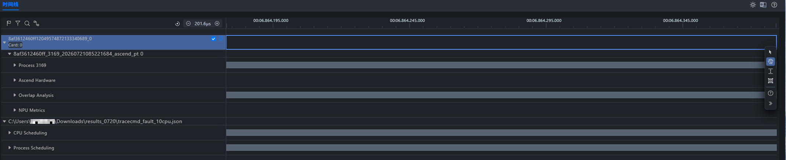

Confirm the ID of the task to be analyzed in the profiling data. The target task ID in this example is 3169; after the container PID mapping is complete, `VLLM::EngineCor:3169` can be located in Process Scheduling of ftrace.

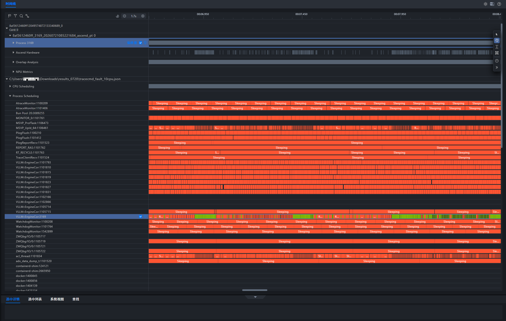

Move the mouse pointer to the target Process Scheduling unit and click the pin icon to the right of the unit name to pin the unit to the top. After pinning, you can always use this task as the reference for comparing profiling and CPU Scheduling even when you continue scrolling or expanding other units.

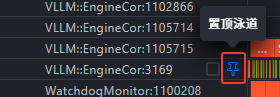

### 3. Correlating Runnable Waiting with Host/Device Gaps

In Process Scheduling, `Runnable` means that a task is ready to run but has not obtained a CPU, and it is one of the important clues for locating the problem.

Expand Process, Ascend Hardware, and Overlap Analysis in the profiling data, as well as CPU Scheduling in ftrace. First find a continuous `Runnable` segment of the target task in a large time range, and then zoom in centered on that area; all units are zoomed synchronously along the same time axis.

Before zooming in:

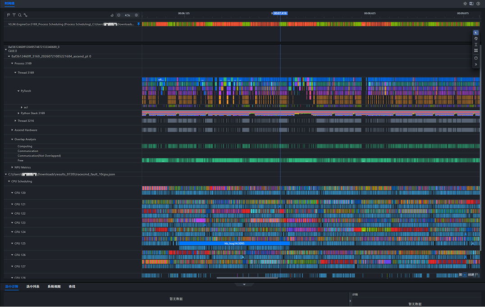

After zooming in:

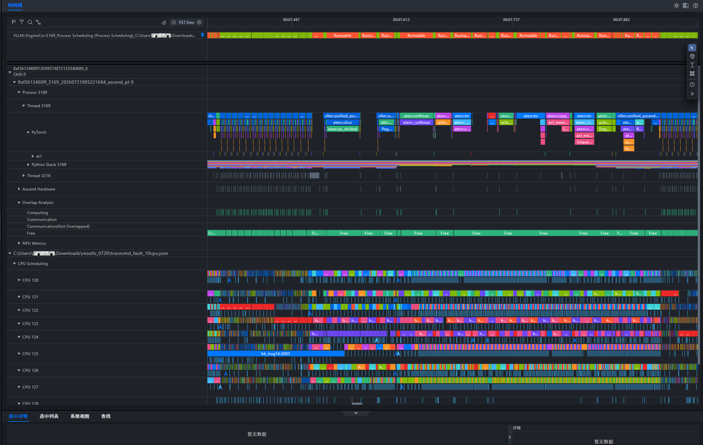

However, `Runnable` can be either queuing after a wake-up or a task being switched out while still runnable, so preemption cannot be asserted from `Runnable` alone.

Further, in the same time window, the long `Runnable` interval of the target task corresponds in time to the interruption of host dispatch activity in the profiling data, the Computing gaps in Overlap Analysis, and the longer Free intervals.

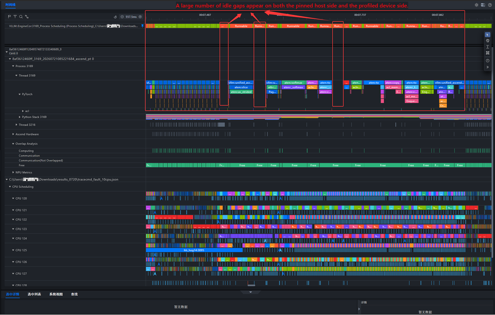

This step establishes time correlation: the host dispatch delay and the device-side gaps occur at the same time as the target task waiting for the CPU. To determine the root cause, you still need to confirm the scheduling situation of the corresponding CPUs during these periods.

### 4. Analyzing CPU Scheduling

For convenience, enter `VLLM` (or the more specific `VLLM::EngineCor:3169`) in the timeline search box to highlight the matching vLLM scheduling slices and dim the others, narrowing the observation range among the complex CPU Scheduling data.

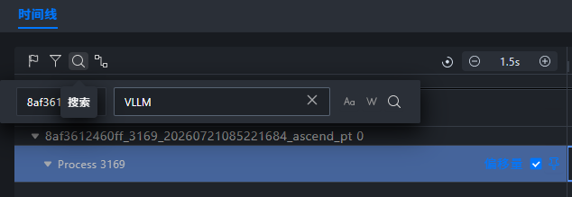

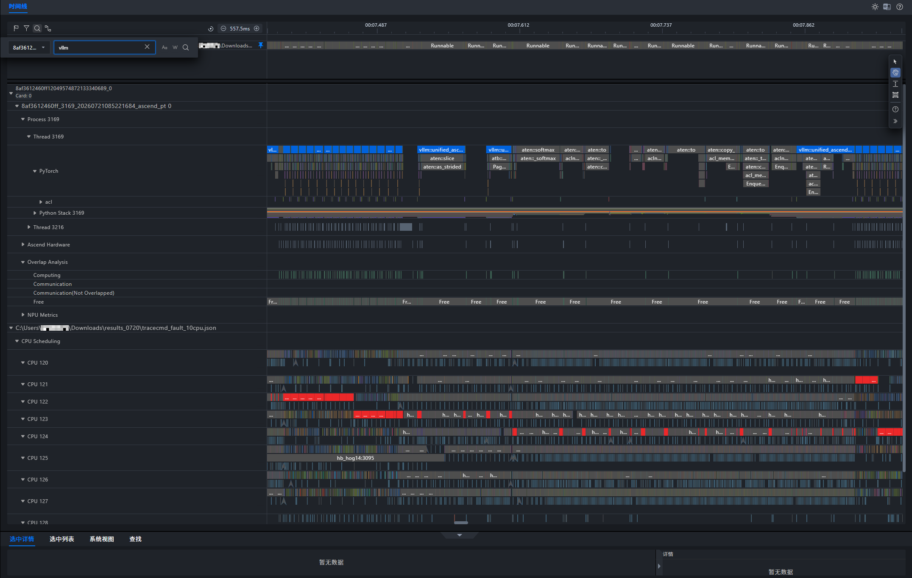

In this example, the slices highlighted in the figure are confirmed to belong to the same `VLLM::EngineCor:3169`; the Running slices of this task appear on different CPU units one after another in the shown time window, which confirms that it migrates multiple times among these CPUs.

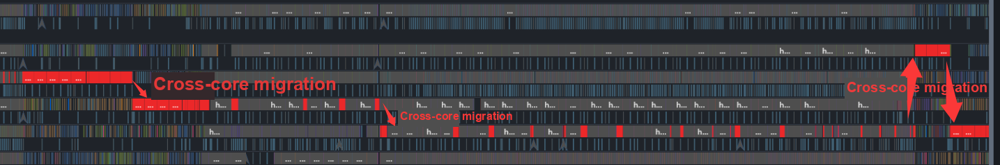

Cross-core migration itself is not necessarily a performance fault, so whether Host Bound occurs still needs to be determined together with the `Runnable` state of the target task and the tasks actually running on the corresponding CPUs.

You can observe that while the target task is in a long `Runnable` state, the corresponding CPU is occupied by the CPU-intensive `hb_hog*` tasks during their busy periods. If a state changes directly from `Running` to `Runnable`, the task was still runnable when it was switched out; combined with the subsequent occupation of the same CPU by `hb_hog*`, direct same-core scheduling contention can be confirmed.

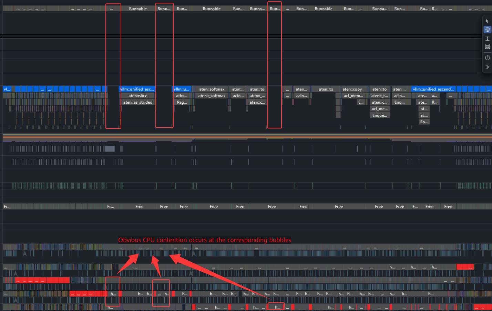

After further zooming in, you can see that during the busy periods of `hb_hog*`, multiple `hb_hog*` tasks frequently obtain the CPU while the target vLLM task can run only intermittently. This explains why the target task stays in `Runnable` for a long time.

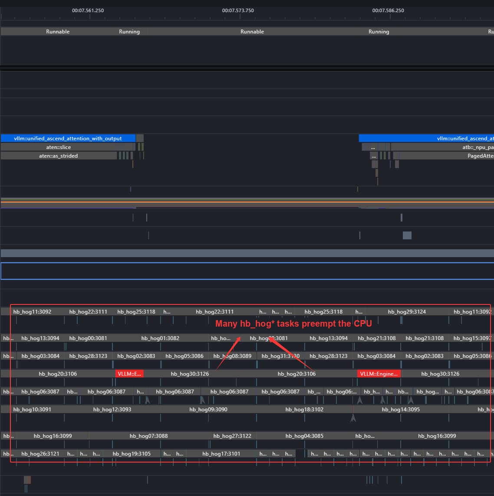

A complete chain of evidence can thus be formed: the `hb_hog*` tasks and the vLLM process tree use overlapping CPU sets; the target task remains runnable after being switched out and shows a long `Runnable` period, while the corresponding CPU is occupied by `hb_hog*` during the same period; these waiting intervals also correspond in time to the host dispatch interruptions and the Computing gaps and Free intervals on the device side. Cross-core migration of the target task was also observed several times, but migration itself is not a sufficient condition for determining the root cause. In summary, the main bottleneck in this example is Host Bound caused by same-core CPU contention.

### 5. Optimizing and Verifying the Result

Keeping `--workload-cpus 120-127` unchanged, only `--hog-cpus` is changed from `120-127` to `128-135`, so that the two types of tasks use non-overlapping CPU sets. In the Fixed round, the Python main process still calls `os.sched_setaffinity(0, set(workload_cpus))`, and each `hb_hog*` calls `os.sched_setaffinity(0, set(hog_cpus))` to restrict itself to CPUs 128 to 135. Then, keeping the other inference and workload configurations unchanged, the profiling and ftrace data are collected and imported again.

After the re-collection, the ID of the key task with the same role becomes 3823, which is a normal change after the process is recreated. In the representative time window shown in the screenshot, the abnormally long `Runnable` periods of the target task are significantly reduced, the Running slices of vLLM and `hb_hog*` are located in different CPU sets, and host dispatch and device computation are more continuous.

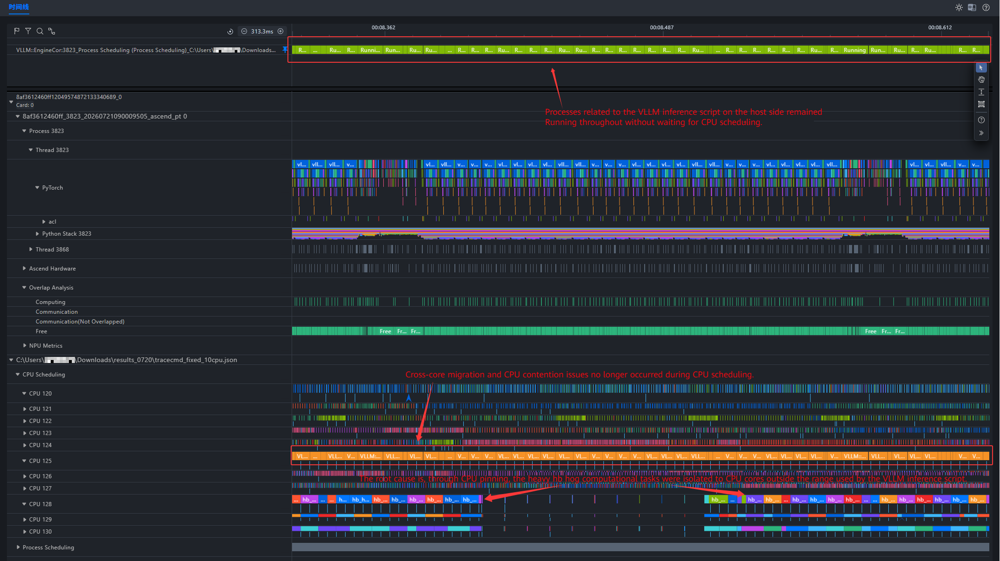

The abnormally long `Runnable` periods caused by same-core contention and the corresponding large Host/Device gaps no longer appear or are significantly reduced. However, CPU affinity only eliminates direct same-core contention between vLLM and `hb_hog*`; it does not mean that the CPUs are exclusively occupied. In actual services, you should also check other processes, cgroup/cpuset, NUMA, and interrupt affinity according to the runtime environment, and re-collect profiling and ftrace data after optimization to verify the effect.

## Joint Analysis Case: Locating Host Bound Caused by Network SoftIRQ

This case constructs a scenario in which, even though the user-mode processes are isolated from the vLLM worker cores, the `NET_RX` SoftIRQ they trigger shares CPUs with the key vLLM task. It is used to demonstrate the more subtle Host Bound that occurs when SoftIRQ directly occupies the vLLM worker cores. For the complete Fault/Fixed construction, RPS configuration and restoration, vLLM profiling start and stop, SoftIRQ statistics, and `trace_marker` marking logic, see [`vllm_softirq_fault_lab.py`](https://gitcode.com/Ascend/msinsight/blob/26.2.0/scripts/ftrace_tools/examples/vllm_softirq_fault_lab.py).

### 1. Scenario and Data Collection

The experiment script constructs a network receive workload through multiple groups of local UDP traffic. As in the previous case, the following parameters accept Linux CPU-list notation such as `144-151` or `144-147,152-155`. This example uses three groups of CPU parameters at the same time, but their targets and setting methods differ:

| Parameter | Target | Setting Method |
| --- | --- | --- |
| `--workload-cpus` | Python main process and subsequent vLLM tasks | After the RPS placement probe is complete and before vLLM is imported, the main thread calls `os.sched_setaffinity(0, set(workload_cpus))`; vLLM tasks created afterwards usually inherit this set initially |
| `--traffic-worker-cpus` | Each `sir_tx*`/`sir_rx*` user-mode traffic process | Each worker process calls `os.sched_setaffinity(0, set(cpus))` at its entry, where `cpus` is `traffic_worker_cpus` |
| `--softirq-cpus` | `NET_RX` receive processing of the loopback device `lo/rx-0` | The script converts the CPU list into a hexadecimal CPU bitmap and writes it to `/sys/class/net/lo/queues/rx-0/rps_cpus`; this is RPS steering, not binding a process or SoftIRQ task with `sched_setaffinity()` |

At startup, `sir_tx*` and `sir_rx*` briefly inherit the original allowed CPU set of the parent process, but before creating sockets, reporting readiness, and starting RPS probing, they explicitly re-bind themselves to `traffic_worker_cpus`. All traffic processes share this allowed set; each process is not pinned to a single CPU. In this example they are restricted to CPUs 160 to 167, keeping the user-mode processes in the actual traffic phase isolated from the vLLM worker cores.

`--softirq-cpus` only controls the RPS/`NET_RX` processing CPUs of the target RX queue. It does not modify the task affinity of `sir_tx*`, `sir_rx*`, vLLM, or `ksoftirqd`, and it does not migrate other SoftIRQs such as `TIMER` or `RCU`. RPS selects a CPU from the allowed set according to the flow hash, adds packets to the backlog queue of the target CPU, and wakes that CPU to process the subsequent network protocol stack, so it does not guarantee that every CPU in the set receives exactly the same number of packets. The script verifies the actual coverage through placement probing; for details about the mechanism, see the [Linux kernel RPS documentation](https://docs.kernel.org/networking/scaling.html#rps-receive-packet-steering). Fault sets the RPS target CPUs to CPUs 144 to 151 used by vLLM, and Fixed changes the target CPUs to CPUs 152 to 159.

| Data | Python/vLLM Process Tree | RPS Target CPU of `NET_RX` | `sir_tx*`/`sir_rx*` | Expected Relationship |
| --- | --- | --- | --- | --- |
| Fault | CPU 144-151 | CPU 144-151 | CPU 160-167 | `NET_RX` overlaps the vLLM worker cores |
| Fixed | CPU 144-151 | CPU 152-159 | CPU 160-167 | The three CPU groups do not overlap |

>Do not wrap the whole script with a narrow CPU range such as `taskset -c 144-151`; the startup process in this example must be allowed at least CPUs 144 to 167, otherwise the RPS target CPUs or the traffic worker processes of Fixed cannot use the specified range.

Run the following command from the repository root:

```bash
# Fault: NET_RX is processed on the vLLM worker cores
python3 scripts/ftrace_tools/examples/vllm_softirq_fault_lab.py \
  --mode fault \
  --workload-cpus 144-151 \
  --softirq-cpus 144-151 \
  --traffic-worker-cpus 160-167 \
  --max-tokens 64 \
  --request-seed 2026 \
  --profile-dir profiling_softirq_direct_fault \
  --state-dir softirq_state_direct_fault

# Fixed: Migrate NET_RX to CPUs 152-159
python3 scripts/ftrace_tools/examples/vllm_softirq_fault_lab.py \
  --mode fixed \
  --workload-cpus 144-151 \
  --softirq-cpus 152-159 \
  --traffic-worker-cpus 160-167 \
  --max-tokens 64 \
  --request-seed 2026 \
  --profile-dir profiling_softirq_direct_fixed \
  --state-dir softirq_state_direct_fixed
```

Both rounds use the same `--request-seed 2026` and make each request generate exactly 64 tokens through `min_tokens=max_tokens=64`. The script writes the actual number of tokens generated by each request into the final `metadata.json`; if the actual number of tokens generated by any request is not 64, the round is marked invalid, avoiding mixing differences in generation workload into the Fault/Fixed comparison.

The current example supports only the loopback device `--rps-device lo --rps-queue rx-0` and requires write permission on `/sys/class/net/lo/queues/rx-0/rps_cpus` and `rps_flow_cnt`.

<span style="color: red;">Modifying the RPS configuration temporarily affects all traffic passing through the target RX queue in that network namespace. Perform this only in an exclusive test environment.</span>

> Before vLLM is formally loaded, the script runs an RPS placement probe and checks the `NET_RX` and `received_rps` increments on the target CPUs. During a complete run, the PIDs of the root process and the traffic worker processes can be obtained from `metadata_armed.json`, and the user-mode task affinity can be checked with `taskset -cp <PID>` or `Cpus_allowed_list`; `taskset` cannot prove that RPS steering has taken effect, which requires reading back `rps_cpus` and verifying `rps_probe.json`. You should also check `softirq_delta.json` and `softnet_delta.json` to confirm that the target CPU coverage, the `NET_RX` increment, and the traffic send and receive are as expected.

After a normal exit or upon receiving a handleable signal, the script restores the original `rps_cpus` and `rps_flow_cnt` configurations. If the process is terminated by `SIGKILL` or automatic restoration fails, follow the prompt in the standard error and run `python3 scripts/ftrace_tools/examples/vllm_softirq_fault_lab.py --restore-rps-state <restore snapshot>` to restore the configuration recorded in `softirq_state_*/rps_restore_pending.json` or `/run/lock/vllm_softirq_fault_lab/lo_rx-0.json`, and then start the next round. Before restoring, the script verifies the system boot identifier, the network namespace, and the unique run identifier of the current round in the snapshot, and requires the local snapshot to be consistent with the global guard under `/run/lock`; if the snapshot is expired, modified, or does not belong to the current running environment, restoration is rejected before any RPS/RFS configuration is written.

> This script isolates and reproduces the impact of `NET_RX` SoftIRQ using loopback traffic and does not generate physical NIC hard interrupts. The current code rejects devices or queues other than `lo/rx-0`; to analyze a real NIC scenario, you need to configure multiple RX queues, physical IRQs, and RPS affinity separately, or extend the script first.

The ftrace collection and conversion process follows the previous text and continues to explicitly specify `--backend=trace-cmd`. To cover the vLLM worker cores, RPS target CPUs, and traffic processes of both rounds, both rounds use `trace_record.py --cpu=144-167` to collect CPUs 144 to 167. This parameter is still only the ftrace collection filter range and is the union of `workload_cpus`, the RPS target CPUs of both rounds, and `traffic_worker_cpus`; it does not set task affinity or RPS. The ftrace and PID mapping files of Fault and Fixed must not have the same name, and the profiling and status output directories must be empty before the experiment. After starting the script, start ftrace collection before the `[ARMED]` countdown ends; if the actual inference time exceeds 30 seconds, increase `--record_time` accordingly. Both rounds should also keep the number of UDP flows, the packet sending rate per flow, the packet length, the traffic period, and the number of generated tokens consistent. Because the inference duration of the two rounds may differ, when verifying traffic, compare the send and receive rates per unit time and the SoftIRQ increment first rather than only the cumulative packet count.

### 2. Observing Only Task States Easily Misses the Problem

After importing the profiling and ftrace data of Fault, locate and pin the target `VLLM::EngineCor` task first. In Process Scheduling, this task is mainly `Running` and does not show the obvious long `Runnable` interval seen in the previous case. If you only use the method of "finding user-mode scheduling contention through `Runnable`", you may easily assume that the target task always runs normally.

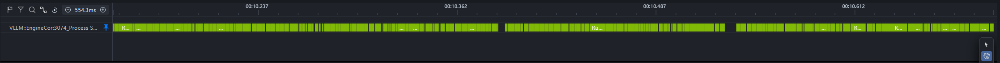

After searching for vLLM in CPU Scheduling, you can also see long and fairly continuous Running scheduling slices of the target task. Here `VLLM::EngineCor:<TID>` represents a Linux scheduling task; it does not represent a specific operator, and continuous scheduling slices alone cannot prove that operator dispatch is unaffected.

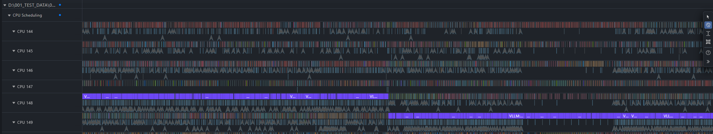

When observing the profiling timeline of Fault alone, periodic gaps can be seen, but in the absence of a baseline with the same configuration these gaps may also be mistaken for a normal inference decoding rhythm. Therefore, you also need to check the interrupt events nested in the scheduling slices in CPU Scheduling and compare them with the Fixed data.

### 3. Confirming SoftIRQ in CPU Scheduling

After expanding the CPU Scheduling unit of the target CPU, dense SoftIRQ execution intervals can be seen below the vLLM scheduling slices. The short event fragments in the figure are obtained by pairing `softirq_entry` and `softirq_exit`, and the name in the tooltip is `softirq`. During analysis, you also need to verify `action=NET_RX` in the event details; `task=VLLM...` in the event indicates the current task when entering the SoftIRQ, not that the SoftIRQ belongs to a vLLM thread. You should also use the RPS probing and SoftIRQ statistics generated by the script to rule out other SoftIRQs such as `TIMER` and `RCU`. For the meaning of `softirq_entry`/`softirq_exit`, see the [Linux Kernel Tracepoint API](https://docs.kernel.org/core-api/tracepoint.html).

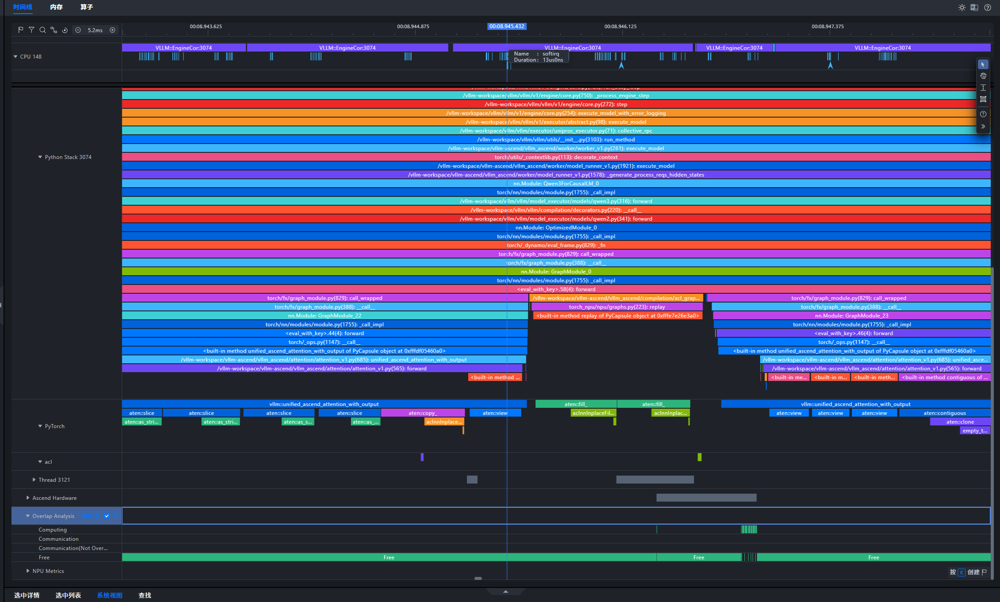

When a SoftIRQ executes in the context of the current task, it usually does not trigger `sched_switch`. Therefore, from the scheduler's point of view, vLLM is still the current task on that CPU, Process Scheduling can keep showing `Running`, and the vLLM scheduling slices in CPU Scheduling can also stay continuous; however, during each SoftIRQ execution interval, the CPU is actually running the kernel network protocol stack, and the vLLM user-mode code does not make forward progress. Here `Running` only indicates the scheduling state and does not mean that vLLM occupies all CPU execution time continuously.

### 4. Optimizing and Comparing the Result

Fixed only changes `--softirq-cpus` from `144-151` to `152-159`; `--workload-cpus 144-151`, `--traffic-worker-cpus 160-167`, the vLLM configuration, and the UDP traffic parameters all remain unchanged. CPUs 152 to 159 are only the RPS target set of `NET_RX` in Fixed and do not become exclusive CPUs of the system for that reason. After re-collection, expand the profiling data of both rounds **on the same time scale**. The following two figures show Fault and Fixed in turn: within the same time range, Fault completes fewer repeated inference segments, the operator slices of PyTorch, ACL, and Ascend Hardware are sparser overall, and the gaps between adjacent segments are longer, whereas the task dispatch and device computation rhythm of Fixed is more compact. This indicates that the host-side dispatch rhythm of Fault is delayed.

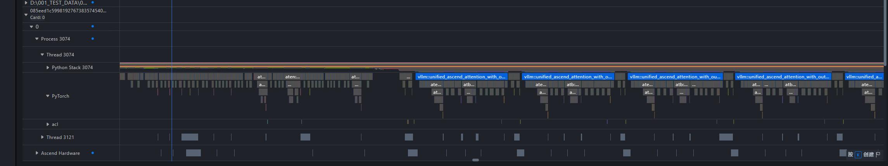

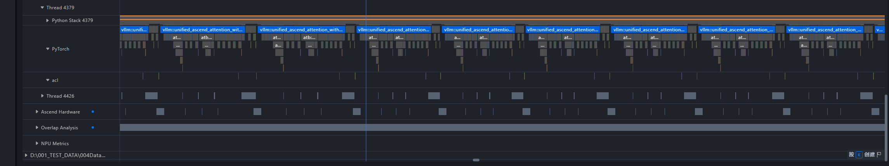

Then pin the CPU units of the corresponding vLLM task in Fault and Fixed respectively. In the following figure, Fault is on the top and Fixed is at the bottom. In the representative time window shown in the screenshot, dense SoftIRQ events exist below the vLLM scheduling slices of Fault, while the same dense SoftIRQ no longer appears on the vLLM worker cores of Fixed and only a small number of IRQ events remain. Note that Fixed does not eliminate the network SoftIRQ; it migrates the `NET_RX` processing generated by the same traffic parameters to CPUs 152 to 159. The few IRQs in the figure may come from inter-core interrupts used by RPS or other system activity and do not indicate physical NIC hard interrupts.

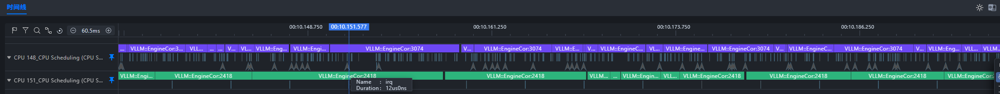

After the processes are recreated in different rounds, the PID/TID of the target task may change. When comparing, confirm through the task role, the profiling data, and the PID mapping that both units belong to the `VLLM::EngineCor` of the corresponding round; do not match them directly by numeric ID.

### 5. Principle and Conclusion

The chain of evidence in this example is as follows: the user-mode traffic processes are always isolated from the vLLM worker cores, ruling out direct same-core contention between `sir_tx*`/`sir_rx*` and vLLM; in Fault, RPS steers `NET_RX` to the vLLM worker cores, and dense SoftIRQs execute in the current context of vLLM; these SoftIRQ executions do not change the `Running` state of the target task, but they occupy CPU time that would otherwise be available for host-side execution and task dispatch, which is reflected in the profiling data as larger intervals between task dispatch and device computation. After `NET_RX` is migrated to dedicated CPUs, the dense `NET_RX` SoftIRQs generated by the constructed traffic no longer appear concentrated on the vLLM worker cores, and the dispatch and computation rhythm in the profiling data improves accordingly. In summary, this example is Host Bound caused by network SoftIRQ occupying the vLLM worker cores.

The subtlety of this case is that observing only the Process Scheduling and CPU Scheduling slices derived from task switches cannot distinguish continuous user-mode execution from the SoftIRQ execution nested in it. A complete closed loop of locating and verifying the problem can be formed only by aligning the SoftIRQ event details with the dispatch intervals in the profiling data and by comparing Fault and Fixed, which differ only in the RPS target CPUs, to observe the sparseness of host-side execution and dispatch.

> If network processing is backlogged and moves to `ksoftirqd/<CPU>`, the target vLLM task may be switched out and enter `Runnable`, in which case the problem takes the more common form of kernel thread scheduling contention. This case focuses on reproducing the situation in which the SoftIRQ executes directly in the context of the current task, by checking `time_squeeze`, controlling the traffic rate, and confirming that the current task when the `NET_RX` event occurs is the target vLLM task.
