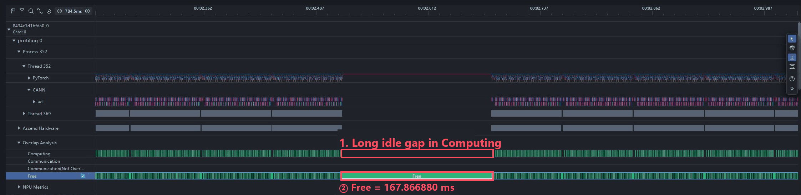
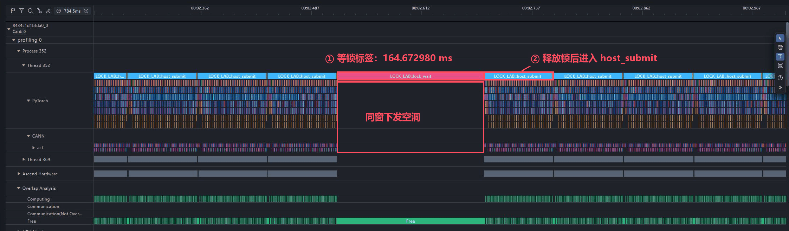
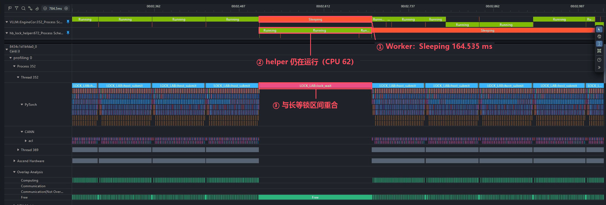
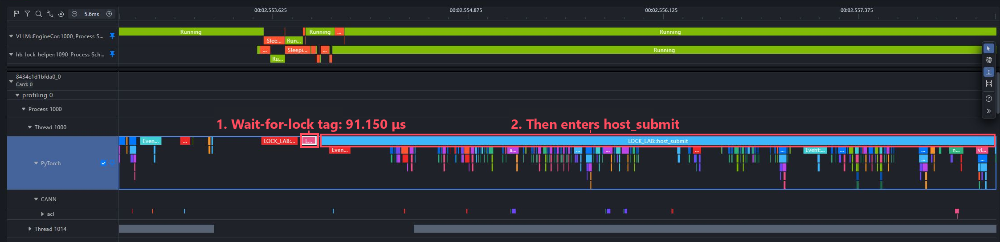
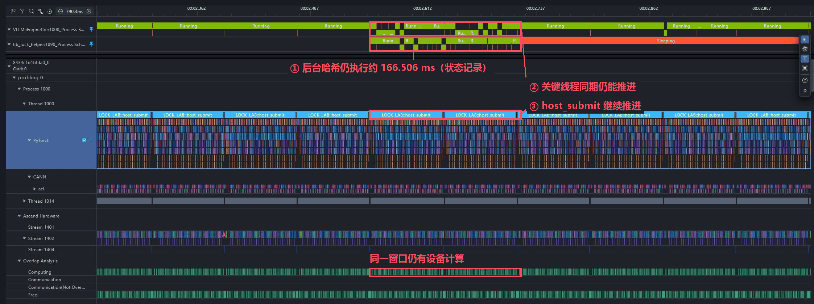

# Host Bound Issue Analysis Based on Linux Kernel Trace

## Background

In large models, the CPU is primarily responsible for task dispatch, while the NPU handles task execution. In live network issues, Host Bound is a frequently occurring issue in both inference and training domains. In profiling, a Host Bound model often manifests as prolonged dispatch time, with corresponding large idle gaps appearing on both the device and host, as shown in the following figure.


When analyzing Host Bound issues, Linux kernel ftrace data usually needs to be collected to observe process scheduling on the CPU. MindStudio Insight provides [`ftrace_tools`](https://gitcode.com/Ascend/msinsight/blob/master/scripts/ftrace_tools/ReadMe.md), in which `trace_record.py` collects ftrace data, `trace_convert.py` converts the data format, and `trace_analyze.py` performs offline statistical analysis. These scripts support importing ftrace data and profiling data into the same project for joint analysis.

## Identification Approach

1. Try general scheduling optimization methods such as core binding, pipeline optimization, and memory allocation library replacement. For scheduling optimization methods of Ascend Extension for PyTorch, see [Scheduling Optimization](https://www.hiascend.com/document/detail/en/Pytorch/latest/ptmoddevg/trainingmigrguide/FrameworkPTAdapter/26.0.0/en/pytorch_model_migration_fine_tuning/pipeline_opt.md).
2. If the general optimization does not achieve the expected effect, collect ftrace data and profiling data within the same service running period.
3. Convert the raw ftrace data to an SQLite DB that MindStudio Insight can import, with priority; use the JSON format only when JSON data already exists, Chrome Trace JSON is required, or an external tool supports only JSON.
4. Import the converted ftrace data and the profiling data into the same project, and analyze task scheduling with the CPU Scheduling, Process Scheduling, and profiling views.

> In container scenarios, it is recommended to collect ftrace on the host and profiling in the service container; the two types of data do not need to be collected in the same container. An ordinary unprivileged container usually cannot collect ftrace directly; if collection inside a container is required, additional permission and tracing file system mount requirements must be met. For details, see [FAQ 8.5 in the `ftrace_tools` README](https://gitcode.com/Ascend/msinsight/blob/master/scripts/ftrace_tools/ReadMe.md#85-can-ftrace-collection-be-used-directly-inside-a-container). If the service container does not use the host PID namespace, PID mapping must also be completed as described in [In-Container Collection](#4-in-container-collection).

## Model Profiling Data Collection

For profiling data collection methods, see the following documents:

- [MindStudio Profiler Tool Guide](https://gitcode.com/Ascend/msprof/blob/master/README.md)
- [msprof General Collection Commands](https://www.hiascend.com/document/detail/en/canncommercial/latest/devaids/Profiling/atlasprofiling_16_0010.html)
- [PyTorch Training/Online Inference Scenario Performance Analysis](https://www.hiascend.com/document/detail/en/canncommercial/latest/devaids/Profiling/atlasprofiling_16_0006.html)

> It is recommended to make the profiling and ftrace collection periods overlap as much as possible; for multi-rank scenarios, you can specify the upper-level directory containing multi-rank data, or any single-rank data directory.

## Linux Kernel ftrace Data Collection

### 1. Introduction to ftrace Data

The Linux kernel has various built-in tracing tools. ftrace has been merged into the mainline kernel since Linux 2.6.27 and is a framework for tracing and debugging kernel runtime behavior, helping developers analyze the internal state of the system at runtime. ftrace supports function call tracing, process scheduling tracing, interrupt latency analysis, and other capabilities, which helps locate kernel-mode performance problems and scheduling exceptions. The `trace_record.py` described above collects scheduling events and interrupt/soft interrupt events by default; the following excerpt shows only the sched events related to CPU task scheduling as an example.

```text
# tracer: nop
#
# entries-in-buffer/entries-written: 112246/112246   #P:192
#
#                                _-----=> irqs-off
#                               / _----=> need-resched
#                              | / _---=> hardirq/softirq
#                              || / _--=> preempt-depth
#                              ||| / _-=> migrate-disable
#                              |||| /     delay
#           TASK-PID     CPU#  |||||  TIMESTAMP  FUNCTION
#              | |         |   |||||     |         |
   kworker/145:1-1023940 [145] d.... 1725926.126419: sched_stat_runtime: comm=kworker/145:1 pid=1023940 runtime=23230 [ns] vruntime=3450824076020452 [ns]
   kworker/145:1-1023940 [145] d.... 1725926.126423: sched_switch: prev_comm=kworker/145:1 prev_pid=1023940 prev_prio=120 prev_state=I ==> next_comm=release_thread next_pid=2813514 next_prio=120
  release_thread-2813514 [145] d.... 1725926.126427: sched_stat_runtime: comm=release_thread pid=2813514 runtime=8880 [ns] vruntime=468045121382 [ns]
  release_thread-2813514 [145] d.... 1725926.126429: sched_switch: prev_comm=release_thread prev_pid=2813514 prev_prio=120 prev_state=S ==> next_comm=swapper/145 next_pid=0 next_prio=120
          <idle>-0       [145] d.h.. 1725926.126478: sched_waking: comm=release_thread pid=2813514 prio=120 target_cpu=145
          <idle>-0       [145] dNh.. 1725926.126480: sched_wakeup: comm=release_thread pid=2813514 prio=120 target_cpu=145
          <idle>-0       [145] d.... 1725926.126485: sched_switch: prev_comm=swapper/145 prev_pid=0 prev_prio=120 prev_state=R ==> next_comm=release_thread next_pid=2813514 next_prio=120
```

This document uses `trace_record.py` provided by `ftrace_tools` to collect ftrace data. By default, the script collects scheduling events and interrupt/soft interrupt events. Common events include:

- `sched_switch`: Records task context switches, including switching out the previous task and switching in the next task.
- `sched_waking`, `sched_wakeup`: Record the task wake-up process.
- `sched_wakeup_new`: Records the first wake-up of a newly created task.
- `sched_migrate_task`: Records task migration between CPU cores.
- `sched_stat_runtime`: Records runtime statistics of tasks.
- `sched_process_fork`, `sched_process_exec`, `sched_process_exit`: Record task creation, execution of a new program, and exit, respectively.
- `irq_handler_entry`, `irq_handler_exit`, `softirq_raise`, `softirq_entry`, `softirq_exit`: Record hard interrupt and soft interrupt behavior.

ftrace usually provides control interfaces and trace data through the tracefs virtual file system, with the common mount path `/sys/kernel/tracing/`; in some environments these interfaces can also be accessed through `/sys/kernel/debug/tracing/`. [`trace-cmd`](https://www.trace-cmd.org/Documentation/trace-cmd/) is a front-end command-line tool for ftrace that encapsulates read and write operations on these tracefs interfaces and trace data and provides easier-to-use collection and parsing commands. **For ftrace collection, `trace-cmd` is recommended.**


### 2. Prerequisites

- Use Python 3.10 or later.
- Run the collection script as the `root` user with ftrace control permissions.
- Obtain the scripts in the [`scripts/ftrace_tools`](https://gitcode.com/Ascend/msinsight/tree/master/scripts/ftrace_tools) directory from the MindStudio Insight repository.
- `trace-cmd` is an optional dependency, but it is strongly recommended for this case. The script has a built-in fallback: it prefers `trace-cmd` by default and falls back to reading and writing the tracing file system directly when `trace-cmd` is unavailable. For the collection and conversion methods of the fallback, see the [`ftrace_tools` README](https://gitcode.com/Ascend/msinsight/blob/master/scripts/ftrace_tools/ReadMe.md).

To install `trace-cmd`, run:

```bash
# Ubuntu
sudo apt-get install trace-cmd

# CentOS
sudo yum install trace-cmd
```

### 3. Command-Line Collection

Go to the `scripts/ftrace_tools` directory and start ftrace collection. The following command is a general example; the CPU range must be adjusted according to the CPUs actually used by the service:

```bash
sudo python trace_record.py --record_time=30 --cpu=0-15 --output=trace.dat
```

Start the service and collect profiling data within this collection window to ensure that the time periods of the two types of data overlap. If the service runtime is uncertain, you can set `--record_time=-1` for continuous collection and press `Ctrl+C` to stop after the service and profiling collection are finished.

For complete parameters, backend differences, and event loss handling, see the ["Collecting ftrace Data" chapter in the `ftrace_tools` README](https://gitcode.com/Ascend/msinsight/blob/master/scripts/ftrace_tools/ReadMe.md#3-collecting-ftrace-data).

### 4. In-Container Collection

It is recommended to collect ftrace on the host and profiling in the service container. If the container does not use the host PID namespace, after the service process is started, the collection side that can access the host `/proc` must use `--NSpid` to generate the PID mapping and pass `pid_mapping.json` through `--pid_mapping` during conversion. The command-line parameter `--NSpid` scans only once at the start of collection, so make sure that the service processes to be mapped already exist before starting ftrace; if service processes are created dynamically during collection, use the programmatic continuous mapping API. For details, see the README link below.

For the permission and mount requirements, PID mapping commands, and usage restrictions of in-container collection, see the ["Container PID Mapping" section in the `ftrace_tools` README](https://gitcode.com/Ascend/msinsight/blob/master/scripts/ftrace_tools/ReadMe.md#43-container-pid-mapping) and [FAQ 8.5](https://gitcode.com/Ascend/msinsight/blob/master/scripts/ftrace_tools/ReadMe.md#85-can-ftrace-be-collected-directly-in-a-container).

## ftrace Data Conversion

`trace_convert.py` parses the raw ftrace data and exports an SQLite DB or Chrome Trace JSON. For joint analysis in MindStudio Insight, the default SQLite DB is recommended; JSON is mainly used for compatibility with existing JSON data, Chrome Trace JSON, or external tools that support only JSON. For complete parameters and format constraints, see the ["Converting ftrace Data" chapter in the `ftrace_tools` README](https://gitcode.com/Ascend/msinsight/blob/master/scripts/ftrace_tools/ReadMe.md#4-converting-ftrace-data).

For example, if the profiling data is located in `result_dir/ctl_1418857_20251025030529768_ascend_pt` and the `trace-cmd` output is located in `result_dir/trace.dat`, the recommended DB conversion command is as follows:

```bash
python trace_convert.py \
  --input=result_dir/trace.dat \
  --output=result_dir/ftrace_data.db \
  --format=db \
  --profiling_data=result_dir/ctl_1418857_20251025030529768_ascend_pt
```

## Common Host Bound Troubleshooting Workflow

After obtaining ftrace and the corresponding Profiling data, start from Device gaps to trace Host submission, and then narrow the scope by combining the key thread's scheduling state and actual calls. The analysis path is: **align data -> find submission pauses -> select a direction based on symptoms -> verify by comparison.**

### 1. Aligning Data and Selecting an Analysis Time Window

Use the [ftrace data conversion](#ftrace-data-conversion) method described earlier to align the timeline and map container PIDs, and import ftrace and Profiling data from the same service run into the same Insight project. Confirm that the collection range covers the CPUs on which the target thread actually ran, the Steps or requests to analyze, and complete scheduling and interrupt events.

Choose a representative stable execution window and avoid model initialization, compilation, and shutdown. If a normal Step or a baseline with the same configuration is available, use it as a reference.

### 2. From Device Gaps Back to Host Submission

Look for obvious or recurring gaps in the Overlap Analysis and Ascend Hardware units in Profiling, then zoom in on the same time window and inspect Host units such as Python/framework and ACL/Runtime.

Key question: **During Device waiting, are subsequent tasks unable to start because the Host does not submit them in time?** Host and Device execute asynchronously. After the Host pauses, queued tasks may continue for a while before a gap appears, so the two do not necessarily start at the same time.

- If a gap is accompanied by longer Host API or task submission intervals, trace the dispatch connections back to the actual call and continue analyzing the key thread. For details, see [Single-Rank Top-Down Operator Dispatch Bottleneck Analysis](./Single_Card_Top_Down_Dispatch_Analysis.md).
- If tasks are submitted on time and are mainly waiting for communication or Device dependencies, continue along the corresponding dependency. For inconsistent pacing across ranks, see [Cluster Fast/Slow Rank Analysis](./Cluster_Slow_Rank_Analysis.md).
- If the gap is only a normal request interval or there is no work to execute, first verify the workload conditions.

After identifying the PID/TID of the thread that actually performs submission, locate its Process Scheduling unit in ftrace and compare it with the CPU Scheduling unit for the CPU it runs on. Pin these units when necessary so that all observations remain centered on the same abnormal time window. The actual submitter may be a framework worker thread or a Worker process.

### 3. Selecting a Case by Common Symptom

First determine whether the key thread is waiting for CPU, blocked, or still Running during the submission pause, and then use other CPU activity and the APIs in Profiling to make the judgment.

| Symptom in the abnormal time window | Possible issue and next step | Case entry |
| --- | --- | --- |
| The submission thread has a long `Runnable` period while other tasks occupy its runnable CPUs at the same time | **CPU scheduling contention**. Check the preemption state, competing tasks on the same cores, and affinity to determine whether waiting for CPU slows submission. If CPUs are not busy, also check core binding ranges and container CPU quotas. | [Host Bound Caused by CPU Contention](#joint-analysis-case-locating-host-bound-caused-by-cpu-contention) |
| The submission thread is `Running`, but its CPU has dense or long IRQ/SoftIRQ processing that corresponds to the submission pause | **Interrupt handling occupies the CPU**. Expand the CPU unit and check the interrupt type, execution range, and overlap with the target thread. | [Host Bound Caused by Network SoftIRQs](#joint-analysis-case-locating-host-bound-caused-by-network-softirqs) |
| The submission thread has a long `Sleeping` period that can be associated with lock acquisition, condition waiting, or a lock-held interval in another thread | **Shared-lock or inter-thread synchronization waiting**. Identify the wait object and release condition, and check whether time-consuming work is inside the critical section. | [Host Bound Caused by Shared-Lock Waiting](#joint-analysis-case-locating-host-bound-caused-by-shared-lock-waiting) |
| Submission pauses before a new batch or Step, together with long data reads or preprocessing, or consumers waiting for producers | **Insufficient input data supply**. Check the DataLoader, preprocessing threads, and queues along the data preparation chain. If synchronous logging or file I/O blocks business threads, verify this along the actual call path. A producer busy with computation and a sleeping consumer can both cause this symptom. | Data loading and preprocessing cases; synchronous logging and I/O blocking cases |
| Synchronous APIs, scalar reads, or data copies repeatedly interrupt continuous task submission | **Frequent synchronization or data transfer breaks the pipeline**. Trace the related APIs and determine whether unnecessary value reads, synchronization waits, or repeated copies exist. | [Dispatch-chain analysis for synchronization and data transfer](./Single_Card_Top_Down_Dispatch_Analysis.md#step-4-tracing-python-apis-using-async_npu-dispatch-connections) |
| The key thread remains `Running` with no obvious interrupt coverage, but Host processing is long or many small operators are submitted one by one | **High Host computation or submission overhead**. Use CPU ranges and available call stacks to inspect Python processing, framework scheduling, Runtime calls, and operator granularity. | Start with [Dispatch-chain analysis](./Single_Card_Top_Down_Dispatch_Analysis.md) |

Scheduling state is a clue and must be correlated with actual calls and Device gaps. For example, if long pauses are almost entirely Sleeping while Runnable and interrupt coverage in the same window are short, prioritize blocked waiting and then verify the cause through lock acquisition, I/O, or synchronous calls. Statistics and conclusions should all focus on the same abnormal window. If events are missing, complete the collection before drawing conclusions.

> Some case links will continue to be updated.

### 4. Validating the Diagnosis with Equal Workload

Make targeted adjustments based on the selected direction, such as separating competing tasks onto different CPUs, shortening critical sections, improving data supply, or reducing unnecessary synchronization, and then collect the corresponding data again.

Keep the business workload consistent during comparison, including the model, inputs, number of requests or Steps, and compare at the same time scale: determine whether the original Host pauses are shorter, Device gaps are reduced, and end-to-end latency or throughput improves. If only thread states change without improving the critical path, continue checking other waits or overhead.

The following cases demonstrate how to locate and validate CPU contention, network SoftIRQ, and shared-lock waiting.

## Joint Analysis Case: Locating Host Bound Caused by CPU Contention

This case runs single-rank vLLM inference with the `Qwen/Qwen3-0.6B` model and examines the impact of periodic CPU-intensive tasks on model submission.

### 1. Scenario Setup

In the problem data, vLLM and 32 `hb_hog*` tasks share CPUs 120-127. The `hb_hog*` tasks periodically perform integer computation and create CPU contention with vLLM. The following analysis uses the available Profiling and ftrace data to locate this scheduling contention.

The fault injection script is [host_bound_fault_lab.py](https://gitcode.com/Ascend/msinsight/blob/master/scripts/ftrace_tools/examples/host_bound_fault_lab.py). For detailed parameters and collection commands, see [Reproducing the CPU Contention Case](#6-reproducing-the-cpu-contention-case) at the end of this case.

### 2. Importing Data and Locating the Target Task

Before importing, use `trace_convert.py` to convert the current ftrace data and use `--profiling_data` to align ftrace timestamps with the corresponding Profiling timeline. If the PID namespaces inside and outside the container differ, also pass `--pid_mapping` during conversion. Then import the Profiling data and converted ftrace data into the same project in MindStudio Insight.


Identify the task to analyze in the Profiling data. In this case, the target task ID is 3169. After container PID mapping, locate `VLLM::EngineCor:3169` in Process Scheduling in ftrace.


Move the pointer over the target Process Scheduling unit and click the pin icon to the right of the unit name to pin the unit to the top. After pinning, you can continue scrolling or expanding other units while always using this task as the reference for comparing Profiling and CPU Scheduling.


### 3. Correlating Runnable Waiting with Host/Device Gaps

A `Runnable` state in Process Scheduling means that a task is ready to run but has not yet obtained a CPU. It is an important clue for locating the issue.

Expand Process, Ascend Hardware, and Overlap Analysis in Profiling, and CPU Scheduling in ftrace. First locate consecutive `Runnable` intervals for the target task over a larger time range, and then zoom in around that area. All units zoom synchronously along the same timeline.

Before zooming in


After zooming in


However, `Runnable` may indicate either queuing after wakeup or preemption while the task is still runnable. You cannot conclude from `Runnable` alone that preemption occurred.

In the same time window, the long `Runnable` interval of the target task corresponds in time to interruptions in Host submission activity in Profiling, Computing gaps in Overlap Analysis, and long Free intervals.


This establishes a temporal correlation: Host submission delays and Device-side gaps occur together with the target task waiting for CPU. To determine the root cause, continue by checking the scheduling state of the corresponding CPUs during these intervals.

### 4. Analyzing CPU Scheduling

For convenience, enter `VLLM` (or the more specific `VLLM::EngineCor:3169`) in the Timeline search box to highlight matching vLLM scheduling slices and dim other slices, narrowing the scope within complex CPU Scheduling data.


This case confirms that the highlighted slices all belong to the same `VLLM::EngineCor:3169` task. Its Running slices appear on different CPU units within the displayed time window, confirming that it migrated multiple times between these CPUs.


Cross-core migration is not necessarily a performance fault, so whether it constitutes Host Bound still depends on the task's `Runnable` state and the tasks actually running on the corresponding CPUs.

You can observe that while the target task remains in a long `Runnable` period, the corresponding CPUs are occupied by `hb_hog*` CPU-intensive tasks during their busy cycles. If a state changes directly from `Running` to `Runnable`, the task was still runnable when it was preempted. Combined with the subsequent occupation of the same CPU by `hb_hog*`, this confirms direct same-core scheduling contention.


After further zooming in, multiple `hb_hog*` tasks frequently obtain CPU during their busy cycles while the target vLLM task runs only intermittently. This explains why the target task remains `Runnable` for a long time.


This forms a complete evidence chain: `hb_hog*` and the vLLM process tree use overlapping CPU sets; the target task remains runnable after preemption and has long `Runnable` periods while the corresponding CPUs are occupied by `hb_hog*`; these waiting intervals also correspond in time to Host submission interruptions and Device-side Computing gaps and Free intervals. The target task also migrated across cores several times, but migration alone is not sufficient evidence of the root cause. Overall, the primary bottleneck in this case is Host Bound caused by same-core CPU contention.

### 5. Optimizing and Verifying Results

Keep `--workload-cpus 120-127` unchanged and change only `--hog-cpus` from `120-127` to `128-135` so that the two types of tasks use non-overlapping CPU sets. In the Fixed round, the Python main process still calls `os.sched_setaffinity(0, set(workload_cpus))`, and each `hb_hog*` task calls `os.sched_setaffinity(0, set(hog_cpus))` to restrict itself to CPUs 128-135. Then keep all other inference and load settings unchanged and collect and import Profiling and ftrace data again.

After re-collection, the ID of the key task with the same role changes to 3823, which is expected after the process is recreated. In the representative time window shown in the screenshot, the abnormally long `Runnable` periods of the target task are significantly reduced, the vLLM and `hb_hog*` Running slices are on different CPU sets, and Host submission and Device computation are more continuous.


The abnormally long `Runnable` periods caused by same-core contention and the corresponding large Host/Device gaps no longer occur or are significantly reduced. However, CPU affinity only eliminates direct same-core contention between vLLM and `hb_hog*`; it does not mean that the CPUs are exclusively reserved. In production environments, still check other processes, cgroup/cpuset settings, NUMA placement, and interrupt affinity, and collect Profiling and ftrace data again after optimization to verify the result.

### 6. Reproducing the CPU Contention Case

This experiment runs vLLM inference and starts 32 periodic CPU-intensive tasks named `hb_hog00` to `hb_hog31`. Each `hb_hog*` has a period of 500 ms, in which about 400 ms is spent on integer computation and about 100 ms on waiting, forming repeated CPU busy intervals. For the complete Fault/Fixed construction, vLLM profiling start and stop, PID/TID metadata recording, and `trace_marker` marking logic, see [`host_bound_fault_lab.py`](https://gitcode.com/Ascend/msinsight/blob/master/scripts/ftrace_tools/examples/host_bound_fault_lab.py).

Before importing vLLM and initializing the model, the Python main process calls `os.sched_setaffinity(0, set(workload_cpus))` to restrict the current main thread to the CPU set specified by `--workload-cpus`. `--workload-cpus` and `--hog-cpus` accept Linux CPU-list notation, for example `120-127` or `120-123,128-131`, with both interval endpoints included. vLLM processes and threads created afterwards usually inherit this CPU affinity initially.

Although the `hb_hog*` worker processes are created by the same main process, each process sets its process name at the `cpu_hog_worker()` entry and then calls `os.sched_setaffinity(0, set(cpus))`; the `cpus` passed here is the `hog_cpus` parsed from `--hog-cpus`. At startup, the worker processes briefly inherit the `workload_cpus` of the main process, but they are re-bound before the experimental workload is created. After the binding succeeds, a worker process reports readiness to the main process and waits for the unified start signal. In the busy phase, the process continuously performs integer operations that allocate no memory and remains runnable; in the waiting phase, it waits for the next period. All `hb_hog*` processes share the same `hog_cpus` allowed set instead of each of the 32 processes being pinned to one CPU, so they can migrate within the set and compete with each other.

This example selects CPUs 120 to 135 in the same local NUMA node as the NPU. When reproducing it, you can first use `lscpu | grep -i numa` or `numactl --hardware` to view the online CPUs and their NUMA affinity, and then replace the example core numbers according to the NUMA node of the device. The CPU settings of the Fault and Fixed experiments are as follows.

| Data | Python/vLLM Process Tree | `hb_hog*` | Expected Relationship |
| --- | --- | --- | --- |
| Fault | CPU 120-127 | CPU 120-127 | The CPU sets overlap |
| Fixed | CPU 120-127 | CPU 128-135 | The CPU sets do not overlap |

`--workload-cpus` is the allowed CPU set usually inherited initially by the Python main process and the subsequent vLLM processes and threads, and `--hog-cpus` is the allowed CPU set used by each `hb_hog*` worker process. The script verifies that the two CPU sets of Fault intersect and that the two CPU sets of Fixed are completely disjoint; this example uses fully overlapping sets in Fault to reliably reproduce same-core contention.

Run the complete script from the repository root to construct the Fault and Fixed data respectively:

```bash
# Fault
python3 scripts/ftrace_tools/examples/host_bound_fault_lab.py \
  --mode fault \
  --workload-cpus 120-127 \
  --hog-cpus 120-127 \
  --hog-count 32 \
  --batch-size 2 \
  --max-tokens 64 \
  --request-seed 2026 \
  --rounds 1 \
  --profile-dir profiling_fault \
  --state-dir host_bound_state_fault

# Fixed
python3 scripts/ftrace_tools/examples/host_bound_fault_lab.py \
  --mode fixed \
  --workload-cpus 120-127 \
  --hog-cpus 128-135 \
  --hog-count 32 \
  --batch-size 2 \
  --max-tokens 64 \
  --request-seed 2026 \
  --rounds 1 \
  --profile-dir profiling_fixed \
  --state-dir host_bound_state_fixed
```

Except for CPU affinity, the two rounds keep the same configuration: the model is `Qwen/Qwen3-0.6B`, `max_model_len=26240`, `tensor_parallel_size=1`, 2 requests are input in a batch per round, each request generates exactly 64 tokens, the sampling parameters are `temperature=0.8`, `top_p=0.95`, `seed=2026`, and 8 tokens are generated for warm-up before formal collection. The script uses `min_tokens=max_tokens` to prevent early termination on EOS and writes the actual number of tokens generated by each request into `metadata.json` after each round; if the actual number of tokens generated by any request is not 64, the round is marked invalid. Both rounds perform only 1 inference round, start 32 `hb_hog*` tasks with a period/busy duration of 500/400 ms, and set `--workload-nice 5`: `hb_hog*` uses the normal priority, and the main process calls `os.nice(5)` after `hb_hog*` finishes creation and re-binding, so that subsequent vLLM tasks initially inherit a lower scheduling priority. The `nice` value affects only the scheduling priority and does not change CPU affinity. Because the defaults of the complete script for batch, generation length, and rounds target more general stress testing, reproducing the data in this document also requires explicitly setting `--batch-size 2 --max-tokens 64 --request-seed 2026 --rounds 1`.

Before each round starts, confirm that the `profiling_fault`, `profiling_fixed`, and `host_bound_state_*` directories are empty. When repeating the experiment, create new profiling and run state output directories for each round and use the actual profiling directory of the round in the conversion command, so that old data does not participate in timeline alignment.

Collect data in the following order in each round:

1. Start the corresponding Fault or Fixed experiment in the inference environment. The experiment program first completes model initialization and warm-up, then outputs `[ARMED]` and starts a 10-second countdown; at this point the vLLM process tree and the `hb_hog*` processes have been created, but the CPU-intensive tasks have not started running.
2. Before the countdown ends, go to the `scripts/ftrace_tools` directory on the host or in a collection container that uses the host PID namespace and can access the host `/proc`, and start ftrace. Both rounds collect CPUs 120 to 135, covering the vLLM CPUs 120 to 127 and the CPUs 128 to 135 to which `hb_hog*` is re-bound in Fixed, and keeping the observation range the same. Here `--cpu=120-135` is only the ftrace collection filter range and is the union of `workload_cpus` and `hog_cpus` of the two rounds; it does not bind the collection process or the service process to these CPUs. The following command applies to the scenario where the service container does not use the host PID namespace; if the collection side and the service use the same PID namespace, `--NSpid` and the subsequent command that renames `pid_mapping.json` can be omitted.

   ```bash
   # Fault
   sudo python trace_record.py \
     --backend=trace-cmd \
     --record_time=30 \
     --cpu=120-135 \
     --output=trace_fault.dat \
     --NSpid
   mv pid_mapping.json pid_mapping_fault.json

   # Fixed
   sudo python trace_record.py \
     --backend=trace-cmd \
     --record_time=30 \
     --cpu=120-135 \
     --output=trace_fixed.dat \
     --NSpid
   mv pid_mapping.json pid_mapping_fixed.json
   ```

   The above command explicitly specifies the `trace-cmd` backend, ensuring that the actual output is consistent with the `.dat` file used by the subsequent conversion command. If `trace-cmd` is unavailable or incompatible, the collection fails directly with an error instead of automatically switching to the debugfs backend and changing the output file to `.txt`. To use debugfs instead, explicitly set `--backend=debugfs`, change the collection output to `trace_fault.txt` and `trace_fixed.txt`, and update the file names in the subsequent `trace_convert.py --input` command accordingly.

3. After the countdown ends, the experiment program calls `llm.start_profile()` in sequence, starts the busy periods of all `hb_hog*` tasks, and performs inference; after inference is complete, it calls `llm.stop_profile()`. Wait for the ftrace collection of the current round to finish before starting the next round, to avoid output files overwriting each other.

After collection is complete, place the ftrace files and PID mapping files in a directory accessible to the conversion environment, and convert the data of the two rounds separately:

```bash
python trace_convert.py \
  --input=trace_fault.dat \
  --output=fault_ftrace_data.db \
  --format=db \
  --profiling_data=profiling_fault \
  --pid_mapping=pid_mapping_fault.json

python trace_convert.py \
  --input=trace_fixed.dat \
  --output=fixed_ftrace_data.db \
  --format=db \
  --profiling_data=profiling_fixed \
  --pid_mapping=pid_mapping_fixed.json
```

If the collection and inference use the same PID namespace, `--pid_mapping` can likewise be omitted during conversion. The screenshots in this document use the JSON data generated during the experiment; when re-collecting, converting to an SQLite DB with the above command is recommended, as the scheduling analysis method is the same for both formats.

## Joint Analysis Case: Locating Host Bound Caused by Network SoftIRQs

This case runs vLLM inference while using local UDP traffic to create a network receive load, and examines the impact of `NET_RX` SoftIRQs on model submission.

### 1. Scenario Setup

The vLLM worker CPUs are CPUs 144-151, and the user-space traffic processes `sir_tx*` and `sir_rx*` use CPUs 160-167. The two types of user-space tasks are already isolated, but RPS directs `NET_RX` receive processing to the vLLM worker CPUs. The following analysis uses scheduling and interrupt units to examine Host Bound in this situation.

The fault injection script is [vllm_softirq_fault_lab.py](https://gitcode.com/Ascend/msinsight/blob/master/scripts/ftrace_tools/examples/vllm_softirq_fault_lab.py). For detailed parameters and collection commands, see [Reproducing the Network SoftIRQ Case](#6-reproducing-the-network-softirq-case) at the end of this case.

### 2. Only Observing Task States Can Easily Miss the Problem

After importing the Fault Profiling and ftrace data, first locate and pin the target `VLLM::EngineCor` task. In Process Scheduling, this task is mostly `Running` and does not show the long `Runnable` interval seen in the previous case. If you continue to use only the method of finding user-space scheduling contention through `Runnable`, you may incorrectly conclude that the target task is executing normally.


After searching for vLLM in CPU Scheduling, you can also see long and fairly continuous Running scheduling slices for the target task. Here, `VLLM::EngineCor:<TID>` represents a Linux scheduling task, not a specific operator. Continuous scheduling slices alone cannot prove that operator submission is unaffected.


When observing only the Fault Profiling timeline, periodic gaps are visible. However, without a baseline with the same configuration, these gaps may also be mistaken for a normal inference decoding rhythm. Therefore, you must also inspect interrupt events nested within the scheduling slices in CPU Scheduling and compare them with Fixed data.

### 3. Confirming SoftIRQs in CPU Scheduling

After expanding the CPU Scheduling unit of the target CPU, dense SoftIRQ execution intervals are visible below the vLLM scheduling slices. The short event fragments in the figure are obtained by pairing `softirq_entry` and `softirq_exit`, and the name in the tooltip is `softirq`. During analysis, also verify `action=NET_RX` in event details. `task=VLLM...` indicates the current task when entering the SoftIRQ; it does not mean that the SoftIRQ belongs to a vLLM thread. Use the RPS probing and SoftIRQ statistics generated by the script to rule out other SoftIRQs such as `TIMER` and `RCU`. For the meaning of `softirq_entry` and `softirq_exit`, see the [Linux Kernel Tracepoint API](https://docs.kernel.org/core-api/tracepoint.html).


When a SoftIRQ executes in the context of the current task, it usually does not trigger `sched_switch`. From the scheduler perspective, vLLM therefore remains the current task on that CPU: Process Scheduling can continue to show `Running`, and the vLLM scheduling slice in CPU Scheduling can remain continuous. During each SoftIRQ execution interval, however, the CPU is actually running the kernel network stack, and vLLM user-space code does not advance. Here, `Running` indicates only the scheduling state; it does not mean that vLLM continuously occupies all CPU execution time.

### 4. Optimizing and Comparing Results

Fixed changes only `--softirq-cpus` from `144-151` to `152-159`; `--workload-cpus 144-151`, `--traffic-worker-cpus 160-167`, the vLLM configuration, and all UDP traffic parameters remain unchanged. CPUs 152-159 are only the `NET_RX` RPS target set in Fixed and do not become exclusive system CPUs. After re-collection, expand both rounds of Profiling data **at the same time scale**. The following figures show Fault and Fixed in order. Fault completes fewer repeated inference segments in the same time range, PyTorch, ACL, and Ascend Hardware operator slices are generally sparser, and the gaps between adjacent segments are longer, whereas task submission and Device computation in Fixed are more compact. This indicates that Host-side submission pacing in Fault is delayed.


Pin the CPU units of the corresponding vLLM task in Fault and Fixed respectively. In the following figure, Fault is on top and Fixed is below. In the representative time window shown in the screenshot, dense SoftIRQ events exist below the vLLM scheduling slices in Fault, while the same dense SoftIRQ no longer appears on the vLLM worker CPUs in Fixed and only a few IRQ events remain. Note that Fixed does not eliminate the network SoftIRQs; it moves `NET_RX` processing generated by the same traffic parameters to CPUs 152-159. The small number of IRQs in the figure may come from inter-core interrupts used by RPS or other system activity and do not indicate physical NIC hard interrupts.


After processes are recreated in different rounds, the PID/TID of the target task may change. During comparison, confirm through the task role, Profiling data, and PID mapping that both units belong to the `VLLM::EngineCor` task in the corresponding round. Do not match them directly by numeric ID.

### 5. Principle and Conclusion

The evidence chain in this case is as follows. The user-space traffic processes are always isolated from the vLLM worker CPUs, which rules out direct same-core contention between `sir_tx*`/`sir_rx*` and vLLM. In Fault, RPS directs `NET_RX` to the vLLM worker CPUs, so dense SoftIRQs execute in the current vLLM context. These SoftIRQs do not change the target task's `Running` state, but they consume CPU time that would otherwise be available for Host-side execution and task submission. In Profiling, this appears as larger intervals between task submissions and Device computation. After moving `NET_RX` to dedicated CPUs, dense `NET_RX` SoftIRQs generated by the synthetic traffic no longer concentrate on the vLLM worker CPUs, and the submission and computation cadence in Profiling improves accordingly. Overall, this case is Host Bound caused by network SoftIRQs occupying the vLLM worker CPUs.

The subtlety of this case is that observing only the Process Scheduling and CPU Scheduling slices derived from task switches cannot distinguish continuous user-space execution from SoftIRQ execution nested within it. A complete localization and verification loop is formed by aligning SoftIRQ event details with Host submission intervals and comparing Fault and Fixed while changing only the RPS target CPUs, so that changes in Host-side execution and submission density become observable.

> If network processing backlog is moved to `ksoftirqd/<CPU>`, the target vLLM task may be preempted and enter `Runnable`, and the issue appears as more common kernel-thread scheduling contention. This case checks `time_squeeze`, controls the traffic rate, and confirms that the current task when a `NET_RX` event occurs is the target vLLM task, focusing on reproducing the scenario in which SoftIRQ executes directly in the current task context.

### 6. Reproducing the Network SoftIRQ Case

The experiment script constructs a network receive workload through multiple groups of local UDP traffic. As in the previous case, the following parameters accept Linux CPU-list notation such as `144-151` or `144-147,152-155`. This example uses three groups of CPU parameters at the same time, but their targets and setting methods differ.

| Parameter | Target | Setting Method |
| --- | --- | --- |
| `--workload-cpus` | Python main process and subsequent vLLM tasks | After the RPS placement probe is complete and before vLLM is imported, the main thread calls `os.sched_setaffinity(0, set(workload_cpus))`; vLLM tasks created afterwards usually inherit this set initially |
| `--traffic-worker-cpus` | Each `sir_tx*`/`sir_rx*` user-mode traffic process | Each worker process calls `os.sched_setaffinity(0, set(cpus))` at its entry, where `cpus` is `traffic_worker_cpus` |
| `--softirq-cpus` | `NET_RX` receive processing of the loopback device `lo/rx-0` | The script converts the CPU list into a hexadecimal CPU bitmap and writes it to `/sys/class/net/lo/queues/rx-0/rps_cpus`; this is RPS steering, not binding a process or SoftIRQ task with `sched_setaffinity()` |

At startup, `sir_tx*` and `sir_rx*` briefly inherit the original allowed CPU set of the parent process, but before creating sockets, reporting readiness, and starting RPS probing, they explicitly re-bind themselves to `traffic_worker_cpus`. All traffic processes share this allowed set; each process is not pinned to a single CPU. In this example they are restricted to CPUs 160 to 167, keeping the user-mode processes in the actual traffic phase isolated from the vLLM worker cores.

`--softirq-cpus` only controls the RPS/`NET_RX` processing CPUs of the target RX queue. It does not modify the task affinity of `sir_tx*`, `sir_rx*`, vLLM, or `ksoftirqd`, and it does not migrate other SoftIRQs such as `TIMER` or `RCU`. RPS selects a CPU from the allowed set according to the flow hash, adds packets to the backlog queue of the target CPU, and wakes that CPU to process the subsequent network protocol stack, so it does not guarantee that every CPU in the set receives exactly the same number of packets. The script verifies the actual coverage through placement probing; for details about the mechanism, see the [Linux kernel RPS documentation](https://docs.kernel.org/networking/scaling.html#rps-receive-packet-steering). Fault sets the RPS target CPUs to CPUs 144 to 151 used by vLLM, and Fixed changes the target CPUs to CPUs 152 to 159.

| Data | Python/vLLM Process Tree | RPS Target CPU of `NET_RX` | `sir_tx*`/`sir_rx*` | Expected Relationship |
| --- | --- | --- | --- | --- |
| Fault | CPU 144-151 | CPU 144-151 | CPU 160-167 | `NET_RX` overlaps the vLLM worker cores |
| Fixed | CPU 144-151 | CPU 152-159 | CPU 160-167 | The three CPU groups do not overlap |

>Do not wrap the whole script with a narrow CPU range such as `taskset -c 144-151`; the startup process in this example must be allowed at least CPUs 144 to 167, otherwise the RPS target CPUs or the traffic worker processes of Fixed cannot use the specified range.

Run the following command from the repository root:

```bash
# Fault: NET_RX is processed on the vLLM worker cores
python3 scripts/ftrace_tools/examples/vllm_softirq_fault_lab.py \
  --mode fault \
  --workload-cpus 144-151 \
  --softirq-cpus 144-151 \
  --traffic-worker-cpus 160-167 \
  --max-tokens 64 \
  --request-seed 2026 \
  --profile-dir profiling_softirq_direct_fault \
  --state-dir softirq_state_direct_fault

# Fixed: Migrate NET_RX to CPUs 152-159
python3 scripts/ftrace_tools/examples/vllm_softirq_fault_lab.py \
  --mode fixed \
  --workload-cpus 144-151 \
  --softirq-cpus 152-159 \
  --traffic-worker-cpus 160-167 \
  --max-tokens 64 \
  --request-seed 2026 \
  --profile-dir profiling_softirq_direct_fixed \
  --state-dir softirq_state_direct_fixed
```

Both rounds use the same `--request-seed 2026` and make each request generate exactly 64 tokens through `min_tokens=max_tokens=64`. The script writes the actual number of tokens generated by each request into the final `metadata.json`; if the actual number of tokens generated by any request is not 64, the round is marked invalid, avoiding mixing differences in generation workload into the Fault/Fixed comparison.

The current example supports only the loopback device `--rps-device lo --rps-queue rx-0` and requires write permission on `/sys/class/net/lo/queues/rx-0/rps_cpus` and `rps_flow_cnt`.

<span style="color: red;">Modifying the RPS configuration temporarily affects all traffic passing through the target RX queue in that network namespace. Perform this only in an exclusive test environment.</span>

> Before vLLM is formally loaded, the script runs an RPS placement probe and checks the `NET_RX` and `received_rps` increments on the target CPUs. During a complete run, the PIDs of the root process and the traffic worker processes can be obtained from `metadata_armed.json`, and the user-mode task affinity can be checked with `taskset -cp <PID>` or `Cpus_allowed_list`; `taskset` cannot prove that RPS steering has taken effect, which requires reading back `rps_cpus` and verifying `rps_probe.json`. You should also check `softirq_delta.json` and `softnet_delta.json` to confirm that the target CPU coverage, the `NET_RX` increment, and the traffic send and receive are as expected.

After a normal exit or upon receiving a handleable signal, the script restores the original `rps_cpus` and `rps_flow_cnt` configurations. If the process is terminated by `SIGKILL` or automatic restoration fails, follow the prompt in the standard error and run `python3 scripts/ftrace_tools/examples/vllm_softirq_fault_lab.py --restore-rps-state <restore snapshot>` to restore the configuration recorded in `softirq_state_*/rps_restore_pending.json` or `/run/lock/vllm_softirq_fault_lab/lo_rx-0.json`, and then start the next round. Before restoring, the script verifies the system boot identifier, the network namespace, and the unique run identifier of the current round in the snapshot, and requires the local snapshot to be consistent with the global guard under `/run/lock`; if the snapshot is expired, modified, or does not belong to the current running environment, restoration is rejected before any RPS/RFS configuration is written.

> This script isolates and reproduces the impact of `NET_RX` SoftIRQ using loopback traffic and does not generate physical NIC hard interrupts. The current code rejects devices or queues other than `lo/rx-0`; to analyze a real NIC scenario, you need to configure multiple RX queues, physical IRQs, and RPS affinity separately, or extend the script first.

The ftrace collection and conversion process follows the previous text and continues to explicitly specify `--backend=trace-cmd`. To cover the vLLM worker cores, RPS target CPUs, and traffic processes of both rounds, both rounds use `trace_record.py --cpu=144-167` to collect CPUs 144 to 167. This parameter is still only the ftrace collection filter range and is the union of `workload_cpus`, the RPS target CPUs of both rounds, and `traffic_worker_cpus`; it does not set task affinity or RPS. The ftrace and PID mapping files of Fault and Fixed must not have the same name, and the profiling and status output directories must be empty before the experiment. After starting the script, start ftrace collection before the `[ARMED]` countdown ends; if the actual inference time exceeds 30 seconds, increase `--record_time` accordingly. Both rounds should also keep the number of UDP flows, the packet sending rate per flow, the packet length, the traffic period, and the number of generated tokens consistent. Because the inference duration of the two rounds may differ, when verifying traffic, compare the send and receive rates per unit time and the SoftIRQ increment first rather than only the cumulative packet count.

## Joint Analysis Case: Locating Host Bound Caused by Shared-Lock Waiting

This case starts from synthetic fault data. The experiment runs on a single Ascend NPU (A2) with vLLM Ascend 0.23 and `Qwen/Qwen3-0.6B` in eager mode, and imports Profiling and the corresponding ftrace data into the same project. The following analysis investigates Device gaps, Host calls, and thread scheduling step by step. For the reproduction script and startup procedure, see [Reproducing the Shared-Lock Wait Case](#5-reproducing-the-shared-lock-wait-case) at the end of this case.

### 1. From Device Gaps Back to Host Waiting

In the stable inference phase in the Overlap Analysis and Ascend Hardware units, locate a `Free` interval lasting **167.866880 ms**, approximately from **2516.7 to 2684.6 ms**. After zooming in and comparing the Host units, you can see that subsequent model execution also pauses within this interval.



Continue tracing the Host call to the Worker that actually executes the model, and search for `LOCK_LAB::lock_wait` in the PyTorch unit. Before the 32nd model execution, this wait lasts **164672.980 microseconds**, and only after it ends does execution enter `LOCK_LAB::host_submit`. The investigation scope is thus narrowed from the device gap to the wait before model execution.



Here, `LOCK_LAB::host_submit` surrounds the model execution entry point `execute_model` and is used to observe when model execution resumes. The specific submission of each device API should still be checked together with the CANN unit.

### 2. Distinguishing CPU Waiting from Blocked Waiting by Scheduling State

In Process Scheduling, locate the key thread `VLLM::EngineCor:352` and align it with the abnormal window. It is mostly `Sleeping`, and the long Sleeping interval lasts **164.535 ms**, with the corresponding scheduling record on CPU 60.



Continue checking CPU scheduling and interrupts as in the general workflow. In this wait window, the key thread is Runnable for only **0.004 ms**; CPU 60 has no SoftIRQ, and total IRQ time is **0.006 ms**. This differs from the previous two cases, where long waits were caused by waiting for CPU or by dense SoftIRQs. The approximately 165 ms pause mainly comes from blocked waiting.

Sleeping indicates that the key thread is blocked. The next step is to identify the object it is waiting for and the thread that can release the wait.

### 3. Checking the Lock Holder and Locating the Long Critical Section

By combining the lock acquisition location with the background-thread code, you can confirm that the key thread and `hb_lock_helper:672` use the same shared statistics lock. After pinning the background thread unit as well, you can see that it is mostly Running on CPU 62, overlapping with the long Sleeping interval of the key thread.

Background lock instrumentation shows that the background thread holds the lock from about **2518.216 ms** to **2683.110 ms**, and the hash computation lasts about **164.522 ms**. This computation almost completely overlaps with the long block of the key thread. After the computation completes and the shared lock is released, the key thread is woken up and subsequent model execution and device activity resume.

Therefore, the cause in this case is: **the background thread placed time-consuming computation inside the shared-lock critical section, so the key model-execution thread was blocked when acquiring the same lock, subsequent tasks could not be submitted in time, and a Device gap formed.**

### 4. Shortening the Critical Section and Verifying the Optimization

Adjust the lock protection scope so that only shared state requiring consistency is read inside the lock, and move computation that does not depend on mutable shared state outside the lock. The simplified change is as follows:

```python
# Before optimization: time-consuming computation also holds the shared lock
with shared_lock:
    snapshot_counter = counter
    hash_payload(immutable_payload)

# After optimization: the lock protects only shared-state reads
with shared_lock:
    snapshot_counter = counter
hash_payload(immutable_payload)
```

After re-collection, inspect the corresponding location. `LOCK_LAB::lock_wait` is reduced to **91.150 microseconds**, after which execution enters `LOCK_LAB::host_submit` without first waiting about 165 ms.



Expand the window to cover the complete background hash interval, approximately **2554.024 to 2720.530 ms**. The key thread is `VLLM::EngineCor:1000`, and the background thread is `hb_lock_helper:1090`. Background computation still lasts about 166.506 ms, but the key thread can continue running. The long Sleeping period that previously accompanied background computation no longer appears, and subsequent model execution is no longer delayed by this critical section.



Local waiting and full-round inference duration are compared as follows.

| Metric | Before optimization | After optimization |
| --- | ---: | ---: |
| Duration of the 32nd `lock_wait` tag | 164672.980 microseconds | 91.150 microseconds |
| Key-thread Sleeping during background hashing in the same Step | 164.522 ms | 0.302 ms |
| Total duration of two `generate` calls | 21.980 s | 21.098 s |

After shortening the critical section, background computation and model execution can progress concurrently. The long block caused by the shared lock is eliminated, and subsequent submission and device computation recover.

### 5. Reproducing the Shared-Lock Wait Case

[vllm_lock_fault_lab.py](https://gitcode.com/Ascend/msinsight/blob/master/scripts/ftrace_tools/examples/vllm_lock_fault_lab.py) creates shared-lock contention at the model execution entry point of a vLLM Worker and collects Profiling data. In fault mode, a background thread holds the shared lock while performing hash computation, and the key model-execution thread is blocked when acquiring the same lock.

Run the following commands from the repository root. CPUs 54-61 are used for inference and CPU 62 for background computation; adjust them for the actual environment. `--model` can also be replaced with a local model directory.

```bash
# Fault: background thread executes hash computation inside the shared lock
OMP_NUM_THREADS=4 python3 scripts/ftrace_tools/examples/vllm_lock_fault_lab.py \
  --mode fault \
  --model Qwen/Qwen3-0.6B \
  --workload-cpus 54-61 \
  --helper-cpus 62 \
  --batch-size 2 \
  --max-tokens 128 \
  --rounds 2 \
  --inject-every 32 \
  --hash-mib 8 \
  --hash-rounds 32 \
  --profile-dir profiling_lock_fault \
  --state-dir lock_state_fault
```

After model warmup, the script prints `[ARMED]`, waits for the default 30-second countdown, and then starts Profiling and inference.

To reproduce the optimized scenario, change `--mode fault` to `--mode fixed` and change the output directories to `--profile-dir profiling_lock_fixed --state-dir lock_state_fixed`. In `fixed` mode, the thread reads the shared-state snapshot inside the lock and performs the same hash computation after releasing the lock, allowing the key model-execution thread to continue submitting tasks. Keep the model, inputs, CPU configuration, and hash workload identical between the two rounds.
