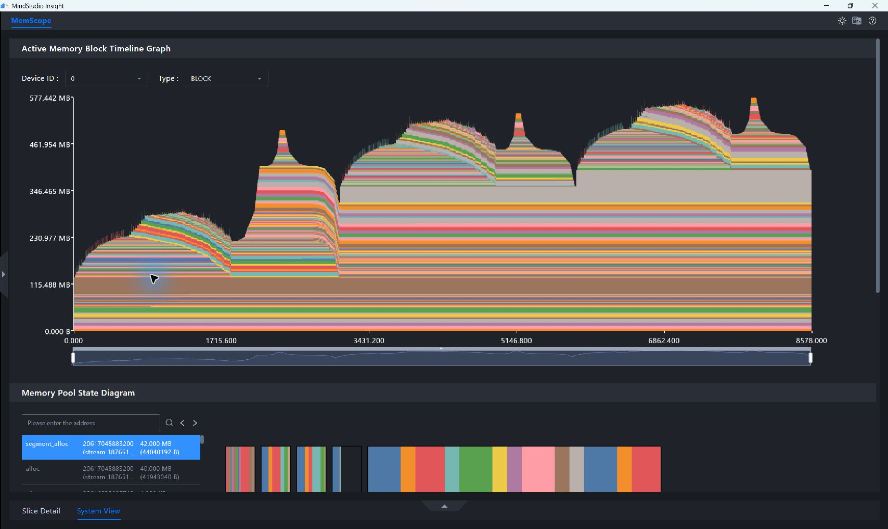
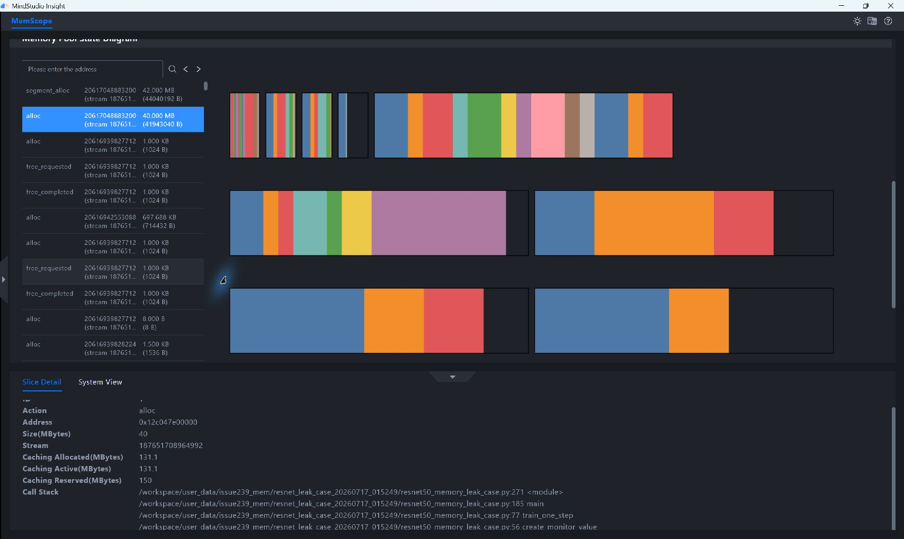
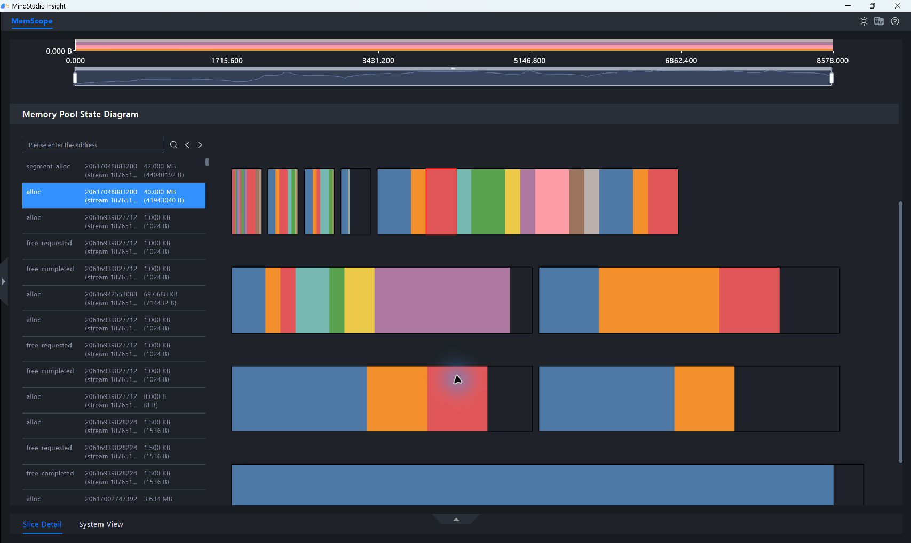
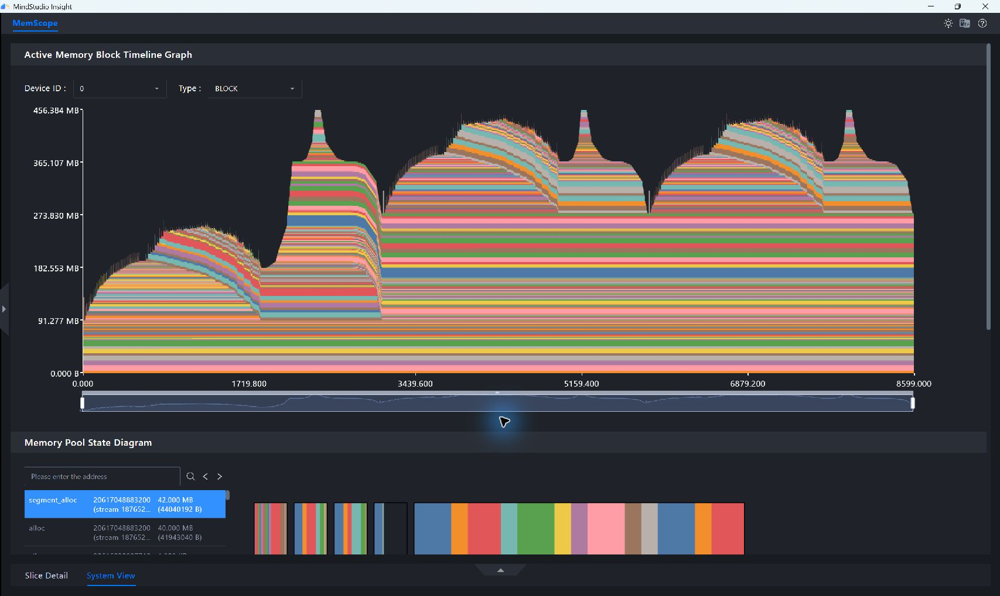
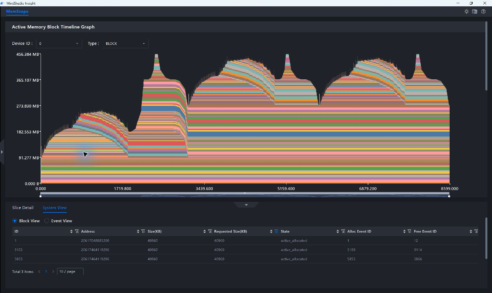
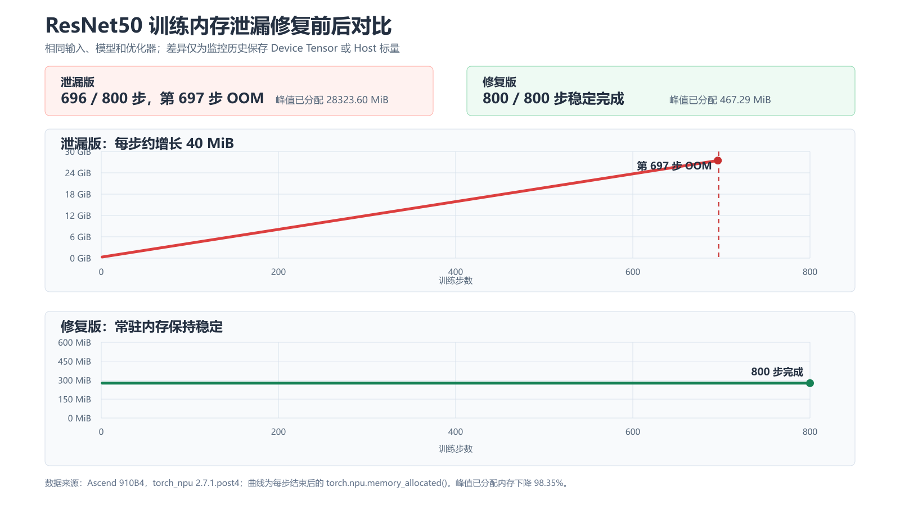

# Locating ResNet50 Training Memory Leaks Based on PyTorch Snapshot

## Case Overview

Training scripts usually record the loss, gradient norm, or other monitoring metrics. If a Device Tensor is
saved directly to a list that survives across steps, the Python reference to the Tensor persists and the corresponding Device
memory cannot be released. A short run may show only slow memory growth, while a long run may trigger
OOM.

This case uses ResNet50 and the Adam optimizer to build a reproducible training scenario and generates a monitoring Tensor of about 40 MiB at each
step:

- The leaking version adds the Device Tensor directly to the history list.
- The fixed version adds only the host scalar value of the monitoring Tensor to the history list.

The training inputs and labels are generated with a fixed random seed and do not represent a real dataset; the ResNet50 forward pass, backward pass, and
Adam parameter update are all real NPU computations. The extra 40 MiB Tensor generated at each step is controlled fault
injection, used to amplify and reliably reproduce the problem within a limited verification time. Its reference pattern is the same as saving the loss
Tensor, model output, or intermediate features to a global container in real training.

This case uses two sets of data to complete the analysis and verification:

1. Record a PyTorch Snapshot of 3 steps, used to locate unreleased
   memory blocks and Python call stacks in MindStudio Insight.
2. Do not record a Snapshot, and train continuously for 800 steps, used to verify that the leaking version eventually runs out of memory and that the fixed version
   can complete stably.

> [!NOTE]
>
> PyTorch Snapshot records the memory managed by the PyTorch caching allocator. This case analyzes the Device Tensor leak
> caused by a Python reference; if you need to analyze memory outside the framework, use the msMemScope
> data source.

## Analysis Approach

Analyze in the order of "confirm the trend, locate the object, trace back the code, verify the root cause, and retest the fix":

1. Compare the memory block lifecycle graphs of the leaking and fixed versions to determine whether memory accumulates across steps.
2. Filter 40 MiB memory blocks by requested size in Block View to confirm whether release events exist.
3. Filter 40 MiB allocation events in Event View, and then trace back the allocation location through the
   `Call Stack` in Slice Detail.
4. Combine the memory pool state and the code reference relationships to distinguish a memory leak from caching or fragmentation problems.
5. Change the history record to a host scalar, and then verify the fix with the same Snapshot analysis path and an 800-step
   long run.

## Data Preparation

### Verification Environment

|Item|Verification Environment|
| --- | --- |
|NPU|Ascend 910B4, nominal HBM 32 GiB|
|npu-smi version|25.2.0|
|Python|3.12.13|
|PyTorch|2.7.1+cpu|
|torch_npu|2.7.1.post4|
|MindStudio Insight|26.0.0|

In the OOM log of the leaking version, the total available capacity reported by PyTorch is `29.49 GiB`. This value is the framework capacity visible to
this process and differs from the nominal 32 GiB HBM of the hardware. `torch.__version__` is displayed as `2.7.1+cpu` in this environment, and the NPU
capability is provided by `torch_npu`. Before collection, run the following commands to confirm that the NPU is
available and that no other task is running on the target NPU:

```bash
npu-smi info
python -c 'import torch, torch_npu; print(torch.npu.is_available(), torch.npu.get_device_name(0))'
```

The expected output contains `True` and the current NPU model.

### Training Workload

|Parameter|Value|
| --- | --- |
|Model|ResNet50|
|Optimizer|Adam|
|batch size|1|
|Input shape|`1 x 3 x 244 x 244`|
|Data type|`float32`|
|Random seed|42|
|Monitoring Tensor|About 40 MiB per step|
|Snapshot analysis window|3 steps|
|Long-run verification|800 steps|

The training inputs and labels are generated by `torch.randn` and `torch.randint` respectively. The core computation path is as follows:

```python
def train_one_step(model, optimizer, loss_fn, history, mode, device):
    create_monitor_value(mode, history, element_count, device)

    inputs = torch.randn(1, 3, 244, 244, device=device)
    labels = torch.randint(0, 10, (1,), device=device)

    predictions = model(inputs)
    loss = loss_fn(predictions, labels)
    loss.backward()
    optimizer.step()
    optimizer.zero_grad(set_to_none=True)
    torch.npu.synchronize()
```

The above code omits the general initialization of the model, optimizer, and argument parsing, and shows only the core computation path directly
related to the memory problem in this case. When reproducing, use the same complete training script according to the training workload table and ensure that the leaking
and fixed versions differ only in how the history data is saved.

Using the same script and random seed, run the following parameter combinations respectively. The 3-step data is used for locating, and the 800-step
data is used to verify the final result.

|Run Group|Mode|Steps|Record Snapshot|Intended Use|
| --- | --- | ---: | --- | --- |
|Leaking version, short collection|`leak`|3|Yes|Locate unreleased blocks and call stacks|
|Fixed version, short collection|`fixed`|3|Yes|Verify the allocation/release event closure|
|Leaking version, long run|`leak`|800|No|Verify that continuous growth eventually triggers OOM|
|Fixed version, long run|`fixed`|800|No|Verify that resident memory is stable and training completes|

### Problematic Code

The monitoring function first generates a Tensor on the NPU and then saves the history data according to the run mode:

```python
def create_monitor_value(mode, history, element_count, device):
    monitor_tensor = torch.randn(
        element_count,
        dtype=torch.float32,
        device=device,
    )

    if mode == "leak":
        history.append(monitor_tensor)
    else:
        history.append(monitor_tensor.mean().item())

    del monitor_tensor
```

Although the leaking version executes `del monitor_tensor`, the list `history` still holds a reference to the same
Tensor, so the corresponding memory cannot be released. The fixed version performs the reduction through `mean().item()`
and synchronizes a single value to the host side for storage, so the original Device Tensor can be released after this step ends.

### Collecting the Snapshot

Enable memory history recording before training, and export the Snapshot after training and NPU synchronization are complete:

```python
torch_npu.npu.memory._record_memory_history(
    stacks="python",
    max_entries=200000,
)

for step in range(3):
    train_one_step()

torch.npu.synchronize()
torch_npu.npu.memory._dump_snapshot(snapshot_path)
torch_npu.npu.memory._record_memory_history(enabled=None)
```

Run the leaking and fixed versions in separate new Python processes to obtain:

- `leak_3_steps_snapshot.pickle`
- `fixed_3_steps_snapshot.pickle`

Three steps are enough to observe whether memory blocks of the same kind accumulate across steps, while controlling the Snapshot file size and
the number of events. The 800-step long run disables memory history recording and keeps only the allocated memory of each step and the final state,
avoiding the extra overhead that collection itself would introduce into the long-run result.

For the general Snapshot collection method, see
[Analyzing Memory Issues Based on PyTorch Snapshot Data](./pytorch_snapshot_memory_analysis.md#snapshot-data-collection).

> [!WARNING] WARNING
>
> Snapshots use the `pickle` format. Import or deserialize only Snapshot files from trusted sources.

## Importing Data and Understanding the Key Views

### Importing the Leaking-Version Snapshot

1. Open MindStudio Insight and click **Import Data** in the upper left corner.
2. Select `leak_3_steps_snapshot.pickle` and click **Confirm**.
3. Select the imported data in the data list on the left to open the **PyTorch Snapshot Data Memory Details
   (Memory Snapshot)** page.
4. Select `Device ID: 0` and `Type: BLOCK` above the memory block lifecycle graph.

For detailed import operations, see [Importing Data](../user_guide/basic_operations.md#importing-data).

### Key Views and Analysis Objectives

|View|Main Operations|Key Fields or Graphics|Purpose in This Case|
| --- | --- | --- | --- |
|Memory block lifecycle graph|Observe the full collection range and the color blocks across steps|Block height, occurrence count, lifecycle|Determine whether resident memory rises step by step|
|Block View|Filter by `Requested Size(KB)`|`State`, `Alloc Event ID`, `Free Event ID`|Confirm whether the 40 MiB blocks are released|
|Event View|Filter by `Size(KB)`|`Action`, cumulative memory, event ID|Confirm whether allocations recur and whether release events exist|
|Slice Detail|Select the target `alloc` event|`Size`, caching allocator state, `Call Stack`|Trace the target allocation back to the Python code|
|Memory pool status graph|Select the `alloc` or `segment_alloc` event|Segment, active and inactive Block|Determine whether memory growth comes from active objects or from fragmentation|

The capacity fields in the MindStudio Insight 26.0.0 GUI are labeled in `KB`; this document converts them as
`1024 KB = 1 MiB`. `Allocated` indicates the Blocks already allocated to Tensors;
in addition to allocated Blocks, `Active` may also include Blocks waiting to be released across streams;
`Reserved` indicates the total amount of Segments reserved from the Device by the PyTorch caching allocator;
`Inactive = Reserved - Active`, indicating the cache space that is not currently occupied by active Tensors and can be reused by the
allocator. In the end state collected in this case there are no Blocks waiting to be released, so the values of `Active` and
`Allocated` are equal.

## Analyzing the Leaking-Version Data

### Confirming That Memory Accumulates Across Steps

1. Keep `Device ID: 0` and `Type: BLOCK`.
2. Drag the left and right boundaries of the zoom slider below the lifecycle graph to both ends.
3. Observe the color blocks that are still alive after each training step and the resident memory baseline.

**Figure 1** Leaking-version 3-step memory block lifecycle graph<a id="leaking-version-3-step-memory-block-lifecycle-graph"></a>


In the graph, a new large block appears in each step, and it does not fall back to the same baseline after the following steps end. The allocated memory of
the 3-step run increases from `317.251 MiB` to `397.252 MiB`, and the cumulative growth between the two steps is about `80 MiB`, which matches the expectation
of retaining one 40 MiB Tensor per step.

### Confirming Unreleased Memory Blocks in Block View

1. Click the up arrow below the lifecycle graph to expand System View.
2. Select Block View.
3. Click the filter button of the `Requested Size(KB)` column.
4. Set both the minimum and maximum values to `40960` and click **Search**.
5. Check `Alloc Event ID` and `Free Event ID`.

**Figure 2** All 40 MiB memory blocks of the leaking version are unreleased<a id="all-40-mib-memory-blocks-of-the-leaking-version-are-unreleased"></a>


The filter result contains 3 Blocks whose requested size is `40960 KB`, with allocation event IDs `1`, `3097`, and
`5842`. The state of all three Blocks is `active_allocated`, and their
`Free Event ID` is `-1`, which means that they are still occupied by active Tensors at the end of collection and that no corresponding release event was recorded in this
Snapshot.

The actual Block size displayed in the GUI is `40960.5 KB`, which is `0.5 KB` larger than the requested size; this is allocator
alignment overhead and does not affect the identification of the 40 MiB monitoring Tensor.

### Tracing the Allocation Source in Event View

1. Switch to Event View.
2. Click the filter button of the `Size(KB)` column.
3. Set both the minimum and maximum values to `40960` and click **Search**.
4. Select any `alloc` event.
5. Click the up arrow at the bottom of the page to expand the details area and switch to Slice Detail.
6. Check `Call Stack`; if the call path is not fully displayed, scroll down the details area.

**Figure 3** Recurring 40 MiB allocation events in the leaking version<a id="recurring-40-mib-allocation-events-in-the-leaking-version"></a>


Event View also filters out events `1`, `3097`, and `5842`. All three events are `alloc`, and
`Allocated(KB)` increases step by step after the events occur. After selecting event `1`, view the complete call stack in
Slice Detail

**Figure 4** Complete call stack of the 40 MiB allocation event<a id="complete-call-stack-of-the-40-mib-allocation-event"></a>


The call path displayed in the GUI from top to bottom is as follows:

```text
resnet50_memory_leak_case.py:271 <module>
resnet50_memory_leak_case.py:185 main
resnet50_memory_leak_case.py:77 train_one_step
resnet50_memory_leak_case.py:56 create_monitor_value
```

`Call Stack` locates the repeated 40 MiB allocations to the statement that creates
`monitor_tensor` in `create_monitor_value`. After further checking the business logic, it is found that the leaking version adds this Tensor to the
`history` list that survives across steps.

### Ruling Out Memory Fragmentation as the Main Cause

1. Select the 40 MiB `alloc` event in the event list on the left of the memory pool status graph.
2. Compare it with the adjacent `segment_alloc` event and the Segment and Block layout on the right.
3. Compare the active and inactive states and the event state at the end of collection between the leaking and fixed versions.

**Figure 5** The 40 MiB active Block and its memory pool<a id="the-40-mib-active-block-and-its-memory-pool"></a>


The selected 40 MiB `alloc` in the graph corresponds to an active Block, and the caching allocator extended a Segment of about
42 MiB for this request. Figure 5 shows the memory pool layout right after the first `alloc` event occurs,
not the end state of the Snapshot collection. Combined with the end-state Segment and Block states and the
complete event records of the two Snapshots, the data is summarized as follows.

|Metric|Leaking Version|Fixed Version|
| --- | ---: | ---: |
|Number of 40 MiB `alloc` events|3|3|
|Number of 40 MiB `free_completed` events|0|3|
|Number of 40 MiB Blocks still active at the end of collection|3|0|
|Total Active|397.252 MiB|276.193 MiB|
|Total Inactive|234.748 MiB|279.807 MiB|
|Total Reserved|632.000 MiB|556.000 MiB|

In the table, `Reserved` is the sum of all Segments in the end state, `Active` is the sum of the active space of all Segments in the end
state, and `Inactive` is calculated as `Reserved - Active`; the number of 40 MiB events and the number of active
Blocks are obtained from the Event View event records and the end-state Block states respectively. Therefore, the end-state
values in the table should not be compared directly with the caching allocator values at the time of the event selected in Figure 5.

The three target Blocks added by the leaking version all remain active; although the fixed version has a higher total Inactive, all its target
Blocks have been released and the resident allocated memory no longer grows. This shows that the problem is caused by active Tensors that are still
referenced, and that cache retention or potential fragmentation is not the main cause of the continuous memory growth and the final OOM in this case.

Therefore, for this root cause, calling `empty_cache()` or adjusting the allocator fragmentation parameters cannot solve the problem.
`empty_cache()` can release only the cache space not occupied by active Tensors; as long as `history` still holds
a reference to the Device Tensor, the memory occupied by the Tensor cannot be returned to the caching allocator even if the local variable has been deleted.

When analyzing other Snapshots, choose the next step according to the following symptoms.

|Main Symptom|Priority Judgment|Next Step|
| --- | --- | --- |
|Allocated and active Blocks keep increasing|Active Tensors are still referenced|Locate the object and code in Block View, Event View, and `Call Stack`|
|Reserved increases but Allocated is basically stable, and many non-reusable inactive split Blocks exist|Cache retention or potential fragmentation|Check the Segment layout, request sizes, and allocator parameters|
|Process Device memory increases, but Allocated and Reserved in the Snapshot are basically stable|Memory outside the PyTorch caching allocator|Continue the analysis with data such as msMemScope|

## Root Cause and Optimization Plan

The root cause is that the monitoring history saves Device Tensors:

```python
history.append(monitor_tensor)
```

For scenarios that only need to record a single statistic, there is no need to save the complete Tensor across steps. Change the saved content
to a host scalar:

```python
history.append(monitor_tensor.mean().item())
```

This modification has the following effects:

1. `mean()` completes the statistics on the Device, reducing the amount of data transferred back to the host.
2. `.item()` returns only one host scalar, and `history` no longer holds a Device Tensor.
3. The original Tensor loses its last Python reference after this step ends, and the corresponding Block can be released and
   reused in subsequent steps.

> [!NOTE]
>
> `.item()` waits for the Device computation to complete and transfers the scalar back to the host; frequent calls may introduce synchronization
> overhead. In performance-sensitive scenarios, reduce the monitoring sampling frequency, accumulate on the Device side and fetch values in batches, or use an
> asynchronous write-to-disk solution. This case only verifies reference release and does not evaluate training throughput based on it.

If the business really needs to save complete Tensors, choose to save them to the CPU, write them to disk periodically, limit the history
window length, or keep only the necessary slices, according to the purpose; never append the Device Tensor of every step to a list indefinitely.

## Verifying the Optimization Result

### Verifying the Release Relationship with a Snapshot

Import `fixed_3_steps_snapshot.pickle` into MindStudio Insight and repeat the analysis
steps of the leaking version.

**Figure 6** Fixed-version 3-step memory block lifecycle graph<a id="fixed-version-3-step-memory-block-lifecycle-graph"></a>


In the fixed version, the temporary allocations of each step fall back after use, and the resident memory does not rise with the steps. The allocated memory at the beginning and
end of the 3 steps is both `276.193 MiB`.

Filter by `Requested Size(KB) = 40960` in Block View.

**Figure 7** Release events are recorded for all 40 MiB memory blocks of the fixed version<a id="release-events-are-recorded-for-all-40-mib-memory-blocks-of-the-fixed-version"></a>


The fixed version contains three 40 MiB allocation records, with allocation event IDs `1`, `3103`, and `5855`, corresponding to
`Free Event ID` values `12`, `3114`, and `5866`. Compared with the `-1` of the leaking version,
the fixed version has formed complete allocation and release event pairs. Events `3103` and `5855` have the same address,
which means that the Block released for the second time is reused directly by the allocator in the third step.

In the import result of this version, the `State` column of the Block table still retains the
`active_allocated` allocation state of this lifecycle record. To determine whether the release is complete, use `Free Event ID`: after jumping to
events `12`, `3114`, and `5866`, their `Action` values are all `free_completed`, which is therefore not contradictory to the release
conclusion.

### Verifying the Final Result with an 800-Step Long Run

The short Snapshot is used to locate the object and the call stack, and the 800-step long run is used to verify whether the fix can solve the actual OOM.
Both long runs use the same inputs, model, optimizer, and random seed, and neither records a Snapshot.

**Figure 8** Comparison of ResNet50 training long-run results<a id="comparison-of-resnet50-training-long-run-results"></a>


|Metric|Leaking Version|Fixed Version|
| --- | ---: | ---: |
|Requested training steps|800|800|
|Completed steps|696|800|
|Final state|OOM at step 697|Completed normally|
|Resident memory change per step|About +40 MiB|About 0 MiB|
|Allocated memory of the first step|317.251 MiB|276.193 MiB|
|Allocated memory of the last completed step|28117.590 MiB|276.193 MiB|
|Peak allocated memory|28323.605 MiB|467.292 MiB|
|Peak reserved memory|29738.000 MiB|556.000 MiB|
|Run time|156.993 s|180.130 s|

The leaking version runs out of memory when it tries to allocate more memory at step 697; the fixed version completes more steps, and its resident allocated
memory stays at about `276.193 MiB`. Compared with the peak of the leaking version before OOM, the peak allocated memory of the fixed version decreases by about
`98.35%`, and the peak reserved memory decreases by about `98.13%`.

The two runs complete different numbers of steps, so the run time cannot be used directly to compare training performance. This case uses the
long-run results only to verify memory stability and whether the OOM disappears, and does not draw throughput conclusions from them.

### Result Closure

This case forms the following chain of evidence:

1. The lifecycle graph shows that the resident memory of the leaking version rises step by step.
2. Block View shows that the `Free Event ID` of the three 40 MiB Blocks is `-1`.
3. Event View proves that allocations of the same size recur in the three training steps.
4. The `Call Stack` in Slice Detail locates the allocation to
   line 56 of `create_monitor_value`.
5. The memory pool state and the end-state comparison table prove that the growth comes from active Blocks, and that cache retention or potential fragmentation is not
   the main cause of the continuous growth.
6. The code check confirms that `history` holds Device Tensors for a long time.
7. In the fixed-version Snapshot, all three 40 MiB allocations have release events, and address reuse occurs.
8. The leaking version runs out of memory at step 697, while the fixed version completes all 800 steps stably.

## Reproduction Acceptance Points

When reproducing with the same scenario, the following conditions should be met:

1. Both the leaking-version and fixed-version Snapshots can be imported into MindStudio Insight successfully.
2. The resident memory in the lifecycle graph of the leaking version rises with the steps.
3. The leaking version allows filtering out the 40 MiB Block added in each step, and there is no corresponding release event.
4. The `Call Stack` in Slice Detail can locate line 56 of `create_monitor_value`.
5. The memory pool state shows that the target Blocks of the leaking version remain active, and that cache retention or potential fragmentation is not the main
   cause of the continuous growth.
6. All three allocations of the same size in the fixed version have release events and address reuse occurs, and the resident memory no longer grows with the
   steps.
7. In the long run, the leaking version eventually triggers OOM, and the fixed version completes all scheduled steps.

The absolute values above are used to check the verification results of this case. Absolute memory values may differ under different hardware, software versions,
and model parameters; the main criteria should be "whether unreleased Blocks keep accumulating" and "whether an allocation/release closure is formed after the fix"
as the main basis for judgment.

## References

- [MindStudio Insight Memory Tuning](../user_guide/memory_tuning.md)
- [MindStudio Insight Importing Data](../user_guide/basic_operations.md#importing-data)
- [Analyzing Memory Issues Based on PyTorch Snapshot Data](./pytorch_snapshot_memory_analysis.md)
- [Ascend for PyTorch Version Compatibility](https://gitcode.com/Ascend/pytorch/blob/master/docs/en/release_notes.md)
