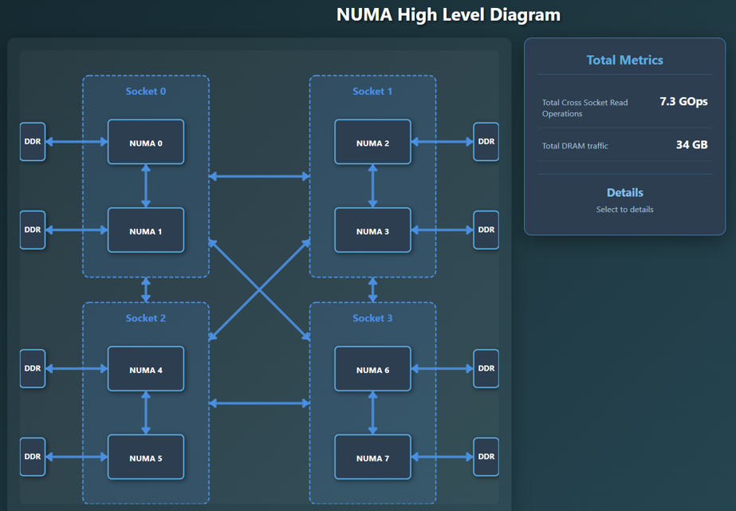
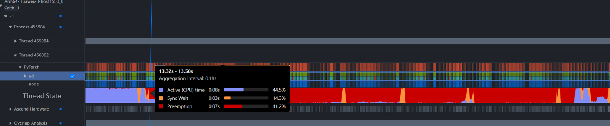
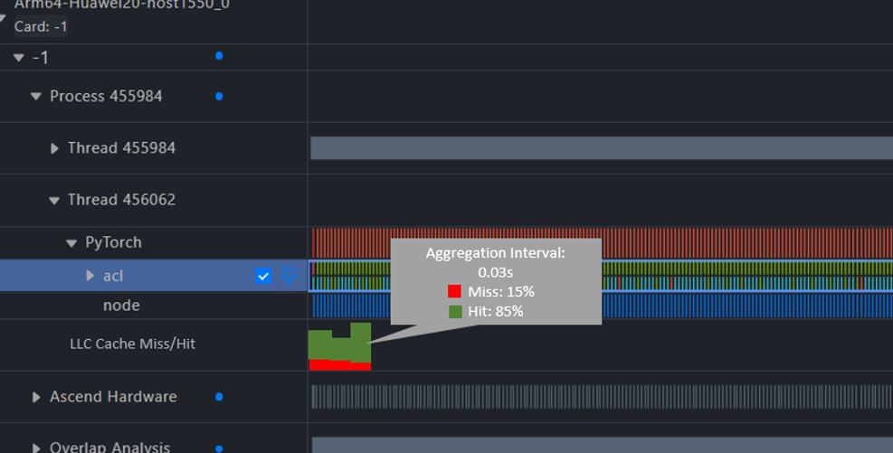

# Design Specification for the NUMA Analysis Feature in MindStudio Insight

**Copyright © 2026 Ascend Community**

## Revision History

| Date | Revision | Description | Author | Reviewer |
| --- | --- | --- | --- | --- |
| 2026-08-01 | v1.0 | First draft | Yang Lei | Liao Yan |
|            |          |          | - | - |

## Abbreviations

| Abbreviation | Full Name | Description |
| --- | --- | --- |
| msInsight | MindStudio Insight | MindStudio Insight performance analysis tool |
| NUMA | Non-Uniform Memory Access | Non-uniform memory access |
|           |                           |                                 |

# 1. Feature Overview

For the A+K scenario (the CPU is Kunpeng), time-series data collection of Uncore and NUMA metrics is supported, providing platform-level and Socket-level performance metrics, including DDR read/write monitoring, NUMA node bandwidth monitoring based on HHA data, NUMA traffic proportion calculation and time-series data tracing, and correlation analysis between CPU-side NUMA performance data and MindStudio NPU data, which improves the efficiency of collaboratively locating performance bottlenecks.

## 1.1 Scope

This document covers the development design of NUMA analysis in MindStudio Insight, focusing on:

1. NUMA architecture diagram: displays the NUMA architecture diagram, including node and link details.
2. Platform Metric visualization: supports metrics such as DRAM Write Bandwidth, Cross Socket Read Bandwidth, Cross SCCL, Total Read BandWidth, LLC BandWidth, and Inner Read BandWidth.
3. Thread analysis: supports the thread analysis chart, including statistics of the three states active, sync wait, and preemption
4. Hit rate analysis: supports LLC miss rate/hit rate analysis (per thread)

## 1.2 Feature Requirement List

| Requirement No. | Requirement | Feature Description | Verifiable Material |
| --- | --- | --- | --- |
| 1 | NUMA-related problem analysis | Supports NUMA architecture diagram display, Platform Metric visualization, thread analysis, and hit rate analysis |            |
|          |                  |                                                              |            |

# 2. Requirement Scenario Analysis

## 2.1 Requirement Source and Value Overview

NUMA-related analysis capabilities are currently unavailable, which makes problem analysis inefficient. By presenting the NUMA architecture diagram, Platform Metric trends, and thread and hit rate trends in MindStudio Insight, developers can view the collected NUMA data intuitively and find the bottleneck quickly.

## 2.2 Typical Usage Scenario

### PyTorch Snapshot Scenario

1. Collect NUMA data with msprof. The collected data is merged into the db.
2. Import the collected data into MindStudio Insight, and analyze the bottleneck by referring to the NUMA architecture and the changes of each metric.

## 2.3 Constraints and Limitations

### 2.3.1 Hardware Limitations

For the specific hardware support scope, see the MindStudio Insight release notes and the documentation of the corresponding data collection tool.

### 2.3.2 System Limitations

The recommended environment recorded in the existing documentation is as follows:

1. Windows 10+.
2. For Linux, `glibc > 2.30` is recommended.
3. macOS 13.0+.
4. It is recommended that the device running MindStudio Insight has more than 16 GB of memory.
5. It is recommended that a memory data file does not exceed 1 GB.

If the actual support matrix changes, the installation guide, release notes, and build scripts prevail.

### 2.3.3 Security and Sensitive Information

MindStudio Insight is a local analysis tool, but input files may contain user paths, function names, call stacks, symbol names, model execution information, and other content. Development and documentation examples should follow these principles:

- Use desensitized paths in examples, such as `/home/xxx/demo.py`.
- Do not place real user names, site information, keys, passwords, or public network addresses in the documentation.
- Validate the legality of user-imported file paths, file types, and file sizes.
- If exception information needs to be output to logs, avoid printing sensitive paths and complete call stacks, and desensitize them when necessary.

# 3. Overall Solution

## 3.1 Data Sources

| Data Source | Data Format | Main Display Content | Description |
| --- | --- | --- | --- |
| msProf | .db | NUMA architecture diagram, the 10 Platform Metric values, thread analysis data, and hit rate analysis data |  |
|        |          |                                                              |      |

## 3.2 Processing Flow

1. The user collects NUMA data and generates data in db format.
2. The user imports the data file into MindStudio Insight.
3. The backend parses the data and establishes the data structures or database connections required for queries.
4. The frontend initiates query requests based on page interaction.
5. The backend returns the query results of NUMA architecture information and metric change information.
6. The frontend displays the NUMA architecture diagram and presents Platform Metric, thread, hit rate, and other information in separate Timeline units.

## 3.3 Relationship with Other Documents

# 4. Use Case 1: NUMA Analysis

## 4.1 Design Objectives

Supports importing NUMA data and displaying the NUMA architecture diagram. Clicking a NUMA element, Socket element, or link displays the corresponding statistics in the extended area.



## 4.2 User Entry

The user collects data with msProf. The collection example in the user guide is as follows:

```python
To be added
```

## 4.3 Page Capabilities

The NUMA page can display:

- NUMA architecture diagram
- Extended statistics
- A time range selected for analysis on the Timeline page. You can jump to the NUMA page, which analyzes only the data in the time range.

## 4.4 Items to Be Confirmed

The following content needs to be supplemented after further confirmation in the design review:

- Backend database table structure or intermediate data structure.

# 5. Use Case 2: Platform Metric Visualization, Thread Analysis, and Hit Rate Analysis

## 5.1 Design Objectives

Supports importing DB result files collected by msMemScope to graphically display the Device memory allocation/release lifecycle, call stack, and memory disassembly information.

New units are added to the Timeline to support the presentation of Platform Metric, thread data, and hit rate data.





## 5.2 Data Preparation

Supports importing files in .db format. The display capabilities recorded in the user guide include:

- Data of the 10 Platform Metrics.
- Thread analysis data.
- Hit rate analysis data.

## 5.3 Page Capabilities

The Timeline page can display:

- Platform Metric visualization: supports metrics such as DRAM Write Bandwidth, Cross Socket Read Bandwidth, Cross SCCL, Total Read BandWidth, LLC BandWidth, and Inner Read BandWidth.
- Thread analysis: supports the thread analysis chart, including statistics of the three states active, sync wait, and preemption
- Hit rate analysis: supports LLC miss rate/hit rate analysis (per thread)

## 5.4 Items to Be Confirmed

The following content needs to be supplemented after further confirmation in the design review:

- Backend database table structure or intermediate data structure.

# 6. DFX Design

## 6.1 Performance Design

- Performance verification is recommended for importing large files, querying long time ranges, and zooming and panning.

- Import and query verification is recommended for memory data files within 1 GB.

- This document does not commit to specific response times; the specific indicators are subject to the performance test results.

## 6.2 Exception Handling Design

It is recommended to cover the following exception scenarios:

- File format mismatch.

- A corrupted file or missing fields.

- A file that is too large, causing parsing failure or excessive time consumption.

- An empty query time range.

- Call stacks or access events not collected.

- The db contains no NUMA-related data.

## 6.3 Security Design

- No new external listening port is added.

- No new authentication mode is added.

- The legality of file import paths and file types should be verified.

- Examples and logs should avoid exposing real user paths, passwords, keys, or site information.

- If third-party components are newly introduced, license and vulnerability checks should be completed according to the project's third-party component introduction process.

## 6.4 Testability Design

The recommended test coverage is as follows:

- NUMA data is imported normally, the architecture diagram is displayed normally, clicking nodes and links works properly, and the extended statistics are correct.

- The Timeline displays Platform Metric data, thread analysis data, and hit rate analysis data normally.

- The db file contains no NUMA or metric-related data.

- Large file import.

- Incorrect file format.

# 7. Verification Method

## 7.1 Static Verification

- Check whether the relative links in the document exist.
- Check whether the example paths are desensitized.
- Check whether template placeholders, empty images, or unclosed Markdown markers still exist.

## 7.2 Functional Verification

- Import a db file and verify the NUMA architecture diagram, the presentation of each metric in the Timeline, the presentation of thread analysis data, and the presentation of hit rate data.
- Verify whether other functions of the tool are affected when NUMA data is empty.
