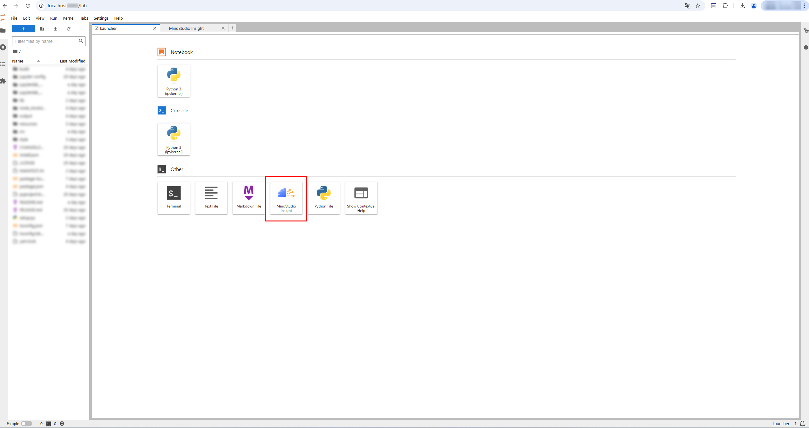

# Installing, Upgrading, and Uninstalling the MindStudio Insight JupyterLab Plugin

## Installing MindStudio Insight

<a id="installation-operation-jupyterlab-plugin"></a>

### Installation Operation (JupyterLab Plugin)

**Introduction**

In the Linux environment, the MindStudio Insight tool provides a more intuitive and interactive operation interface by integrating into JupyterLab as a plugin. The advantages of the JupyterLab plugin are shown in [**Table 1** JupyterLab plugin advantages](#jupyterlab-plugin-advantages).

**Table 1** JupyterLab plugin advantages<a id="jupyterlab-plugin-advantages"></a>

|Advantage|Description|
|--|--|
|Seamless integration|Supports running the MindStudio Insight tool directly in the Jupyter environment, eliminating the need to switch platforms or copy data on the server and enabling immediate use of data upon collection.|
|Quick startup|The MindStudio Insight tool can be quickly started through the JupyterLab command line or graphical interface.|
|Smooth operation|In the Linux environment, starting MindStudio Insight through the JupyterLab environment effectively resolves stuttering issues compared to full-package communication, significantly improving the operational experience.|
|Remote connection|Supports remote startup of MindStudio Insight, allowing direct visual analysis through a remote connection service in a local browser, alleviating the difficulties of uploading and downloading large model training or inference data.|

**Environment Setup**

1. Install the JupyterLab environment in the Linux environment. For environment requirements, see [**Table 2** Environment requirements](#environment-requirements).

    ```shell
    pip install jupyterlab
    ```

    > [!NOTE]
    >
    > To enable cluster-scenario data, install the Python dependencies as described in the [Installing Dependencies](./mindstudio_insight_install_linux.md#installing-dependencies) section.

    **Table 2** Environment requirements<a id="environment-requirements"></a>

    |Type|Requirement|
    |--|--|
    |System|Linux|
    |Python|Python >= 3.8<br>|
    |JupyterLab environment|JupyterLab >= 4.0 and < 5.0|

2. After the installation is complete, check the JupyterLab version.

    ```shell
    jupyter --version
    ```

3. (Optional) You are advised to use conda for environment management.

    Create a virtual environment and activate it.

    ```shell
    conda create -n {your_env_name} python={python version} jupyterlab={jupyterlab version}
    conda activate {your_env_name}  # Activate the virtual environment
    ```

**Procedure**

1. Install the MindStudio Insight plugin package.

    ```shell
    pip install mindstudio_insight_jupyterlab-{version}-py3-none-{platform}.whl
    ```

    > [!NOTE]
    >
    > Before installing the plugin package, confirm the umask setting of the current user. The recommended setting is `0027`. For specific suggestions, see [Security Statement](../legal/security_statement.md).

2. Check whether MindStudio Insight is installed successfully.

    ```shell
    jupyter labextension list
    ```

    If the echo contains the following content, the installation is successful.

    ```ColdFusion
    mindstudio_insight_jupyterlab v{version} enabled  X (python, mindstudio_insight_jupyterlab)
    ```

3. Enable the JupyterLab service and open the MindStudio Insight tool.

    <a id="jupyter_3"></a>

    - If you are a non-root user, run the following command:

        ```shell
        jupyter lab
        ```

    - If you are the `root` user, run the following command:

        ```shell
        jupyter lab --allow-root
        ```

    > [!NOTE]
    >
    > It is recommended to use a non-root user to execute commands. If you actually need to start as the `root` user, strictly execute the root user's command. Otherwise, there will be security risks.

    After enabling, use a browser and enter the address **http://**\{_your\_server\_ip_\}**:**\{_your\_server\_port_\}**/lab** to open the JupyterLab environment homepage, as shown in [**Figure 1** JupyterLab environment homepage](#jupyterlab-environment-homepage). Click the MindStudio Insight icon to open the MindStudio Insight tool. The port number can be checked in the terminal in real time; the default value for the port is `8888`.

    **Figure 1** JupyterLab environment homepage<a id="jupyterlab-environment-homepage"></a>
    

4. If the MindStudio Insight icon is not found after opening the JupyterLab environment homepage, run the following command to check whether the MindStudio Insight plugin is enabled:

    ```shell
    jupyter server extension list
    ```

    - If the echo is as follows, the plugin is enabled.

        ```ColdFusion
        mindstudio_insight_jupyterlab enabled
            - Validating mindstudio_insight_jupyterlab...
              mindstudio_insight_jupyterlab  OK
        ```

    - If it is not enabled, execute the following command to enable the MindStudio Insight plugin.

        ```shell
        jupyter server extension enable --py mindstudio_insight_jupyterlab
        ```

5. After enabling the MindStudio Insight plugin, repeat step [3](#jupyter_3) to open the MindStudio Insight tool.

    **Precautions**

    - If no browser is installed on the local machine, or if the large model performance tuning data and JupyterLab reside on a server, you need to enable the service on the server and load the data, then use a local browser to access and view it. For details about how to enable the JupyterLab service, refer to the following steps.
        1. Create a JupyterLab configuration file. The configuration here is the official JupyterLab configuration and is unrelated to the MindStudio Insight plugin.

            ```shell
            jupyter lab --generate-config
            ```

        2. Go to the jupyter directory and open the `jupyter_lab_config.py` configuration file.
        3. Modify the configuration file. Search for the keywords `c.ServerApp.ip` and `c.ServerApp.open_browser`, delete the comment symbol before the line where they are located, modify them to the following configuration, and save to make the configuration file take effect.

            ```text
            # Modify the value to make it effective (remove the comment from the configuration file)
            c.ServerApp.ip = '0.0.0.0'
            c.ServerApp.open_browser = False
            ```

        4. After the configuration is complete, see [3](#jupyter_3) to restart the JupyterLab service and open the MindStudio Insight tool.

    - If the cloud platform you are currently using has integrated the JupyterLab service and you need to use the MindStudio Insight tool on the cloud platform, you can install the Jupyter proxy service plugin **jupyter-server-proxy** on the cloud platform to use the MindStudio Insight tool normally.<br>
    If the Jupyter proxy service plugin cannot be installed on the cloud platform and ports 9000 to 9099 are not open to the public network, the MindStudio Insight tool cannot be used.
        1. Install the Jupyter proxy service plugin.

            ```shell
            pip install jupyter-server-proxy
            ```

        2. See [3](#jupyter_3) to restart the JupyterLab service and open the MindStudio Insight tool.

    - On the JupyterLab environment homepage, you can click the MindStudio Insight icon multiple times to open multiple MindStudio Insight tabs, and they can be used simultaneously.

    - Pay attention to the security risks when using MindStudio Insight after installing it via the JupyterLab plugin. For details, see [Security Statement](../legal/security_statement.md).

## Upgrading MindStudio Insight

If you need to upgrade MindStudio Insight, you must first uninstall the currently installed MindStudio Insight, then obtain the latest MindStudio Insight software package and reinstall it.

Based on your actual scenario, refer to [Uninstalling MindStudio Insight](#uninstalling-mindstudio-insight) to complete the uninstallation, and then reinstall the latest MindStudio Insight software package.

## Uninstalling MindStudio Insight

<a id="jupyterlab-plugin-uninstallation"></a>

### Uninstallation Operation (JupyterLab Plugin)

Uninstall the MindStudio Insight plugin package.

```shell
pip uninstall mindstudio_insight_jupyterlab
```
