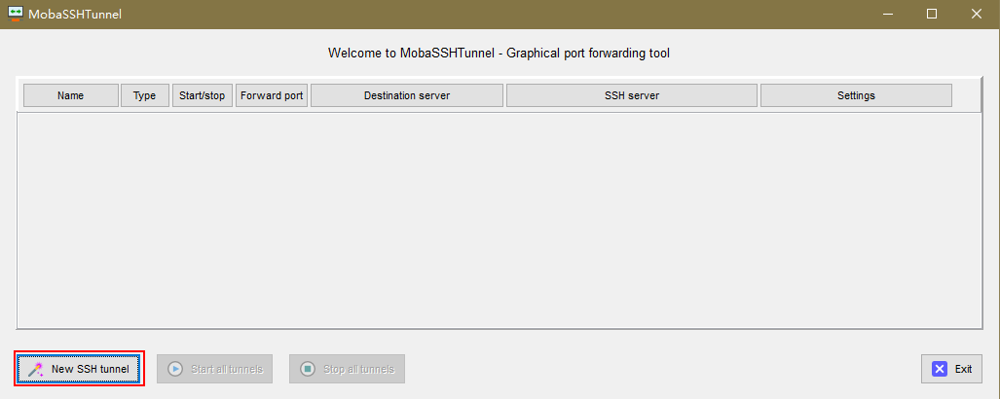
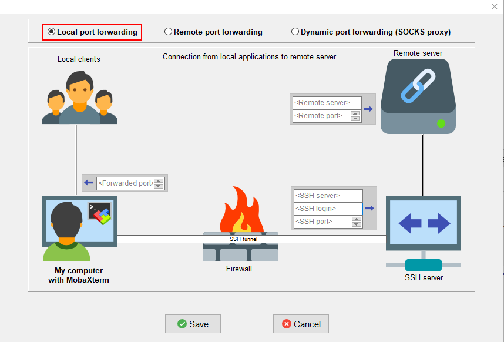
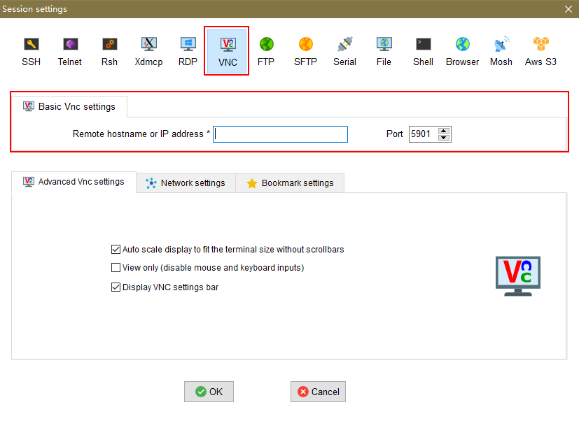
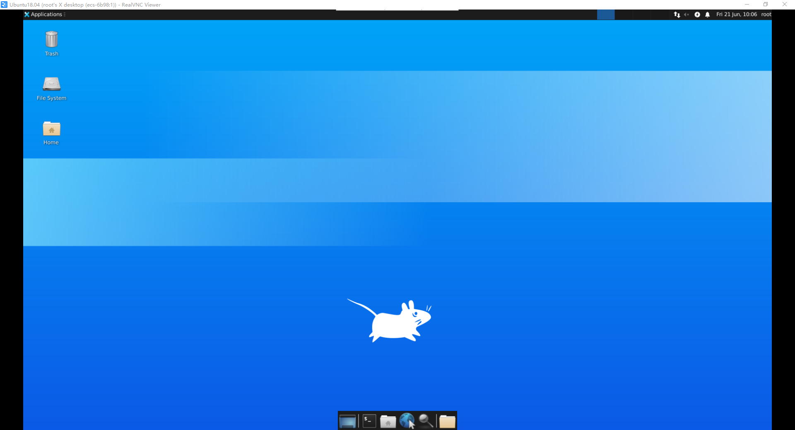

# Installing, Upgrading, and Uninstalling MindStudio Insight on Linux

## Installing MindStudio Insight

<a id="installation-operation-linux"></a>

### Installation Operation (Linux)

<a id="overview"></a>

#### Overview

In the Linux environment, MindStudio Insight can be used in local mode or forwarding mode.

- Local mode

    In local mode, the server running the Linux OS is directly connected to an external monitor. The tool GUI is displayed on the OS desktop, which is similar to the scenario where a local Windows host is connected to a monitor. In this scenario, there is no delay of the tool GUI.

- Forwarding mode

    If no Linux server is available locally, you can connect to a remote Linux server and use X11, VNC, or xRDP to forward the desktop or software GUI on the remote Linux server to the local PC. For example, the app GUI on the Linux server is displayed on the local Windows desktop. You can use the forwarding capability of MindStudio Insight to implement GUI forwarding on the Linux server, which is convenient for developers. However, compared with the local mode, the forwarding mode is affected by network performance and may cause network delay. As a result, suspension may occur during tool installation and use.

This document describes the X11 and VNC forwarding modes. Developers can select one forwarding mode according to the actual situation. For details, see [**Table 1** Forwarding modes](#forwarding-modes). To install and use MindStudio Insight in forwarding mode, install the forwarding mode and software dependencies first. For details, see [Installing Dependencies](#installing-dependencies).

> [!NOTE]
>
> The VNC forwarding mode is recommended, which provides a smoother experience.

**Table 1** Forwarding modes<a id="forwarding-modes"></a>

|Forwarding Mode|Network Delay|Security|Remarks|
|--|--|--|--|
|X11|Relatively high|The underlying layer is based on the SSH security protocol.|It is mostly used in local area networks with good network conditions.|
|VNC|Relatively low|By default, the TCP protocol is used. You can use the SSH security protocol to ensure secure access.|It is more widely used and can be used on cross-city networks and VPN networks.|

**Setting Up the Environment**

In the Linux OS, the environment requirements for installing MindStudio Insight are described in [**Table 2** Environment requirements for installing MindStudio Insight](#environment-requirements-for-installing-mindstudio-insight).

**Table 2** Environment requirements for installing MindStudio Insight<a id="environment-requirements-for-installing-mindstudio-insight"></a>

|Type|Limitation|
|--|--|
|Hardware|- Memory: at least 4 GB (8 GB or above recommended)<br> - Minimum disk space: 6 GB|
|System requirement|- The glibc version must be 2.27 or later.<br> - The OS provides a built-in GUI desktop or supports X11 or VNC forwarding.|
|Supported OSs|OSs that use APT as the package management software:<br> - Ubuntu 18.04-x86_64/aarch64<br> - Ubuntu 20.04-x86_64/aarch64<br> - Ubuntu 22.04-x86_64/aarch64<br> - CentOS 8.2-x86_64/aarch64<br> - Debian 10.0<br> - Debian 10.8<br> OSs that use Yum or DNF as the package management software:<br> - EulerOS 2.8-aarch64<br> - EulerOS 2.12-aarch64<br> - openEuler 20.03-x86_64/aarch64<br> - openEuler 22.03 LTS-x86_64/aarch64<br> - openEuler 22.03 LTS<br> - openEuler 22.03 LTS SP4<br> - HCE 2.0<br> - CUlinux 3.0<br> - Kylin V10 SP3<br> - Euler 2.13(ARM)<br> - HCE 2.0.2503(x86)<br> - Tlinux 3.1 - kernel version 5.4<br> - BClinux 21.10 U4<br> - TencentOS Server 4.4_x86|

> [!NOTE]
>
> When installing and using MindStudio Insight on a passthrough VM running the veLinux 5.15 system, you are advised to use the JupyterLab plugin to install MindStudio Insight. For details about how to install the JupyterLab plugin, see [JupyterLab Plugin Installation](./mindstudio_insight_install_jupyterlab.md#installation-operation-jupyterlab-plugin).

<a id="installing-dependencies"></a>

#### Installing Dependencies

**Dependency List**

In the Linux environment, install related dependencies before installing MindStudio Insight. For details, see [**Table 3** Dependency list](#dependency-list).

<a id="dependency-list"></a>

| Dependency | Description |
| --- | --- |
| `libwebkit2gtk-4.0-dev` | Required runtime library for MindStudio Insight display on Ubuntu systems. |
| `gtk3-devel` `webkit2gtk4.1-devel` | Required runtime libraries for MindStudio Insight display on CentOS systems. |
| `gtk3-devel` `webkit2gtk3-devel` | Required runtime libraries for MindStudio Insight display on EulerOS and openEuler systems. |
| `xterm` | Required dependency for X11 forwarding on all systems when using this display mode. |
| `x11-apps` | Required dependency for X11 forwarding on Ubuntu systems when using this display mode. |
| `xorg-x11-xauth` | Required dependency for X11 forwarding on CentOS, EulerOS, and openEuler systems when using this display mode. |
| `xfce4` | Required dependency for VNC forwarding on Ubuntu, CentOS, and openEuler systems when using this display mode. |
| `gnome-desktop` | Required dependency for VNC forwarding on EulerOS systems when using this display mode. |
| `click` | Python library dependency for the integrated `msprof-analyze` cluster analysis tool. See the [build.txt](https://gitcode.com/Ascend/msprof-analyze/blob/master/requirements/build.txt) file for version requirements. |
| `networkx` | Python library dependency for the integrated `msprof-analyze` cluster analysis tool. See the [build.txt](https://gitcode.com/Ascend/msprof-analyze/blob/master/requirements/build.txt) file for version requirements. |
| `jinja2` | Python library dependency for the integrated `msprof-analyze` cluster analysis tool. See the [build.txt](https://gitcode.com/Ascend/msprof-analyze/blob/master/requirements/build.txt) file for version requirements. |
| `PyYaml` | Python library dependency for the integrated `msprof-analyze` cluster analysis tool. See the [build.txt](https://gitcode.com/Ascend/msprof-analyze/blob/master/requirements/build.txt) file for version requirements. |
| `tqdm` | Python library dependency for the integrated `msprof-analyze` cluster analysis tool. See the [build.txt](https://gitcode.com/Ascend/msprof-analyze/blob/master/requirements/build.txt) file for version requirements. |
| `prettytable` | Python library dependency for the integrated `msprof-analyze` cluster analysis tool. See the [build.txt](https://gitcode.com/Ascend/msprof-analyze/blob/master/requirements/build.txt) file for version requirements. |
| `ijson` | Python library dependency for the integrated `msprof-analyze` cluster analysis tool. See the [build.txt](https://gitcode.com/Ascend/msprof-analyze/blob/master/requirements/build.txt) file for version requirements. |
| `xlsxwriter` | Python library dependency for the integrated `msprof-analyze` cluster analysis tool. See the [build.txt](https://gitcode.com/Ascend/msprof-analyze/blob/master/requirements/build.txt) file for version requirements. |
| `sqlalchemy` | Python library dependency for the integrated `msprof-analyze` cluster analysis tool. See the [build.txt](https://gitcode.com/Ascend/msprof-analyze/blob/master/requirements/build.txt) file for version requirements. |
| `numpy` | Python library dependency for the integrated `msprof-analyze` cluster analysis tool. See the [build.txt](https://gitcode.com/Ascend/msprof-analyze/blob/master/requirements/build.txt) file for version requirements. |
| `pandas` | Python library dependency for the integrated `msprof-analyze` cluster analysis tool. See the [build.txt](https://gitcode.com/Ascend/msprof-analyze/blob/master/requirements/build.txt) file for version requirements. |
| `psutil` | Python library dependency for the integrated `msprof-analyze` cluster analysis tool. See the [build.txt](https://gitcode.com/Ascend/msprof-analyze/blob/master/requirements/build.txt) file for version requirements. |

**Installing Dependencies**

1. Run the following commands to install Python-related dependencies.

    ```shell
    pip3 install click
    pip3 install networkx
    pip3 install jinja2
    pip3 install PyYaml
    pip3 install tqdm
    pip3 install prettytable
    pip3 install ijson
    pip3 install "xlsxwriter>=3.0.6"
    pip3 install sqlalchemy
    pip3 install "numpy<=1.26.4"
    pip3 install "pandas<=2.3.2"
    pip3 install psutil
    ```

2. Configure the forwarding method and install dependencies required by the MindStudio Insight software package. You are advised to configure VNC and X11 for forwarding.

<a id="installing-vnc-forwarding-mode"></a>

#### Configuring VNC Forwarding Mode

Starting MindStudio Insight through VNC forwarding provides a smoother experience. Therefore, you are advised to use the VNC forwarding to use MindStudio Insight.

> [!NOTE]
>
> - MindStudio Insight cannot be started through VNC in EulerOS 2.12.
> - This section is for reference only. For details about how to install VNC, see the [VNC Official Documentation](https://docs.redhat.com/en/documentation/red_hat_enterprise_linux/6/html/deployment_guide/chap-tigervnc#s2-starting-vncserver).

**Installing Dependencies**

1. Run the following command to install the libraries required for running MindStudio Insight.
    - Ubuntu and other OSs that use APT as the package management software

        ```shell
        sudo apt install -y libwebkit2gtk-4.0-dev
        ```

    - CentOS, EulerOS, openEuler, and other OSs that use Yum or DNF as the package management software

        1. Run the following command to query the webkit2gtk library file.

            ```shell
            sudo yum search webkit2gtk
            ```

            The command output is as follows:

            ```tex
            = Name and Summary match: webkit2gtk =====================================================================================
            webkit2gtk3-devel.aarch64 : Development files for webkit2gtk3
            webkit2gtk3-help.noarch : Documentation files for webkit2gtk3
            webkit2gtk3-jsc.aarch64 : JavaScript engine from webkit2gtk3
            webkit2gtk3-jsc-devel.aarch64 : Development files for JavaScript engine from webkit2gtk3
            ========================================================================================== Name match: webkit2gtk ===========================================================================================
            webkit2gtk3.aarch64 : GTK+ Web content engine library
            ========================================================================================= Summary match: webkit2gtk =========================================================================================
            libproxy-webkitgtk4.aarch64 : plugin for webkit2gtk3
            ```

        2. Based on the command output, run the following command to install the webkit2gtk library file:

            ```shell
            sudo yum install -y ${dependency_name}
            ```

            Where `dependency_name` is the name of the dependency file, which can be determined by referring to the command output. For example, as shown in the command output above, if `webkit2gtk3-devel` exists in the command output, the dependency file name here is `webkit2gtk3-devel`; if `webkit2gtk3-devel` does not exist in the command output, you need to find `webkit2gtk3`, and the dependency file name here is `webkit2gtk3`.

        > [!NOTE]
        >
        > EulerOS 2.12 is developed based on openEuler 22.03 LTS SP1. You need to configure the openEuler 22.03 LTS SP1 repository before running the installation command. For details about how to configure the openEuler repository, see [openEuler Software Repository Configuration](https://mirrors.huaweicloud.com/mirrorDetail/5ebe3408c8ac54047fe607f0?mirrorName=openEuler&catalog=os).

2. As the root user, execute the following command to install the desktop dependencies for MindStudio Insight forwarding through VNC.

    - Ubuntu and other OSs that use APT as the package management software

        ```shell
        apt-get install -y xfce4 xfce4-goodies
        ```

    - CentOS, EulerOS, openEuler, and other OSs that use Yum or DNF as the package management software
        1. Run the following command to check whether xfce exists:

            ```shell
            yum search xfce
            ```

            If the echo contains xfce-related information, execute the following command to install xfce.

            ```shell
            yum install -y xfce4*
            ```

            If the echo is "No match found", go to [2](#2_b).

        2. Run the following command to check whether gnome exists:<a id="2_b"></a>

            ```shell
            yum search gnome
            ```

            If the echo contains gnome-related information, run the following command to install gnome:

            ```shell
            yum install -y gnome*
            ```

3. Install the VNC Server.
    - Ubuntu and other OSs that use APT as the package management software

        ```shell
        apt-get install -y tightvncserver
        ```

    - CentOS, EulerOS, openEuler, and other OSs that use Yum or DNF as the package management software

        ```shell
        yum install -y tigervnc-server
        ```

**Setting Up the VNC Server**

1. Run the following command to set the password for the first VNC connection:

    ```shell
    vncserver
    ```

2. The echo is as follows. Enter the password as prompted.

    ```shell
    You will require a password to access your desktops.
    Password:Enter your password.
    Verify:Re-enter your password.
    ```

3. After entering the password, the following information is displayed. <a id="3"></a>

    ```ColdFusion
    Would you like to enter a view-only password (y/n)?
    ```

    Enter **n** as prompted. The following information is displayed, indicating that the startup script and default configuration are being created. The `x` value in the first line indicates the display number, which varies depending on the actual situation.

    ```ColdFusion
    New 'localhost.localdomain:x' desktop is localhost.localdomain:x
    Creating default startup script /home/xxx/.vnc/xstartup
    Creating default config /home/xxx/.vnc/config
    Starting applications specified in /home/xxx/.vnc/xstartup
    Log file is /home/xxx/.vnc/localhost.localdomain:3.log
    ```

4. Run the following command to stop the enabled VNC server:

    ```shell
    vncserver -kill :x
    ```

    > [!NOTE]
    >
    > The `x` value here is the same as the `x` value displayed in the first line of step [3](#3).

5. Run `vi ~/.vnc/xstartup` to open the xstartup startup script, and add a new line of text at the end of the script to configure it. For the text content to be added, see [**Table 4** Text content](#text-content).

    **Table 4** Text content<a id="text-content"></a>

    |Installed Dependency|Text Content|
    |--|--|
    |xfce|startxfce4 &|
    |gnome|gnome-session &|

6. Run the `:wq!` command to save the script and exit.

**Starting the VNC Server**

Run the following command to start the VNC Server:

```shell
vncserver -localhost -geometry 1920x1080
```

> [!NOTE]
>
> - `localhost`: Starts the VNC service on the local host, which must be used together with [Port Forwarding](#port-forwarding). In a secure network environment, you can also skip using localhost and [Port Forwarding](#port-forwarding), and directly [connect to VNC Server locally](#connecting-to-vnc-server-locally) (not recommended).
> - `geometry 1920x1080`: Configures the VNC desktop resolution to 1920x1080. You can also configure it based on the resolution of your monitor.

**Port Forwarding**<a id="port-forwarding"></a>

Securely forward the Linux local host service to a Windows local port through an SSH tunnel.

1. Open the remote login tool and choose **Tools** \> **MobaSSHTunnel \(port forwarding\)**. MobaXterm is used as an example here.
2. Click **New SSH Tunnel** to create a new SSH configuration.

    **Figure 1**  Creating an SSH configuration
    

3. Select **Local port forwarding** and configure the page information according to [**Table 5**  Configuring Local port forwarding page information](#configuring-local-port-forwarding-page-information).

    **Figure 2**  Local port forwarding
    

    **Table 5**  Configuring Local port forwarding page information<a id="configuring-local-port-forwarding-page-information"></a>

    |Name|Description|Example|
    |--|--|--|
    |Remote server|Address of the Linux server.|127.0.0.1|
    |Remote port|Port of the Linux server. The value is 5900 plus the value of `x` (display number) set in the VNC Server.|5901|
    |SSH server|IP or URL address for the SSH connection.|192.168.25.38|
    |SSH login|Username/password pair for SSH login.|-|
    |SSH port|Port used for SSH login, generally `22`.|22|
    |Forwarded port|Port on the local Windows to which the port is forwarded. It can be the same as the Remote port.|5901|

4. Click **Save** to complete the SSH configuration.
5. In the **MobaSSHTunnel** dialog, select the configured SSH Tunnel and click  to enable port forwarding.

    If the **SSH login** parameter in the SSH configuration is set to a username, a dialog box will pop up when you start the SSH Tunnel for the first time. Enter the password corresponding to the user to start the SSH Tunnel.

**Connecting to VNC Server Locally**<a id="connecting-to-vnc-server-locally"></a>

1. On the MobaXterm tool homepage, click **Session** to enter the **Session settings** page.
2. Click **VNC** and configure **Remote hostname or IP address** and **Port** based on the actual situation.

> [!NOTE]
>
> - If port forwarding is used, **Remote hostname or IP address** is **127.0.0.1**, and **Port** is the **Forwarded port** in port forwarding.
> - If port forwarding is not used, **Remote hostname or IP address** is the actual IP of the remote Linux server, and **Port** is 5900 plus the `x` (display number) value set in the VNC Server.

    **Figure 3** Configuring VNC
    

3. After the configuration is complete, click **OK**. Enter the VNC password in the dialog box that appears, and the desktop will be forwarded to the local PC for subsequent operations.

    **Figure 4** Desktop
    

<a id="installing-x11-forwarding-mode"></a>

#### Configuring X11 Forwarding Mode

**Prerequisites**

Ensure the source is available. You can run the following command as the `root` user to check whether the source is available.

- Ubuntu and other OSs that use APT as the package management software

    ```shell
    apt-get update
    ```

- CentOS, EulerOS, openEuler, and other OSs that use Yum or DNF as the package management software

    ```shell
    yum makecache
    ```

> [!NOTE]
>
> If openEuler and its derivative OSs prompt that related dependencies cannot be found during installation, the possible reason is that the source configured in the system does not have the related dependencies. See [solution](https://www.hiascend.com/forum/thread-02101178181671140059-1-1.html) to configure a new source and reinstall the corresponding dependencies.

**Procedure**

1. Install the library files that MindStudio Insight depends on for display running.
    - Ubuntu and other OSs that use apt as the package management software type

        ```shell
        sudo apt install -y libwebkit2gtk-4.0-dev
        ```

    - CentOS/EulerOS/openEuler and other OSs that use yum/dnf as the package management software type

        1. Query the webkit2gtk library file.

            ```shell
            sudo yum search webkit2gtk
            ```

            The echo information is as follows:

            ```ColdFusion
            = Name and Summary match: webkit2gtk =====================================================================================
            webkit2gtk3-devel.aarch64 : Development files for webkit2gtk3
            webkit2gtk3-help.noarch : Documentation files for webkit2gtk3
            webkit2gtk3-jsc.aarch64 : JavaScript engine from webkit2gtk3
            webkit2gtk3-jsc-devel.aarch64 : Development files for JavaScript engine from webkit2gtk3
            ========================================================================================== Name match: webkit2gtk ===========================================================================================
            webkit2gtk3.aarch64 : GTK+ Web content engine library
            ========================================================================================= Summary match: webkit2gtk =========================================================================================
            libproxy-webkitgtk4.aarch64 : plugin for webkit2gtk3
            ```

        2. Based on the echo information, run the following command to install the webkit2gtk library file:

            ```shell
            sudo yum install -y ${dependency_name}
            ```

            Where `dependency_name` is the name of the dependency file, which can be determined by referring to the echo information. For example, as shown in the echo information above, if `webkit2gtk3-devel` exists in the echo information, the dependency file name here is `webkit2gtk3-devel`; if `webkit2gtk3-devel` does not exist in the echo information, you need to find `webkit2gtk3`, and the dependency file name here is `webkit2gtk3`.

        > [!NOTE]
        >
        > EulerOS 2.12 is developed based on openEuler 22.03 LTS SP1. You need to configure the openEuler 22.03 LTS SP1 repository before executing the installation command. For details about configuring the openEuler repository, see [openEuler Software Repository Configuration](https://mirrors.huaweicloud.com/mirrorDetail/5ebe3408c8ac54047fe607f0?mirrorName=openEuler&catalog=os).

2. Install the dependency files for MindStudio Insight forwarding through X11.

    - Ubuntu and other OSs that use APT as the package management software type

        ```shell
        sudo apt-get install -y xterm x11-apps
        ```

    - CentOS, EulerOS, openEuler, and other OSs that use Yum or DNF as the package management software

        ```shell
        sudo yum install -y xterm xorg-x11-xauth
        ```

<a id="installing-mindstudio-insight"></a>

#### Installing MindStudio Insight

1. Use the installation user of MindStudio Insight to upload the software package to the environment to be installed.
2. In the directory where the software package is located, run the following command to decompress the MindStudio Insight software package.
    - AArch64 architecture software package

        ```shell
        unzip MindStudio-Insight_{version}_linux-aarch64.zip
        ```

    - x86_64 architecture software package

        ```shell
        unzip MindStudio-Insight_{version}_linux-x86_64.zip
        ```

3. Start MindStudio Insight.

    ```shell
    ./MindStudio-Insight
    ```

> [!NOTE]
>
> - If you run MindStudio Insight on an EulerOS system and clicking  in the toolbar at the upper left corner of the interface fails to open the import selection dialog, see [The Data Import Dialog Box Cannot Be Displayed When MindStudio Insight Is Running on EulerOS](../support/faq.md#faq-euleros-import-dialog).
> - When running MindStudio Insight in X11 forwarding mode, if pasting information into the input box does not work as expected, resulting in incorrect input, see [The Information in the Text Box Is Incorrectly Pasted When MindStudio Insight Is Running in X11 Forwarding Mode](../support/faq.md#faq-x11-paste-error).

## Upgrading MindStudio Insight

If you need to upgrade MindStudio Insight, you must first uninstall the currently installed MindStudio Insight, then obtain the latest MindStudio Insight software package and reinstall it.

Based on your actual scenario, refer to [Uninstalling MindStudio Insight](#uninstalling-mindstudio-insight) to complete the uninstallation, and then reinstall the latest MindStudio Insight software package.

## Uninstalling MindStudio Insight

<a id="uninstallation-linux"></a>

### Uninstallation (Linux)

On Linux, there are two ways to uninstall the MindStudio Insight tool.

- Method 1: Uninstall by directly deleting the extracted MindStudio Insight software package. This operation does not delete log files.
- Method 2: Uninstall using the command line.
    1. Uninstall MindStudio Insight.

        ```shell
        rm -rf MindStudio-Insight resources
        ```

    2. Delete the log files of MindStudio Insight.

        ```shell
        rm -rf ${HOME}/.mindstudio_insight
        ```
