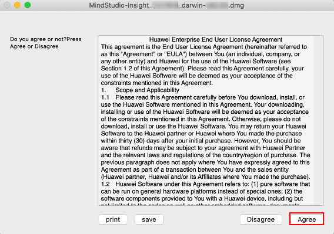
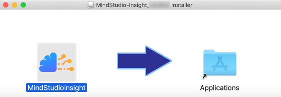

# Installing, Upgrading, and Uninstalling MindStudio Insight on macOS

## Installing MindStudio Insight

### Installation Operation (macOS)

**Environment Setup**

Prepare a macOS system running macOS Ventura 13.5 or later.

**Procedure**

1. Double-click the **MindStudio-Insight\__\{version\}_\_macos-_\{arch\}_.dmg** software package to enter the license agreement page, and click **Agree**, as shown in [**Figure 1** License Agreement](#license-agreement).

    **Figure 1** License Agreement
    

2. In the **Installer** dialog that appears, drag the MindStudio Insight app to the **Applications** folder, as shown in [**Figure 2** Drag app to folder](#drag-app-to-folder).

    **Figure 2** Drag app to folder
    

3. Double-click the MindStudio Insight app in **Applications** to open the MindStudio Insight tool.

> [!NOTE]
>
> - When running the MindStudio Insight app on some macOS systems, you may encounter a situation where MindStudio Insight cannot be opened.  If a dialog appears indicating that MindStudio Insight cannot be opened when you run MindStudio Insight, click **OK** in the dialog message, then go to **System Settings** \> **Privacy & Security** \> Security and select **App Store & Known Developers**. In the "MindStudio Insight was blocked to protect your Mac" message that appears, click **Open Anyway** to grant execution permission. Double-click the MindStudio Insight app again. When the dialog indicating that MindStudio Insight cannot be opened appears, click **Open** in the dialog to open the MindStudio Insight tool normally.
> - If you need to open multiple MindStudio Insight tools simultaneously on a macOS system, you can run the `open -n /Applications/MindStudio Insight.app` command in a cmd window. However, it is not recommended to open the same data in two MindStudio Insight windows at the same time to avoid data parsing issues.

## Upgrading MindStudio Insight

If you need to upgrade MindStudio Insight, you must first uninstall the currently installed MindStudio Insight, then obtain the latest MindStudio Insight software package and reinstall it.

Based on your actual scenario, refer to [Uninstalling MindStudio Insight](#uninstalling-mindstudio-insight) to complete the uninstallation, and then reinstall the latest MindStudio Insight software package.

## Uninstalling MindStudio Insight

### Uninstallation (macOS)

1. Locate MindStudio Insight.
2. Right-click the MindStudio Insight app to bring up the menu bar.
3. Click **Move to Trash** to uninstall.
