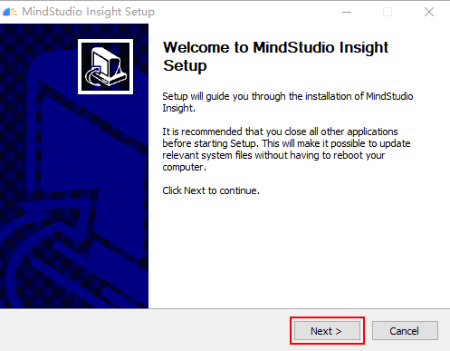
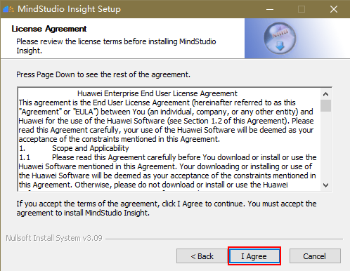
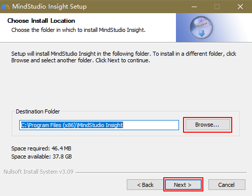
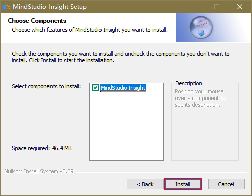
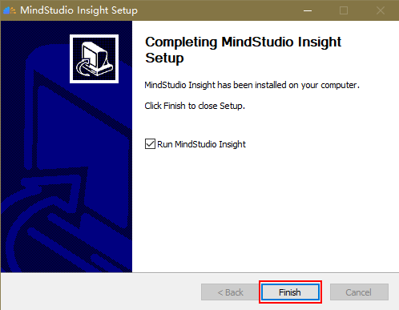
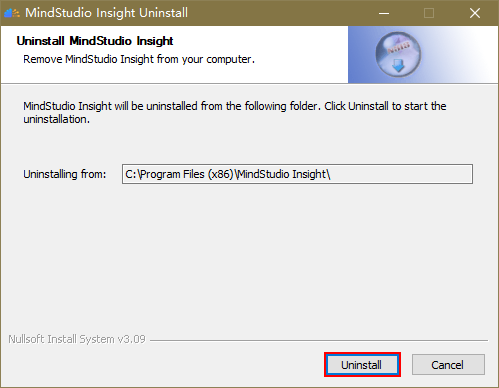
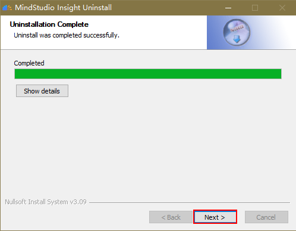
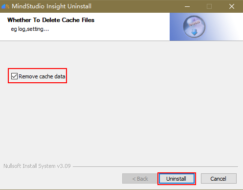
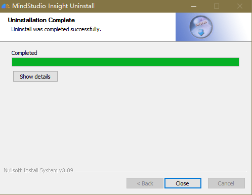

# Installing, Upgrading, and Uninstalling MindStudio Insight on Windows

## Installing MindStudio Insight

<h3 id="installation-operation-windows">Installation Operation (Windows)</h3>

**Environment Preparation**

The installation and visualization of the MindStudio Insight tool have certain requirements for the Windows system and device configuration. See [**Table 1** System Configuration Requirements](#system-configuration-requirements).

**Table 1** System configuration requirements

| Category   | Requirement                           | Description                                                  |
|--|--|--|
| System     | Windows 10 64-bit operating system    | -                                                            |
| Memory     | 16 GB or above recommended            | For large model cluster scenarios, the amount of data loaded is large. |
| Disk space | 30 GB or above free space recommended | Used to store database files generated when loading profile data. |

**Installation Steps**

1. Double-click the **MindStudio-Insight\__\{version\}_\_win.exe** package to start installing MindStudio Insight.
2. The MindStudio Insight Setup screen appears. Click **Next**, as shown in [**Figure 1** Setup](#Setup).

    **Figure 1** Setup
    

3. On the **License Agreement** page, click **I Agree**, as shown in [**Figure 2** License-Agreement](#License-Agreement).

    **Figure 2** License-Agreement
    

4. Select the installation path for MindStudio Insight and click **Next**, as shown in [**Figure 3** Select Installation Path](#select-installation-path).

    **Figure 3** Select Installation Path
    

    > [!NOTE]
    >
    > The default installation directory is **C:\Program Files (x86)\MindStudio Insight**. If you choose to install to another directory, to prevent other users from modifying the runtime files, you need to revoke the modification permission of ordinary users. Right-click the selected folder, choose **Properties** > **Security**, and modify user permissions on the **Security** tab.

5. Select the installation component MindStudio Insight and click **Install**, as shown in [**Figure 4**  Select installation components](#select-installation-components).

    **Figure 4**  Select installation components
    

6. Complete the MindStudio Insight installation and click **Finish**, as shown in [**Figure 5**  Complete installation](#complete-installation).

    **Figure 5**  Complete installation 
    

7. Start MindStudio Insight.

    - If you selected **Run MindStudio Insight** in [6](#6), MindStudio Insight will start automatically after you click **Finish**.
    - If you did not select **Run MindStudio Insight**, after the installation is complete, double-click the MindStudio Insight shortcut icon on the desktop, or double-click **MindStudio-Insight.exe** in the installation directory to start the MindStudio Insight tool.

> [!NOTE]
>
> If a "Missing Dependencies" error dialog box appears when you run the MindStudio Insight tool after installation, see [Missing Dependencies Error Dialog Box When Running MindStudio Insight Tool](../support/faq.md#faq-missing-dependencies) for resolution.

## Upgrading MindStudio Insight

If you need to upgrade MindStudio Insight, you must first uninstall the currently installed MindStudio Insight, then obtain the latest MindStudio Insight software package and reinstall it.

Based on your actual scenario, refer to [Uninstalling MindStudio Insight](#uninstalling-mindstudio-insight) to complete the uninstallation, and then reinstall the latest MindStudio Insight software package.

## Uninstalling MindStudio Insight

<h3 id="uninstallation-windows">Uninstallation (Windows)</h3>

1. Go to the MindStudio Insight installation directory, double-click **Uninstall.exe**, and the uninstall interface is displayed. Click **Uninstall** to uninstall, as shown in [**Figure 6** MindStudio Insight uninstall interface](#mindstudio-insight-uninstall-interface).

    **Figure 6** MindStudio Insight uninstall interface
    

2. Click **Next**.

    **Figure 7** Uninstall
    

3. Select **Remove cache data** to clear cache data, and click **Uninstall**.

    **Figure 8** Clear cache data
    

4. Complete the uninstallation.

    **Figure 9** Uninstallation completed
    
