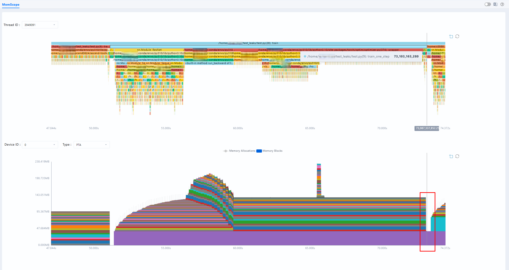
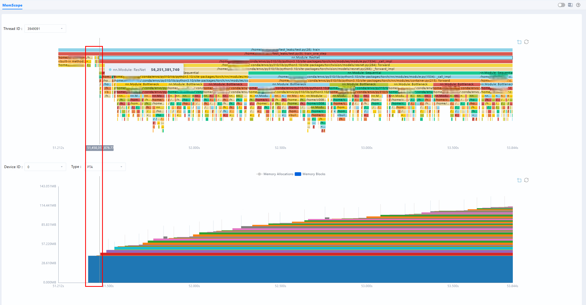
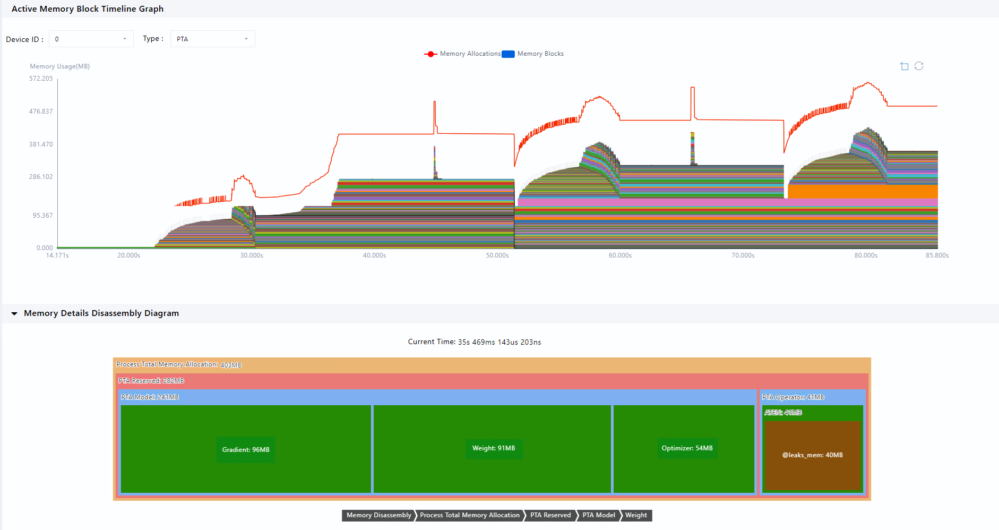
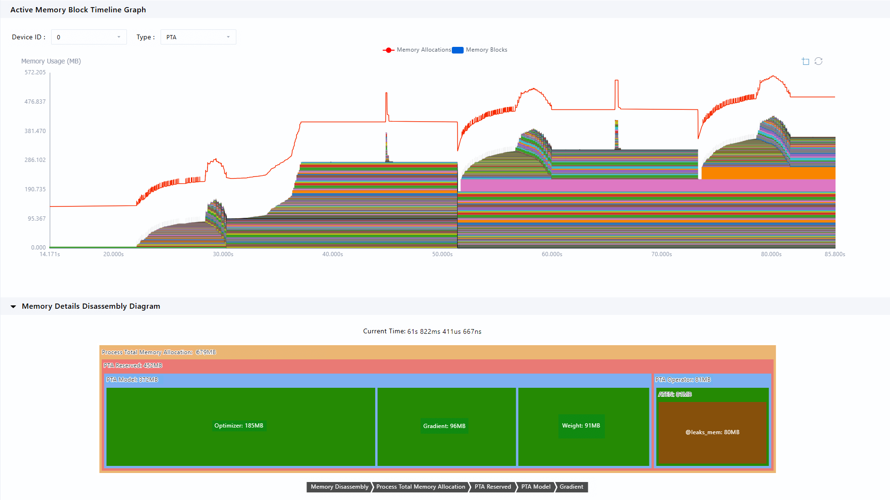
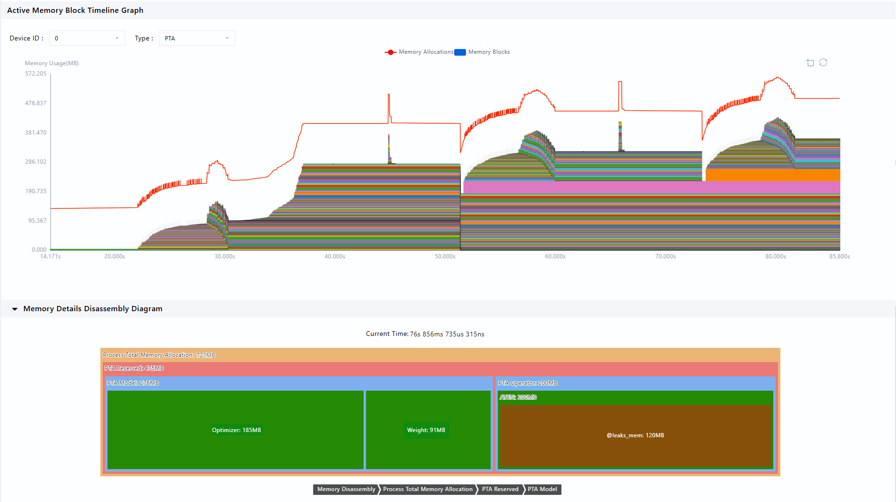

# **Memory Issue Analysis Cases**

## Overview

Memory issues are common in Ascend full-stack development activities. However, due to the complex software stack layers involved in memory issues (including the OS driver and runtime library, CANN, MindSpore/PyTorch_NPU, model training, and model inference), it is often challenging to locate and resolve these issues. For details about typical memory issue categories, see [**Table 1** Memory issue categories](#memory-issue-categories).

This document describes how to use MindStudio Insight to locate memory issues.

**Table 1** Memory issue categories <a id="memory-issue-categories"></a>

|Issue Category|Symptom|Scenario|
|--|--|--|
|Memory corruption|The precision is abnormal or NaN occurs, which usually occurs on the device.|Training, inference, and operator development|
|Excessive memory usage|Excessive memory usage is usually related to the following two situations:<br> - Memory leak or out of memory (OOM): The memory usage on the host or device keeps increasing or even OOM occurs.<br> - Great difference from the expected or baseline value: Actual measured memory usage far exceeds the expected or baseline data, with differences potentially reaching gigabytes. This behavior is typically observed on the device.|Training and inference|

**Analysis Process**

For excessive memory usage or OOM on the device, the issue analysis process is as follows:

1. Use the profiling tools to collect profile data and import the data to MindStudio Insight.
2. On the **Memory** page, view the memory curve and memory allocation/release details of operators or components in the memory analysis area to perform basic analysis and determine the exception scope, step, or operator.
3. Use the memory tool (msMemScope) to collect memory details and memory disassembly data within the exception scope, and import the data to MindStudio Insight.
4. On the memory details (msMemScope) page, analyze the memory usage based on the call stack flame graph, Memory Block Timeline Graph, and Memory Details Table.

## Preparation

**Preparing Software**

- Download and install MindStudio Insight. For details, see [MindStudio Insight Installation Guide](../../install_guide/mindstudio_insight_install_overview.md).
- Install the msMemScope tool. For details, see [msMemScope Installation Guide](https://gitcode.com/Ascend/msmemscope/blob/master/docs/en/install%5Fguide/install%5Fguide.md).

**Preparing Data**

The following collects memory leak data.

1. Use the msMemScope tool to run the following command to allocate a 4 x 10 MB tensor in each step and add it to the global variable `leak\_mem\_list` (which will not be released with `train\_one\_step`). Collect Python trace data of three steps.

    ```shell
    msmemscope --level=0,1 --events=alloc,free,access,launch --analysis=decompose --data-format=db python test.py
    ```

    The sample code of `test.py` is as follows:

    ```python
    import torch
    import torch_npu
    from torchvision.models import resnet50
    import msmemscope
    import msmemscope.describe as describe
    leak_mem_list = []
    def train_one_step(model, optimizer, loss_fn, device):
        # Mark the code block. The owner attribute of all memory allocation events in the code block will be labeled as leaks_mem
        describe.describer(owner="leaks_mem").__enter__()
        # Memory leak code segment
        leak_mem_list.append(torch.randn(1024 * 1024 * 10, dtype=torch.float32).to(device))
        # End marker
        describe.describer(owner="leaks_mem").__exit__(None, None, None)
        # Single training code segment
        inputs = torch.randn(1, 3, 224, 224).to(device)
        labels = torch.rand(1, 10).to(device)
        pred = model(inputs)
        loss_fn(pred, labels).backward()
        optimizer.step()
        optimizer.zero_grad()
    def train(model, optimizer, loss_fn, device, steps=1):
        for i in range(steps):
            train_one_step(model, optimizer, loss_fn, device)
    device = torch.device("npu:0")
    torch.npu.set_device(device)  # Set the device.
    model = resnet50(pretrained=False, num_classes=10).to(device)  # Load the model
    optimizer = torch.optim.Adam(model.parameters(), lr=1e-2)  # Define the optimizer
    loss_fn = torch.nn.CrossEntropyLoss()  # Define the loss function

    # Enable the collection of Python function call data
    msmemscope.tracer.start()
    train(model, optimizer, loss_fn, device, steps=3)  # Start training

    # Disable the collection of Python function call data
    msmemscope.tracer.stop()
    ```

2. After the collection is complete, a file in .db format is generated.
3. Download the file to the local host.

## Memory Analysis

**Importing Data**

1. Open MindStudio Insight and click **Import Data** in the navigation tree on the left.
2. In the displayed **File Explorer** dialog box, select the .db file to be imported.
3. After the import is successful, the **Leaks** page is displayed.

**Memory Analysis**

1. Open the **Leaks** page and view the call stack flame graph and Memory Block Timeline Graph.
2. Click and drag the mouse to box-select the step 2 area in the Memory Block Timeline Graph, and release the mouse button to zoom in on the area.

    As shown in [**Figure 1** Unreleased memory blocks](#unreleased-memory-blocks), there is still an unreleased memory block when step 2 ends.

    **Figure 1** Unreleased memory blocks <a id="unreleased-memory-blocks"></a>

    

3. The call stack flame graph shows that the memory block comes from a tensor object and is allocated before the forward propagation starts, as shown in [**Figure 2** Tensor object](#tensor-object)

    **Figure 2** Tensor object <a id="tensor-object"></a>

    

4. When cross-referencing the `leaks\_mem` segment against the Memory Details Disassembly Diagram, a clear increasing trend is detected within the segment. From step 1, the memory usage of the `leaks\_mem` segment is 40 MB for the first time, as shown in [**Figure 3** Checking the memory usage in step 1](#checking-the-memory-usage-in-step-1).

    **Figure 3** Checking the memory usage in step 1 <a id="checking-the-memory-usage-in-step-1"></a>

    

    As shown in [**Figure 4** Checking the memory usage in step 2](#checking-the-memory-usage-in-step-2), the `leaks_mem` memory usage in step 2 increases from 40 MB to 80 MB.

    **Figure 4** Checking the memory usage in step 2 <a id="checking-the-memory-usage-in-step-2"></a>

    

    As shown in [**Figure 5** Checking the memory usage in step 3](#checking-the-memory-usage-in-step-3), the `leaks_mem` memory usage in step 3 increases from 80 MB to 120 MB.

    **Figure 5** Checking the memory usage in step 3 <a id="checking-the-memory-usage-in-step-3"></a>

    
