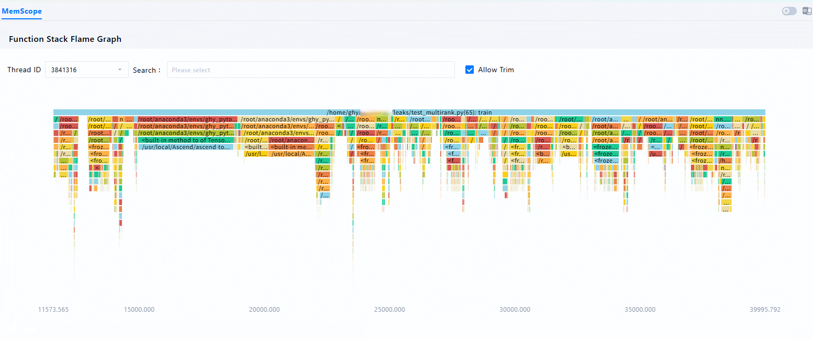
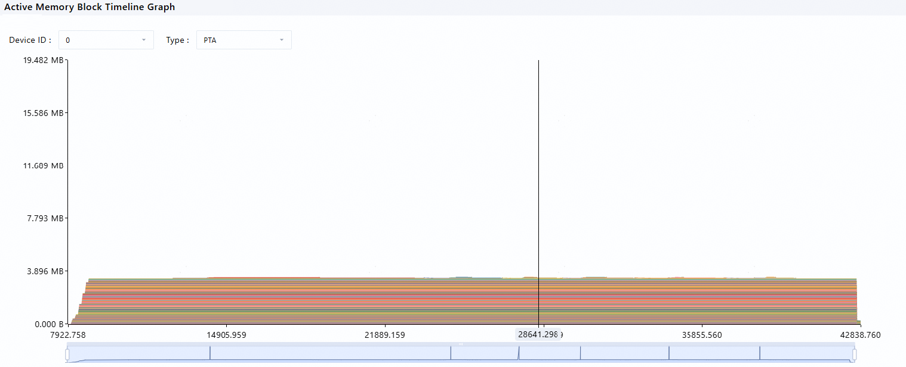
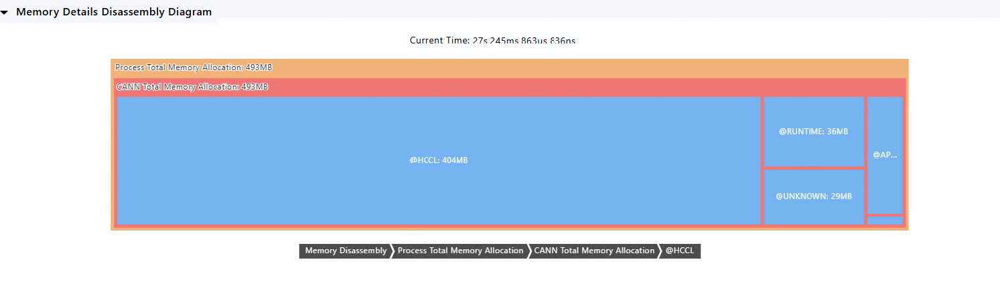
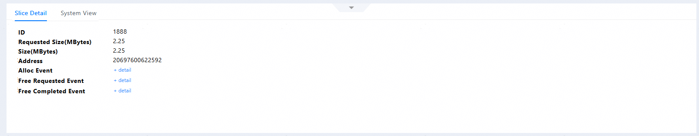
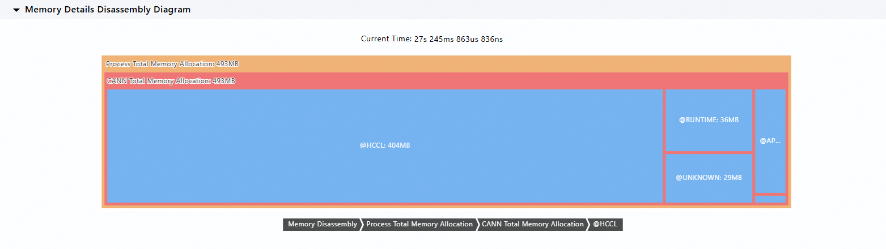
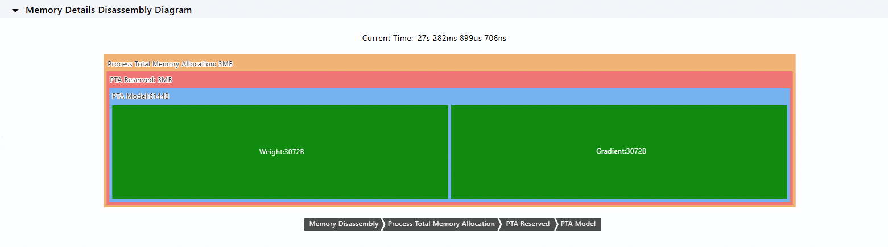
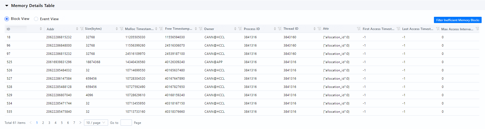
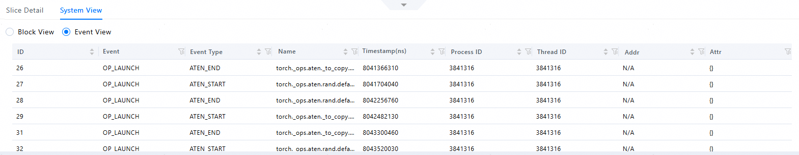
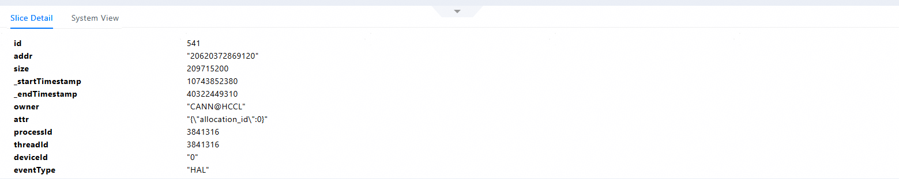

# **MindStudio Insight Memory Tuning (MemScope)**

## Overview

MindStudio Insight displays the detailed memory allocation on the device in graphics. Currently, two types of memory data sources are supported:

### MemScope Data Source

Based on the visualization of the memory allocation and release lifetime, the tool marks the details of various memory allocations using the **Python call stack** and **customized tracing labels**, to locate memory problems, **analyze peak values**, and **identify inefficient memory blocks** to achieve the tuning objective.

## Preparations

### Collecting MemScope Data

**Environment Setup**

Install MindStudio Insight first. For details, see [MindStudio Insight Installation Guide](../../install_guide/mindstudio_insight_install_guide.md).

Install the msMemScope tool. Before installation, ensure that the following conditions are met:

- The CANN toolkit (version 7.0 or later) has been installed and the environment variables have been configured.
- Python version >= 3.8

Installation command:

```shell
pip install msmemscope
```

For more installation methods, see [msMemScope Tool Installation Guide](https://gitcode.com/Ascend/msmemscope/blob/master/docs/en/install%5Fguide/install%5Fguide.md).

**Data Collection**

Data for memory tuning scenarios is collected and generated by the msMemScope tool, which supports the following collection methods.

| Collection Method | Applicable Scenario | Collection Command Example | Generated File |
| --- | --- | --- | --- |
| Command line | General command-line approach, applicable to multiple frameworks | `msmemscope --output=./output python train.py` | memscope_dump_{timestamp}.db |
| Python API | Custom collection scope and parameters | See [msMemScope Python API Collection](https://gitcode.com/Ascend/msmemscope/blob/master/docs/en/user_guide/memory_profile.md#collection-via-python-apis) | memscope_dump_{timestamp}.db |
| mstx instrumentation | Combined with mstx instrumentation capability | See [msMemScope mstx Instrumentation Collection](https://gitcode.com/Ascend/msmemscope/blob/master/docs/en/user_guide/memory_profile.md#collection-via-mstx-instrumentation) | memscope_dump_{timestamp}.db |

> [!NOTE]
>
> - `--events` must include at least the `alloc` and `free` events; otherwise, the Memory Block Timeline Graph cannot be generated.
> - The Memory Details Disassembly Diagram is generated only when `--analysis` value includes `decompose`.
> - For more collection parameters and usage, see [msMemScope User Guide](https://gitcode.com/Ascend/msmemscope/blob/master/docs/en/user%5Fguide/memory%5Fprofile.md).

**Importing Data**

After collection is complete, import the generated db-format file into the MindStudio Insight tool. For data import operations, see [Importing Data](../basic_operations.md#importing-data).

## Data Description

### MemScope Data Description

You can import the memory result files in DB format collected by the msMemScope tool to display related content in graphics. For details about how to obtain the DB file, see [Collection via CLI](https://gitcode.com/Ascend/msmemscope/blob/master/docs/en/user_guide/memory_profile.md#collection-via-cli) in the *msMemScope Memory Collection*. For details about the memory data that can be imported, see [**Table 1** Data visualization dependencies](#data-visualization-dependencies).

**Table 1** Data visualization dependencies <a id="data-visualization-dependencies"></a>

<style type="text/css">

</style>
<table class="tg"><thead>
  <tr>
    <th class="tg-0lax">File Name</th>
    <th class="tg-0lax">Description</th>
    <th class="tg-0lax">Displayed Content</th>
  </tr></thead>
<tbody>
  <tr>
    <td class="tg-0pky" rowspan="3">memscope_dump_{timestamp}.db</td>
    <td class="tg-0lax">The value of <code>--events</code> must contain at least the alloc and free events.</td>
    <td class="tg-0pky">Memory block lifetime chart (memory allocation/release curve and memory block chart)</td>
  </tr>
  <tr>
    <td class="tg-0lax">The value of <code>--analysis</code> contains <code>decompose</code>.</td>
    <td class="tg-0lax">Memory details chart</td>
  </tr>
  <tr>
    <td class="tg-0lax">The tracer function is enabled using the Python API.</td>
    <td class="tg-0pky">Python call stack chart</td>
  </tr>
</tbody>
</table>

## Memory Details

### MemScope Data Memory Details

#### Function Description

During memory tuning, MindStudio Insight displays the memory status through the Python call stack and memory block lifetime charts, allowing developers to conveniently analyze and locate memory issues.

#### GUI Description

The memory details (msMemScope) page consists of the Call Stack Flame Graph (area 1), Memory Block Timeline Graph (area 2), Memory Details Disassembly Diagram (area 3), and Memory Details Table (area 4).

- Area 1: Call Stack Flame Graph. By selecting a thread ID, the corresponding Python call stack diagram is displayed. Enter a function name to search in the "Search" input box, or click the drop-down box to select a function name. Multiple function names can be selected for searching, and the searched functions will be highlighted in the call stack graph, as shown in [**Figure 1** Call Stack Flame Graph](#call-stack-flame-graph).

  > [!NOTE]
  >
  > By default, the **Allow Trim** option is selected in this area. In this state, the tool compresses data without affecting the overall data display, improving the tool usability.

  **Figure 1**  Call Stack Flame Graph<a id="call-stack-flame-graph"></a>

  

- Area 2: The Memory Block Timeline Graph displays the memory allocation/release line graph and memory block graph. You can select a color block in the memory block chart to view details about the memory block. You can also select a device ID and type to view the corresponding memory block timeline graph, as shown in [**Figure 2** Memory Block Timeline Graph](#memory-block-timeline-graph).

  The chart contains three trend lines to help you analyze the data, described as follows:
  1. **reserved trend line**: AI framework level. The total size of the cache pool requested from the driver for secondary allocation (for example, for tensors);
  2. **process_used trend line**: Process-level total memory usage, including the reserved data;
  3. **device_used trend line**: Device-level total memory usage, including the process_used data.

  **Figure 2**  Memory Block Timeline Graph<a id="memory-block-timeline-graph"></a>

  

- Area 3: The Memory Details Disassembly Diagram is not displayed by default. When you hover the mouse pointer over the call stack flame graph or Memory Block Timeline Graph, a timeline is displayed. In the Memory Block Timeline Graph area, click the timeline to view the memory details disassembly graph at the corresponding time point. After the memory details disassembly graph is displayed, you can click the button in the upper left corner to hide or display the graph, as shown in [**Figure 3** Memory Details Disassembly Diagram](#memory-details-disassembly-diagram).

  **Figure 3**  Memory Details Disassembly Diagram<a id="memory-details-disassembly-diagram"></a>

  

- Area 4: The Memory Details Table is classified into **Block View** and **Event View** for your selection, as shown in [**Figure 4**  Memory Details Table](#memory-details-table). For details, see [Memory Details](#memory-details).

  **Figure 4**  Memory Details Table<a id="memory-details-table"></a>

  

#### Usage Description

**The call stack flame graph and Memory Block Timeline Graph can be used to view data within a specified time range.**

In the call stack flame graph and Memory Block Timeline Graph of MindStudio Insight, you can select a range by dragging the zoom slider in the trend chart to display data within a specified range, as shown in [**Figure 5** Zoom slider in the trend chart](#zoom-slider-in-the-trend-chart).

**Figure 5** Zoom slider in the trend chart <a id="zoom-slider-in-the-trend-chart"></a>


**The zoom slider in the trend chart supports trend chart visualization and diversified operations on the time domain.**

1. Trend chart visualization:

    The background of the zoom slider in the trend chart of MindStudio Insight displays the trend of the memory usage (Operator Allocated) in the overall time range, and intuitively displays the memory usage trend in the selected time range.

    > [!NOTE]
    >
    >The Operator Allocated curve indicates the change trend of the allocated memory collected when the operator allocates or releases the memory. It represents the total allocated memory of all operators.

2. Diversified operations on the time domain:

  - You can use the left and right arrow keys to select the start time and end time and view the memory usage.
  - You can select any range in the trend chart to select a time range and display the corresponding memory usage.
  - You can set a fixed time length and drag left or right to view the memory usage in the fixed time length.

**The Memory Block Timeline Graph and Memory Details Disassembly Diagram support dragging and zooming**

The maximum zoom ratio of the Memory Block Timeline Graph is determined by the viewport size and the precision of the data coordinates. After the upper limit is reached, continuing to zoom in keeps the current view; you can still zoom out or reset. When a too-small time range is selected on the thumbnail axis, it is automatically expanded to a range that can be displayed stably, and the linked views are updated accordingly.

 - The Memory Block Timeline Graph and Memory Details Disassembly Diagram support moving the view by dragging and zooming by scrolling.
 - The Memory Block Timeline Graph supports selecting a zoom mode through the button in the upper-right corner of the view. Two modes are available: horizontal zoom and proportional zoom. The default is proportional zoom:

   - Horizontal Zoom: Only the horizontal time axis is zoomed. After selection, use the `Shift` key + `↑` key/`↓` key to zoom horizontally.
   - Proportional Zoom: The entire view is zoomed proportionally. After selection, use the `Ctrl` key + `↑` key/`↓` key to zoom proportionally.

**Memory Details Disassembly Diagram**

When you hover the mouse pointer over the call stack flame graph or Memory Block Timeline Graph, a timeline is displayed. In the Memory Block Timeline Graph area, click the timeline to view the Memory Details Disassembly Diagram at the corresponding time point below the Memory Block Timeline Graph, helping you view the memory usage. The content displayed in Memory Details Disassembly Diagram varies depending on the selected type.

To view a specified memory layer, click the layer bar below Memory Details Disassembly Diagram.

- When the type is set to HAL, Memory Details Disassembly Diagram displays only the memory data classified at the CANN layer, as shown in [**Figure 6** Memory Details Disassembly Diagram at the CANN layer](#memory-details-disassembly-diagram-at-the-cann-layer).

    **Figure 6** Memory Details Disassembly Diagram at the CANN layer <a id="memory-details-disassembly-diagram-at-the-cann-layer"></a>

    

- If **Type** is set to a value other than **HAL**, Memory Details Disassembly Diagram displays the memory type and layer of the memory pool on the corresponding framework. For example, if **Type** is set to PTA, Memory Details Disassembly Diagram displays only the memory information of the PTA framework, as shown in [**Figure 7** Memory Details Disassembly Diagram of the PTA framework](#memory-details-disassembly-diagram-of-the-pta-framework).

    **Figure 7** Memory Details Disassembly Diagram of the PTA framework <a id="memory-details-disassembly-diagram-of-the-pta-framework"></a>

    

> [!NOTE]
>
> You can drag the Memory Details Disassembly Diagram leftward, rightward, upward, and downward, and zoom in or out the diagram.
>
> - Place the cursor on the diagram and hold down the left mouse button to drag the diagram left, right, up, or down.
> - On the Memory Details Disassembly Diagram, you can use the mouse wheel to zoom in or out the diagram. Alternatively, you can select a memory block and left-click to zoom in on the selected memory layer.

<a id="memory-details"></a>

**Memory Details**

The Memory Details Table area displays memory details by **Block View** and **Event View**. By default, all memory information is displayed.

> [!NOTE]
>
> - The memory details are hidden by default. To view the details, click the expand button to display the memory details. If you do not need to view the memory details, click the collapse button to hide the memory details.
> - Filter is supported for the **Size**, **Malloc Timestamp**, and **Free Timestamp** fields in **Block View**, and the **Timestamp** field in **Event View**. After you click , you can enter integers between **0** and the value displayed in the table to set the minimum and maximum values of the filter range.

- **Block View**: displays detailed information about memory blocks, as shown in [**Figure 8** Block View](#block-view). For details about the fields, see [**Table 2** Block View fields](#block-view-fields).

    When you select different device IDs and types in the Memory Block Timeline Graph, the information displayed in the memory block view is updated accordingly. When you select an area in the Memory Block Timeline Graph, the information displayed in the memory block view is also updated accordingly, showing information about all memory blocks that overlap with the selected time range.

    To filter inefficient memory blocks, you can click **Filter Inefficient Memory Blocks** in the upper right corner of the **Block View** table, and set thresholds for early request, delayed release, or long idle period.

    **Figure 8** Block View <a id="block-view"></a>

    

    **Table 2** Block View fields <a id="block-view-fields"></a>

    |Field|Description|
    |--|--|
    |ID|Memory Block ID – a unique identifier for each memory block. Clicking it navigates to the corresponding block in the call stack flame graph and highlights it.|
    |Addr|Memory block address, which corresponds to the address of the memory request, release, or access event.|
    |Size(KBytes)|Size of the memory block, which corresponds to the memory request event. The unit is KBytes.|
    |Malloc Timestamp(ns)|Time when the memory block is requested, which corresponds to the memory request event. The unit is nanoseconds.|
    |Free Timestamp(ns)|Time when the memory block is released, which corresponds to the memory release event. The unit is nanoseconds.|
    |Owner|Memory block owner.|
    |Process ID|Memory block process ID, which corresponds to the process ID of the memory request or release event.|
    |Thread ID|Memory block thread ID, which corresponds to the thread ID of the memory request or release event.|
    |First Access Timestamp(ns)|Time of the first access event.|
    |Last Access Timestamp(ns)|Time of the last access event.|
    |Max Access Interval(ns)|Maximum interval of access events.|
    |Attr|Extended attributes:<br> - **allocation_id**: ID for the request, access, or release sequence of a memory block. It uniquely identifies a group of memory events.<br> - **lazy_used**: early request. The value can be **true** or **false**. **true** indicates that the scenario has been detected.<br> - **delayed_free**: delayed release. The value can be **true** or **false**. **true** indicates that the scenario has been detected.<br> - **long_idle**: long idle period. The value can be **true** or **false**. **true** indicates that the scenario has been detected.|

  > [!NOTE]
  >
  > - If the imported data is collected by the msMemScope tool of a version earlier than MindStudio 8.2.RC1 or no access event is collected, **allocation\_id** is displayed as **0**, **First Access Timestamp\(ns\)** and **Last Access Timestamp\(ns\)** are displayed as **-1**, and **Max Access Interval\(ns\)** is displayed as **0**.
  > - Currently, the msMemScope tool can collect memory access events only in the ATB and Ascend for PyTorch operator scenarios. Therefore, **First Access Timestamp\(ns\)**, **Last Access Timestamp\(ns\)**, and **Max Access Interval\(ns\)** are available only in these scenarios. In other scenarios, **First Access Timestamp\(ns\)** and **Last Access Timestamp\(ns\)** are displayed as **-1**, and **Max Access Interval\(ns\)** is displayed as **0**.

- **Event View**: displays detailed information about memory events, as shown in [**Figure 9** Event View](#event-view). For details about the fields, see [**Table 3** Event View fields](#event-view-fields).

    When you select different device IDs in the Memory Block Timeline Graph, the information displayed in the event view is updated accordingly. When you select a specific area in the Memory Block Timeline Graph, the information in the event view is also updated, displaying all memory events within the selected time range.

    **Figure 9** Event View <a id="event-view"></a>

    

    **Table 3** Event View fields <a id="event-view-fields"></a>

    |Field|Description|
    |--|--|
    |ID|Event ID, which, together with **Process ID**, uniquely identifies an event.|
    |Event|Events recorded by msMemScope.|
    |Event Type|Event subtypes.|
    |Name|Event name, which is related to the value of **Event**.|
    |Timestamp(ns)|Time when a memory event occurs.|
    |Process ID|Process information.|
    |Thread ID|Thread ID.|
    |Addr|Memory address.|
    |Attr|Memory event attribute. Each event type has its own attribute.|
    |Call Stack(Python)|Python call stack. This field is displayed only when the information is collected.|
    |Call Stack(C)|C call stack. This field is displayed only when the information is collected.|

    > [!NOTE]
    >
    > For details about the values of **Event**, **Event Type**, and **Name** fields, see the description of the **msmemscope\_dump\_\{timestamp\}.csv** result file in section [Collection via CLI](https://gitcode.com/Ascend/msmemscope/blob/master/docs/en/user_guide/memory_profile.md#collection-via-cli) in *msMemScope Memory Collection*.

- **Slice Detail**: displays details about the memory block, as shown in [**Figure 10** Slice Detail](#slice-detail).

    When you click the view of any time point in the Memory Block Timeline Graph, the displayed information in the **Slice Detail** area is updated accordingly.

    **Figure 10** Slice Detail <a id="slice-detail"></a>

    
