# **MindStudio Insight Memory Tuning (PyTorch Snapshot)**

## Overview

### PyTorch Snapshot Data Source

Based on the visualization of the memory allocation and release lifetime, the tool locates and tunes memory fragmentation problems based on the **memory pool allocation status**.

> [!NOTE]
>
>The PyTorch Snapshot function is referred to as the memory snapshot function in this document.

## Preparations

### Collecting PyTorch Snapshot Data

#### Basic Collection Process

torch_npu provides APIs for collecting memory snapshots. The basic collection process is as follows:

1. Enable the memory history function. Before running the model code, call `torch_npu.npu.memory._record_memory_history()` to enable the memory history function. This function records memory allocation and release events and stack information.
2. Run the target code, that is, the model code for analyzing the memory usage scenario (such as training or inference).
3. Export the memory snapshot. After the code execution is complete, call `torch_npu.npu.memory._dump_snapshot("snapshot.pickle")` to save the memory snapshot as a `pickle` file.

|Core API Parameters|Description|
|--|--|
|`torch_npu.npu.memory._record_memory_history()` function parameters|- `enabled`: Controls the scope of recorded content. `None` disables recording; `state` records only current allocations; `all` records all memory allocation/deallocation events (default).<br>- `context`: Controls the scope of recorded stack information. `None` does not record; `state` records only current allocations; `alloc` additionally records allocation operation stacks; `all` additionally records deallocation operation stacks (default).<br>- `stacks`: Controls the stack depth. `python` includes Python/TorchScript/inductor; `all` additionally includes C++ (default).<br>- `max_entries`: Limits the number of recorded memory events. Default is `9223372036854775807` (no limit).<br>- `device`: Optional parameter that specifies the device for which to record memory history.|
|`torch_npu.npu.memory._dump_snapshot(file_path)` function parameters|- `file_path`: specifies the path of the file that stores the memory snapshot. The file format is `pickle`.|

The following is an example of the code for collecting **PyTorch Snapshot (memory snapshot)** data:

```python
import torch
import torch_npu

# Enable the memory history to record all events and stack information.
torch_npu.npu.memory._record_memory_history(stacks='python')

# Run the model code.
def run_model():
    # Model definition and training/inference code
    model = torch.nn.Linear(1000, 1000).cuda()
    input = torch.randn(1000, 1000).cuda()
    output = model(input)
    loss = output.sum()
    loss.backward()

run_model()

# Export memory snapshot.
torch_npu.npu.memory._dump_snapshot("model_memory_snapshot.pickle")
```

## Data Description

### PyTorch Snapshot Data Description

PyTorch Memory Snapshot is a memory snapshot function provided by PyTorch. It is used to record and analyze the memory usage of the memory pool managed by PyTorch during model running. For details about the original data of memory snapshot, see [Memory Snapshot Use Cases](https://gitcode.com/Ascend/pytorch/blob/v2.7.1-26.0.0/docs/en/framework_feature_guide_pytorch/memory_snapshot.md#use-cases) in *Memory Snapshot*.

**Common Memory Problems**

  - Memory leak, overflow, or reallocation: During model training or inference, the memory usage keeps increasing step by step or request by request until an avalanche occurs (APP or PTA reserved memory suddenly decreases after reaching a certain point) or out of memory (OOM) occurs.

  - Memory fragmentation: During model training, there is a large gap between the operator reservation and operator allocation curves.

  - Peak memory tuning: During model training, the peak memory needs to be analyzed to determine which operators or tensors cause the peak memory. Then evaluate whether the memory peak can be reduced by adjusting the allocation order of tensors or the execution order of operators.

> [!NOTE]
>
>The preceding common memory problems occur when the memory tab page is displayed on the **System Tuning** page after profile data is collected.

## Memory Details

### PyTorch Snapshot Data Memory Details (Memory Snapshot)

#### Description

Based on the visualization of the memory allocation and release lifetime, the tool locates and tunes memory fragmentation problems based on the **memory pool allocation status**.

#### GUI Description

The **PyTorch Snapshot** page consists of the Memory Block Timeline Graph (area 1), Memory Pool Status Graph (area 2), and Memory Details Table (area 3).

- Area 1: As shown in [**Figure 1** Memory Snapshot Memory Block Timeline Graph](#memory-snapshot-memory-block-timeline-graph). The Memory Block Timeline Graph displays the reserved line chart, the memory allocation/deallocation line chart, and the memory block diagram. Selecting a colored block in the memory block diagram displays the details of that memory block, and calculates **Unreleased Total**, **Unreleased Max Block**, and **Unreleased Min Block** within the range selected by the zoom bar. The meanings of these three statistics are as follows:

  - **Unreleased Total**: the sum of the sizes of memory blocks that are **allocated but not deallocated** within the zoom bar interval.
  - **Unreleased Max Block**: the size of the **largest** memory block that is **allocated but not deallocated** within the zoom bar interval.
  - **Unreleased Min Block**: the size of the **minimum** memory block that is **allocated but not released** within the zoom bar interval.

  > [!NOTE]
  >
  > reserved line chart: a trend chart of the total PTA cache pool size (Operator Reserved), showing the change trend of the total PTA Caching pool size. It intuitively presents the actual cache pool size requested and managed by PTA from the driver, which is the sum of all segment sizes at any given moment.
  >2. reserved trend line: The trend of the total PTA cache pool size (Operator Reserved), indicating the change trend of the total PTA Caching cache pool size. It intuitively presents the size of the cache pool actually requested from and managed by the driver, which is the sum of all segment sizes at any time.

  **Figure 1** Memory Snapshot Memory Block Timeline Graph<a id="memory-snapshot-memory-block-timeline-graph"></a>

  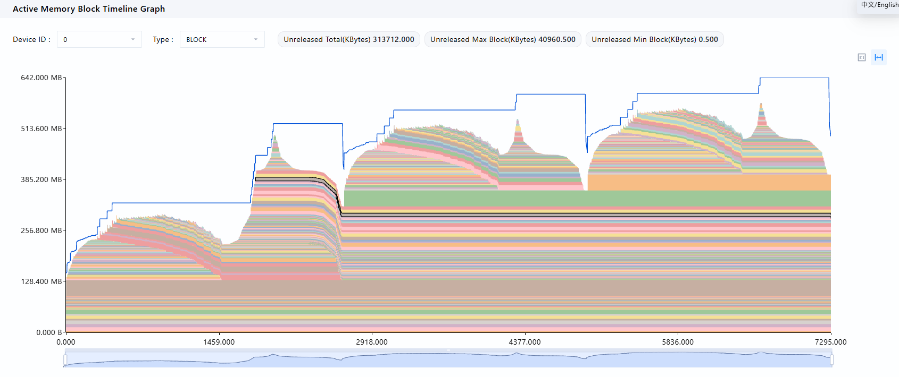

- Area 2: As shown in [**Figure 2** Memory Snapshot Memory Pool State Diagram](#memory-snapshot-memory-pool-state-diagram), when you hover the mouse pointer over the Memory Block Timeline Graph, a timeline is displayed. In the Memory Block Timeline Graph area, click the timeline to view the memory pool status graph at the corresponding time point. For details, see [Memory Pool Status Graph](#memory-pool-status-graph).

  **Figure 2** Memory Snapshot Memory Pool State Diagram<a id="memory-snapshot-memory-pool-state-diagram"></a>

  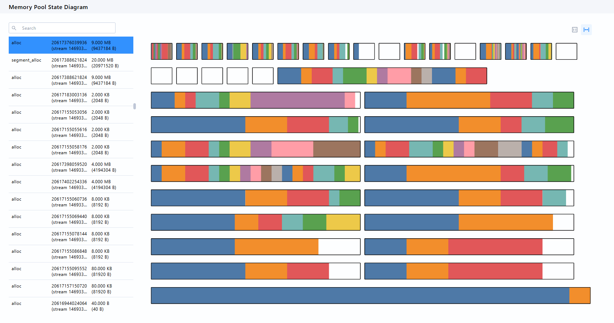

- Area 3: As shown in [**Figure 3** Memory Snapshot Detail Data](#memory-snapshot-detail-data), the memory snapshot details table is classified into **Block View** and **Event View** for your selection. For details, see [Memory Snapshot Details](#memory-snapshot-details).

  **Figure 3** Memory Snapshot Detail Data<a id="memory-snapshot-detail-data"></a>

  

#### Usage Description

**The Memory Block Timeline Graph can be used to view data within a specified time range.**

In the Memory Block Timeline Graph of MindStudio Insight, you can select a range by dragging the zoom slider in the memory snapshot trend chart to display data within a specified range, as shown in [**Figure 4** Zoom slider in the memory snapshot trend chart](#zoom-slider-in-the-memory-snapshot-trend-chart).

**Figure 4** Zoom slider in the memory snapshot trend chart <a id="zoom-slider-in-the-memory-snapshot-trend-chart"> </a>

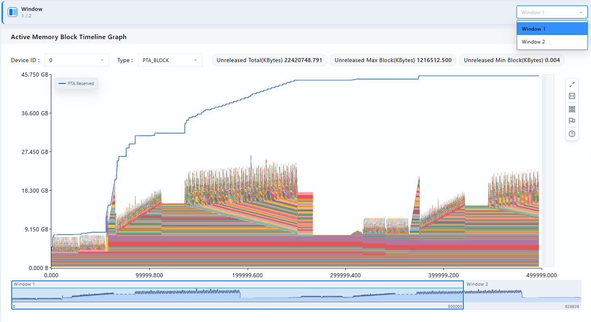

**The Memory Block Timeline Graph supports viewing data in a specified time range**

In MindStudio Insight, the Memory Block Timeline Graph displays data in a specified range by selecting an area on the memory snapshot trend chart zoom slider below, as shown in [**Figure 5** Zoom slider in the memory snapshot trend chart](#zoom-slider-in-the-memory-snapshot-trend-chart).

**Figure 5** Zoom slider in the memory snapshot trend chart <a id="zoom-slider-in-the-memory-snapshot-trend-chart"></a>

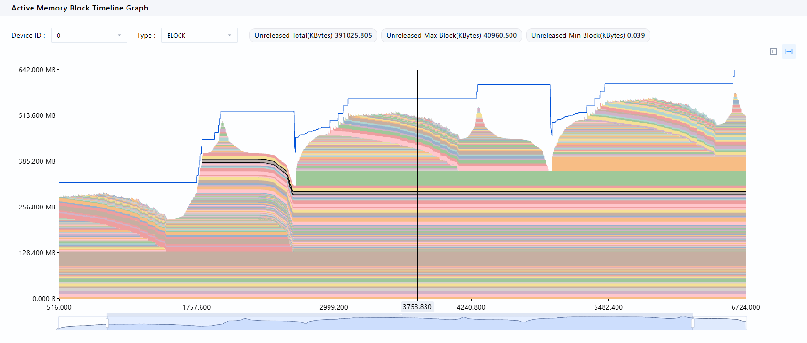

**The zoom slider in the trend chart supports trend chart visualization and diversified operations on the time domain.**

1. Trend chart visualization:

    The background of the zoom slider in the memory snapshot trend chart of MindStudio Insight displays the trend chart of the memory usage (Operator Allocated) in the overall time range, intuitively showing the trend of the entire memory usage in the selected time range.

    > [!NOTE]
    >
    >The Operator Allocated curve indicates the change trend of the allocated memory collected when the operator allocates or releases the memory. It represents the total allocated memory of all operators.

2. Diversified operations on the time domain:

    - You can use the left and right arrow keys to select the start time and end time and view the memory usage.
    - You can select any range in the trend chart to select a time range and display the corresponding memory usage.
    - You can set a fixed time length and drag the slider leftwards or rightwards to view the memory usage in the fixed time length.
    - You can select different windows through the trend chart zoom slider to display the data of different windows.

**Support for marking differences for comparison**

After hovering the mouse over a memory block in the timeline graph, press the `K` key or click the marker axis directly to mark or unmark the memory block. The mark is then displayed or hidden on the marker axis on the right side of the graph. You can mark multiple memory blocks at the same time and display the memory difference between two adjacent marks on the marker axis, as shown in the legend in [**Figure 6** Difference comparison](#difference-comparison).

**Figure 6** Difference comparison <a id="difference-comparison"></a>

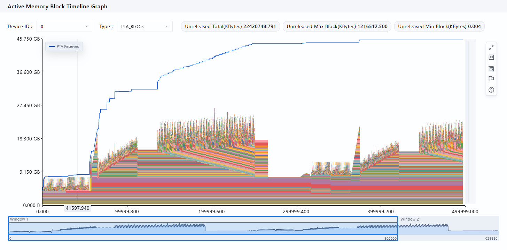

**Timeline Graph Toolbar Usage Description**

- **Zoom view**: Switch between proportional and horizontal modes through the toolbar. The scroll wheel zooms in the current mode; the `W` and `S` keys zoom horizontally, and the `Ctrl` + `W`/`S` keys zoom proportionally.
- **Pan view**: Drag the chart to pan, or use the `A`/`D` keys or the arrow keys to pan the view.
- **Reset view**: Click the reset button, or use the `R` key or the middle mouse button to restore the full view.
- **Layer management**: Click to show or hide the **memory block graph**, the **reserved trend line**, and the **difference marker** respectively. When a layer is restored, it is automatically aligned with the current viewport.
- **Difference marker**: Click the marker axis on the right to create a flag; hover over a memory block and press the `K` key to add or remove an associated flag.
- **Marker management**: Centrally rename, hide, recolor, or delete flags. Hiding the difference marker does not affect marker management.

The functions can also be triggered from the toolbar on the right side of the interface, as shown in the legend in [**Figure 7** Timeline graph toolbar guide](#timeline-graph-toolbar-guide).

**Figure 7** Timeline graph toolbar guide <a id="timeline-graph-toolbar-guide"></a>

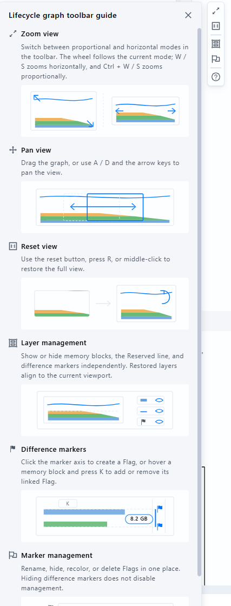

<a id="memory-pool-status-graph"></a>

**Memory Pool Status Graph Display**

When the mouse is placed in the Memory Block Timeline Graph area, click a memory color block to display the event overview and the memory pool status diagram of the corresponding time point below the Memory Block Timeline Graph. You can also search the corresponding address to precisely locate event details and filter data by specific event type, as shown in [**Figure 8** Memory Pool Status Diagram](#memory-pool-status-diagram).

> [!NOTE]
>
>If the memory pool status is not updated after you click a memory color block, the allocation event of this memory color block was not collected in its lifecycle.

**Figure 8** Memory Pool Status Diagram <a id="memory-pool-status-diagram"></a>

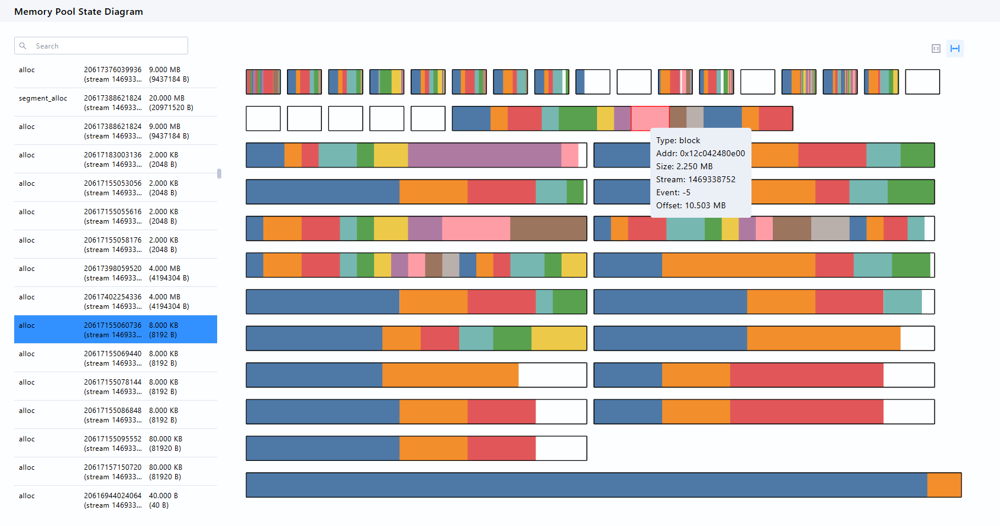

<a id="memory-snapshot-details"></a>

**Memory Snapshot Details**

The memory details include the slice detail and system view. The slice detail displays the details of the event. In the system view, the memory block view and memory event view are used to display memory details. By default, all memory-related information is displayed.

> [!NOTE]
>
> - The memory details are hidden by default. To view the details, click the expand button to display the memory details. If you do not need to view the memory details, click the collapse button to hide the memory details.
> - For the **Size(KBytes)** and **Requested Size(KBytes)** fields in the memory block view, and the **Size(KBytes)**, **Allocated(KBytes)**, **Active(KBytes)**, and **Reserved(KBytes)** fields in the memory event view, you can click  to enter the minimum and maximum values for range filtering.

- **Block View**: displays detailed information about memory blocks within the selected interval of the zoom bar, as shown in [**Figure 9** Block View](#memory-snapshot-block-view). For details about the fields, see [**Table 1** Block View fields](#memory-snapshot-block-view-fields). When hovering the mouse over the view, a  button appears in the upper right corner. Click it to copy the currently displayed content in the table.

    **Figure 9** Block View <a id="memory-snapshot-block-view"></a>

    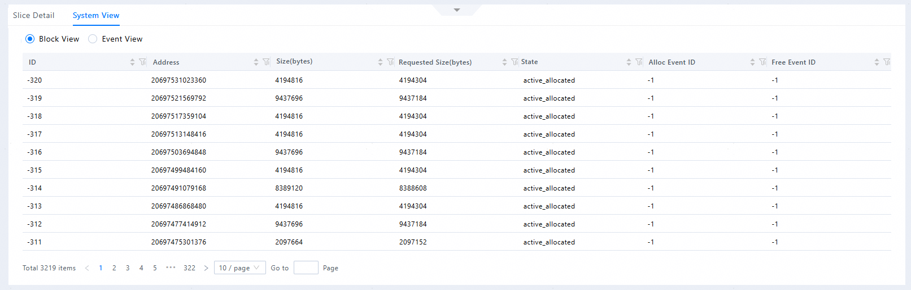

    **Table 1** Block View fields <a id="memory-snapshot-block-view-fields"></a>

    |Field|Required/Optional|Description|Type|Example Value|Remarks|
    |--|--|--|--|--|--|
    |ID|Required|Unique ID of a memory event.|Integer|0|You can click the ID to navigate to the corresponding memory block in the memory timeline graph and highlight it.<ul><li>A negative value indicates that the allocation event of this memory block was not recorded during the memory snapshot collection lifetime (the negative value has no actual meaning).</li><br><li>A non-negative value represents the memory block allocation event ID.</li></ul>|
    |Requested Size(KBytes)|Required|Size of the memory block to be allocated, in KBytes.|Floating point number|12.5|Size of the memory required by the allocation event. The PTA performs padding and alignment based on the requested size. Therefore, the allocated size may be greater than the requested size.|
    |Size(KBytes)|Required|Size of the memory operated by the memory event, in KBytes.|Floating point number|12.5|Actual size of the memory allocated to the memory block, in KBytes. The value is greater than or equal to the requested size.|
    |Address|Required|Memory event address.|Hexadecimal address starting with 0x|0x7f9f00000000|Address of the memory block in the memory.|
    |State|Required|Memory block status.|One of the enumerated values. For details, see the remarks.|`active_allocated`|Current status of the memory block. The options are as follows:<br><ul><li>`active_allocated`: The memory block has been allocated and is currently in use. It cannot be reused.</li><br><li>`active_pending_free`: The memory block has been requested to be released, but the release is not complete (possibly due to cross-stream dependencies). It cannot be reused.</li><br><li>`inactive`: The memory block is not allocated (or the memory block has been released) and can be reused.</li></ul>|
    |Alloc Event ID|Optional|ID of the memory block allocation event.|Integer|1|Unique ID of the memory block allocation event. The value `-1` indicates that the memory block allocation event is not recorded in the memory snapshot collection lifetime. You can click the memory block allocation event ID to navigate to the corresponding event in the Memory Pool State Diagram and highlight it.|
    |Free Event ID|Optional|ID of the memory block release completion event.|Integer|2|Unique ID of the memory block release completion event. The value `-1` indicates that the memory block release completion event is not recorded in the memory snapshot collection lifetime. You can click the memory block deallocation completion event ID to navigate to the corresponding event in the Memory Pool Status Diagram and highlight it.|

  The Block View provides the **Auto Filter Unreleased in Range** function, whose filtering logic is as follows:

    - When this function is not selected, all memory block details whose allocation and release intervals intersect with the range selected by the zoom slider are displayed. For the schematic diagram, see "Before Enabling" in [**Figure 10** Schematic diagram of the Auto Filter Unreleased in Range logic](#auto-filter-unreleased-in-range-logic); for the actual effect, see [**Figure 11** Block View with Auto Filter Unreleased in Range not selected](#block-view-auto-filter-not-selected).

    - When this function is selected, all memory block details whose memory blocks are allocated but not released within the range selected by the zoom slider are displayed. It is used to identify memory blocks occupied by potentially leaked tensors. For the schematic diagram, see "After Enabling" in [**Figure 10** Schematic diagram of the Auto Filter Unreleased in Range logic](#auto-filter-unreleased-in-range-logic); for the actual effect, see [**Figure 12** Block View with Auto Filter Unreleased in Range selected](#block-view-auto-filter-selected).

      **Figure 10** Schematic diagram of the Auto Filter Unreleased in Range logic <a id="auto-filter-unreleased-in-range-logic"></a>

      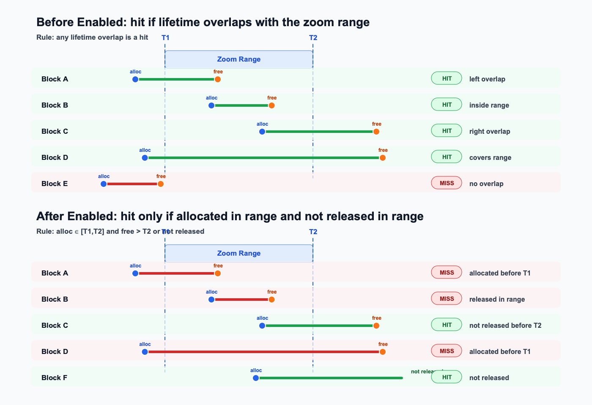

      **Figure 11** Block View with Auto Filter Unreleased in Range not selected <a id="block-view-auto-filter-not-selected"></a>

      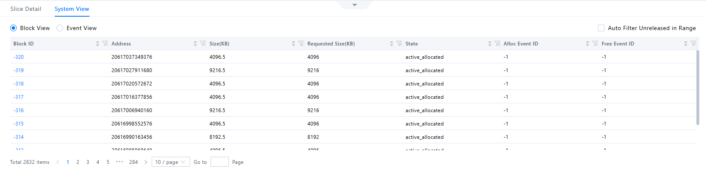

      **Figure 12** Block View with Auto Filter Unreleased in Range selected <a id="block-view-auto-filter-selected"></a>

      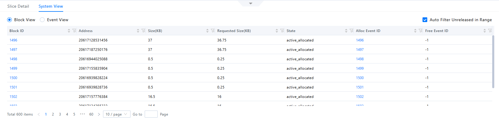

- Event View: displays detailed information about memory events in the range selected by the zoom slider, as shown in [**Figure 13** Memory Snapshot Event View](#memory-snapshot-event-view). For details about the fields, see [**Table 2** Memory Snapshot Event View fields](#memory-snapshot-event-view-fields). When the mouse hovers over the view, the  button appears in the upper-right corner; click it to copy the content currently displayed in the table.

    When a different "Device ID" is selected in the Memory Block Timeline Graph, the information displayed in the Event View is updated accordingly. When part of the Memory Block Timeline Graph is box-selected, the Event View information is also updated and displays all memory events within the selected time range.

    **Figure 13** Memory Snapshot Event View <a id="memory-snapshot-event-view"></a>

    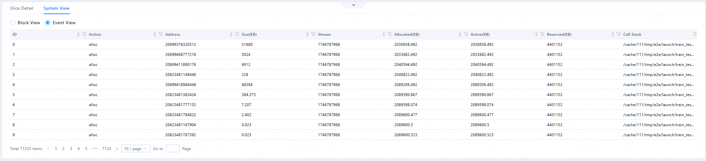

    **Table 2** Event View fields <a id="memory-snapshot-event-view-fields"></a>

    |Field|Required/Optional|Description|Type|Example Value|Remarks|
    |--|--|--|--|--|--|
    |ID|Required|Unique ID of a memory event.|Integer|0|You can click the memory event ID to jump to the corresponding event in the Memory Block Timeline Graph and highlight it.|
    |Action|Required|Memory event operation type.|One of the enumerated values. For details, see the description.|alloc|<ul><li>Memory segment operations:</li><br><ul><li>`segment_alloc`: memory segment allocation event, which triggers the PTA memory pool to allocate physical memory from the driver and triggers capacity expansion.</li><br><li>`segment_free`: memory segment release event, which triggers the PTA memory pool to release physical memory and triggers capacity reduction.</li><br><li>`segment_map`: memory segment mapping event. In the virtual memory scenario, this event triggers the PTA memory pool to map the physical memory to the virtual address space.</li><br><li>`segment_unmap`: memory segment unmapping event. In the virtual memory scenario, this event triggers the PTA memory pool to cancel the mapping of the physical memory to the virtual address space. </li></ul><li>Memory block operations:</li><br><ul><li>`alloc`: memory block allocation event. The PTA searches the memory pool for available inactive memory blocks for secondary allocation.</li><br><li>`free_requested`: memory block release request event. The PTA memory pool sets the memory block status to `active_pending_free` and waits for subsequent release. </li><li>`free_completed`: memory block release completion event. The PTA memory pool sets the memory block status to `inactive` and releases the memory block to the memory pool. </li></ul><li>Operator workspace snapshot: `workspace_snapshot`.</li></ul>|
    |Address|Required|Memory event address.|Hexadecimal address starting with 0x|0x7f9f00000000|Memory address operated by the memory event.|
    |Size(KBytes)|Required|Size of the memory operated by the memory event, in KBytes.|Floating point number|12.5|None|
    |Stream|Required|ID of the stream to which the memory event belongs.|Integer|0|None|
    |Allocated(KBytes)|Required|Total size of secondary allocations from the PTA memory pool after the event, in KBytes.|Floating point number|12.5|Total size of all `active_allocated` blocks in all segments, indicating the size of memory that has been secondarily allocated from the PTA memory pool to tensors when the event occurs.|
    |Active(KBytes)|Required|Total size of active memory in the PTA memory pool after the event occurs, in KBytes.|Floating point number|12.5|Total size of all `active_allocated` blocks in all segments, indicating the size of memory that has been secondarily allocated from the PTA memory pool to tensors when the event occurs.|
    |Reserved(KBytes)|Required|Total size of reserved memory in the PTA memory pool after the event occurs, in KBytes.|Floating point number|12.5|The value is the total size of all memory segments, indicating the size of memory that is actually allocated from the driver and reserved in the PTA memory pool when the event occurs.|
    |Call Stack|Optional|Call stack of a memory event.|String|`/home/xxx/test/demo.py: 60 main`|Call stack of a memory event, which displays the call stack triggered when the memory event occurs. If the value is empty, the possible causes are as follows:<br><ul><li>Stacks are not enabled when `_record_memory_history` is called.</li><br><li>The event occurs in autograd during backward propagation, and there may be no call stack information.</li></ul>|

    > [!NOTE]
    >
    > For details about the values of **Event**, **Event Type**, and **Name** fields, see the description of the **msmemscope\_dump\_\{timestamp\}.csv** result file in section [Collection via CLI](https://gitcode.com/Ascend/msmemscope/blob/master/docs/en/user_guide/memory_profile.md#collection-via-cli) in *msMemScope Memory Collection*.

- **Slice Detail**: You can view multiple detail entries by clicking a color block in the Memory Block Timeline Graph, an event in the event list on the left side of the Memory Pool State Diagram, or a color block in the Memory Pool State Diagram. The detail information is divided into the following three categories:
  - Event-type: As shown in [**Figure 14** Event Type Selected Details](#event-type-selected-details). The field descriptions are provided in [**Table 3** Event-type Slice Detail fields](#event-type-slice-detail-fields). Basic event information is displayed in the left area, and specific event information can be viewed by switching the event type.

    When you click the view of any time point in the Memory Block Timeline Graph, the displayed information in the **Slice Detail** area is updated accordingly.

    **Figure 14** Event Type Selected Details <a id="event-type-selected-details"></a>

    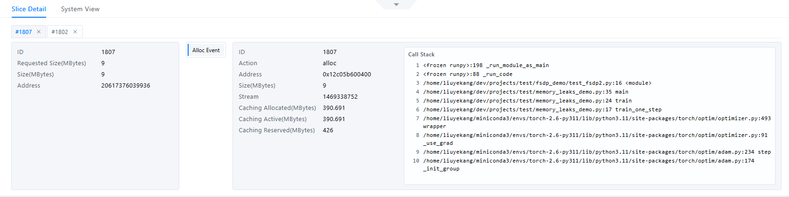

    **Table 3** Event-type Slice Detail fields <a id="event-type-slice-detail-fields"></a>

    |Field|Required/Optional|Description|Type|Example Value|Remarks|
    |--|--|--|--|--|--|
    |ID|Required|Unique ID of a memory event. You can click the memory event ID to jump to the corresponding event in the Memory Block Timeline Graph and highlight it.|Integer|0|Click to jump to the Memory Block Timeline Graph.|
    |Action|Required|Memory event operation type.|One of the enumerated values. For details, see the description.|alloc|<ul><li>Memory segment operations:</li><br><ul><li><idp:inline displayname="code" id="code31262515467">segment_alloc</idp:inline>: memory segment allocation event, which triggers the PTA memory pool to allocate physical memory from the driver and triggers capacity expansion.</li><br><li><idp:inline displayname="code" id="code4698165713466">segment_free</idp:inline>: memory segment release event, which triggers the PTA memory pool to release physical memory and triggers capacity reduction.</li><br><li><idp:inline displayname="code" id="code52211310174716">segment_map</idp:inline>: memory segment mapping event. In the virtual memory scenario, this event triggers the PTA memory pool to map the physical memory to the virtual address space.</li><br><li><idp:inline displayname="code" id="code26361219154714">segment_unmap</idp:inline>: memory segment unmapping event. In the virtual memory scenario, this event triggers the PTA memory pool to cancel the mapping of the physical memory to the virtual address space. </li></ul><li>Memory block operations:</li><br><ul><li><idp:inline displayname="code" id="code1864793164714">alloc</idp:inline>: memory block allocation event. The PTA searches the memory pool for available inactive memory blocks for secondary allocation.</li><br><li><idp:inline displayname="code" id="code12643164524710">free_requested</idp:inline>: memory block release request event. The PTA memory pool sets the memory block status to `active_pending_free` and waits for subsequent release. </li><li><idp:inline displayname="code" id="code1395455394717">free_completed</idp:inline>: memory block release completion event. The PTA memory pool sets the memory block status to `inactive` and releases the memory block to the memory pool. </li></ul><li>Operator workspace snapshot: <idp:inline displayname="code" id="code281085764715">workspace_snapshot</idp:inline>.</li></ul>|
    |Address|Required|Memory event address.|Hexadecimal address starting with 0x|0x7f9f00000000|Memory address operated by the memory event.|
    |Size(MBytes)|Required|Size of the memory operated by the memory event, in MBytes.|Floating point number|12.5|None|
    |Stream|Required|ID of the stream to which the memory event belongs.|Integer|0|None|
    |Caching Allocated(MBytes)|Required|Total size of secondary allocations from the PTA memory pool after the event, in MBytes.|Floating point number|12.5|Total size of all `active_allocated` blocks in all segments, indicating the size of memory that has been secondarily allocated from the PTA memory pool to tensors when the event occurs.|
    |Caching Active(MBytes)|Required|Total size of active memory in the PTA memory pool after the event occurs, in MBytes.|Floating point number|12.5|The value should be the sum of the total size of all `active_allocated` blocks and the total size of all `active_pending_free` blocks in all segments. Size of memory that is actually occupied but cannot be reused in the PTA memory pool when the event occurs.|
    |Caching Reserved(MBytes)|Required|Total size of reserved memory in the PTA memory pool after the event occurs, in MBytes.|Floating point number|12.5|The value is the total size of all memory segments. indicating the size of memory that is actually allocated from the driver and reserved in the PTA memory pool when the event occurs.|
    |Call Stack|Optional|Call stack of a memory event.|String|`/home/xxx/test/demo.py: 60 main`|Call stack of a memory event, which displays the call stack triggered when the memory event occurs. If the value is empty, the possible causes are as follows:<br><ul><li>Stacks are not enabled when `_record_memory_history` is called.</li><br><li>The event occurs in autograd during backward propagation, and there may be no call stack information.</li></ul>|

  - Block-type: As shown in [**Figure 15** Block Type Selected Details](#block-type-selected-details), with field descriptions in [**Table 4** Block-type Slice Detail fields](#block-type-slice-detail-fields). Basic event information is displayed in the left area, and specific event information can be viewed by switching event types.

    **Figure 15** Block Type Selected Details <a id="block-type-selected-details"></a>

    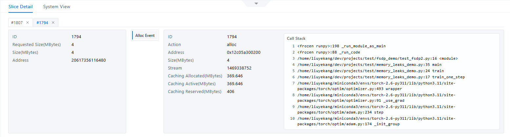

    **Table 4** Block-type Slice Detail fields<a id="block-type-slice-detail-fields"></a>

    |Field|Optional/Required|Description|
    |-|-|-|-|
    |ID|Required|Block ID: a value greater than zero indicates a valid allocation event ID, while a negative value means that no allocation event was captured for this block. The specific magnitude of a negative value carries no semantic meaning.|
    |Requested Size(MBytes)|Required|The memory size requested by the allocation event that actually triggered the allocation of this block. Due to alignment and other reasons, the actual block size may be slightly larger than the requested size, in MBytes.|
    |Size(MBytes)|Required|Block size, in MBytes.|
    |Address|Required|Block memory address, in hexadecimal.|

  - Segment-type: As shown in [**Figure 16** Segment Type Selected Details](#segment-type-selected-details). The field descriptions are provided in [**Table 5** Segment-type Slice Detail fields](#segment-type-slice-detail-fields). Basic event information is displayed in the left area, and specific event information can be viewed by switching the event type.

    **Figure 16** Segment Type Selected Details <a id="segment-type-selected-details"></a>

    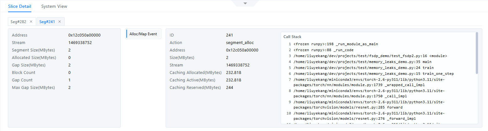

    **Table 5** Segment-type Slice Detail fields<a id="segment-type-slice-detail-fields"></a>

    |Field|Optional/Required|Description|
    |-|-|-|-|
    |Address|Required|Segment memory address, in hexadecimal.|
    |Stream|Required|Stream ID, which together with the address uniquely identifies a segment.|
    |Segment Size(MBytes)|Required|Total segment size, in MBytes.|
    |Allocated Size(MBytes)|Required|The memory within the segment that has been sub-allocated (in the form of blocks), i.e., the memory that is actually occupied and temporarily unavailable for reuse. It equals the sum of all active block sizes, in MBytes.|
    |Gap Size(MBytes)|Required|The total size of gaps caused by discontinuous addresses between blocks within the segment. This value indicates the total gap size in the memory segment, equal to "Segment Size - Allocated Size", in MBytes.|
    |Block Count|Required|The number of active blocks that have been sub-allocated.|
    |Gap Count|Required|The number of gaps between blocks.|
    |Max Gap Size(MBytes)|Required|The size of the largest gap, in MBytes.|
