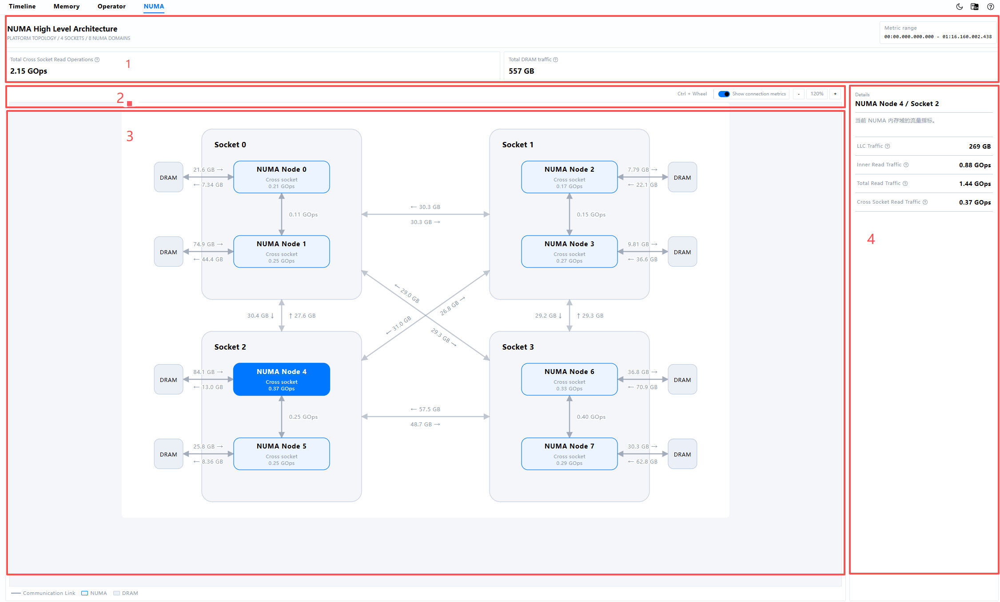
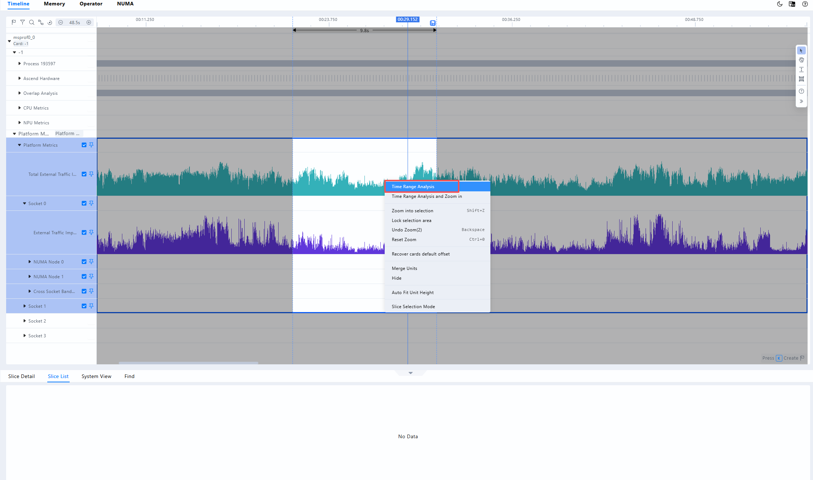
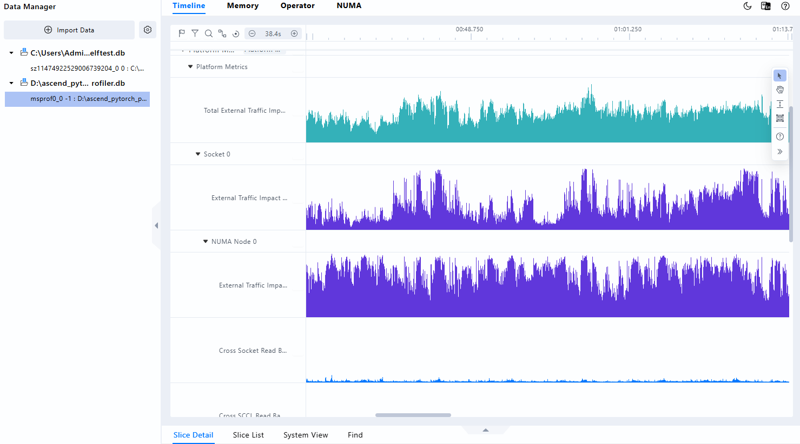
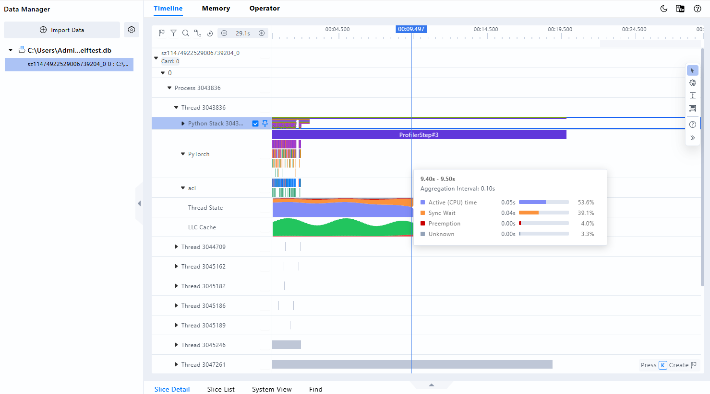
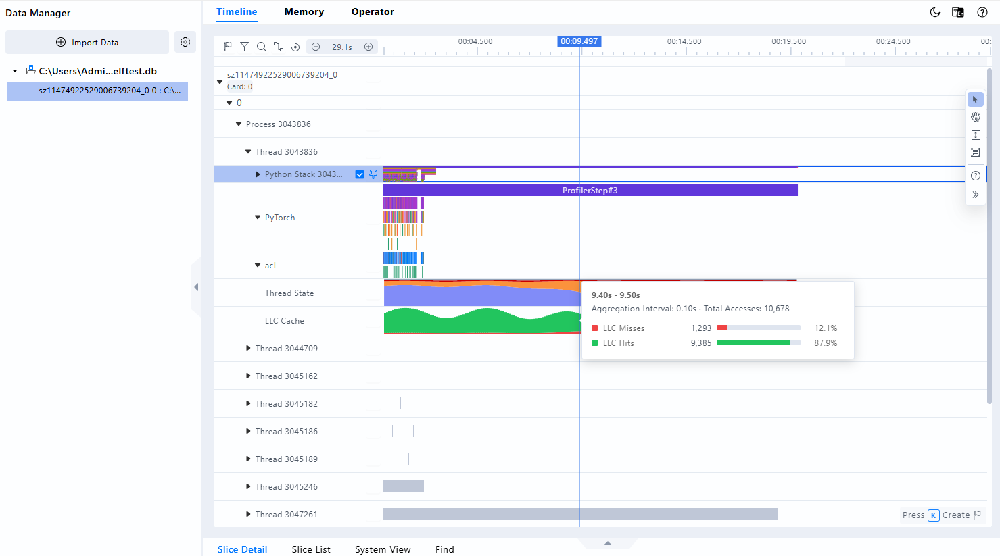

# **MindStudio Insight NUMA Analysis**

## Introduction

NUMA (Non-Uniform Memory Access) analysis displays CPU sockets, NUMA nodes, DRAM, and inter-node access relationships. It helps developers locate host-side performance issues such as uneven memory access, excessive cross-socket access, and inappropriate thread-memory affinity.

After importing profile data that contains NUMA metrics, you can view the NUMA high-level architecture diagram, system summary metrics, and details for sockets, NUMA nodes, DRAM, and communication links on the NUMA page. You can also view NUMA-related Platform Metric, Thread State, and LLC Hit/Miss units in the Timeline to correlate CPU-side memory access issues and thread states with NPU execution.

## Before You Begin

**Environment Preparation**

Install MindStudio Insight first. For details, see [MindStudio Insight Installation Guide](../install_guide/mindstudio_insight_install_guide.md).

**Data Preparation**

Use a performance analysis tool that supports NUMA metric collection to collect data, and then import the result into MindStudio Insight. For details, see [Importing Data](./basic_operations.md#importing-data).

> [!NOTE]
>
> - NUMA analysis depends on NUMA metrics in the main profile database, typically `ascend_pytorch_profiler.db` in the collection result directory.
> - Importing a standalone NUMA database file is no longer supported. Import the complete Profiling result directory, or import a main database result that contains NUMA metrics.
> - If the collected data does not contain NUMA-related tables or metrics, the NUMA tab may not be displayed, or the page may indicate that no NUMA data is available.

## Data Description

NUMA analysis mainly depends on NUMA topology and metric sampling data in the database. The metrics supported by different collection tools and hardware platforms may differ. The actual page content depends on the imported data.

**Table 1** NUMA data dependencies

| Data Source | Key Data | Main Content | Description |
| --- | --- | --- | --- |
| `ascend_pytorch_profiler.db` | NUMA-related tables such as `NUMA_TITLES_NAMES`, `NUMA_LEVELS_HIERARCHY_NAMES`, and `NUMA_METRICS` | NUMA high-level architecture diagram, system summary metrics, socket metrics, NUMA node metrics, DRAM read/write metrics, and communication link metrics | The database must contain the NUMA hierarchy, metric names, and sampled values. |
| Timeline parsing results | Platform Metric, Thread State, LLC Hit/Miss, and other data | NUMA-related units in the Timeline | Thread State depends on thread-level Active Time, Wait Time, Preemption Time, and Unknown Time metrics. It is displayed only when the collected data contains the corresponding events or metrics. |

> [!NOTE]
>
> - NUMA metric values are calculated from samples within the selected time range. For bandwidth metrics, the time range must contain samples from at least two different timestamps to calculate total traffic. Otherwise, the metric displays `"No data collected"`.
> - Bandwidth metrics on the page display total traffic within the selected time range in the NUMA high-level architecture diagram. For example, if the source data unit is `GB/s`, the page displays the total in `GB`.
> - Directional traffic between sockets depends on explicit Outgoing/Incoming direction information in the database. If the collection environment does not support Protocol Adapter, socket link metrics may be unavailable.

## NUMA High-Level Architecture Diagram

### Function Description

The NUMA high-level architecture diagram uses a topology view to display sockets, NUMA nodes, DRAM, and communication links in the current data. Developers can quickly inspect access relationships between sockets and NUMA nodes, and use metric totals to determine whether cross-socket access, cross-SCCL access, DRAM reads and writes, or LLC traffic are abnormal.

### Interface Description

The NUMA high-level architecture diagram consists of system metrics, the topology operation area, the NUMA topology, and a details panel, as shown in Figure 1.

**Figure 1** NUMA high-level architecture diagram



- Area 1: System metrics and metric time range. Displays the number of sockets, number of NUMA domains, and statistics time range for the current data, together with global summary NUMA metrics.
- Area 2: Topology operation area. Supports zooming in, zooming out, resetting the zoom level, and showing or hiding link metrics.
- Area 3: NUMA topology. Displays sockets, NUMA nodes, DRAM, and communication links. Different nodes and links can be selected by clicking them.
- Area 4: Details panel. Displays metric details for the selected socket, NUMA node, DRAM, or communication link. When no object is selected, system summary metrics are displayed.

### Usage

1. Import a Profiling result directory or main database data that contains NUMA metrics into MindStudio Insight.
2. After the import succeeds, open the **NUMA** tab to access the NUMA high-level architecture diagram.
3. Check the number of sockets, number of NUMA domains, and metric time range at the top of the page to confirm the current statistics scope.
4. Click a socket, NUMA node, DRAM module, or communication link to view its metrics in the **Details** panel on the right.
5. To view metric values on links, turn on **Show Link Metrics**.
6. To adjust the topology view, use the zoom in, zoom out, and reset zoom buttons on the toolbar, or hold `Ctrl` and scroll the mouse wheel to zoom.

> [!NOTE]
>
> If you have selected an analysis time range in the Timeline, the NUMA high-level architecture diagram preferentially displays statistics for that range. If no analysis time range is selected, the diagram displays statistics for the complete time range in the data.



## Metrics

The metrics in the NUMA high-level architecture diagram describe access traffic at different levels within the selected time range. A larger value indicates that the corresponding access path or hardware level handled more data access during that time range. For details, see Table 2.

**Table 2** NUMA metrics

| Metric | Location | Unit | Description | Analysis Guidance |
| --- | --- | --- | --- | --- |
| Cross Socket Read Traffic | NUMA node | GB or GOps | Total cross-socket read traffic handled by the current NUMA node through inter-socket links within the selected time range. | If the value is high, check thread binding, memory allocation placement, and process NUMA affinity to reduce remote socket access. |
| Total Cross Socket Read Traffic | Socket, system summary | GB or GOps | Total cross-socket read traffic for the current socket or for all NUMA nodes in the system within the selected time range. | Use this metric to determine whether the current socket or the entire system has significant cross-socket access pressure. |
| Cross SCCL Read Traffic | NUMA node, communication link between NUMA nodes | GB or GOps | Total read traffic between different SCCL chiplets in the same socket within the selected time range. | If the value is high, analyze thread distribution and task binding to determine whether access within the socket is balanced. |
| Total Read Traffic | NUMA node | GB or GOps | Total read traffic completed by the current NUMA node within the selected time range, including local and remote reads. | Compare this metric with Inner Read Traffic and Cross Socket Read Traffic to analyze the local-to-remote access ratio. |
| Inner Read Traffic | NUMA node | GB or GOps | Total read traffic between CPU cores and local memory of the current NUMA node within the selected time range. | A higher local access ratio generally indicates better thread-memory affinity. |
| DRAM Read Traffic | NUMA node, DRAM node, DRAM link | GB | Total data read by the current NUMA node from directly connected DRAM within the selected time range. | Use this metric to analyze whether read traffic is concentrated on specific NUMA nodes or DRAM links. |
| DRAM Write Traffic | NUMA node, DRAM node, DRAM link | GB | Total data written by the current NUMA node to directly connected DRAM within the selected time range. | Use this metric to analyze whether write traffic is concentrated and to identify memory write hotspots. |
| LLC Traffic | NUMA node | GB | Total LLC traffic recorded for the current NUMA node within the selected time range. | Combine this metric with the LLC Hit/Miss unit in the Timeline to evaluate cache access efficiency. |
| Total DRAM Traffic | System summary | GB | Total data read from and written to DRAM by all NUMA nodes within the selected time range. | Use this metric to observe DRAM access pressure on the entire system. |
| Source To Target Traffic | Communication link between sockets | GB or GOps | Total communication traffic from the source socket to the target socket explicitly recorded by database Outgoing/Incoming fields within the selected time range. | Use this metric to determine whether directional traffic between sockets is unbalanced. |
| Target To Source Traffic | Communication link between sockets | GB or GOps | Total communication traffic from the target socket to the source socket explicitly recorded by database Outgoing/Incoming fields within the selected time range. | Compare this metric with Source To Target Traffic to identify reverse-link pressure. |

> [!NOTE]
>
> - Metric names displayed on the page use traffic terminology, such as `Cross Socket Read Traffic`. The corresponding sampled metrics in the source database may use bandwidth terminology, such as `Cross Socket Read Bandwidth`.
> - When a metric displays `"No data collected"`, no sample data is available for statistics within the current time range. For bandwidth metrics, at least two samples from different timestamps are required to calculate total traffic. This message is also displayed when samples are insufficient; it does not necessarily mean that the metric value is 0.

## Viewing NUMA Data in the Timeline

The Timeline displays events, operators, system metrics, and hardware metrics during model execution. When the imported data contains the corresponding metrics, the Timeline can display NUMA Platform Metric, Thread State, and LLC Cache units, helping developers correlate NUMA access anomalies and thread scheduling states with model execution phases. For basic Timeline usage, see [Timeline](./system_tuning.md#timeline).

### NUMA Platform Metric Unit

The NUMA Platform Metric unit displays NUMA-related metrics over time hierarchically by Platform Metrics, Socket, and NUMA Node, as shown in Figure 2.

**Figure 2** NUMA Platform Metric unit



Expand the **Platform Metrics** node to view system-level summary metrics. Expand Socket and NUMA Node nodes to view metrics at the corresponding hardware level. The units actually displayed at each level depend on the collected data.

**Table 3** NUMA Platform Metric units

| Display Level | Main Metrics | Description |
| --- | --- | --- |
| Platform Metrics | System-level summary metrics | Observe changes in system-wide NUMA metrics over time and quickly locate abnormal time ranges. |
| Socket | Socket-level metrics | Compare access across sockets and determine whether load or cross-socket access is concentrated. |
| NUMA Node | External Traffic Impact, Cross Socket Read, Cross SCCL Read, DRAM Read/Write, Total Read, Inner Read, LLC, and other metrics | Analyze changes in local, cross-node, memory, and cache access for an individual NUMA node. |

When viewing the NUMA Platform Metric unit, first locate periods of obvious fluctuation in system-level metrics, and then expand the corresponding Socket and NUMA Node levels. Hover over a curve to view the metric value at a specific time. To analyze cumulative traffic within a time range, select the range in the Timeline, switch to the **NUMA** tab, and view the statistics in the NUMA high-level architecture diagram.

### Thread State Unit

**Figure 3** Thread State unit



The Thread State unit displays the proportion of different runtime states for each thread during the collection period. Each data point corresponds to an aggregation period, and the four states in the stacked chart sum to 100%. For details, see Table 4.

**Table 4** Thread State states

| State | Database Metric | Description | Analysis Guidance |
| --- | --- | --- | --- |
| Active | Active Time | Time during which the thread actually runs on the CPU. | A high proportion usually indicates that the thread continuously occupies the CPU. Combine this with CPU utilization and NUMA local-access metrics to determine whether the thread fully uses local compute and memory resources. |
| Sync Wait | Wait Time | Time during which the thread waits because of synchronization mechanisms such as locks, condition variables, and synchronization points. | If the proportion is high, check inter-thread dependencies, lock contention, synchronization frequency, and task partitioning. |
| Preemption | Preemption Time | Time during which the thread is preempted by the operating system scheduler and temporarily loses CPU execution resources. | If the proportion is high, check CPU load, thread count, core binding, and CPU affinity to reduce scheduling contention between threads. |
| Unknown | Unknown Time | Time that cannot be classified into the preceding three states. | If the proportion is high, first verify that the collected data is complete, and then use other Timeline events to determine whether unidentified wait or scheduling phases exist. |

For an aggregation period, the Timeline summarizes the duration of the four states and calculates the displayed proportion as follows:

```text
State ratio = Duration of the current state / Sum of durations of the four states x 100%
State duration (seconds) = State time recorded in the database (nanoseconds) / 1,000,000,000
```

For example, if Active, Sync Wait, Preemption, and Unknown last 70 ms, 20 ms, 10 ms, and 0 ms in an aggregation period, their ratios are 70%, 20%, 10%, and 0%, respectively. Hover over the data point to view both the duration and ratio of each state.

> [!NOTE]
>
> - Thread State data is displayed by thread and does not represent the summary state of the entire process or system.
> - The Timeline displays a data point only when the same aggregation period contains valid Active Time, Wait Time, Preemption Time, and Unknown Time data, all values are non-negative, and the total duration is greater than 0.
> - Whether the Thread State unit is displayed depends on the collection tool and data content. It is independent of whether the NUMA high-level architecture diagram has available metrics.

### LLC Cache Unit

**Figure 4** LLC Cache unit



The LLC Cache unit is located under the corresponding Thread node and displays the number of Last Level Cache (LLC) hits and misses for each thread during the collection period. Each bar corresponds to an aggregation period. The total bar height is the sum of hits and misses, the red area at the bottom represents misses, and the green area at the top represents hits. For details, see Table 5.

**Table 5** LLC Cache metrics

| Metric | Database Metric | Description | Analysis Guidance |
| --- | --- | --- | --- |
| LLC Hits | LLC Hits | Number of LLC hits recorded for the thread in the current aggregation period. | Combine this metric with total accesses and hit ratio to observe cache access efficiency in different execution phases. |
| LLC Misses | LLC Misses | Number of LLC misses recorded for the thread in the current aggregation period. | If the miss ratio increases, further investigate thread call events, data locality, and NUMA metrics. |

For an aggregation period, the Timeline summarizes hits and misses separately and calculates the displayed ratios as follows:

```text
Total accesses = Hits + Misses
Hit ratio = Hits / Total accesses x 100%
Miss ratio = Misses / Total accesses x 100%
```

For example, if an aggregation period contains 900 hits and 100 misses, total accesses are 1000, the hit ratio is 90.0%, and the miss ratio is 10.0%. Hover over the bar to view the aggregation time range, aggregation interval, total accesses, and the counts and ratios of hits and misses.

> [!NOTE]
>
> - LLC Cache data is displayed by thread and does not represent the summary result of the entire process or system. It is also different from LLC Traffic displayed as traffic in the NUMA high-level architecture diagram.
> - Bar height represents an absolute count, not a fixed 100% percentage. Height is automatically scaled based on the currently visible data range. When comparing threads or comparing before and after zooming, use the counts in the tooltip.
> - The current parser treats a missing count on either side as 0. Periods with zero total accesses are not drawn as bars. When data is incomplete, interpret the percentages together with the collection conditions.
> - The LLC Cache unit is displayed only when the collected data contains the corresponding metric samples. It is independent of whether the Thread State unit and the NUMA high-level architecture diagram have available metrics.

## FAQ

### NUMA Tab Not Displayed or No NUMA Data Message

Possible causes:

- The imported data does not contain NUMA metrics.
- The complete Profiling result directory was not imported, or the main database file is missing.
- The database lacks the NUMA hierarchy, metric names, or metric sample data.
- No NUMA samples exist within the selected time range.

Verify that NUMA-related metrics were enabled in the collection configuration, and import the complete Profiling result directory containing `ascend_pytorch_profiler.db` again.

### Some Metrics Display "No Data Collected"

This message indicates that no valid samples for the metric exist within the current time range. For bandwidth metrics, at least two samples from different timestamps are required to calculate total traffic, and the message is also displayed when samples are insufficient. Expand the analysis time range in the Timeline, or verify that the collection tool and hardware platform support the metric.

### Socket Link Metrics Are Unavailable

If the page displays the message `"Protocol Adapter not enabled or not supported (A2)"`, the current data lacks Outgoing/Incoming information required to calculate directional traffic between sockets. NUMA node, DRAM, and other collected metrics remain available.

### Why Are Metric Values Not Instantaneous Bandwidth

The NUMA high-level architecture diagram focuses on the total access volume within the selected time range. Bandwidth samples are therefore converted to total traffic for that range. To observe instantaneous trends, view the corresponding Platform Metric unit in the Timeline.

## Usage Constraints

- Only Profiling database results that contain NUMA metrics are supported.
- Importing a standalone NUMA database file is not supported.
- The availability of NUMA metrics, Thread State, and LLC Hit/Miss depends on the collection tool, hardware platform, and actual database content.
- Large Profiling datasets may increase import, query, and page rendering time. Select an appropriate time range based on the analysis objective.
- Use desensitized data in documentation screenshots to avoid exposing real paths, user names, business names, model names, keys, public IP addresses, or other sensitive information.
