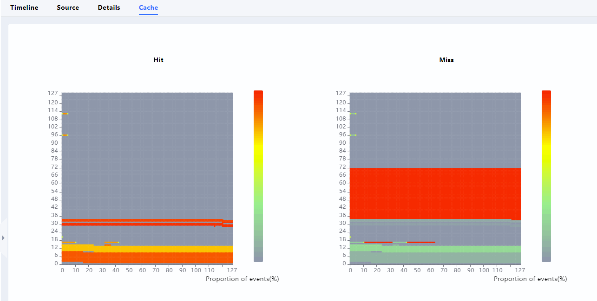
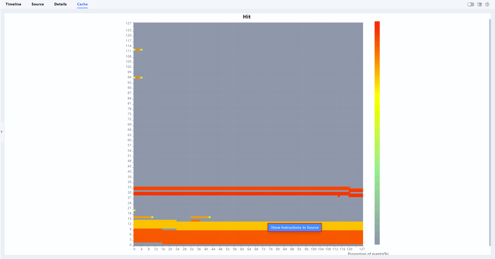

# Cache

## Function

The **Cache** tab page displays the L2 cache access status of kernel functions in user programs, helping users optimize the cache hit rate.

## GUI Description

The **Cache** tab page displays the L2 cache access status of kernel functions in user programs, as shown in [**Figure 1** Cache tab page](#cache-tab-page). Click any graph on the **Cache** tab page to zoom in on the graph.

Select a memory unit to display details about the memory unit, including the cache line index, number of events, and event proportion.

**Figure 1** Cache tab page 

## Instructions

**Event Graphs Can Be Associated with Source Codes**

On the **Cache** tab page, select a hit or miss event graph and click to enlarge the event graph. In the enlarged event graph, right-click the selected memory cell and choose **Show Instructions in Source** from the shortcut menu. The **Source** tab page is displayed, and the related instruction line is highlighted, as shown in [**Figure 2** Jumping to instruction table](#jumping-to-instruction-table).

**Figure 2** Jumping to instruction table 

