# Details

## Function

The **Details** tab page displays **Base Info**, **Compute Workload Analysis**, **Core Occupancy**, **Roofline**, **Top Warp Stall Season**, and **Memory Workload Analysis**. The analysis results are displayed in charts and data panes.

## GUI Description

The **Details** tab page consists of six areas:

- Area 1: **Base Info**, as shown in [**Figure 1** Base Info](#base-info).
- Area 2:  **Core Occupancy**, as shown in [**Figure 2** Core Occupancy](#core-occupancy).
- Area 3: **Roofline**, as shown in [**Figure 3** Roofline - Memory Unit](#memory-unit).
- Area 4: **Compute Workload Analysis**, as shown in [**Figure 7** Compute Workload Analysis](#compute-workload-analysis).
- Area 5: **Top Warp Stall Season**, as shown in [**Figure 8** Top Warp Stall Season](#TopWarpStallSeason).
- Area 6: **Memory Workload Analysis**, as shown in [**Figure 9** Memory Workload Analysis](#memory-workload-analysis)

**Base Info**

Area 1: **Base Info**. You can view the basic operator information, including the name, duration, and type. [**Table 1** Base Info fields](#base-info-fields) describes the fields.

**Figure 1** Base Info 
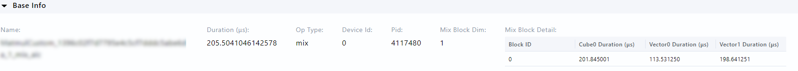

**Table 1** Base Info fields 

| Field | Description |
|-------|-------------|
| Name | Operator name. |
| Duration (μs) | Total operator duration. |
| Op Type | Operator type. The options are **mix**, **vector**, **cube**, and **AI Core**. |
| Device Id | Device ID. |
| Pid | Process ID |
| Block Dim | Number of sub blocks. This parameter is used when the operator type is **vector**, **cube**, or **AI Core**. |
| Mix Block Dim | Number of sub blocks. This parameter is used when the operator type is **mix**. |
| Block Detail | Duration details of sub blocks. This parameter is used when the operator type is vector, cube, or AI Core. For details about the fields, see [**Table 2** Block Detail fields](#block-detail-fields). |
| Mix Block Detail | Duration details of sub blocks. If the operator type is mix, the value is the parameter name. For details about the parameters, see [**Table 3** Mix Block Detail fields](#mix-block-detail-fields). |

**Table 2** Block Detail fields 

| Field | Description |
|-------|-------------|
| Block ID | Sub block ID. This parameter is not available when the operator type is **AI Core**. |
| Core Type | Sub block type. |
| Duration (μs) | Duration of sub blocks. |

**Table 3** Mix Block Detail fields 

| Field | Description |
|-------|-------------|
| Block ID | Sub block ID. |
| Cube0 Duration (μs) | Duration of the cube core in AI Core. |
| Vector0 Duration (μs) | Duration of one vector core in AI Core. |
| Vector1 Duration (μs) | Duration of another vector core in AI Core. |

**Core Occupancy**

Area 2: **Core Occupancy**. The inter-core load is displayed and analyzed based on the number of clock cycles, total core throughput, and cache hit rate, as shown in [**Figure 2** Core Occupancy](#core-occupancy).

Developers can select **Cycles**, **Throughput**, or **Cache Hit Rate\(%\)** to display the core usage and analysis result, helping them locate and analyze exceptions.

**Figure 2** Core Occupancy 
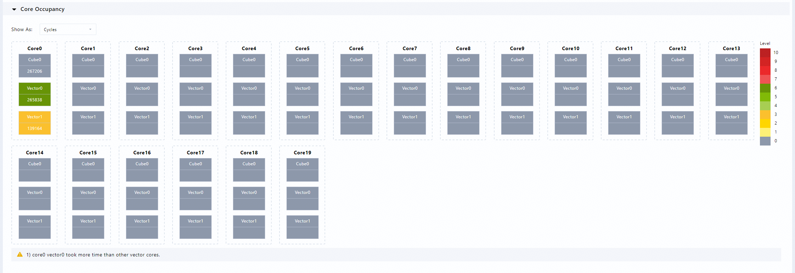

> [!NOTE]
>
> - This module is supported by the profile data exported from Atlas A3 products, Atlas A2 products, and Ascend 950PR&950DT products.
> - Core Occupancy is classified into 10 levels. Levels 4–6 indicate balance near the average, while levels 0–3 and 7–10 signify significant deviation from the average.

**Roofline**

Area 3: **Roofline**. Developers use the Roofline model graph to view operator performance and analyze the results to provide a basis for performance optimization. In the Roofline model graph, the X axis represents the arithmetic intensity (Ops/Byte), which indicates the number of operations supported by each byte of memory. The Y axis represents the performance (TOPS/s), which indicates the number of trillion operations per second.

The Roofline model graph displays the computing power name, which describes the instruction types that maximize the computing power, such as **Cube\_INT\(100.000000%\) + Vec\_FP16\(30.000000%\),Vec\_FP32\(70.000000%\)** (indicating that cube computing units process only INT instructions, and vector computing units process 30% FP16 instructions and 70% FP32 instructions).

> [!NOTE]
>
> - This module is supported only by Ascend 950PR&950DT products, Atlas A3 products, Atlas A2 products, and Atlas inference products.
> - When the data of Ascend 950PR&950DT products is imported, the instruction types are displayed in the Roofline model graph. You can filter the instruction types based on the parameters in the graph to view the Roofline model graph.

- For Ascend 950PR&950DT products, Atlas A3 products, and Atlas A2 products, the Roofline model analysis includes the memory unit, memory channel, and MTE tabs.

    **Memory Unit**: displays the HBM/L2 and memory unit model, as shown in [**Figure 3** Memory Unit](#memory-unit). For details about the parameters, see [**Table 4** Memory Unit parameters](#memory_unit_parameters).

    **Figure 3** Memory Unit 
    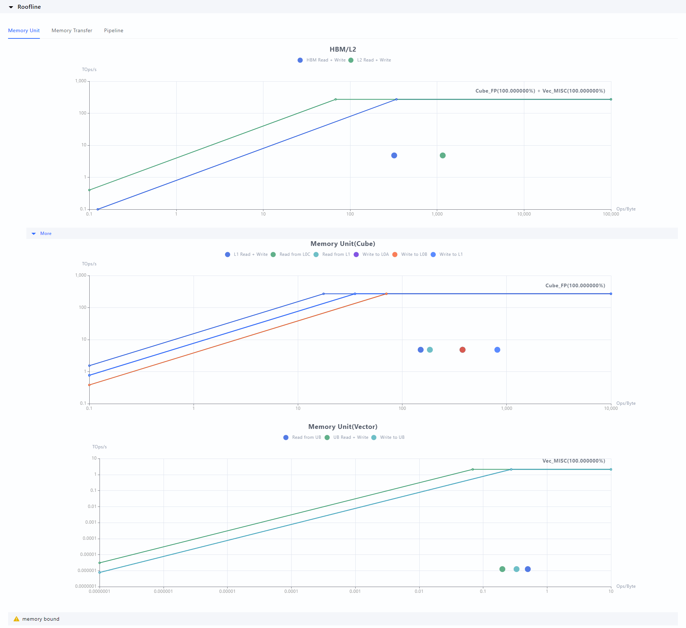

    **Table 4** Memory Unit parameters 

    | Parameter        | Description                                       |
    |--|--|
    | HBM Read + Write | Read and write of the high bandwidth memory unit. |
    | L2 Read + Write  | Read and write of the L2 memory unit.             |
    | L1 Read + Write  | Read and write of the L1 memory unit.             |
    | Write to L1      | Write to the L1 memory unit.                      |
    | Read from L1     | Read from the L1 memory unit.                     |
    | Write to L0A     | Write to the L0A memory unit.                     |
    | Write to L0B     | Write to the L0B memory unit.                     |
    | Read from L0C    | Read from the L0C memory unit.                    |
    | UB Read + Write  | Read and write of the UB memory unit.             |
    | Read from UB     | Read from the UB memory unit.                     |
    | Write to UB      | Write to the UB memory unit.                      |
    | Vector Read UB   | Read from the UB memory unit by the vector unit.  |
    | Vector Write UB  | Write to the UB memory unit by the vector unit.   |

    **Memory Transfer**: displays the memory transfer path, as shown in [**Figure 4** Memory Transfer](#memory-transfer). For details about the parameters, see [**Table 5** Memory Transfer parameters](#memory-transfer-parameters).

    **Figure 4** Memory Transfer 
    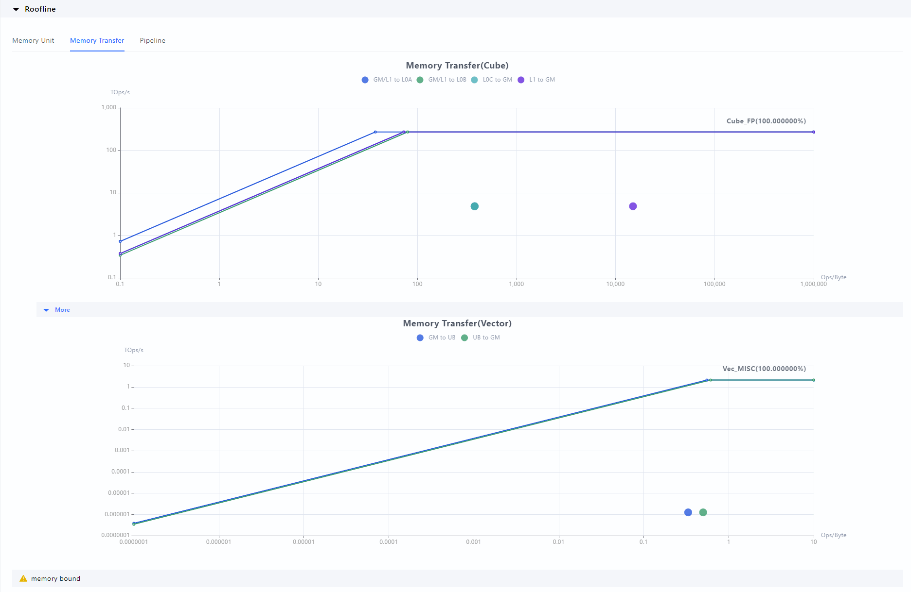

    **Table 5** Memory Transfer parameters 

    | Parameter    | Description                       |
    |--|--|
    | GM/L1 to L0A | Memory channel from GM/L1 to L0A. |
    | GM/L1 to L0B | Memory channel from GM/L1 to L0B. |
    | L0C to GM    | Memory channel from L0C to GM.    |
    | L1 to GM     | Memory channel from L1 to GM.     |
    | L0C to L1    | Memory channel from L0C to L1.    |
    | GM to UB     | Memory channel from GM to UB.     |
    | UB to GM     | Memory channel from UB to GM.     |

    **Pipeline**: displays the pipeline model, as shown in [**Figure 5** Pipeline](#pipeline). For details about the parameters, see [**Table 6** Pipeline parameters](#pipeline-parameters).

    **Figure 5** Pipeline 
    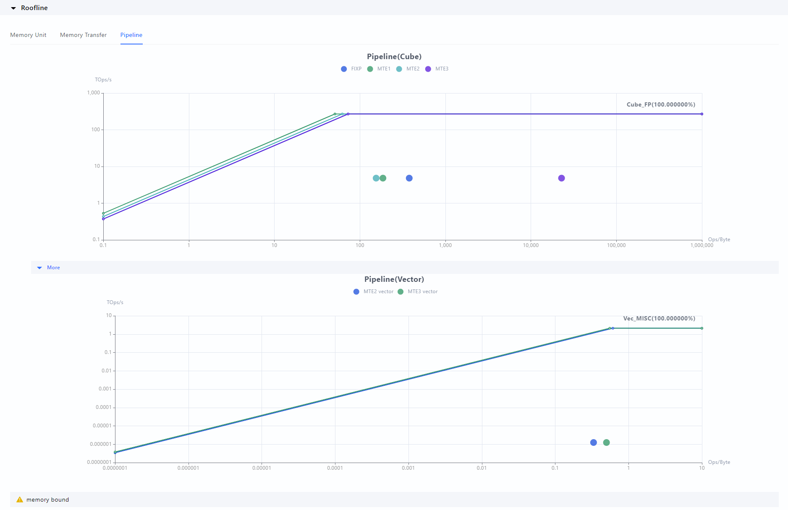

    **Table 6** Pipeline parameters 

    | Parameter   | Description                                |
    |--|--|
    | MTE1        | MTE1 channel.                              |
    | MTE2        | MTE2 channel.                              |
    | MTE3        | MTE3 channel.                              |
    | FIXP        | FIXP channel.                              |
    | MTE2 vector | MTE2 channel of the vector computing unit. |
    | MTE3 vector | MTE3 channel of the vector computing unit. |

- If the hardware product is an Atlas inference product, only **Memory Unit** exists, as shown in [**Figure 6** Memory Unit](#memory-unit-graph). For details about the parameters, see [**Table 7** Memory Unit parameters](#memory-unit-parameters-1).

    **Figure 6** Memory Unit model 
    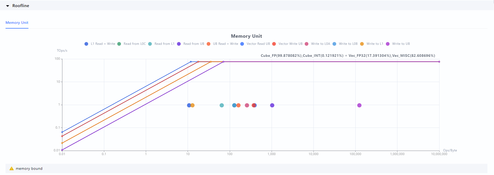

    **Table 7** Memory Unit parameters 

    | Parameter       | Description                                      |
    |--|--|
    | L1 Read + Write | Read and write of the L1 memory unit.            |
    | Read from L0C   | Read from the L0C memory unit.                   |
    | Read from L1    | Read from the L1 memory unit.                    |
    | Read from UB    | Read from the UB memory unit.                    |
    | UB Read + Write | Read and write of the UB memory unit.            |
    | Vector Read UB  | Read from the UB memory unit by the vector unit. |
    | Vector Write UB | Write to the UB memory unit by the vector unit.  |
    | Write to L0A    | Write to the L0A memory unit.                    |
    | Write to L0B    | Write to the L0B memory unit.                    |
    | Write to L1     | Write to the L1 memory unit.                     |
    | Write to UB     | Write to the UB memory unit.                     |

**Compute Workload Analysis**

Area 4: **Compute Workload Analysis**. Developers can view the information in a bar chart and data pane, helping them analyze compute workload, as shown in [**Figure 7** Compute Workload Analysis](#compute-workload-analysis). The parameters are displayed in a bar chart and data pane based on the collected data. For details about the parameters, see [**Table 8** Compute Workload Analysis parameters](#compute-workload-analysis-parameters). The content indicated by the  icon indicates the compute workload analysis result of each block.

**Figure 7** Compute Workload Analysis 
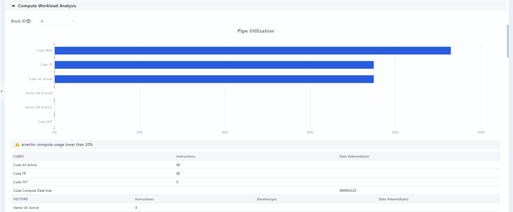

**Table 8** Compute Workload Analysis parameters 

| Parameter | Description |
|-----------|-------------|
| Block ID | Sub block ID. You can switch the block ID to view the corresponding information. When the operator type is **AI Core**, this parameter is displayed as **NA**, and the multi-core average value is displayed. |
| Pipe Utilization | Pipe (instruction queue) visualization. It is displayed in a bar chart.  - Horizontal coordinate: Cycles percentage, calculated as follows: Cycles/Total cycles. **Cycles** indicates the clock cycles consumed by the instruction execution on the sub block.  - Vertical coordinate: operator instructions, provided by the data in the BIN file. |
| CUBE | Name of a cube instruction. This parameter is displayed when the operator type is **cube**. |
| CUBE0 | Name of a cube instruction. This parameter is displayed when the operator type is **mix**. |
| VECTOR | Name of a vector instruction. This parameter is displayed when the operator type is vector. |
| VECTOR0 | Name of a vector instruction. This parameter is displayed when the operator type is **mix**. |
| VECTOR1 | Name of a vector instruction. This parameter is displayed when the operator type is **mix**. |
| AICORE | Name of an AI Core instruction. This parameter is displayed when the operator type is **AI Core**. |
| Instructions | Number of operator instructions. |
| Duration(μs) | Duration of operator instructions. |
| Data Volume(Byte) | Operator instruction data volume. |

**Top Warp Stall Season**

Area 5 is the Top Warp Stall Season chart, which mainly displays the wait counts caused by resource conflicts, data dependencies, and other reasons during instruction execution, including active. See [**Figure 8**  Top Warp Stall Season](#TopWarpStallSeason) for details, and see [**Table 9**  Top Warp Stall Season parameter description](#TopWarpStallSeason-parameter-description) for parameter descriptions.

**Figure 8** Top Warp Stall Season 
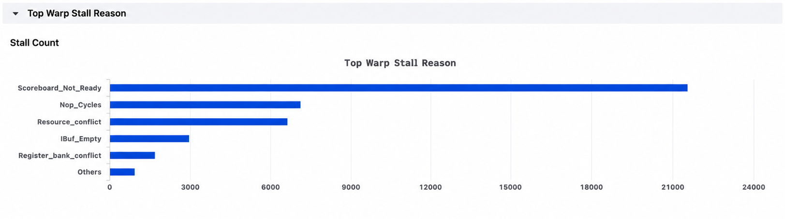

**Table 9** Top Warp Stall Season parameter description 

| Parameter | Description |
|-----------|-------------|
| Nop_Cycles | No-operation cycles. |
| Divergence_Stack_Spill | Branch divergence stack spill. Pipeline stall cycles caused by insufficient stack space or mismatch between predicted and actual paths during branch instruction execution. |
| IBuf_Empty | Instruction buffer empty. Pipeline stall cycles caused by the inability to fetch the next instruction when IBuf is empty. |
| Register_bank_conflict | Register bank conflict. Pipeline stall cycles caused by conflicts when instructions access the same register bank, forcing the pipeline to pause to avoid data errors. |
| Resource_conflict | Resource conflict. Pipeline stall cycles caused by multiple instructions simultaneously competing for the same hardware resource and being unable to execute in parallel. |
| ScoreBoard_Not_Ready | Scoreboard not ready. Pipeline stall caused by the ScoreBoard state not yet being ready (for example, preceding instructions still occupying relevant resources or registers), preventing the current instruction from continuing execution. |
| Warp_Level_Sync | Warp-level synchronization wait. In multi-threaded execution, instruction execution is stalled to ensure synchronization and consistency among threads within the same warp when synchronization conditions are not met. |
| active | Number of times instructions are successfully issued without stalls. |
| Others | Pipeline stall cycles triggered by other exceptions or control logic beyond the explicitly classified stall causes. |

**Memory Workload Analysis**

Area 6: **Memory Workload Analysis**. It displays the memory workload analysis information in the memory heatmap and data pane, as shown in [**Figure 9** Memory Workload Analysis](#memory-workload-analysis). The parameters in the memory heatmap and data pane are displayed based on the collected data. For details about the parameters, see [Table 10 Parameter description](#parameter-description). **Peak\(%\)** on the right of the heatmap indicates the arrow color, with the value representing the peak bandwidth proportion (i.e., the proportion of the maximum bandwidth). The content indicated by the  icon indicates the memory workload analysis result of each block.

**Figure 9** Memory Workload Analysis 
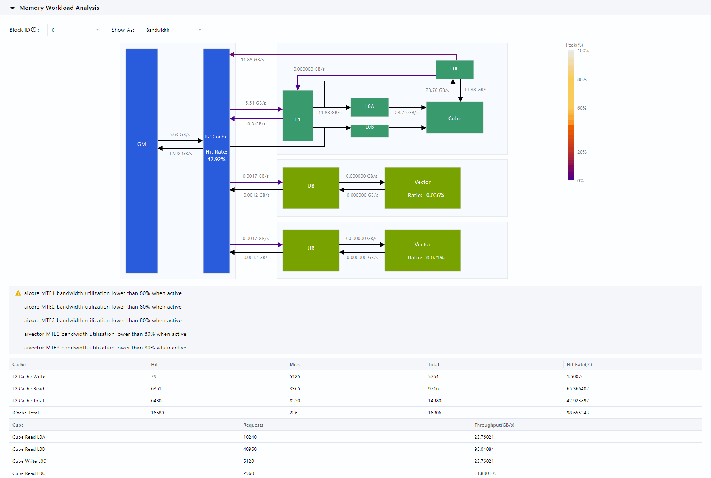

**Table 10** Parameter description 

| Parameter | Description |
|-----------|-------------|
| Block ID | Sub block ID. You can select the sub block to be viewed from the **Block ID** drop-down list. When the operator type is **AI Core**, **Block ID** is displayed as **NA**, and the multi-core average value is displayed. |
| Show As | Optional. You can select the flow arrow content of the heatmap to display the number of requests or bandwidth. The arrow on the heatmap indicates the flow direction.  - Num of Request  - Bandwidth |

The content displayed in the data pane varies according to the operator type. The content is the data parsing result based on the BIN file. The details are as follows:

- If the operator type is AI Core, the parameters in the table pane are described in [**Table 11** Parameters for AI Core](#parameters-for-ai-core).

    **Table 11** Parameters for AI Core 

    | Parameter        | Description                                                                               |
    |--|--|
    | Cache            | L2 cache.                                                                                 |
    | Cube             | Cube computing unit.                                                                      |
    | HBM              | High bandwidth memory unit.                                                               |
    | L0A              | L0A memory unit.                                                                          |
    | L0B              | L0B memory unit.                                                                          |
    | L0C              | L0C memory unit.                                                                          |
    | L1               | L1 memory unit.                                                                           |
    | Pipe             | Computing channel.                                                                        |
    | UB               | UB memory unit.                                                                           |
    | Vector           | Vector computing unit.                                                                    |
    | Requests         | Number of operations.                                                                     |
    | Throughput(GB/s) | Throughput, indicating the amount of data transferred per second by the channel, in GB/s. |

- If the operator type is mix, the parameters in the table pane are described in [**Table 12** Parameters for mix](#parameters-for-mix).

    **Table 12** Parameters for mix 

    | Parameter           | Description                                                                               |
    |--|--|
    | Cache               | L2 cache.                                                                                 |
    | Hit                 | Number of cache hits.                                                                     |
    | Miss                | Number of times that the cache is reallocated after a cache miss.                         |
    | Total               | Total number of cache requests.                                                           |
    | Hit Rate(%)         | Cache hit rate.                                                                           |
    | Cube                | Cube computing unit.                                                                      |
    | HBM Cube            | High bandwidth memory unit of the cube unit.                                              |
    | HBM Vector Core0    | High bandwidth memory unit of the vector unit of core 0 in AI Core.                       |
    | HBM Vector Core1    | High bandwidth memory unit of the vector unit of core 1 in AI Core.                       |
    | Scalar              | Scalar unit                                                                               |
    | Scalar Cube         | Scalar unit of the cube unit.                                                             |
    | Scalar Vector Core0 | Scalar unit of the vector unit of core 0 in AI Core.                                      |
    | Scalar Vector Core1 | Scalar unit of the vector unit of core 1 in AI Core.                                      |
    | L0A                 | L0A memory unit.                                                                          |
    | L0B                 | L0B memory unit.                                                                          |
    | L0C                 | L0C memory unit.                                                                          |
    | L1                  | L1 memory unit.                                                                           |
    | Requests            | Number of operations.                                                                     |
    | Throughput(GB/s)    | Throughput, indicating the amount of data transferred per second by the channel, in GB/s. |
    | Peak(%)             | Ratio of the actual bandwidth to the theoretical bandwidth.                               |
    | Pipe Cube           | Computing channel of the cube unit.                                                       |
    | Pipe Vector Core0   | Computing channel of the vector unit of core 0 in AI Core.                                |
    | Pipe Vector Core1   | Computing channel of the vector unit of core 1 in AI Core.                                |
    | Instructions        | Number of instructions.                                                                   |
    | Cycle               | Clock cycle consumed by the channel.                                                      |
    | Time(μs)            | Running time of the scalar unit.                                                          |
    | Wait Cycles         | Number of blocked cycles on the corresponding pipe.                                       |
    | Active Rate(%)      | Percentage of the running cycles to the total cycles.                                     |
    | UB Core0            | UB memory unit of core 0 in AI Core of the **mix** operator.                              |
    | UB Core1            | UB memory unit of core 1 in AI Core of the **mix** operator.                              |
    | Vector Core0        | Vector computing unit.                                                                    |
    | Vector Core1        | Vector computing unit.                                                                    |

- If the operator type is vector, the parameters in the table pane are described in [**Table 13** Parameters for vector](#parameters-for-vector).

    **Table 13** Parameters for vector 

    | Parameter        | Description                                                                               |
    |--|--|
    | Cache            | L2 cache.                                                                                 |
    | Hit              | Number of cache hits.                                                                     |
    | Miss             | Number of times that the cache is reallocated after a cache miss.                         |
    | Total            | Total number of cache requests.                                                           |
    | Hit Rate(%)      | Cache hit rate.                                                                           |
    | HBM              | High bandwidth memory unit.                                                               |
    | Scalar           | Scalar unit                                                                               |
    | Requests         | Number of operations.                                                                     |
    | Throughput(GB/s) | Throughput, indicating the amount of data transferred per second by the channel, in GB/s. |
    | Pipe             | Computing channel.                                                                        |
    | Instructions     | Number of instructions.                                                                   |
    | Cycle            | Clock cycle consumed by the channel.                                                      |
    | Time(μs)         | Running time of the scalar unit.                                                          |
    | Wait Cycles      | Number of blocked cycles on the corresponding pipe.                                       |
    | Active Rate(%)   | Percentage of the running cycles to the total cycles.                                     |
    | UB               | UB memory unit.                                                                           |
    | Vector           | Vector computing unit.                                                                    |
    | Peak(%)          | Ratio of the actual bandwidth to the theoretical bandwidth.                               |

- If the operator type is cube, the parameters in the table pane are described in [**Table 14** Parameters for cube](#parameters-for-cube).

    **Table 14** Parameters for cube 

    | Parameter        | Description                                                                               |
    |--|--|
    | Cache            | L2 cache.                                                                                 |
    | Hit              | Number of cache hits.                                                                     |
    | Miss             | Number of times that the cache is reallocated after a cache miss.                         |
    | Total            | Total number of cache requests.                                                           |
    | Hit Rate(%)      | Cache hit rate.                                                                           |
    | Cube             | Cube computing unit.                                                                      |
    | HBM              | High bandwidth memory unit.                                                               |
    | Scalar           | Scalar unit                                                                               |
    | L0A              | L0A memory unit.                                                                          |
    | L0B              | L0B memory unit.                                                                          |
    | L0C              | L0C memory unit.                                                                          |
    | L1               | L1 memory unit.                                                                           |
    | Requests         | Number of operations.                                                                     |
    | Throughput(GB/s) | Throughput, indicating the amount of data transferred per second by the channel, in GB/s. |
    | Peak(%)          | Ratio of the actual bandwidth to the theoretical bandwidth.                               |
    | Pipe             | Computing channel.                                                                        |
    | Instructions     | Number of instructions.                                                                   |
    | Cycle            | Clock cycle consumed by the channel.                                                      |
    | Time(μs)         | Running time of the scalar unit.                                                          |
    | Wait Cycles      | Number of blocked cycles on the corresponding pipe.                                       |
    | Active Rate(%)   | Percentage of the running cycles to the total cycles.                                     |

## Instructions

**Viewing Cycles**

In the **Pipe Utilization** bar chart area, move the pointer over the bar chart of the corresponding instruction. The actual cycles information is displayed, as shown in [**Figure 10** Viewing Cycles](#viewing-cycles).

**Figure 10** Viewing Cycles 
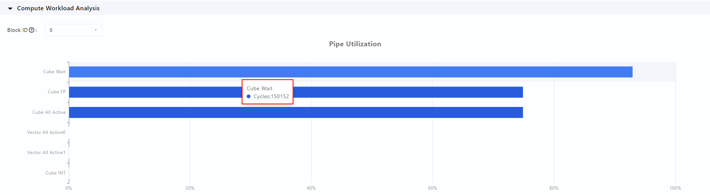

**Viewing Operator Performance in the Roofline Model Performance Graph**

In any view of the **Memory Unit**, **Memory Transfer**, or **Pipeline** in the **Roofline** area, hover over a parameter point to display the corresponding performance metrics for that memory unit, as shown in [**Figure 11** Displaying operator performance information](#displaying-operator-performance-information). For details about the parameters, see [**Table 15** Performance parameters](#performance-parameters).

**Figure 11** Displaying operator performance information 
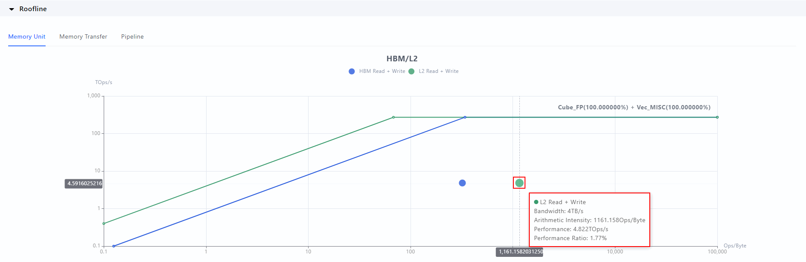

**Table 15** Performance parameters 

| Parameter | Description |
|-----------|-------------|
| Bandwidth | Indicates the upper limit of the hardware bandwidth. |
| Arithmetic Intensity | Corresponds to the X axis, indicating the number of operations supported by a unit of memory. |
| Performance | Corresponds to the Y axis, indicating the number of operations per unit time (trillions of operations per second). |
| Performance Ratio | Performance percentage = Actual operator performance/Optimal hardware performance |

**Comparing Operator Performance**

MindStudio Insight allows developers to compare the details of two operators to intuitively view the differences between the two operators, facilitating analysis. Before comparing operator details, you need to set the baseline operator and comparison operator. For details, see [Data Comparison](../basic_operations.md#managing-data).

In operator comparison mode, the **Details** tab page displays comparison data in terms of **Base Info**, **Core Occupancy**, **Compute Workload Analysis**, and **Memory Workload Analysis**. Only operators of the same type can be compared.

- **Base Info**: The basic information between operators is compared.
- **Core Occupancy**: Based on the comparison data, if the comparison data contains core occupancy data, the analysis result is displayed on the page. If the comparison data does not contain core occupancy data, the analysis result is not displayed on the page.
- **Roofline**: This module does not support comparison. If the comparison data contains this module, the content of this module is displayed in operator comparison mode.
- **Compute Workload Analysis**: You can view the corresponding information in the bar chart and data pane. In the bar chart, blue bars indicate the comparison data, and green bars indicate the baseline data. The data pane displays the differences between operators. You can click **See more** in the **Details** column to view details about the baseline data and comparison data, as shown in [**Figure 12** Compute Workload Analysis comparison](#compute-workload-analysis-comparison).

    **Figure 12** Compute Workload Analysis comparison 
    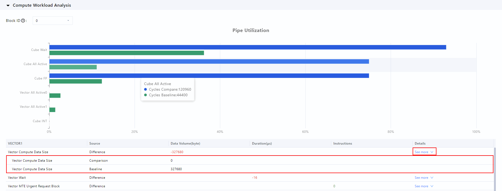

- **Memory Workload Analysis**: You can view the corresponding information in the memory heatmap and data pane. The data in the brackets in the heatmap is the baseline data, and the data outside the brackets is the comparison data. The data pane displays the differences between operators. You can click **See more** in the **Details** column to view details about the baseline data and comparison data, as shown in [**Figure 13** Memory Workload Analysis comparison](#memory-workload-analysis-comparison).

    **Figure 13** Memory Workload Analysis comparison 
    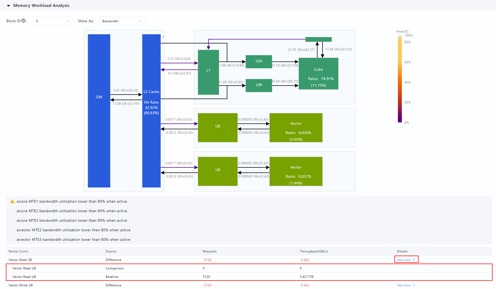
