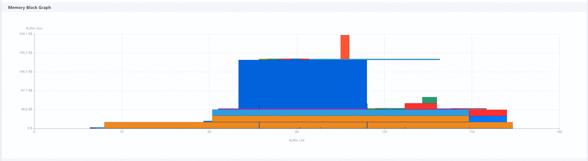
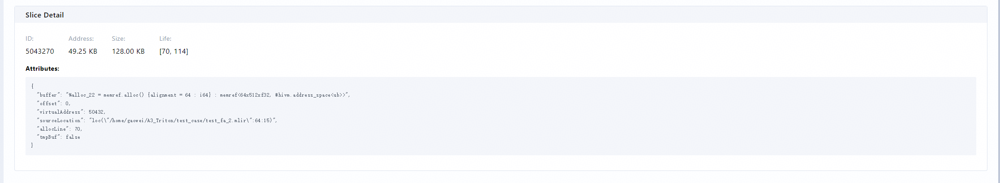
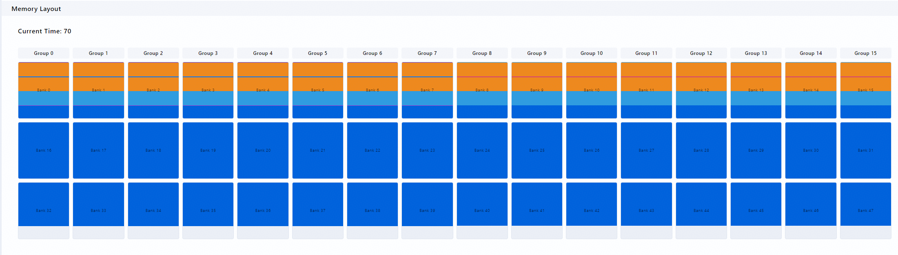
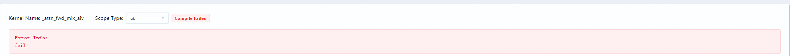

# On-Chip Memory

## Function

The **On-Chip Memory** page displays the memory layout, helping you understand the memory layout and details and analyze the unified buffer (UB) overflow problem.

## GUI Description

After the `memory_info.json` file in the specified directory is imported, the **On-Chip Memory** page is displayed, showing the memory layout, as shown in [**Figure 1** On-Chip Memory - Memory Block Graph](#on-chip-memory-memory-block-graph). Click a color block in the memory block graph to view the details and layout of the memory block, as shown in [**Figure 2** On-Chip Memory - Slice Detail](#on-chip-memory-slice-detail) and [**Figure 3** On-Chip Memory - Memory Layout](#on-chip-memory-memory-layout).

 - [**Figure 1** On-Chip Memory - Memory Block Graph](#on-chip-memory-memory-block-graph) shows the memory usage over time, including the peak memory usage and fragmentation during the entire running process. The horizontal axis indicates the virtual execution sequence, with each time unit representing a line in the IR file. The vertical axis indicates the address of the on-chip memory. Each color block in the figure represents a tensor memory block.
 - [**Figure 2** On-Chip Memory - Slice Detail](#on-chip-memory-slice-detail) displays the memory block size, lifetime, allocation position, and whether the variable is temporary.
 - [**Figure 3** On-Chip Memory - Memory Layout](#on-chip-memory-memory-layout) shows the physical layout of the memory, helping you tune the memory and reduce bank conflicts. To understand the layout of this figure, you need to understand the memory layout of the Ascend AI Processor. For details, see [Avoiding Bank Conflicts in the Unified Buffer](https://www.hiascend.com/document/detail/en/CANNCommunityEdition/latest/programug/Ascendcopdevg/docs/en/guide/getting_started/ascend_c_overview_and_learning_path.md) in *Ascend C Operator Development Guide*.

## Instructions

Import the `memory_info.json` file from the specified directory. **Memory Block Graph** is displayed, as shown in [**Figure 1** On-Chip Memory - Memory Block Graph](#on-chip-memory-memory-block-graph). The basic information is displayed on the top of the page, including the operator name, memory type, and compilation status. You can switch between memory types to view the corresponding on-chip memory status and compilation status. If the compilation fails, the error information is displayed, as shown in [**Figure 4** On-Chip Memory - Basic information](#on-chip-memory-basic-information).

Click any memory block in [**Figure 1** On-Chip Memory - Memory Block Graph](#on-chip-memory-memory-block-graph) to display the memory details and layout of the memory block, as shown in [**Figure 2** On-Chip Memory - Slice Detail](#on-chip-memory-slice-detail) and [**Figure 3** On-Chip Memory - Memory Layout](#on-chip-memory-memory-layout).

**Figure 1** On-Chip Memory - Memory Block Graph 

**Figure 2** On-Chip Memory - Slice Detail 

**Figure 3** On-Chip Memory - Memory Layout 

**Figure 4** On-Chip Memory - Basic information 

