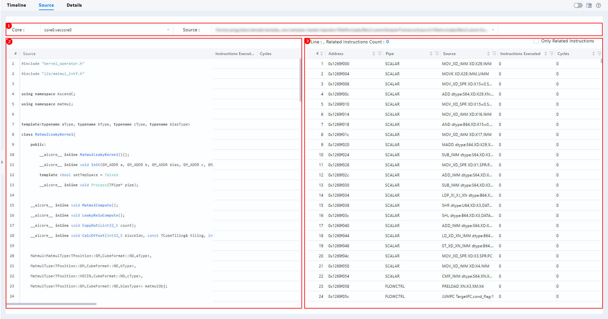
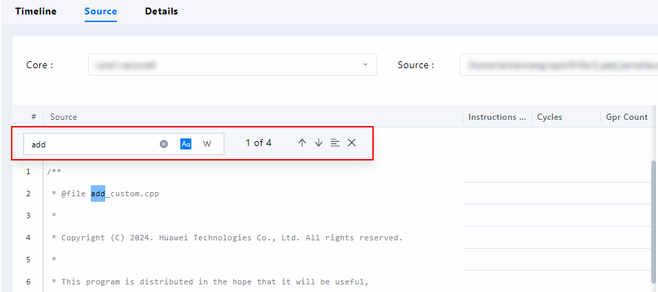
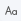
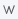
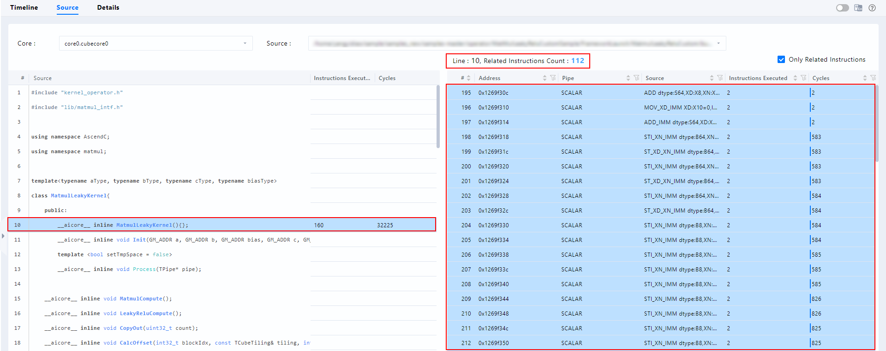
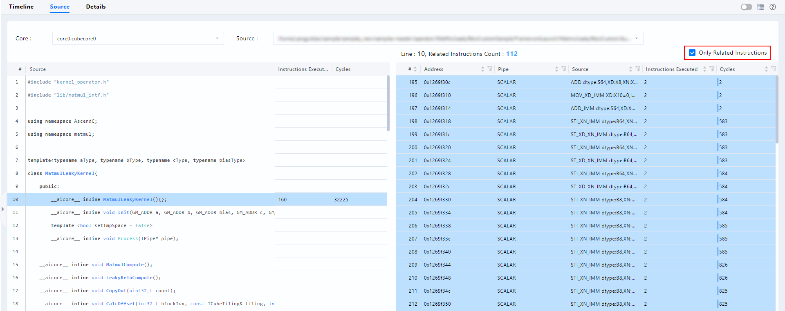
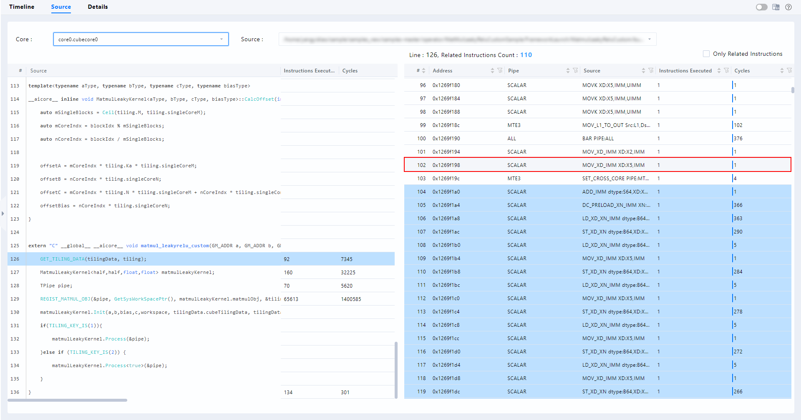
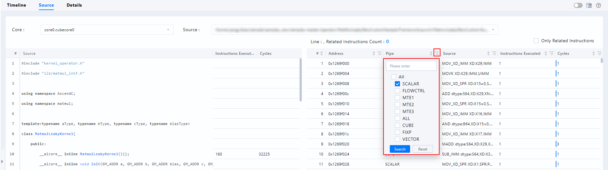

# Source

## Function

The **Source** tab page displays the operator instruction heatmap, and allows you to view the mapping between operator source code and instruction sets and the duration. During Ascend C operator development, developers can analyze the performance.

## GUI Description

The **Source** tab page consists of three parts: filter bar (area 1), source file code attributes (area 2), and instructions (area 3), as shown in [**Figure 1** Source tab page](#source-tab-page).

**Figure 1** Source tab page 

- Area 1: filter bar. You can filter the content to be viewed by **Core** and **Source**.
- Area 2: source file code attribute table. It shows each line of code and the corresponding execution duration and count. For details about the fields in the table, see [**Table 1** Fields in the source code attribute table](#fields_in_the_source_code_attribute_table).

    **Table 1** Fields in the source code attribute table 

    | Field                 | Description                                                                                                                                                                               | Examples |
    |--|--|--|
    | #                     | Code line number.                                                                                                                                                                         | 100      |
    | Source                | Source file code.                                                                                                                                                                         | -        |
    | Instructions Executed | Number of codes in the line executed on each core.                                                                                                                                        | 100      |
    | Cycles                | Number of cycles (clock cycles) consumed when the codes in the line are executed on each core.                                                                                            | 100      |
    | GPR Count             | Number of times the general-purpose register is used when the codes in the line are executed on each core. This field is displayed only when the data is collected by msopprof simulator. | 10       |
    | L2 Cache Hit Rate     | L2 cache hit rate of the line of code executed on all cores. This field is displayed only when the data is collected by msopprof.                                                         | 100%     |
    | Process Bytes         | Sum of the data volume processed by the line of code on each core, in Bytes.                                                                                                              | 2048     |

- Area 3: instructions. You can view instruction records, including the address, content, quantity, and times. [**Table 2** Instruction fields](#instruction-fields) describes the fields in the table.

    **Table 2** Instruction fields 

    | Field                         | Description                                                                                                                                                                                                                                                                                                                                                                                                                   | Examples     |
    |--|--|--|
    | #                             | Sequence number.                                                                                                                                                                                                                                                                                                                                                                                                              | 100          |
    | Address                       | Offset address of the instruction.                                                                                                                                                                                                                                                                                                                                                                                            | 0x1122a828   |
    | Pipe                          | Pipe (instruction queue) where the instruction is located.                                                                                                                                                                                                                                                                                                                                                                    | MTE2         |
    | Source                        | Instruction content.                                                                                                                                                                                                                                                                                                                                                                                                          | BAR PIPE:ALL |
    | Instructions Executed         | Number of instructions in the line executed on each core.                                                                                                                                                                                                                                                                                                                                                                     | 100          |
    | GPR Count                     | Number of times the general-purpose register is used when the instructions in the line are executed on each core. This field is displayed only when the data is collected by msopprof simulator.                                                                                                                                                                                                                              | 10           |
    | GPR Status                    | Register dependency information is presented graphically as a set of directed lines, each representing a register. A solid leftward arrow indicates a write, a hollow rightward arrow indicates a read, and a vertical bar denotes that the register is still in use. Hovering over a register displays its details.  This parameter is displayed only when the data exported from Ascend 950PR&950DT products is used. | -            |
    | Cycles                        | Number of cycles (clock cycles) consumed when the instructions in the line are executed on each core.                                                                                                                                                                                                                                                                                                                         | 100          |
    | L2 Cache Hit Rate             | L2 cache hit rate of the instruction executed on all cores. This field is displayed only when the data is collected by msopprof.                                                                                                                                                                                                                                                                                              | 72%          |
    | Process Bytes                 | Data volume processed by the instruction on each core, in Bytes.                                                                                                                                                                                                                                                                                                                                                              | 2048         |
    | UB Read Conflict              | Read conflicts of vector instructions on the UB Bank. This field is displayed only when the data is collected by msopprof simulator.                                                                                                                                                                                                                                                                                          | 1            |
    | UB Write Conflict             | Write conflicts of vector instructions on the UB Bank. This field is displayed only when the data is collected by msopprof simulator.                                                                                                                                                                                                                                                                                         | 0            |
    | Vector Utilization Percentage | Utilization of the vector computing unit, in percentage. This field is displayed only when the data is collected by msopprof simulator.                                                                                                                                                                                                                                                                                       | 35.29        |

## Instructions

**Source Code Search**

In the **Source** area, press **Ctrl+F** on the keyboard to display the search box. Enter a keyword in the search box to select **Match case** and other functions as required and press **Enter**. The keyword is highlighted, as shown in [**Figure 2** Searching source code](#searching-source-code). [**Table 3** Icon functions](#icon-functions) describes the functions of the icons in the search box.

> [!NOTE]
>
> In macOS, press **Command+F** on the keyboard to display the search box.

**Figure 2** Searching source code 

**Table 3** Icon functions 

| Icon | Function |
|------|----------|
|  | Indicates the **Match case** function. After this icon is selected, the entered keyword can be found, and the search is case-sensitive. |
|  | Indicates the **Words** function. After this icon is selected, keywords that match exactly can be found. |
|  | Scrolls up the search results. |
|  | Scrolls down the search results. |
|  | Allows you to drag select a source code area. After clicking this icon, you can select the source code area by clicking the left mouse button. Then, you can search for the source code in the selected area. |
|  | Allows you to close the search box and exit the search function. Alternatively, press **Esc** to exit. |

**Viewing Related Instructions**

Click any line of code in the source file code attributes. The code related to the line is highlighted in the instructions. The number of lines (**Line**) and the total number of instructions (**Related Instructions Count**) associated with the selected code are displayed above the instructions, as shown in [**Figure 3** Viewing related instructions](#viewing-related-instructions). The selected code is in line 10 and 112 instructions are associated with the code.

**Figure 3** Viewing related instructions 

If you select **Only Related Instructions** in the instruction table, only the instructions related to the line of code are displayed, as shown in [**Figure 4** Filtering related instructions](#filtering-related-instructions).

**Figure 4** Filtering related instructions 

**Viewing Related Code**

Click any row in the instruction table to highlight the related code in the source code attribute table, and to highlight all related instructions for that row. See [**Figure 5** Viewing related code](#viewing-related-code) for an example.

**Figure 5** Viewing related code 

> [!NOTE]
>
> If there are multiple lines of associated codes, only the uppermost codes are highlighted.

**Filtering Instructions**

In the instruction table, click  next to each field in the table header to filter the content to be viewed, as shown in [**Figure 6** Filtering instructions](#filtering-instructions).

**Figure 6** Filtering instructions 

