# Timeline

## Function

During operator performance tuning, MindStudio Insight displays the detailed execution status of bottom-layer instructions in the operator running process on the timeline. The tool also displays the instruction call sequence and time consumption of each pipe on each core of the AI processor. By analyzing the timeline, you can quickly locate performance bottlenecks by viewing instruction details and duration.

By examining the duration and intervals at each layer of the timeline view, you can identify performance bottlenecks in the corresponding instructions and pipes, such as instruction execution bottlenecks or particularly time-consuming instructions.

## GUI Description

**GUI**

The **Timeline** tab page consists of the toolbar (area 1), graphical display (area 2), and data pane (area 3), as shown in [**Figure 1** Timeline page](#timeline-page).

**Figure 1** Timeline page 
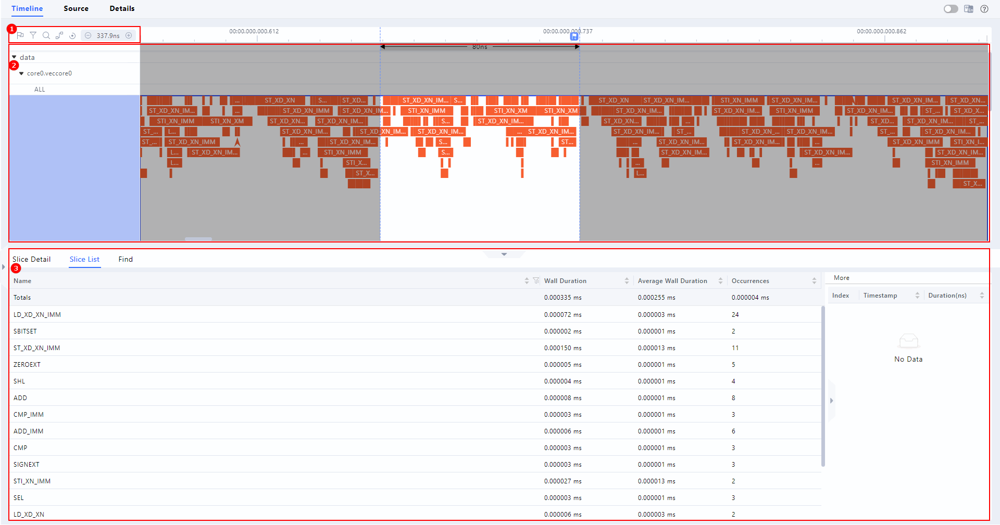

- Area 1: toolbar, which contains common shortcut keys. From left to right, the shortcut keys are **Marker List**, **Filter** (rank or unit), **Search**, **Flow Events**, **Reset** (page restoration), **Timeline Zoom Out**, and **Timeline Zoom In**.
- Area 2: graphical display. The left pane displays the layer information of each core. The first layer is **Core**, and the second layer is **Pipe**. The timeline view is displayed on the right by line, including the execution sequence and duration of each instruction. For details about the unit information, see [Unit Information](#unit-information).
- Area 3: data pane, which displays statistics or instruction details. To view the details of a single instruction, you can select **Slice Detail**. To view a list of instructions from a selected area in a unit, you can select **Slice List**.

**Unit Information**

| Unit | Description |
|------|-------------|
| ALL | Instructions in this channel will be executed in all channels. |
| SCALAR | Scalar unit. |
| FLOWCTRL | Control flow instruction. |
| MTE1 | Data transfer pipeline, from L1 to {L0A/L0B, UB}. |
| CUBE | Matrix multiplication unit. |
| FIXP | Pipeline of data transfer from FIXPIPE L0C to OUT/L1  Only the profile data exported from Atlas A2 products can be displayed. |
| MTE2 | Data transfer pipeline, from {DDR/GM, L2} to {L1, L0A/B, UB}. |
| VECTOR | Vector unit. |
| MTE3 | Data transfer pipeline, from UB to {DDR/GM, L2, L1}, or from L1 to {DDR/L2}. |
| CACHEMISS | Missed iCache. |
| USEMASK | Custom instrumentation range. |
| MTE Throughput | Memory throughput information.  - GM_TO_L1: throughput of data transferred from GM to L1.  - GM_TO_TOTAL: total throughput of GM output data.  - GM_TO_UB: throughput of data transferred from GM to UB.  - L1_TO_GM: throughput of data transferred from L1 to GM.  - TOTAL_TO_GM: total throughput of GM input data.  - UB_TO_GM: throughput of data transferred from UB to GM. |

## Instructions

### Basic Functions

**Floating Toolbar**

The **Timeline** interface supports adjusting the view through the mouse function bar. The interface is shown in [Figure 2 Floating Toolbar](#floating-toolbar), and the main functions are as follows:

1. Default mode: You can flexibly click with the mouse and freely select units by dragging a box.
2. Pan mode: Freely drag the timeline chart horizontally to flexibly view and locate operators.
3. Auto fit unit height : Automatically compresses blank and invalid areas in response to window resizing, making the view display clearer.
4. Floating toolbar guide: Provides an illustrated introduction to the floating toolbar functions.
5. The floating toolbar can be hidden and shown via key press.

    **Figure 2** Floating toolbar 
    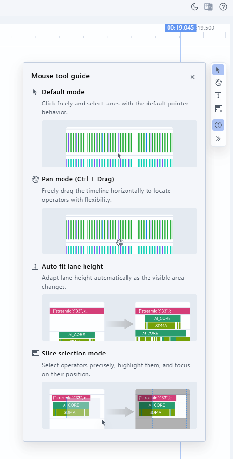

**Zooming In and Out on the GUI**

You can zoom in or out the **Timeline** interface, or move it left and right. The operations are as follows:

- Click any position in the tree chart or graphical pane on the **Timeline** interface and press **W** (zoom in) or **S** (zoom out) key to zoom. The maximum zoom-in precision is 1ns.
- Click any position in the tree chart or graphical pane on the **Timeline** interface and press **A** (move left), **D** (move right), left arrow (move left), or right arrow (move right) key to move it left or right, or press up arrow (move up) or down arrow (move down) key to move it upward or downward.
- In the graphical pane, hold down **Alt** and click the left mouse button to zoom in a selected area.
- Click  (zoom in) or  (zoom out) on the toolbar in the upper left corner of the page.
- Click  on the toolbar in the upper left corner to restore the graphical pane to display all timeline views.
- Move the pointer to any position in the tree chart or graphical pane on the **Timeline** interface, and hold down **Ctrl** and scroll the mouse wheel to zoom in or out.
- In the graphical pane, hold down **Ctrl** and click the left mouse button to drag the unit chart left or right.

    > [!NOTE]
    >
    > On macOS, you need to press the Command key and scroll the mouse wheel to zoom in or out, and press the Command key and left mouse button to drag the unit chart left or right.

- In the graphical pane, right-click to zoom in or out. For details, see [**Table 1** Right-click menu](#right-click-menu).

    **Table 1** Right-click menu 

    | Menu                | Description                                                                                                                                            | Operation                                                                                                                                                                                                           |
    |--|--|--|
    | Fit to screen       | Enlarges a single instruction to the maximum width of the visible range of the screen. If no instruction is selected, this parameter is not displayed. | Select an instruction and right-click it. In the displayed menu, click **Fit to screen** to enlarge the selected instruction to fit the maximum visible width of the screen.                                        |
    | Zoom into selection | Zooms in on the selected area to the maximum width of the visible range of the screen. If no area is selected, this parameter is not displayed.        | Select an area and right-click it. In the displayed menu, click **Zoom into selection** to enlarge the selected area to the maximum width of the visible range of the screen.                                       |
    | Undo Zoom(0)        | Undoes the zoom. The number in the parentheses changes with the number of zoom operations. The initial value is **0**.                                 | On the zoomed-in **Timeline** page, right-click to display a shortcut menu. Click **Undo Zoom(0)** to cancel the zooming. The page is zoomed out once, and the number in the brackets decreases by one accordingly. |
    | Reset Zoom          | Resets the zoom to restore the chart to the initial state.                                                                                             | On the zoomed-in Timeline page, right-click and choose **Reset Zoom** from the shortcut menu. The chart is reset to the initial state.                                                                              |

**Instruction Search**

MindStudio Insight allows you to search for instructions on the **Timeline** tab page.

- Click  on the toolbar in the upper left corner of the page. In the displayed text box, enter the command to be searched for and press **Enter**. The matched commands are displayed, as shown in [**Figure 3** Total number of searched commands](#total-number-of-searched-commands). In this example, 11,754 instructions containing "mov" are found.

    **Figure 3** Total number of searched commands 
    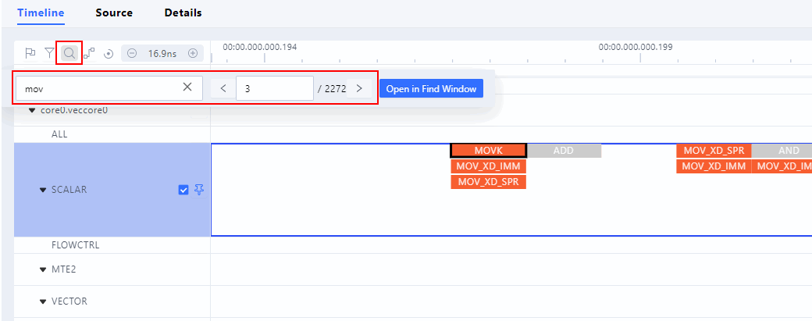

- Click  on the toolbar in the upper left corner of the page. You can click  and 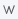 on the left of the search text box to enable case-sensitive matching and whole-word matching, as shown in [**Figure 4** Case match and whole word match](#case-match-and-whole-word-match).

    Click  to enable case match. Enter the information to be searched for and press **Enter**. The instructions whose names contain the search item will be matched.

    Click  to enable whole-word match. Enter the information to be searched for and press **Enter**. The instructions whose names are the same as the search item will be matched, regardless of the case.

    If both  and  are selected, case match and whole-word match are enabled. Enter the name of the instruction to be searched for in the text box and press **Enter**. The instruction whose name is the same as the search item will be matched.

    **Figure 4** Case match and whole word match 
    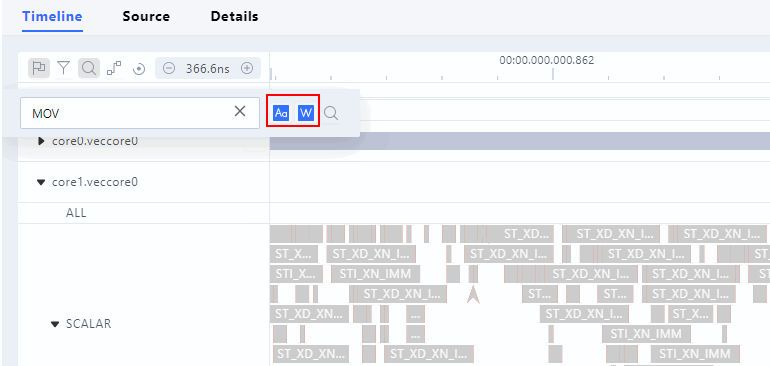

- Click the switch button next to the search box to view the previous or next matched instruction, or type a number next to the search box to search for the corresponding instruction. The instruction is highlighted in the middle of the page, as shown in [**Figure 5** Locating an instruction](#locating-an-instruction).

    **Figure 5** Locating an instruction 
    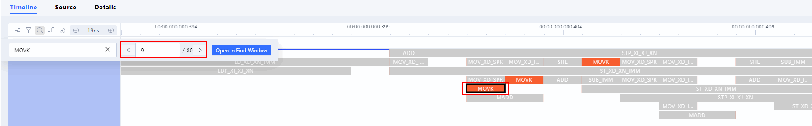

- Click **Open in Find Window** next to the search box. The **Find** tab page is displayed in the lower part of the page, showing all search instructions, as shown in [**Figure 6** Open in Find Window](#open-in-find-window-2). [**Table 2** Field description](#field-description) describes the fields. Click the instruction in the Jump to Timeline column to go to the specific location of the instruction in the timeline view.

    **Figure 6** Open in Find Window 
    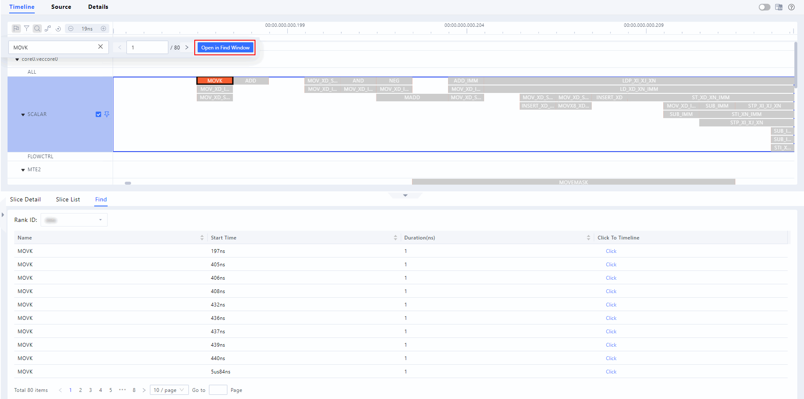

    **Table 2** Field description 

    | Field             | Description                                                                             |
    |--|--|
    | Rank ID           | Rank ID. You can select the data file to be viewed.                                     |
    | Name              | Instruction name.                                                                       |
    | Start Time        | Start time of instruction execution.                                                    |
    | Duration(ns)      | Total duration of instruction execution.                                                |
    | Click To Timeline | Click **Click** to go to the specific location of the instruction in the timeline view. |

### Displaying Profile Data

**Setting and Viewing Markers**

- Region marker

  On the **Timeline** page, select a region and click  or press the **K** key to mark and save the selected region, as shown in [**Figure 7** Region marker](#region-marker-4).

  **Figure 7** Region marker 
  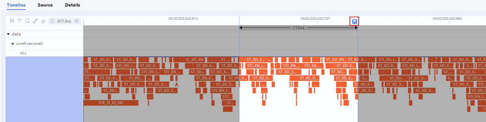

  Double-click a marker to set the marker pair attributes. You can modify the marker pair name and color, and delete the marker pair, as shown in [**Figure 8** Modifying marker pair attributes](#modifying-marker-pair-attributes-5).

  **Figure 8** Modifying marker pair attributes 
  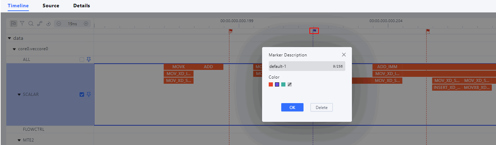

- Single-point marker

  Click anywhere in the uppermost empty unit or press **K** to generate a single-point marker, as shown in [**Figure 9** Single-point marker](#single-point-marker-6). Double-click a marker to set its attributes. You can modify the marker name and color, and delete the marker.

  **Figure 9** Single-point marker 
  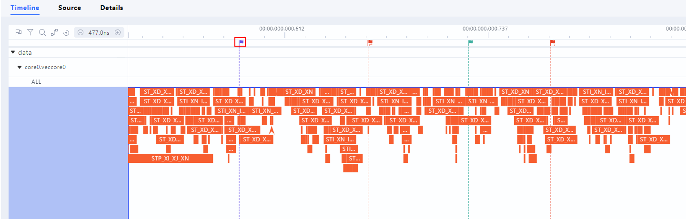

- Marker management

  Click  on the toolbar in the upper left corner to show all marker information, as shown in [**Figure 10** Viewing marker information](#viewing-marker-information-7).

  **Figure 10** Viewing marker information 
  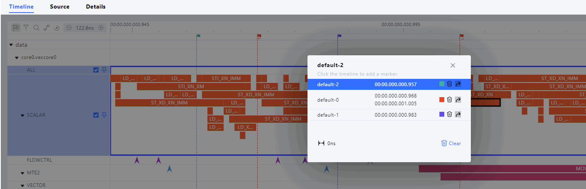

  - Click the  icon corresponding to a marker to delete the marker.
  - Click **Clear** in the lower part of the dialog box to delete all markers.
  - Click a region marker. The **Slice Detail** tab page in the lower part of the page displays the duration information of the region.
  - If a marker is not displayed on the current visualization page, click the  icon corresponding to the marker to go to the marker page.
  - Click the color icon corresponding to a marker to set the color to facilitate marker category management.

**Synchronizing Flows Between Instructions**

- MindStudio Insight displays the synchronization flows between instructions (from `SET_FLAG` to `WAIT_FLAG`). Click an instruction with a flow to display the flow associated with the instruction. Even if the pipe at the start point or end point of the flow is folded, the flow does not disappear, as shown in [**Figure 11** Instruction flows](#instruction-flows).

    **Figure 11** Instruction flows 
    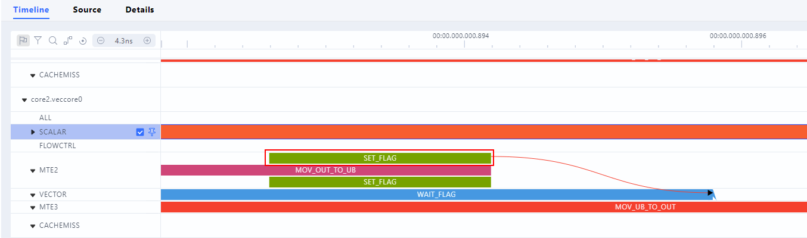

- MindStudio Insight supports the full flow function. You can click  on the toolbar in the upper left corner of the page. In the dialog box that is displayed, select one or more flow types. All flows between pipes are displayed in the timeline view, as shown in [**Figure 12** Full flows](#full-flows-8).

    > [!NOTE]
    >
    > A maximum of 10 flow types can be selected.

    **Figure 12** Full flows 
    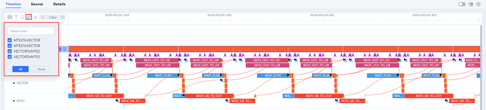

- The `SET_FLAG` and `WAIT_FLAG` instructions can be hidden.

    In the operator display area, right-click and choose **Hide SET/WAIT events** from the shortcut menu to hide the `SET_FLAG` and `WAIT_FLAG` instructions. The flow disappears at the same time. See [**Figure 13** Hiding SET/WAIT events](#hiding-set-wait-events).

    **Figure 13** Hiding SET/WAIT events 
    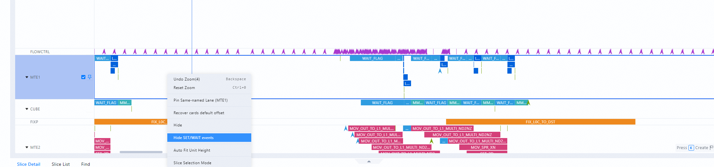

    After hiding SET/WAIT events, right-click the menu again and click **Show SET/WAIT events**, the hidden `SET_FLAG` and `WAIT_FLAG` instructions are displayed. The instruction flow can be displayed properly based on the flow function. See [**Figure 14** Show SET/WAIT events](#show-set-wait-events).

    **Figure 14** Showing SET/WAIT events 
    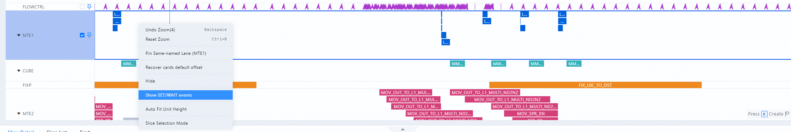

### Tuning Display

**Hide Units**

For details about how to hide units in the operator tuning scenario, see [hiding units](../system_tuning/timeline.md#displaying-page-optimization).

**Auto Unit Height**

For details about the auto unit height function in operator tuning scenarios, see [Auto Unit Height](../system_tuning/timeline.md#displaying-page-optimization).

### Displaying Statistics

MindStudio Insight allows you to view instruction statistics and details about a single instruction.

- Left-click to select instructions within a single pipe unit or across multiple core units. The selection is reflected in the **Slice List** below, which displays statistical information for the selected instructions (see [Figure 15 Slice List](#slice-list-9)). For details about the fields, see [Table 3 Fields on the Slice List tab page](#fields-on-the-slice-list-tab-page).

    You can move the cursor to the **Slice List** tab page and click  to copy the content displayed in the **Slice List** tab page and paste the content to an Excel file for analysis.

    Click an instruction in the **Slice List** column. All instructions with the same name as the instruction in the area are displayed in the **More** list on the right. Click a row in the **More** list to locate the instruction in the timeline view, and go to the **Slice Detail** page, where you can view the details about the instruction.

    **Figure 15** Slice List 
    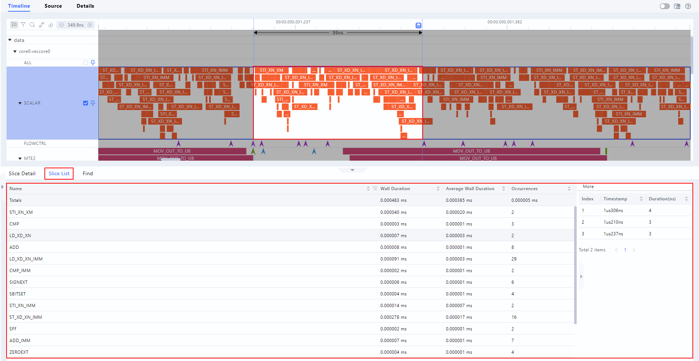

    **Table 3** Fields on the Slice List tab page 

    | Field                 | Description                                    |
    |--|--|
    | Name                  | Instruction name.                              |
    | Wall Duration         | Total duration of instruction execution.       |
    | Average Wall Duration | Average instruction execution time.            |
    | Max Wall Duration     | Maximum operator execution duration.           |
    | Min Wall Duration     | Minimum operator execution duration.           |
    | Occurrences           | Number of times that an instruction is called. |
    | Index                 | Sequence number.                               |
    | Start Time            | Timestamp in the graphical pane.               |
    | Duration(ms)          | Execution duration.                            |

- If you select a single instruction, you can view the details of the instruction in the lower part, as shown in [**Figure 16** Slice Detail](#slice-detail-10). For details about the fields, see [**Table 4** Slice Detail fields](#slice-detail-fields).

    Select a single instruction and press **M** to select the **Timeline** area to which the instruction belongs. Press **M** again to cancel the selection.

    **Figure 16** Slice Detail 
    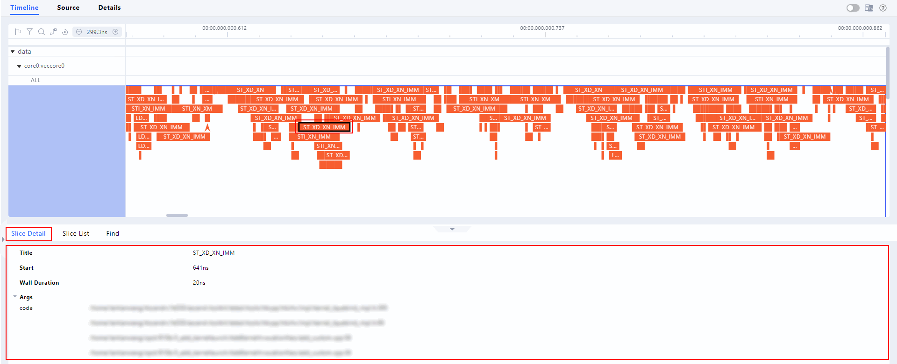

    **Table 4** Slice Detail fields 

    | Field                | Description                                                                                                                          |
    |--|--|
    | Title                | Name.                                                                                                                                |
    | Start                | Start time.                                                                                                                          |
    | Start(Raw Timestamp) | Original start time of data collection.                                                                                              |
    | Wall Duration        | Total duration.                                                                                                                      |
    | Args | Operator parameters, including:  - `code`: code call stack.  - `detail`: instruction source code.  - `pc_addr`: PC address. |
