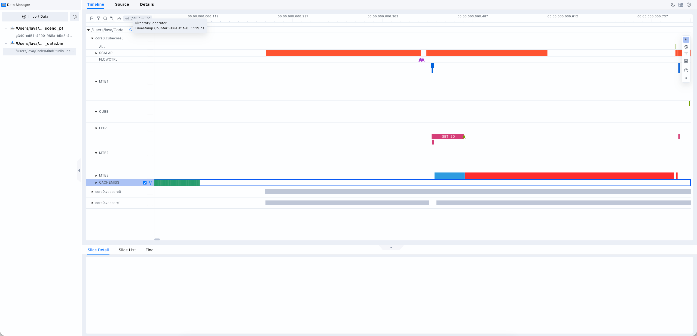
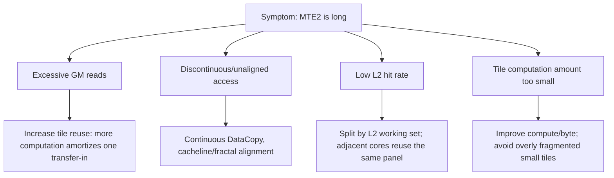
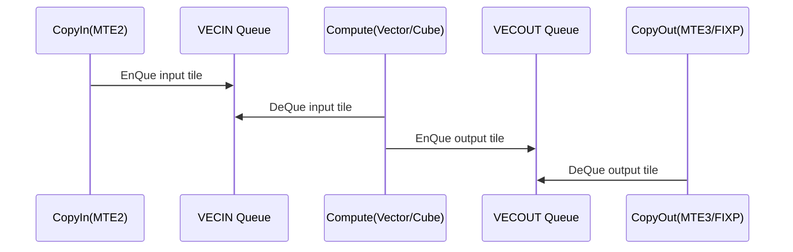

# Overall Interface Introduction



Operator execution is a multi-core concurrent process, so the first-level units in the pipeline graph are classified by AiCore. The unit name format is core_id.coreTypeCoreId. There are two coreType values: cube and vec.

## Unit Introduction

Units can be classified into 3 categories: data transfer, control flow, computing flow, and statistical events

**Data Transfer Flow**

Data must be transferred in before computation and transferred out after computation. The data transfer flow reflects the pipeline of data transfer in and out.

MTE1 unit: L1 --> L0A/L0B

MTE2 unit: GM --> L1, GM --> L0A/L

MTE3 unit: UB --> GM

FixPipe unit: L0 -> GM/L1

> For an introduction to the storage and transfer units, see [Storage Units and DMA Units](https://gitcode.com/cann/asc-devkit/blob/master/docs/en/guide/programming_guide/advanced_programming/hardware_implementation/basic_architecture.md#storage-units-and-dma-units).

**Control Flow**

The control unit provides instruction control for the whole computation process and is responsible for the operation control of the entire Ai Core. The control flow unit reflects branches, loops, and other conditions during the computation.

FLOWCTRL unit: control flow instruction pipeline

**Computing Flow**

SCALAR unit: the pipeline of scalar operations in the operator implementation

VECTOR unit: instructions executed on the vector core

CUBE unit: instructions executed on the cube core

**Statistical Events**

CACHE_MISS unit: indicates the occurrence of a cache_miss event

# Tuning Principles

AscendC is an SPMD model, that is, the same kernel runs on multiple cores and uses block_idx to process different data slices. Therefore, pipeline coverage is very important for AscendC tuning.

The goal of pipeline graph tuning is not to make a certain pipeline the shortest, but to make the computing flow wait less, the transfer flow block less, and the multi-core load balanced. The ideal state is that the computing flow and the transfer flow cover each other as fully as possible.

# **Bottleneck Identification**

**Load Imbalance**

If the pipe pipelines of multiple cores differ greatly in length, the loads on the cores are unbalanced.

**MTE2 bottleneck**: CopyIn bottleneck

MTE2 is mainly responsible for transferring data from GM and L2 into L1, L0A/L0B, and UB. If MTE2 is long in the pipeline graph and there are many idle gaps in the computing flow, the data supply cannot keep up.



Key strategies:

- For `GM -> UB`, transfer in large contiguous blocks as much as possible to avoid many small DataCopy operations.
- For `GM -> L1/L0A/B`, satisfying the fractal size and cacheline alignment is better; the official storage documentation explicitly states that cacheline alignment gives better performance for GM to L1/L0A/B transfers.
- For Matmul operators, give priority to reusing A/B panels by multiple tiles in L1/L2.
- If MTE2 cannot be hidden by computation, increase `baseM/baseN/baseK` or increase the computation amount per tile.
- If the tile is already large but still slow, check whether the L2/UB/L1 working set is blown up, causing repeated reads from GM.

**MTE3 or FIXP is very long**: CopyOut bottleneck

MTE3 is mainly responsible for UB --> GM, and FIXP is responsible for L0C --> GM/L1. A long duration indicates that the output write-back, format conversion, post-quantization processing, or small-block writes are too heavy.

Tuning directions:

- Fuse post-processing as much as possible: bias, scale, relu, cast, and quant should not fall to GM multiple times.
- Keep the output write-back contiguous and aligned; avoid writing by column, with a small stride, or in fragments.
- Reduce writing intermediate results back to GM; if the work can be done in UB/L1/L0C, do not write to external memory.
- Matmul split-K increases partial sum write-back and reduction; consider it only when the M/N parallelism is insufficient.
- If MTE3 is long but Vector/Cube is very short, the operator is memory-bound, and continuing to optimize the computing instructions is of little value; reduce the write traffic first.

**The computing flow is very long and the transfer flow is completely covered**

For Matmul/Conv, use Cube first instead of simulating large-scale multiply-add with Vector.

`baseM/baseN/baseK` must match the Cube instruction granularity to avoid too many tail blocks.

For Vector operators, ensure data alignment, a reasonable mask, and a sufficiently large single processing length.

For compute-bound cases, do not blindly double buffer or continue to reduce the tile; a smaller tile may only increase the scheduling and control flow overhead.

Check whether a large amount of scalar computation, address computation, or dynamic branching slows down the main loop.

**Large gaps between pipes: synchronization/queue/pipeline orchestration problems**



If computation starts long after MTE2 finishes, or transfer starts long after computation ends, the common causes are queue synchronization, buffer count, stage arrangement, or an unreasonable loop structure.

**. Serial CopyIn / Compute / CopyOut**

Problematic code: the three stages of each tile are serial; Vector starts only after MTE2 finishes, and MTE3 writes only after Vector finishes.

```c++
for (int i = 0; i < tileNum; ++i) {
    LocalTensor<half> x = inQueue.AllocTensor<half>();
    DataCopy(x, gmInput[i * tileLen], tileLen);   // MTE2
    inQueue.EnQue(x);

    LocalTensor<half> xLocal = inQueue.DeQue<half>();
    LocalTensor<half> y = outQueue.AllocTensor<half>();
    Adds(y, xLocal, half(1.0), tileLen);          // VECTOR
    inQueue.FreeTensor(xLocal);
    outQueue.EnQue(y);

    LocalTensor<half> yLocal = outQueue.DeQue<half>();
    DataCopy(gmOutput[i * tileLen], yLocal, tileLen); // MTE3
    outQueue.FreeTensor(yLocal);
}
```

After optimization: split the code into functions and prefetch the next tile while computing the current tile.

```c++
pipe.InitBuffer(inQueue, 2, tileLen * sizeof(half));
pipe.InitBuffer(outQueue, 2, tileLen * sizeof(half));

CopyIn(0);

for (int i = 0; i < tileNum; ++i) {
    if (i + 1 < tileNum) {
        CopyIn(i + 1);      // MTE2 prefetches the next block
    }

    Compute(i);             // VECTOR computes the current block
    CopyOut(i);             // MTE3 writes back the current block
}
__aicore__ inline void CopyIn(int i) {
    LocalTensor<half> x = inQueue.AllocTensor<half>();
    DataCopy(x, gmInput[i * tileLen], tileLen);
    inQueue.EnQue(x);
}

__aicore__ inline void Compute(int i) {
    LocalTensor<half> x = inQueue.DeQue<half>();
    LocalTensor<half> y = outQueue.AllocTensor<half>();

    Adds(y, x, half(1.0), tileLen);

    inQueue.FreeTensor(x);
    outQueue.EnQue(y);
}

__aicore__ inline void CopyOut(int i) {
    LocalTensor<half> y = outQueue.DeQue<half>();
    DataCopy(gmOutput[i * tileLen], y, tileLen);
    outQueue.FreeTensor(y);
}
```

**2. Insufficient buffer count**

Problematic code: there is only one input buffer, but the code tries to prefetch the next block, so `AllocTensor()` may wait for the previous block to be released.

```c++
pipe.InitBuffer(inQueue, 1, tileLen * sizeof(half));
pipe.InitBuffer(outQueue, 1, tileLen * sizeof(half));

CopyIn(0);

for (int i = 0; i < tileNum; ++i) {
    if (i + 1 < tileNum) {
        CopyIn(i + 1);      // May be blocked at AllocTensor
    }

    Compute(i);
    CopyOut(i);
}
```

After optimization: use double buffers for the input/output queues.

```c++
pipe.InitBuffer(inQueue, 2, tileLen * sizeof(half));
pipe.InitBuffer(outQueue, 2, tileLen * sizeof(half));

CopyIn(0);

for (int i = 0; i < tileNum; ++i) {
    if (i + 1 < tileNum) {
        CopyIn(i + 1);
    }

    Compute(i);
    CopyOut(i);
}
```

If `CopyOut` is obviously slower, you can add a buffer only on the output side, but check whether UB is sufficient:

```c++
pipe.InitBuffer(inQueue, 2, tileBytes);
pipe.InitBuffer(outQueue, 2, tileBytes);  // Usually start with 2
```

**3. Incorrect EnQue / DeQue order**

Problematic code: `Compute()` calls `DeQue()` first, but `CopyIn()` has not happened yet, so Vector waits on the input queue.

```c++
for (int i = 0; i < tileNum; ++i) {
    Compute(i);     // DeQue waits
    CopyIn(i);
    CopyOut(i);
}
```

After optimization: ensure that `CopyIn(i)` has been enqueued before `Compute(i)`.

```c++
CopyIn(0);

for (int i = 0; i < tileNum; ++i) {
    if (i + 1 < tileNum) {
        CopyIn(i + 1);
    }

    Compute(i);
    CopyOut(i);
}
```

A more conservative single-buffer version should be arranged at least as follows:

```c++
for (int i = 0; i < tileNum; ++i) {
    CopyIn(i);
    Compute(i);
    CopyOut(i);
}
```

Although there is no overlap, there is no incorrect dependency where `DeQue` waits for data that never arrives.

**4. FreeTensor is too late**

Problematic code: the input tensor is not released in time after use, so the subsequent `CopyIn` has no available buffer.

```c++
LocalTensor<half> saved[8];

for (int i = 0; i < tileNum; ++i) {
    CopyIn(i);

    LocalTensor<half> x = inQueue.DeQue<half>();
    LocalTensor<half> y = outQueue.AllocTensor<half>();

    Adds(y, x, half(1.0), tileLen);

    saved[i % 8] = x;       // Wrong: occupies the input buffer
    outQueue.EnQue(y);

    CopyOut(i);
}

for (int k = 0; k < 8; ++k) {
    inQueue.FreeTensor(saved[k]);
}
```

After optimization: release the data as soon as it no longer participates in computation.

```c++
for (int i = 0; i < tileNum; ++i) {
    CopyIn(i);

    LocalTensor<half> x = inQueue.DeQue<half>();
    LocalTensor<half> y = outQueue.AllocTensor<half>();

    Adds(y, x, half(1.0), tileLen);

    inQueue.FreeTensor(x);  // Release in time
    outQueue.EnQue(y);

    CopyOut(i);
}
```

Version placed in the pipeline:

```c++
CopyIn(0);

for (int i = 0; i < tileNum; ++i) {
    if (i + 1 < tileNum) {
        CopyIn(i + 1);
    }

    LocalTensor<half> x = inQueue.DeQue<half>();
    LocalTensor<half> y = outQueue.AllocTensor<half>();

    Adds(y, x, half(1.0), tileLen);

    inQueue.FreeTensor(x);
    outQueue.EnQue(y);

    CopyOut(i);
}
```

**5. CopyOut is postponed to the end of the loop**

Problematic code: MTE3 writes in a concentrated manner after Vector has computed many tiles, causing MTE3 to trail.

```c++
for (int i = 0; i < tileNum; ++i) {
    CopyIn(i);
    Compute(i);     // Only EnQue output
}

// MTE3 is postponed to the end
for (int i = 0; i < tileNum; ++i) {
    CopyOut(i);
}
```

After optimization: write back as soon as each tile is computed.

```c++
CopyIn(0);

for (int i = 0; i < tileNum; ++i) {
    if (i + 1 < tileNum) {
        CopyIn(i + 1);
    }

    Compute(i);
    CopyOut(i);     // Start MTE3 as soon as possible
}
```

If `CopyOut` is particularly long, consider moving the next round of `CopyIn` earlier, so that at least the write-back and the subsequent transfer-in/computation are interleaved:

```c++
CopyIn(0);

for (int i = 0; i < tileNum; ++i) {
    if (i + 1 < tileNum) {
        CopyIn(i + 1);
    }

    Compute(i);

    // Write back immediately after the current output is enqueued; do not accumulate to the end
    CopyOut(i);
}
```

**6. Transfer in all inputs first, then compute all of them, then write all of them back**

Problematic code: batch processing by stage. It blocks when the UB queue capacity is insufficient, and even when the capacity is sufficient, there is no pipeline overlap.

```c++
for (int i = 0; i < tileNum; ++i) {
    CopyIn(i);
}

for (int i = 0; i < tileNum; ++i) {
    Compute(i);
}

for (int i = 0; i < tileNum; ++i) {
    CopyOut(i);
}
```

After optimization: advance the pipeline tile by tile.

```c++
pipe.InitBuffer(inQueue, 2, tileBytes);
pipe.InitBuffer(outQueue, 2, tileBytes);

CopyIn(0);

for (int i = 0; i < tileNum; ++i) {
    if (i + 1 < tileNum) {
        CopyIn(i + 1);
    }

    Compute(i);
    CopyOut(i);
}
```

A more complete three-stage steady-state form:

```c++
// prologue
CopyIn(0);

for (int i = 0; i < tileNum; ++i) {
    // stage 1: prepare next
    if (i + 1 < tileNum) {
        CopyIn(i + 1);
    }

    // stage 2: consume current
    Compute(i);

    // stage 3: write current result
    CopyOut(i);
}
```

**7. Unnecessary full-pipe barrier**

Problematic code: `PIPE_ALL` after each segment, forcibly serializing pipes that could run in parallel.

```c++
for (int i = 0; i < tileNum; ++i) {
    CopyIn(i);
    AscendC::PipeBarrier<PIPE_ALL>();

    Compute(i);
    AscendC::PipeBarrier<PIPE_ALL>();

    CopyOut(i);
    AscendC::PipeBarrier<PIPE_ALL>();
}
```

After optimization: reduce heavy synchronization and rely on queue semantics first. Add a barrier of the minimum scope only when there is a real cross-pipe data visibility requirement.

```c++
CopyIn(0);

for (int i = 0; i < tileNum; ++i) {
    if (i + 1 < tileNum) {
        CopyIn(i + 1);
    }

    // DeQue itself expresses the dependency on the completion of CopyIn(i)
    Compute(i);

    // DeQue output itself expresses the dependency on the completion of Compute(i)
    CopyOut(i);
}
```

If synchronization is required, narrow its scope:

```c++
// Example: use a smaller-scope synchronization only when it is really needed between specific pipes
AscendC::PipeBarrier<PIPE_V>();
```

Do not use `PIPE_ALL` as a default safety net in the hot loop.

**8. Control overhead is high because tiles are too small**

Problematic code: very few elements are processed each time, so `Alloc/EnQue/DeQue/Free` and the loop control take too large a proportion.

```c++
constexpr int tileLen = 64;  // Too small; for illustration only

for (int i = 0; i < tileNum; ++i) {
    CopyIn(i);
    Compute(i);
    CopyOut(i);
}
```

After optimization: increase the tile size or merge multiple small tiles.

```c++
constexpr int tileLen = 1024;  // Chosen according to the UB capacity, alignment, and operator characteristics

CopyIn(0);

for (int i = 0; i < tileNum; ++i) {
    if (i + 1 < tileNum) {
        CopyIn(i + 1);
    }

    Compute(i);
    CopyOut(i);
}
```

Or merge multiple small tasks:

```c++
constexpr int smallTilesPerGroup = 4;

for (int g = 0; g < groupNum; ++g) {
    CopyInGroup(g, smallTilesPerGroup);
    ComputeGroup(g, smallTilesPerGroup);
    CopyOutGroup(g, smallTilesPerGroup);
}
```

Optimization goals:

```text
Reduce the number of loop iterations
Reduce the number of EnQue/DeQue operations
Make a single Vector/Cube instruction process a long enough length
Leave room for CopyIn/Compute/CopyOut overlap
```

**9. The tail branch is inside the main loop**

Problematic code: every tile checks for a tail block, inserting `FLOWCTRL/SCALAR` into the hot path.

```c++
for (int i = 0; i < tileNum; ++i) {
    int len;
    if (i == tileNum - 1) {
        len = tailLen;
    } else {
        len = tileLen;
    }

    CopyIn(i, len);
    Compute(i, len);
    CopyOut(i, len);
}
```

After optimization: the main loop over full tiles has no branch, and the tail is handled separately.

```c++
for (int i = 0; i < fullTileNum; ++i) {
    CopyIn(i, tileLen);
    Compute(i, tileLen);
    CopyOut(i, tileLen);
}

if (tailLen > 0) {
    CopyInTail(fullTileNum, tailLen);
    ComputeTail(fullTileNum, tailLen);
    CopyOutTail(fullTileNum, tailLen);
}
```

To combine this with double buffering:

```c++
if (fullTileNum > 0) {
    CopyIn(0, tileLen);

    for (int i = 0; i < fullTileNum; ++i) {
        if (i + 1 < fullTileNum) {
            CopyIn(i + 1, tileLen);
        }

        Compute(i, tileLen);
        CopyOut(i, tileLen);
    }
}

if (tailLen > 0) {
    CopyInTail(fullTileNum, tailLen);
    ComputeTail(fullTileNum, tailLen);
    CopyOutTail(fullTileNum, tailLen);
}
```

**10. Repeated initialization of objects or tiling parameters**

Problematic code: object registration, configuration, or complex tiling branches are repeated in the inner tile loop, resulting in dense `SCALAR/FLOWCTRL` activity.

```c++
for (int i = 0; i < tileNum; ++i) {
    REGIST_MATMUL_OBJ(&pipe, workspace, matmulObj, &tiling);
    InitTilingParams(runtimeShape, tiling);

    CopyIn(i);
    MatmulCompute(i);
    CopyOut(i);
}
```

After optimization: hoist the initialization that can be hoisted and keep only the stable hot path inside the tile.

```c++
REGIST_MATMUL_OBJ(&pipe, workspace, matmulObj, &tiling);
InitTilingParams(runtimeShape, tiling);

CopyIn(0);

for (int i = 0; i < tileNum; ++i) {
    if (i + 1 < tileNum) {
        CopyIn(i + 1);
    }

    MatmulCompute(i);
    CopyOut(i);
}
```

If the branches differ greatly for different shapes/scenarios, separate them with a tiling key or template specialization:

```c++
if (tilingKey == SMALL_M) {
    RunSmallMKernel();
} else if (tilingKey == LARGE_K) {
    RunLargeKKernel();
} else {
    RunDefaultKernel();
}
```

Keep each `RunXxxKernel()` simple, stable, and with few branches.

**Recommended Comparison Template**

Problematic version:

```C++
for (int i = 0; i < tileNum; ++i) {
    if (IsTail(i)) {
        PrepareTail();
    }

    InitSomething();

    CopyIn(i);
    AscendC::PipeBarrier<PIPE_ALL>();

    Compute(i);
    AscendC::PipeBarrier<PIPE_ALL>();

    SaveForLater(i);
}

for (int i = 0; i < tileNum; ++i) {
    CopyOut(i);
}
```

Optimized version:

```c++
InitOnce();
PrepareMainLoopParams();

pipe.InitBuffer(inQueue, 2, tileBytes);
pipe.InitBuffer(outQueue, 2, tileBytes);

if (fullTileNum > 0) {
    CopyIn(0);

    for (int i = 0; i < fullTileNum; ++i) {
        if (i + 1 < fullTileNum) {
            CopyIn(i + 1);
        }

        Compute(i);
        CopyOut(i);
    }
}

if (tailLen > 0) {
    ProcessTail();
}
```

Tuning directions:

- For regular pipelines, use `TQue depth=1`; do not mistake the queue depth for a double buffer.
- A double buffer is `InitBuffer(..., num=2, ...)` and requires extra UB/L1 space.
- When the number of loop iterations is very small, the benefit of double buffering is limited; the official documentation also notes that for small data or when the computation is significantly longer than the transfer, double buffering may yield little benefit or even make things worse.
- Avoid processing all tiles completely serially with `CopyIn(); Compute(); CopyOut();`; form a pipeline by iterating over tiles.
- When there are too many synchronization lines, check for unnecessary barriers, repeated EnQue/DeQue, or incorrect reuse of temporary buffers across stages.

**Excessive control flow proportion: high SCALAR/FLOWCTRL**

Typical causes:

```text
Frequent if/else inside the inner loop
A tail check for every tile
Too many dynamic shape branches
Complex address computation
Tiles are too small, so the control overhead takes a larger proportion
```

Tuning directions:

```text
Keep the main loop on a branch-free fast path
Handle the tail separately
Decide the branches in advance in the host tiling stage
Precompute constants, strides, and offsets
Split the kernel or the function by tiling key when necessary
Unroll moderately, but avoid code bloat
```

**CACHEMISS: poor local instruction locality**

```text
The hot path code is too large
Excessive template expansion or unrolling
Too many scenario branches packed into one kernel
Infrequently used paths are mixed with the main path
```

Tuning directions:

```text
Reduce the code size of the main loop
Split out the cold path
Specialize by tiling key or scenario
Reduce excessive unrolling
Avoid handling too many completely different modes in one kernel
```

**Slow core trailing**

```text
Uneven block_idx splitting
The tail all falls on one core
blockDim is too large or too small for a small shape
The data accessed by some cores has worse locality
The areas accessed by multiple cores are too scattered, resulting in poor L2 reuse
```

Tuning directions:

```text
Split the tasks evenly
Distribute the tail across multiple cores
Merge small tasks and split large tasks
Split in two dimensions (M/N) to avoid a heavy single-dimension tail
Have adjacent cores process adjacent tiles to improve L2 locality
```
