# Communication

## Function Description

The **Communication** tab page displays the network link performance across the cluster and the communication performance of all nodes. By analyzing the overlapped duration between cluster communication and computation, slow hosts or nodes in the cluster training can be identified.

## GUI Description

The **Communication** tab page displays cluster communication performance from two dimensions: network-wide link display and node-based display. The data is displayed in two parts: **Communication Matrix** and **Communication Duration Analysis**.

**Communication Matrix**

The **Communication Matrix** tab page displays information about communication operators in a specified step communication group, including the bandwidth, communication duration, transmission size, and link mode, as shown in [**Figure 1** Communication Matrix](#communication-matrix). For details about the parameters, see [**Table 1** Communication Matrix fields](#communication-matrix-fields).

**Figure 1** Communication Matrix

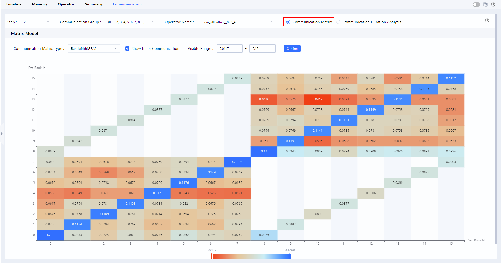

**Table 1** Communication Matrix fields 

|Field|Description|
|--|--|
|Cluster|Cluster name. You can select a cluster from the drop-down list when importing cluster data.|
|Step|Step ID. You can select a step from the drop-down list.|
|Communication Group|Communication group. You can select one, multiple, or all nodes from the drop-down list. The nodes are displayed on the vertical coordinate.|
|Operator Name|Communication operator name. You can select **Total Op info** or a type of operator from the drop-down list.  The data of communication operators are grouped by type, like "allreduce-total" for easier viewing. When you select the **top**, **bottom**, or **middle** type, move the pointer to the communication matrix heatmap and click a cell to see the specific communication operator name.  - **Total Op info**: data of all communication operators in the selected Step and communication group.  - **total**: average bandwidth of the communication operators (total transmission volume of a type of communication operators/total transmission time). You are advised to view this type first.  - **top**: communication operators with the highest bandwidth. Top *N* indicates the **N** highest bandwidths.  - **middle**: communication operators with the median bandwidth.  - **bottom**: communication operators with the lowest bandwidth. Bottom *N* indicates the **N** lowest bandwidths.|
|Matrix Model|Communication matrix heatmap.|
|Communication Matrix Type|Communication matrix type.  - **Bandwidth (GB/s)**: bandwidth (GB/s).  - **Transit Size(MB)**: communication size.  - **Transport Type**: link type.  - **Transit Time(ms)**: communication duration.|
|Show Inner Communication|Communication data in the rank. This option is not selected by default.|
|Visible Range|Visible range of data. By default, all data is displayed. You can manually set the data display range.|
|Src Rank Id|Source Rank ID. The horizontal coordinate is the ID of the source rank in the link information.|
|Dst Rank Id|Destination Rank ID. The vertical coordinate is the ID of the destination rank in the link information.|

**Communication Duration Analysis**

**Communication Duration Analysis** displays the communication performance of nodes, including the communication operator thumbnail, communication duration, data analysis, and advice, as shown in [**Figure 2** Communication Duration Analysis](#Communication-Duration-Analysis). For details about the parameters, see [**Table 2** Communication Duration Analysis fields](#Communication-Duration-Analysis-fields).

**Figure 2** Communication Duration Analysis 

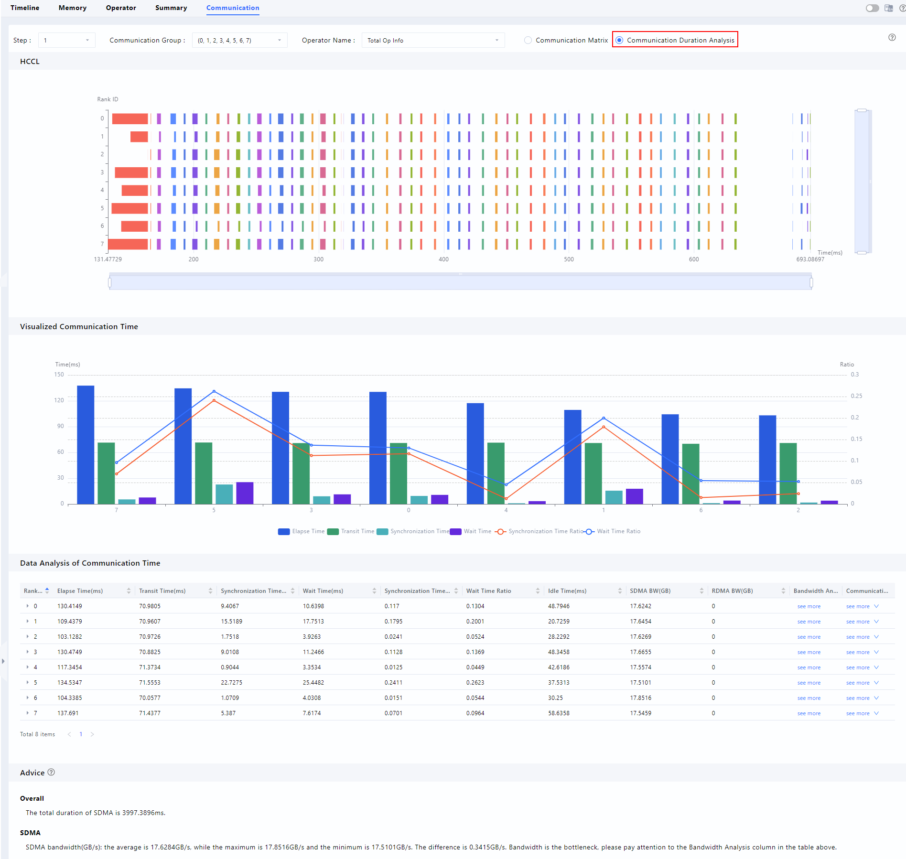

**Table 2** Communication Duration Analysis fields 

|Field|Description|
|--|--|
|Cluster|Cluster name. You can select a cluster from the drop-down list when importing cluster data.|
|Step|(Mandatory) Step ID. You can select a step from the drop-down list.|
|Communication Group|(Mandatory) Communication group. You can select or search for one, multiple, or all nodes from the drop-down list. The nodes are displayed on the vertical coordinate.|
|Operator Name|(Mandatory) Communication operator name. You can select **Total Op Info** or a specific operator from the drop-down list. **Total Op Info** indicates the sum of all communication operator data in the selected **Step** and communication group.|
|Communication Matrix|(Mandatory) Communication matrix. Either this parameter or **Communication Duration Analysis** must be set.|
|Communication Duration Analysis|(Mandatory) Communication duration analysis. Either this parameter or **Communication Matrix** must be set.|
|Communication|Execution sequence and time of communication operators. The slow rank information is displayed below the thumbnail. For details, see [Quickly Analyzing and Locating Abnormal Communication Operators](#quickly-analyzing-and-locating-abnormal-communication-operators).|
|Rank ID|Vertical coordinate in the communication operator thumbnail, which indicates Rank ID.|
|Time(ms)|Horizontal coordinate of the communication operator thumbnail, which indicates the operator running time, in milliseconds.|
|Visualized Communication Time|Visualized communication duration chart.|
|Time(ms)|Vertical coordinate on the left of the communication duration chart, which indicates the duration, in milliseconds.|
|Ratio|Vertical coordinate on the right of the communication duration chart, which indicates the duration percentage.|
|Data Analysis of Communication Time|Operator communication duration data analysis. You can move the cursor to the table and click  to copy the content displayed in the table and paste it to an Excel file for analysis.|
|Rank ID|Rank ID.|
|Elapsed Time(ms)|Total time of all communication operator events.|
|Transit Time(ms)|Communication duration, which indicates the communication duration of the communication operator, which is the total duration of communication operators on SDMA links (communication within a server) and RDMA links (communication between servers). If the communication duration is too long, a link may be faulty.|
|Synchronization Time(ms)|Synchronization duration, which is required for synchronization between nodes before the first communication between ranks. This parameter is used to determine whether the long waiting time is caused by a slow node or a slow link.|
|Wait Time(ms)|Waiting duration. Synchronization is performed before two nodes communicate with each other to ensure that communication is established after the two nodes are synchronized.|
|Synchronization Time Ratio|Synchronization duration ratio. **Synchronization Time Ratio** = **Synchronization Time**/(**Synchronization Time** + **Transit Time**). A larger synchronization duration ratio before communication indicates a lower communication efficiency, which may be caused by slow ranks.|
|Wait Time Ratio|Wait time ratio of a communication operator. **Wait Time Ratio** = **Wait Time**/(**Wait Time** + **Transit Time**). A larger wait time ratio indicates that the wait time of the node accounts for a larger proportion of the total communication duration, and the communication efficiency is lower.|
|Idle Time(ms)|Duration for communication operator delivery. **Idle Time** = **Elapsed Time** – **Transit Time** – **Wait Time**|
|SDMA BW(GB)|SDMA bandwidth.|
|RDMA BW(GB)|RDMA bandwidth.|
|Bandwidth Analysis|Bandwidth analysis. Click `See more` to view the bandwidth details of the specified operator on the corresponding node, as shown in [**Figure 3** Bandwidth analysis](#bandwidth-analysis).|
|Communication Operators Details|Details about the communication operator. This parameter is displayed only when **Operator Name** is set to **Total Op info**. Click `See more` to view the link details of the communication operator on the corresponding node, as shown in [**Figure 4** Communication operator details](#communication-operator-details-1).|
|Advice|Advice on the imported data upon analysis. It analyzes the bandwidth, byte alignment, communication retransmission, and communication packets, and provides suggestions, as shown in [**Figure 5** Advice](#advice).|

**Figure 3** Bandwidth analysis 

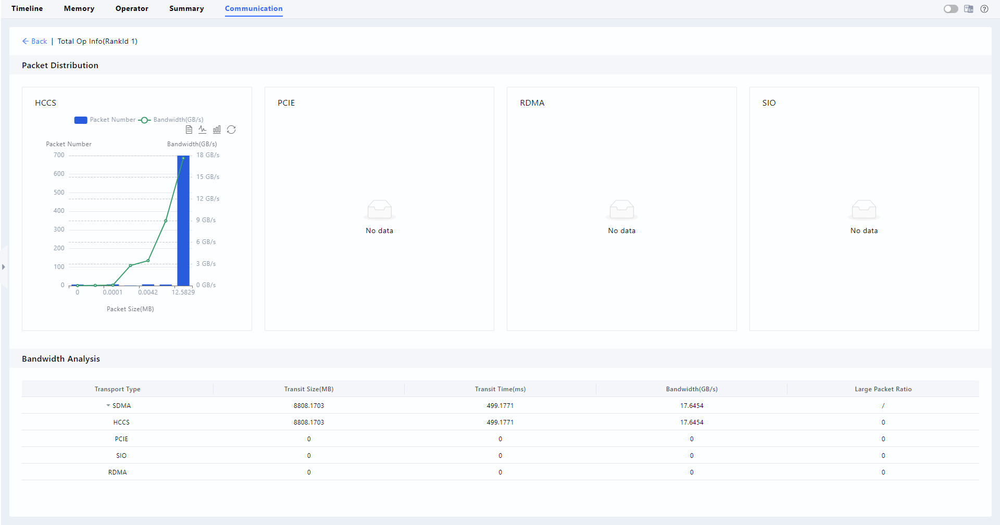

The bandwidth analysis page displays the communication performance of network-wide links, including the communication duration, traffic, bandwidth, and link type. [**Table 3** bandwidth analysis fields](#bandwidth-analysis-fields) describes the fields on the bandwidth analysis page.

**Table 3** Bandwidth analysis fields 

|Field|Description|
|--|--|
|Packet Number|Number of communication packets.|
|Packet Size(MB)|Size of a communication packet.|
|Transport Type|Link mode.|
|SDMA|SDMA links (communication links between devices in a node), including HCCS, PCIe, and SIO links.|
|RDMA|RDMA links (inter-node device communication links).|
|UB|UB links (Device-to-Device communication links within a SuperPoD).|
|Transit Size(MB)|Size of communication packets within one communication process.|
|Transit Time(ms)|Duration of one communication process.|
|Bandwidth(GB/s)|Bandwidth. The bandwidth equals the traffic divided by the communication duration. Empirical bandwidth reference values: **RDMA_Bandwidth** = **12.5**; **HCCS_Bandwidth** = **18**; and **PCIe_Bandwidth** = **20**.|
|Large Packet Ratio|Ratio of large communication packets. It is the ratio of packets whose sizes are big enough to enable the communication link to reach the empirical bandwidth.|

**Figure 4** Communication operator details 

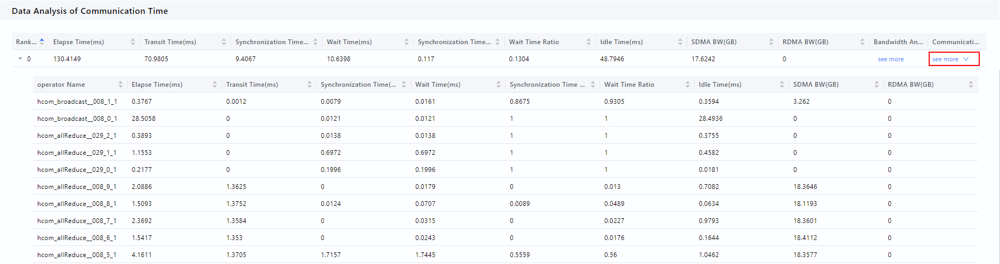

This column displays communication performance by operator, including the communication duration, waiting duration, and synchronization duration of the communication operator. [**Table 4** Communication operator detail fields](#communication-operator-detail-fields) describes the fields in the figure.

**Table 4** Communication operator detail fields

|Field|Description|
|--|--|
|Operator Name|Communication operator name.|
|Elapsed Time(ms)|Total duration of all events of the communication operators, in milliseconds.|
|Transit Time(ms)|Communication duration, in milliseconds. The communication duration is calculated based on the total duration of the communication operators of the SDMA and RDMA links.|
|Synchronization Time(ms)|Synchronization duration, in milliseconds. It is the waiting time before the first data transmission.|
|Wait Time(ms)|Wait duration (ms). Synchronization is performed before two ranks communicate with each other.|
|Synchronization Time Ratio|Synchronization duration ratio. The calculation formula is **Synchronization Time**/(**Synchronization Time** + **Transit Time**).|
|Wait Time Ratio|Waiting duration ratio. The calculation formula is **Wait Time**/(**Wait Time** + **Transit Time**).|
|Idle Time(ms)|Duration for communication operator delivery. **Idle Time** = **Elapsed Time** – **Transit Time** – **Wait Time**|
|SDMA BW(GB)|SDMA bandwidth.|
|RDMA BW(GB)|RDMA bandwidth.|
|Operation|Click `Show in Timeline` to view the corresponding communication operator on the timeline page. Click `Show in Thumbnail` to view the operator in the communication operator thumbnail.|

The advice provides data analysis including bandwidth description, byte alignment analysis, communication retransmission analysis, and communication packet analysis, and suggestions. You can further locate the slow rank and specific operator based on the advice in the parallel strategy analysis on the overview page.

-

> The following content is sourced from the communication link type chapter of *Performance Tuning Tool Guide*. In case of updates, refer to the source document.
> The following content is sourced from the "Communication Link Type" chapter of the *Performance Tuning Tool Guide*. If it is updated, the source document prevails.

In communication analysis, data transmission is completed through different link types. The description of each link type is shown in [**Table 19** Communication link type description](#communication-link-type-description).

**Table 19** Communication link type description

|Link Type|Full Name|Description|Applicable Scenario|Empirical Bandwidth Reference (GB/s)|
|--|--|--|--|--|
|SDMA|Shared Direct Memory Access|Intra-node inter-device communication link, i.e., data transmission between different NPUs within the same server.|Single-machine multi-rank scenario, communication between NPUs within the same server.|-|
|HCCS|Huawei Cache Coherence System|A subtype of SDMA, an intra-node communication link based on the Huawei Cache Coherence System.|Communication between NPUs interconnected via HCCS within the same server.|18|
|PCIe|Peripheral Component Interconnect Express|A subtype of SDMA, an intra-node communication link based on the PCIe bus.|Communication between NPUs connected via PCIe within the same server.|20|
|SIO|Serial Input/Output|A subtype of SDMA, an intra-node communication link based on serial input/output.|Intra-node communication under specific hardware topologies.|-|
|RDMA|Remote Direct Memory Access|Cross-node inter-device communication link, i.e., direct memory access between NPUs on different servers.|Multi-machine multi-rank scenario, communication between NPUs across servers.|12.5|
|UB|Unified Bus|A high-speed interconnect dedicated to Ascend SuperPoDs for communication between devices in the same SuperPoD.|NPU communication over UB within the same SuperPoD.|-|

> [!NOTE]
>
> - SDMA includes three subtypes: HCCS, PCIe, and SIO. The MindStudio Insight tool automatically identifies the subtype used based on the actual hardware topology.
> - The empirical bandwidth reference values are typical values of theoretical peak bandwidth. Actual bandwidth is affected by factors such as hardware configuration, network topology, and communication mode, and is provided for reference only.
> - When the actual bandwidth is significantly lower than the empirical bandwidth reference value, a link bottleneck may exist. It is recommended to check the network configuration and communication mode.
> - Bandwidth calculation method: Bandwidth = Communication data volume/Communication duration. On the bandwidth analysis page, communication bottlenecks can be identified by comparing the actual bandwidth with the empirical bandwidth reference value.

Bandwidth description: displays the maximum, minimum, and average values of the SDMA and RDMA bandwidths and the differences between the maximum and minimum values in the overview, SDMA, and RDMA dimensions, helping developers quickly identify exceptions.

- Byte, retransmission, and packet analysis: collect statistics on byte alignment data of communication operators, communication retransmission analysis data, communication packet data, and communication bandwidth preemption data, and provides suggestions for developers.

**Figure 5** Advice 

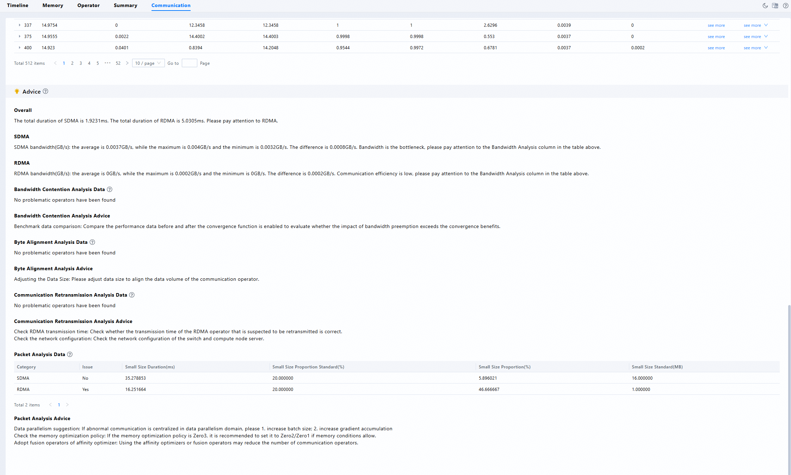

## Usage Description

**Displaying and Zooming In on Communication Operator Thumbnails**

- The **Communication** tab page supports the display of communication operator thumbnails.
    - On the **Communication** tab page, select the required information from the drop-down lists in the upper part of the page. The corresponding communication operator thumbnail is displayed.
    - Click a single operator in the communication operator thumbnail. The rank ID, operator name, start time, and elapsed time of the operator are displayed, as shown in [**Figure 1** Communication operator thumbnail](#communication-operator-thumbnail). For details about the fields in the figure, see [**Table 1** Operator fields displayed in the hover box](#operator-fields-displayed-in-the-hover-box).

        **Figure 1** Communication operator thumbnail

        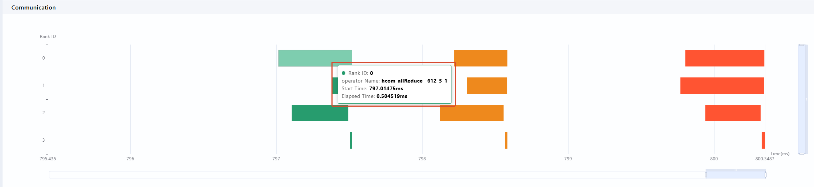

        **Table 1** Operator fields displayed in the hover box 

      |Field|Description|
      |--|--|
      |Rank ID|Rank ID of the communication operator.|
      |Operator Name|Communication operator name.|
      |Start Time|Start time of the communication operator.|
      |Elapsed Time|Total execution duration of the communication operator.|

- You can zoom in or out on, move left or right, and move up or down an communication operator thumbnail. The operations are as follows:
    - Drag the slider below the thumbnail or the slider on the right to zoom in or out.
    - Move the pointer to any position of the communication operator thumbnail and hold down **Ctrl** and scroll the mouse wheel to zoom in or out.
    - Drag the slider below the communication operator thumbnail to move the thumbnail leftward or rightward.
    - If the communication operator thumbnail is not displayed in the default state, you can hold down **Shift** and press the left or right arrow key to move the thumbnail leftward or rightward.
    - Drag the slider on the right of the communication operator thumbnail to move the thumbnail upward or downward to view the operator.

Click the communication operator thumbnail to use the following shortcuts. A rounded border indicates focus, and the question mark next to the title explains the controls.

|Shortcut|Action|
|--|--|
|W / S|Zoom in / out on the time axis.|
|A / D|Move the visible time range left / right.|
|Shift + W / Shift + S|Zoom in / out on the Rank axis to show fewer / more Ranks.|
|Up / Down arrow|Move up / down by whole Rank rows.|
|Esc|Exit chart keyboard navigation.|

Zoom is anchored at the pointer inside the plot, or at the view center when the pointer is outside the plot. Hold a key to repeat. Each time-axis zoom step uses a factor of 1.2, and each pan step moves 10% of the visible range. Click the Reset Zoom icon in the upper right to restore the full time range and all Ranks. The icon is disabled when both axes already show their full ranges.

**Supporting Communication Operator Linkage**

On the **Communication** tab page, the operators in the communication operator thumbnail can be found in the timeline view.

On the **Communication** tab page, right-click a single operator in the communication operator thumbnail display area and choose **Find in Timeline** from the shortcut menu. The operator is displayed in the timeline view, as shown in [**Figure 2** Find in Timeline](#find-in-timeline).

**Figure 2** Find in Timeline

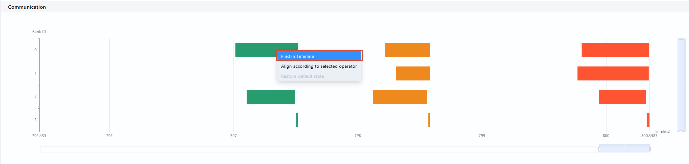

On the **Timeline** tab page, right-click a communication operator and choose **Find in Communication** from the shortcut menu. The communication operator thumbnail is displayed on the **Communication** tab page. The filter box automatically matches the operator information, as shown in [**Figure 3** Find in Communication](#find-in-communication).

> [!NOTE]
>
> The communication operator in the **Plane** unit does not support the **Find in Communication** function. The communication operator thumbnail on the **Communication** tab page cannot be displayed.

**Figure 3** Find in Communication 

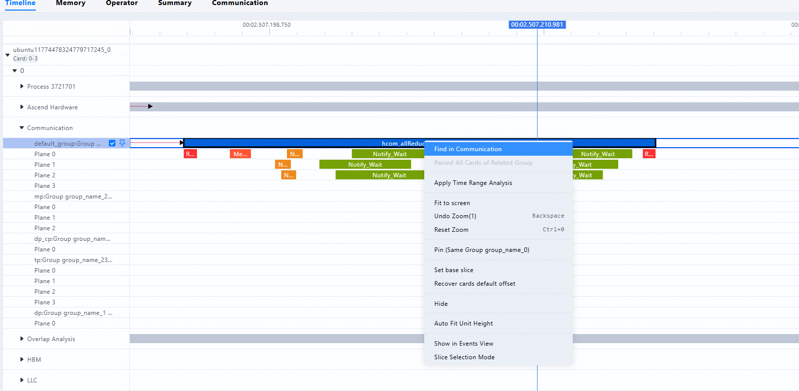

**Aligning Communication Operators by One Click**

In the communication operator thumbnail of the same communication group, you can align the names of communication operators by one click to view the communication status of the same operator in each rank.

On the **Communication** tab page, select the required communication group. In the communication operator thumbnail display area, right-click a single operator and choose **Align according to selected operator** from the shortcut menu. The operators with the same name in the communication group are aligned by time. The alignment policy is to align the tail time with the last operator, as shown in [**Figure 4** Operator alignment](#operator-alignment).

To cancel operator alignment, right-click any operator and choose **Restore default state** from the shortcut menu. The initial communication operator thumbnail is displayed.

**Figure 4** Operator alignment

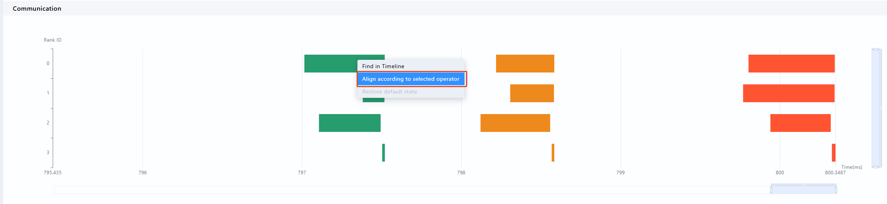

**Filtering the Data Visible Range**

When **Communication Matrix** is selected, enter a visible range next to **Visible Range** and click `Confirm`. The communication matrix model graph is dynamically refreshed based on the selected range, as shown in [**Figure 5** Visible Range](#visible-range).

**Figure 5** Visible Range

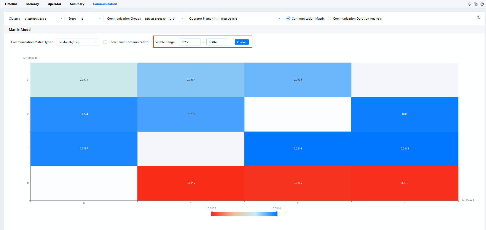

**Quickly Analyzing and Locating Abnormal Communication Operators** 

When **Communication Duration Analysis** is selected, you can quickly analyze and locate abnormal operators through the communication operator thumbnail.

MindStudio Insight automatically checks if slow ranks and abnormal operator exist. It can display the top 3 slowest ranks and top 3 most abnormal operators on the communication operator thumbnail, as shown in [**Figure 6** Slow rank list](#slow-rank-list). [**Table 2** Fields in the slow rank list](#fields-in-the-slow-rank-list) describes the fields about slow ranks and abnormal operators. You can analyze and optimize operator performance based on the information.

**Figure 6** Slow rank list 

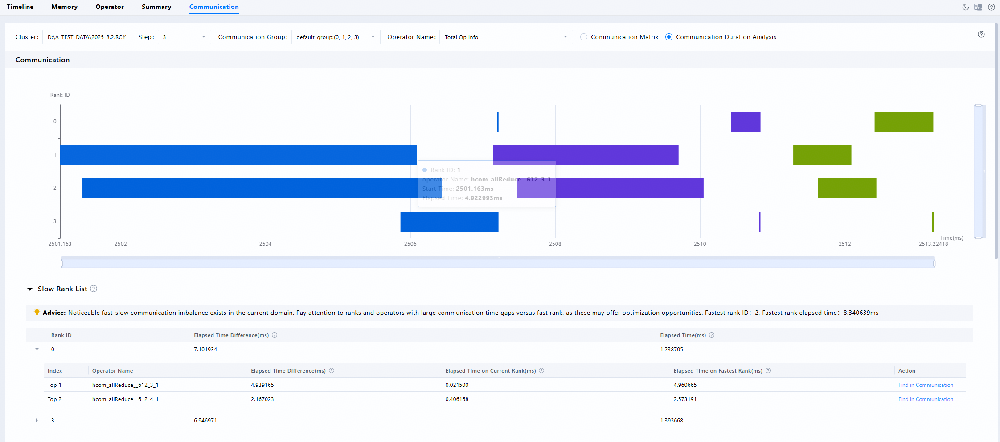

> [!NOTE]
>
> - When **Operator Name** is set to **Total Op Info**, the slow rank and abnormal operator list can be displayed in the **Communication** thumbnail. Otherwise, the list is not displayed.
> - The communication analysis is not supported for the communication group that contains the P2P or alltoallv operator, and the slow rank and abnormal operator list is not displayed.

**Table 2** Fields in the slow rank list 

|Field|Description|
|--|--|
|**Slow rank parameters**|-|
|Rank ID|ID of the slow rank.|
|Elapsed Time Difference(ms)|Time difference = Time taken by the fastest rank - Time taken by the current rank (unit: ms) The communication time difference indicates the communication time that can be reduced to some extent.|
|Elapsed Time(ms)|Total time consumed by the communication operators on the current rank.|
|**Abnormal operator parameters**|-|
|Index|Top ranking of abnormal operators.|
|Operator Name|Name of the abnormal operator.|
|Elapsed Time Difference(ms)|Time difference = Time taken by the communication operator on the fastest rank - Time taken by the communication operator on the current rank (unit: ms) The time difference indicates the communication time that can be reduced to some extent.|
|Elapsed Time on Current Rank(ms)|Time taken by the communication operator on the current rank.|
|Elapsed Time on Fastest Rank(ms)|Time taken by the communication operator on the fastest rank.|
|Action|You can click `Find in Communication` to highlight the operator in the communication operator thumbnail.|

**Comparing Cluster Data**

MindStudio Insight allows developers to compare cluster data to intuitively and clearly view the data differences. For details about how to set baseline data and comparison data, see [Data Comparison](../basic_operations.md#managing-data).

- Communication Matrix

    In comparison mode, if you select **Communication Matrix**, the differences in the communication matrix model graph are displayed. If you select any model box, the comparison data and baseline data are displayed, as shown in [**Figure 7** Communication matrix comparison mode](#communication-matrix-comparison-mode).

    **Figure 7** Communication matrix comparison mode

    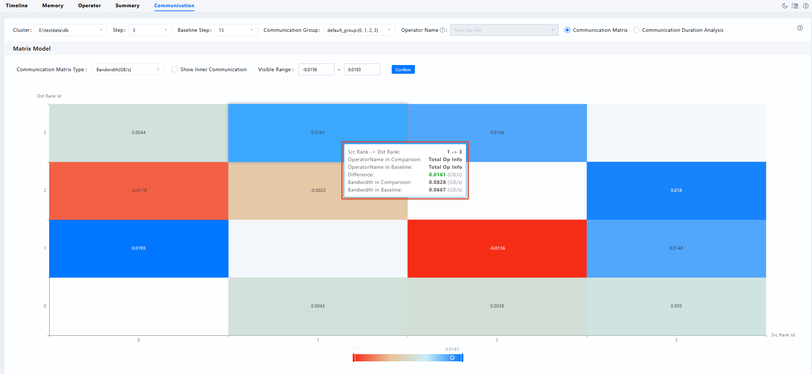

- Communication Duration Analysis

    In comparison mode, if you select **Communication Duration Analysis**, the **Communication** tab page displays the comparison step ID and baseline step ID. **Communication Group** displays the union set of the comparison data and baseline data, and **Operator Name** is fixed to **Total Op Info**.

    In the communication operator thumbnail, select the corresponding operator to display the details of the comparison data and baseline data. In the communication duration bar chart, select a bar chart to display the difference between the comparison data and baseline data, as shown in [**Figure 8** Communication in comparison mode](#communication-in-comparison-mode).

    **Figure 8** Communication in comparison mode

    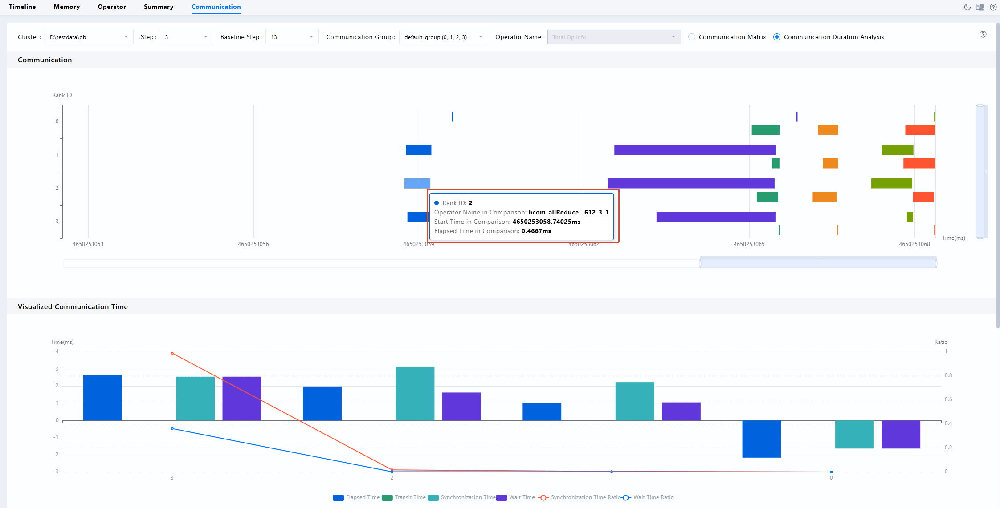

    In the **Data Analysis of Communication Time** area, no **Bandwidth Analysis** parameter is displayed, but the difference between the comparison data and the baseline data is displayed. Click `see more` in the **Details** column to display the details about the comparison data and baseline data, as shown in [**Figure 9** Comparison details in the Data Analysis of Communication Time area](#comparison-details-in-the-data-analysis-of-communication-time-area).

    **Figure 9** Comparison details in the Data Analysis of Communication Time area 

    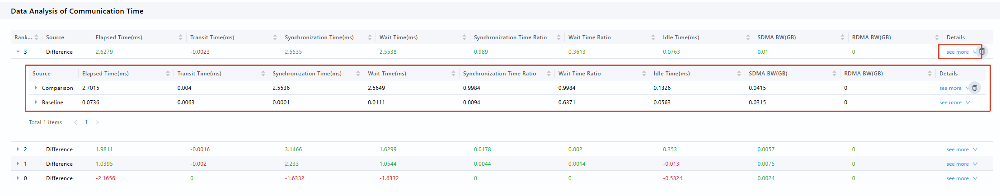
