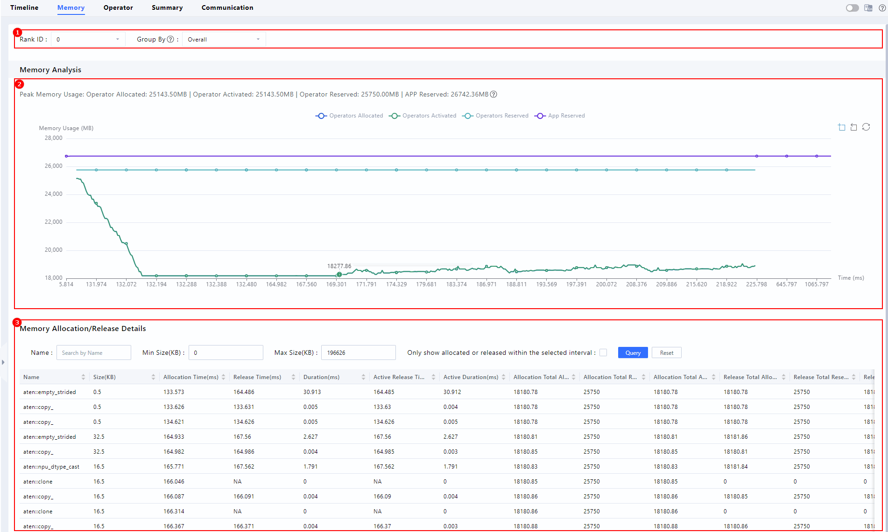
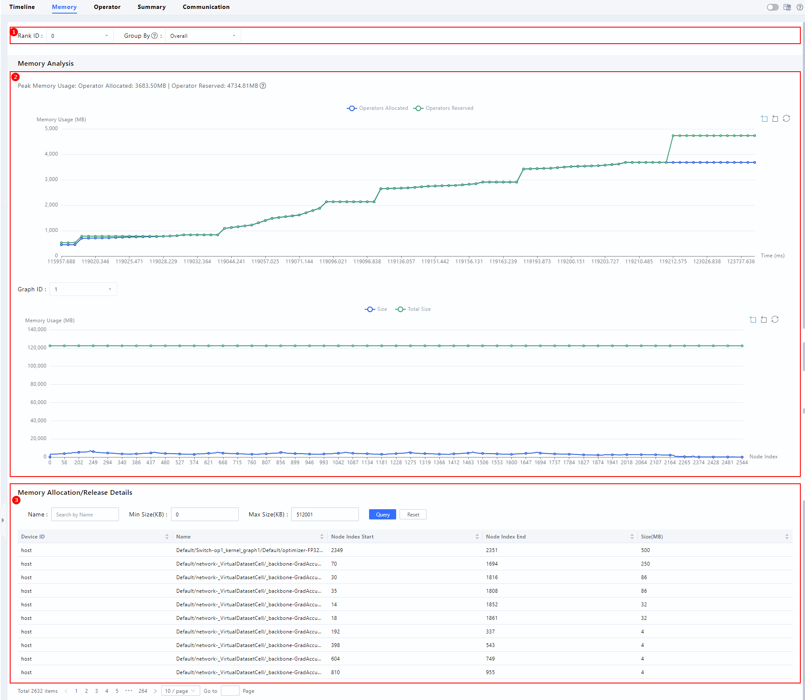
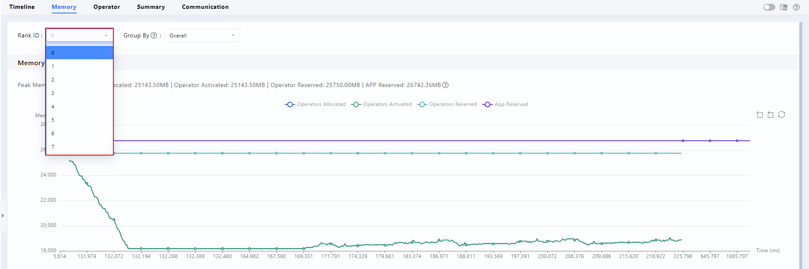
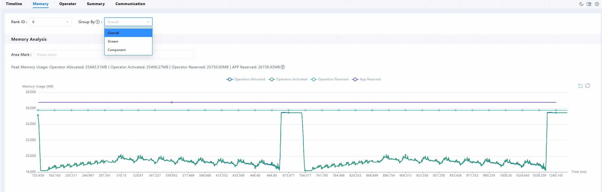
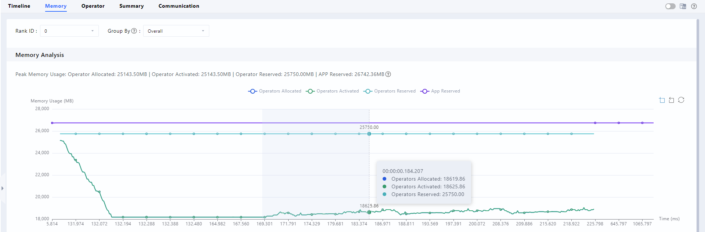
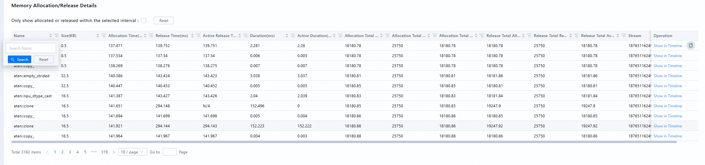
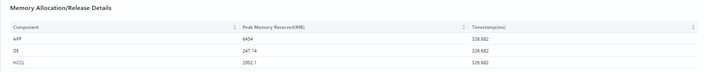
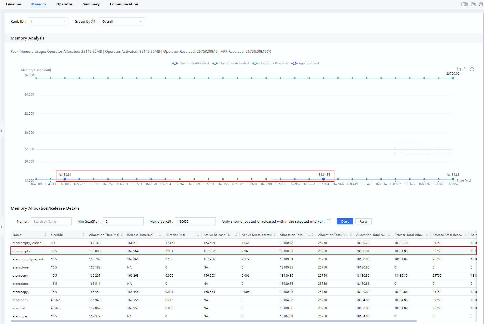
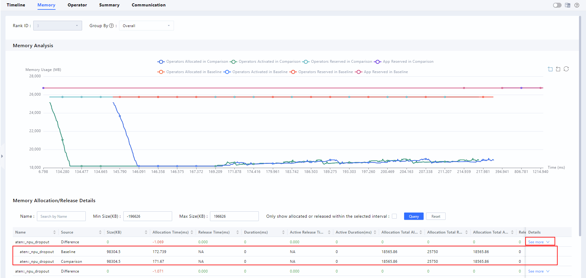

# Memory

## Function Description

The **Memory** tab page displays the memory information collected during the collection process. You can view the overall memory trend in the memory curve. You can also select and zoom in on the peak area in the curve and combine the operator memory information to accurately locate the operator with high memory consumption.

**Precautions**

For data with more than 3 million entries, the LTTB (Largest Triangle Three Buckets) algorithm is used for downsampling when the memory line chart is rendered to improve rendering performance. Therefore, when the data volume is large, only the sampling result is displayed; when the chart is zoomed in to a small range, the data points are displayed in full.

## GUI Description

**GUI Display (Dynamic Curve Scenario)**

The **Memory** tab page consists of the parameter configuration area (area 1), operator memory curve (area 2), and memory allocation/release details table (area 3), as shown in [**Figure 1** Memory dynamic curve](#memory-dynamic-curve).

**Figure 1** Memory dynamic curve 

- Area 1: parameter configuration area.
    - **Rank ID**: You can switch the options to view the memory information of different ranks. The entire page is refreshed in real time after the switch.
    - **Group By**: You can switch different dimensions to display memory information. The dimensions include **Overall**, **Stream**, and **Component**.
    - **Host Name**: This parameter is available only when the imported DB file contains the **HOST\_INFO** table.

- Area 2: operator memory curve. The **Region Marker** box above the curve displays the region marker names in the timeline. These marks are displayed in the corresponding regions on the memory curve based on the configured colors. If you delete a marker from the region mark box, the marker is removed from the memory curve, but is not deleted from the timeline.
    - The **Operator Allocated** curve indicates the change trend of the allocated memory collected when the operator allocates or releases memory, that is, the total allocated memory of all operators. The collected memory data is allocated by PyTorch and Graph Engine (GE).
    - The **Operator Reserved** curve indicates the change trend of the reserved memory collected when the operator allocates or releases memory, that is, the total reserved memory of all operators. The collected memory data is allocated by PyTorch and GE.
    - The **Operator Activated** curve indicates the total memory held, including the memory that is reused by other streams but is not released. The collected memory data is allocated by streams in PyTorch. If no stream information is available, no **Operator Activated** curve is displayed.
    - The **APP Reserved** curve indicates the memory trend reserved by the entire process.
    - When **Group By** is set to **Component**, the curve displays the memory usage of PyTorch operators and GE.

- Area 3: memory allocation/release details table, which displays the memory information of each operator. The table supports searching, sorting, pagination, and redirection. You can click the table header of each column to display data in ascending, descending, or default order. You can click  in the upper right corner of the table to copy the content displayed in the table and paste the content to an Excel file for analysis.

**GUI Display (Static Curve Scenario)**

The **Memory** tab page consists of the parameter configuration area (area 1), operator memory curve (area 2), and memory allocation/release details table (area 3), as shown in [**Figure 2** Memory static curve](#memory-static-curve).

**Figure 2** Memory static curve 

- Area 1: parameter configuration area. You can set **Rank ID** and **Group By** to view the memory information of different ranks. After the setting, the entire page is refreshed immediately.
- Area 2: operator memory curve, which consists of a dynamic curve and a static curve. The static curve exists only in the MindSpore data scenario.
    1. Dynamic curve: The **Region Marker** box above the curve displays the region marker names in the timeline. These marks are displayed in the corresponding regions on the memory curve based on the configured colors. If you delete a marker from the region mark box, the marker is removed from the memory curve, but is not deleted from the timeline.
        - The **Operator Allocated** curve indicates the change trend of the allocated memory collected when the operator allocates or releases memory, that is, the total allocated memory of all operators. The collected memory data is allocated by PyTorch and Graph Engine (GE).
        - The **Operator Reserved** curve indicates the change trend of the reserved memory collected when the operator allocates or releases memory, that is, the total reserved memory of all operators. The collected memory data is allocated by PyTorch and GE.
        - The **Operator Activated** curve indicates the total memory held, including the memory that is reused by other streams but is not released. The collected memory data is allocated by streams in PyTorch.
        - The **APP Reserved** curve indicates the memory trend reserved by the entire process.

    2. Static curve:

        This chart exists only in the MindSpore data scenario. You can switch **Graph ID** to view the memory allocation of the selected rank.

        - **Size**: size of the memory dynamically allocated by index.
        - **Total Size**: maximum memory size that is automatically preset.

- Area 3: memory allocation/release details table, which displays the memory information of each operator in the static curve. The table supports searching, sorting, pagination, and redirection. You can click the table header of each column to display data in ascending, descending, or default order. You can click  in the upper right corner of the table to copy the content displayed in the table and paste the content to an Excel file for analysis.

## Usage Description

**Switching Ranks**

MindStudio Insight allows you to switch **Rank ID** to view the memory information of different ranks. Click the **Rank ID** text box in the upper part of the page and select the rank number to be viewed from the drop-down list. After the switching, the operator memory curve and memory allocation/release details table of the corresponding rank are displayed, as shown in [**Figure 1** Switching ranks](#switching-ranks)

**Figure 1** Switching ranks 

Switching the Display Dimension

MindStudio Insight allows you to switch **Group By** to view the operator memory curve in different dimensions. Click the **Group By** text box in the upper part of the page and select the dimension to be viewed from the drop-down list, as shown in [**Figure 2** Switching the dimension](#switching-the-dimension). This function is supported only in the dynamic curve scenario.

- Global: collects statistics on the memory size of operators in the reserved, allocated, and held states, and the total reserved memory size of PyTorch.
- Stream: collects statistics on the operator memory size in the reserved, allocated, and held states by stream.
- Component: collects statistics on the memory size of PyTorch operators in the reserved, allocated, and held states, and the memory size of GE in the reserved, allocated, and held states.

**Figure 2** Switching the dimension

**Zooming In and Out on a Memory Curve**

MindStudio Insight allows you to left-click to drag select and zoom in on the selected part of the curve and right-click to zoom out on the curve. To improve the display performance, most points are hidden in the curve when the data volume is large. You can select a fine area to display all points or right-click the selected part to restore the original display effect.

In the curve, click and drag the mouse to the end point to be zoomed in and release the mouse. The selected region is zoomed in. If some points are still hidden, repeat the zoom-in operation to display the hidden points. [**Figure 3** Selected zoom-in region](#selected-zoom-in-region) shows the selected zoom-in region.
**Figure 3** Selected zoom-in region

> [!NOTE]
>
> - Click  in the upper right corner of the curve. If the button is dimmed, the curve is locked and cannot be zoomed in by clicking and dragging the mouse. You can click the button again or right-click the curve to restore the chart. The zoom-in function is enabled by default.
> - Click  in the upper right corner of the curve. The curve is restored to the initial state.

**Searching for Operators**

In the memory allocation/release details table, operators can be searched in dynamic and static curve scenarios. The procedure is as follows:

> [!NOTE]
>
> - In the MindSpore static curve scenario, the memory allocation/release details table of operators in the static curve is displayed. In other scenarios, the memory allocation/release details table of operators in the dynamic curve is displayed.
> - When **Group By** is set to **Component**, the operator search function is not supported.

- Dynamic Curve

    In the table header, click  next to a parameter name to search for related information. You can enter an operator name in the **Name** column for fuzzy search. Other parameters such as **Size** and **Duration** support range search, as shown in [**Figure 4** Searching for operators](#searching-for-operators-1). For details about the parameters, see [**Table 1** Dynamic curve fields](#dynamic-curve-fields)

    If you select **Only show allocated or released within the selected interval** above the table, the operators are those allocated or released within the selected interval in the curve.

    **Figure 4** Searching for operators

    

    **Table 1** Dynamic curve fields

  |Field|Description|
  |--|--|
  |Name|Operator name.|
  |Size(KB)|Size of the memory to be allocated, in KB.|
  |Allocation Time(ms)|Tensor memory allocation time, which is calculated from the time when the collection starts, in milliseconds.|
  |Release Time(ms)|Tensor memory release time, which is calculated from the time when the collection starts, in milliseconds.|
  |Duration(ms)|Memory holding time.|
  |Active Release Time(ms)|Time when the memory is actually returned to the memory pool.|
  |Active Duration(ms)|Actual memory usage duration.|
  |Allocation Total Allocated(MB)|Total memory allocated by PyTorch and GE during operator memory allocation.|
  |Allocation Total Reserved(MB)|Total memory reserved by PyTorch and GE during operator memory allocation.|
  |Allocation Total Active(MB)|Total memory allocated to the current stream during operator memory allocation (including the memory that is reused by other streams but is not released).|
  |Release Total Allocated(MB)|Size of the memory used by PyTorch and GE in the memory pool after the operator memory is released.|
  |Release Total Reserved(MB)|Size of the memory occupied by PyTorch and GE in the memory pool after the operator memory is released.|
  |Release Total Active(MB)|Total memory reused by other streams in the PyTorch and GE memory after the operator memory is released.|
  |Stream|Memory address of an AscendCL stream, which is used to mark different AscendCL streams.|
  |Operation|Click `Show in Timeline` to view the corresponding operator on the timeline page.|

- Static Curve

    In the filter bar, enter the operator name and the range of the memory occupied by the operator (minimum and maximum values), and click `Query`. You can also click `Reset` to reset the search criteria. By default, the minimum and maximum memory sizes occupied by the operators in the selected rank are displayed in the filter bar. You can adjust them according to the actual situation. As shown in [**Figure 5** Searching for operators (static curve)](#searching-for-operators-static-curve), search for operators whose names contain data and whose memory size ranges from 0 KB to 35 KB. [Table 2 Static curve fields](#static-curve-fields) describes the fields in the table.

    **Figure 5** Searching for operators (static curve)

    ")

    **Table 2** Static curve fields 

    |Field|Description|
    |--|--|
    |Device ID|Sequence number of the device that allocates memory. The default value is **host**.|
    |Name|Operator name.|
    |Node Index Start|Search start node.|
    |Node Index End|Search end node.  The value **4294967295** is the final end node of the index. In the static curve, the value of this node is the actual end node plus 1. For example, if the actual end node is 32, the index of the node in the horizontal coordinate in the static curve is 33, and the end value of the node index in the table is **4294967295**.|
    |Size(MB)|Size of the memory to be allocated, in MB.|
    |Operation|Click `Show in Timeline` to view the corresponding operator on the timeline page.|

- When **Group By** is set to **Component**, the operator search function is not supported. [**Figure 6** Component-level memory allocation/release details](#component-level-memory-application-release-details) shows the page. [**Table 3** Field description](#field-description) describes the fields.

    **Figure 6** Component-level memory application/release details 

    

    **Table 3** Field description 

  |Field|Description|
  |--|--|
  |Component|Component name.|
  |Peak Memory Reserved(MB)|Peak size of the memory occupied by a component, in MB. Only components whose peak memory usage is greater than or equal to 100 MB are displayed.|
  |Timestamp(ms)|Time when the memory usage of a component reaches the peak value, in milliseconds.|

**Highlighting**

When **Group By** is set to **Overall** and you move the pointer to a data record in the table (the curve is zoomed in to display all operators in the table), if the point (including the allocation time and release time) corresponding to the data record is displayed above the curve, the corresponding point on the curve is highlighted. This helps you quickly locate the operator.

Move the pointer to the red box in the table. The operator position is highlighted in the curve, as shown in [**Figure 7** Highlighting an operator](#highlighting-an-operator).

**Figure 7** Highlighting an operator

**Comparing the Performance of Ranks**

MindStudio Insight allows you to compare the memory performance of ranks. For details about how to set the comparison data, see [Data Comparison](../basic_operations.md#managing-data).

In inter-rank performance comparison mode, the value of **Rank ID** is fixed and cannot be switched. **Group By** can be set only to **Global** or **Component**. The operator memory curve displays the memory changes of two ranks, so that you can view the memory comparison trend between the two ranks. The memory allocation/release details table displays the data difference between two ranks. When **Group By** is set to **Global**, you can search for operators by name and memory size. The minimum memory size can be a negative value, and the search criteria are limited to the comparison result, as shown in [**Figure 8** Performance comparison](#performance-comparison).

You can click `See more` in the **Details** column of the memory allocation/release details table to view the baseline data and comparison data details.

**Figure 8** Performance comparison

