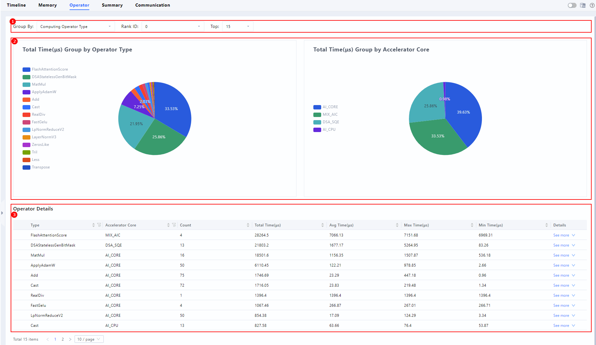
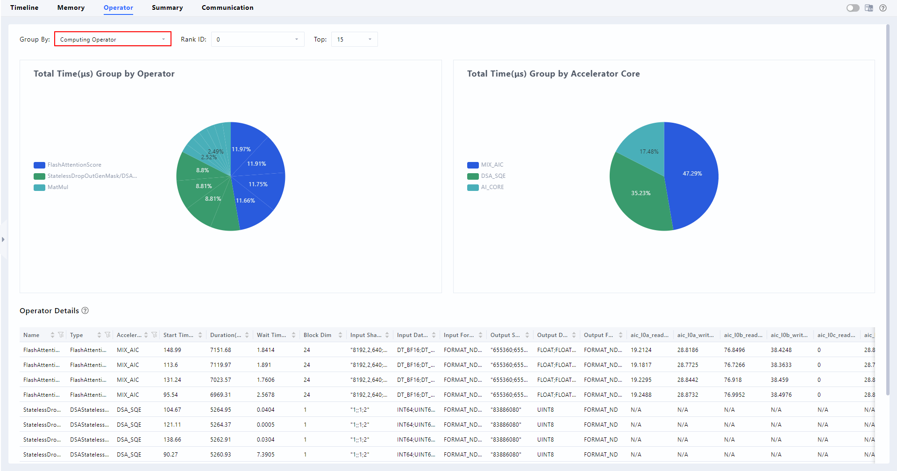
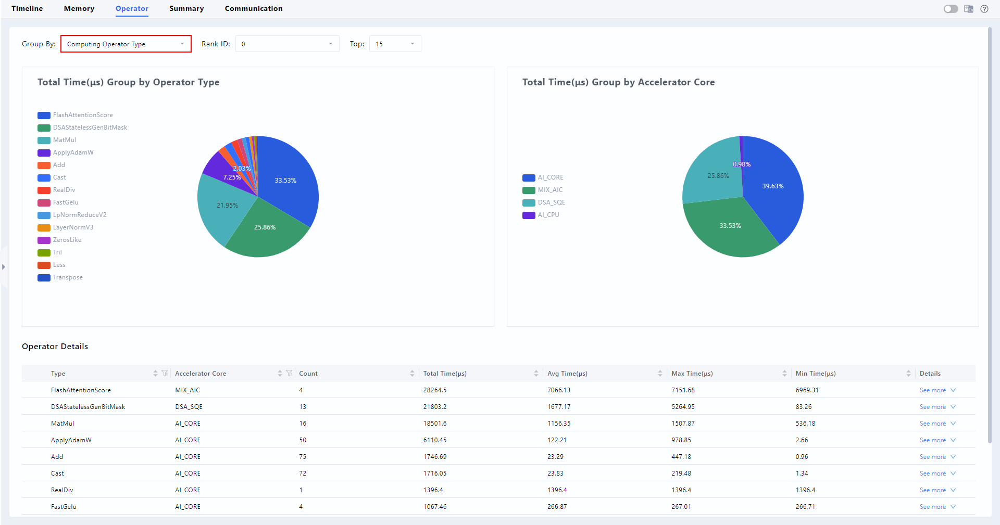
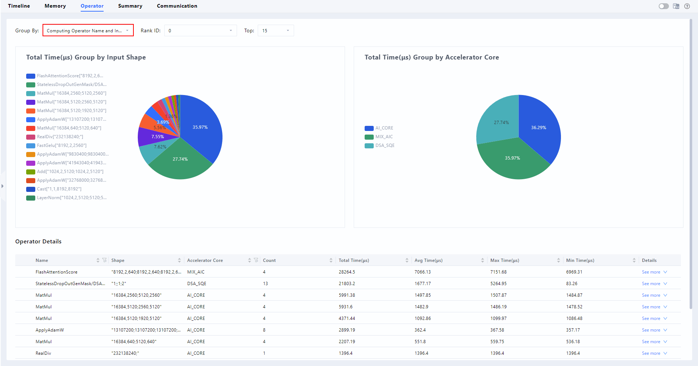
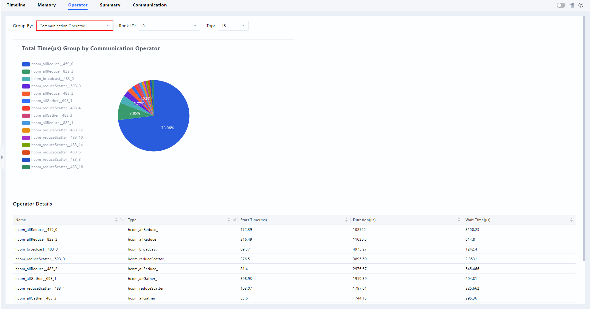
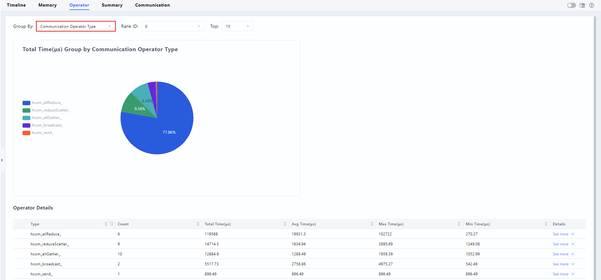
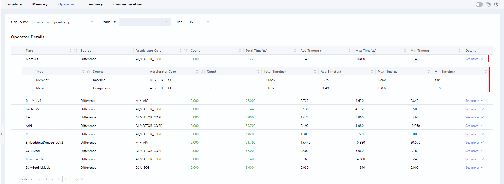

# Operator 

## Function Description

The **Operator** view analyzes the duration of computing and communication operators, helping developers quickly locate performance bottlenecks.

## GUI Description

The **Operator** tab page consists of the parameter configuration area (area 1), duration percentage pie chart (area 2), and duration statistics and details table (area 3), as shown in [**Figure 1** Operator](operator.md#operator).

**Figure 1** Operator

- Area 1: parameter configuration area. [**Table 1** Parameter configuration](#parameter-configuration) describes the parameters.

    **Table 1** Parameter configuration 

  |Parameter|Description|
  |--|--|
  |Group by|- **Computing Operator**: displays details about all computing operators, helping developers locate time-consuming computing operators.  - **Computing Operator Type**: collects statistics on computing operators of the same type, calculates the total time, maximum time, and average time, and allows you to view details about computing operators of a specific type, helping developers quickly identify performance bottlenecks of computing operators of a specific type, such as AICPU operators.  - **Computing Operator Name and Input Shape**: collects statistics on operators of the same type and input shape, calculates the total time, maximum time, and average time, and allows you to view details about operators of a specific type, helping developers quickly identify performance bottlenecks of operators of a specific type with a specific input.  - **Communication Operator**: displays details about all communication operators, helping developers locate time-consuming communication operators.  - **Communication Operator Type**: collects statistics on communication operators of the same type, calculates the total time, maximum time, and average time, and allows you to view details about communication operators of a specific type, helping developers quickly identify performance bottlenecks of communication operators of a specific type.|
  |Rank ID|Operator profile data can be displayed by a single rank.|
  |Top|You can set **Top** to display the top *N* records with the longest total duration. The default value is **15**. If you select **Custom**, you can customize the number of records.|
  |Host Name|This parameter is available only when the imported DB file contains the **HOST_INFO** table.|

- Area 2: duration percentage pie chart.
    - When **Group By** is set to **Computing Operator**, **Computing Operator Type**, or **Computing Operator Name and Input Shape**, two pie charts are displayed. The left pie chart shows the duration percentage of different computing operator types. This view is affected by the **Top** configuration in area 1 and displays only the percentage of top *N* or all computing operators or computing operator types. The right pie chart shows the duration percentage of top *N* or all computing operators or computing operator types by accelerator core, such as AI Core and AICPU.
    - When **Group By** is set to **Communication Operator** or **Communication Operator Type**, one pie chart is displayed, showing the duration percentage of different communication operator types. This view is affected by the **Top** configuration in area 1 and displays only the percentage of top *N* or all communication operators or communication operator types.

- Area 3: duration statistics and details data table, which displays operator statistics or details. You can click `See more` to view details. You can also click `Export` in the upper right corner of the table to export all data in the operator details table to a .csv file.

## Usage Description

**Computing Operator**

This page is displayed when **Group By** is set to **Computing Operator**. You can view details about a single computing operator to quickly locate performance problems, as shown in [Figure 1 Computing Operator](#computing-operator). [**Table 1** Computing Operator fields](#computing-operator-fields) describes the fields in **Operator Details**. You can click  next to a field to perform fuzzy search on the field.

**Figure 1** Computing Operator 

**Table 1** Computing Operator fields 

|Field|Description|
|--|--|
|Name|Operator name.|
|Type|Operator type.|
|Accelerator Core|AI accelerator core type, including AI Core and AICPU.|
|Start Time(ms)|Operator execution start time.|
|Duration(μs)|Execution duration of the current operator.|
|Wait Time(μs)|Waiting time for executing the operator.|
|Block Num|Number of running splits, which corresponds to the number of cores during task running. In MindStudio Insight 8.3.0 and earlier versions, this field is displayed as **Block Dim**.|
|Input Shapes|Operator input shape.|
|Input Data Types|Input data type of the operator.|
|Input Formats|Input format of the operator.|
|Output Shapes|Operator output shape.|
|Output Data Types|Output data type of the operator.|
|Output Formats|Output format of the operator.|

> [!NOTE]
>
> If `aic_metrics=torch_npu.profiler.AiCMetrics.PipeUtilization` is set in the collection configuration and the `profiler_level` is `Level1` or above, the computing operator details will display AI Core and AI Vector Core performance metric fields. For detailed field descriptions, see [AI Core/AI Vector Core Performance Metric Field Description](system_tuning_overview.md#ai-core-performance-metric-field-description).

**Computing Operator Type**

This page is displayed when **Group By** is set to **Computing Operator Type**. You can view the duration percentage and detailed data of different computing operator types to quickly locate performance problems, as shown in [**Figure 2** Computing Operator Type](#computing-operator-type). [Table 2 Computing Operator Type fields](#computing-operator-type-fields) describes the fields in the **Operator Details** area. You can click  next to the field to perform fuzzy search on the related field.

**Figure 2** Computing Operator Type

**Table 2** Computing Operator Type fields 

|Field|Description|
|--|--|
|Type|Operator type.|
|Accelerator Core|AI accelerator core type, including AI Core and AICPU.|
|Count|Number of operator executions.|
|Total Time(μs)|Total operator execution time.|
|Avg Time(μs)|Average operator execution time.|
|Max Time(μs)|Maximum operator execution time.|
|Min Time(μs)|Minimum operator execution time.|
|Details|Click `See more` in the **Details** column to display details about a single computing operator. For details, see [**Table 1** Computing Operator fields](#computing-operator-fields).|

**Computing Operator Name and Input Shape**

This page is displayed when **Group By** is set to **Computing Operator Name and Input Shape**. You can view the time consumption proportion and detailed data of computing operators of different types under a specific input shape to quickly find operator performance problems, as shown in [**Figure 3** Computing Operator Name and Input Shape](#computing-operator-name-and-input-shape). For details about the fields in **Operator Details**, see [**Table 3** Computing Operator Name and Input Shape fields](#computing-operator-name-and-input-shape-fields). You can click  next to a field to perform fuzzy search on the field.

**Figure 3** Computing Operator Name and Input Shape

**Table 3** Computing Operator Name and Input Shape fields

|Field|Description|
|--|--|
|Name|Operator name.|
|Shape|Operator input shape.|
|Accelerator Core|AI accelerator core type, including AI Core and AICPU.|
|Count|Number of operator executions.|
|Total Time(μs)|Total operator execution time.|
|Avg Time(μs)|Average operator execution time.|
|Max Time(μs)|Maximum operator execution time.|
|Min Time(μs)|Minimum operator execution time.|
|Details|Click `See more` in the **Details** column to display details about a single operator. For details, see [**Table 1** Computing Operator fields](#computing-operator-fields).|

**Communication Operator**

This page is displayed when **Group By** is set to **Communication Operator**. You can view details about a single communication operator to quickly locate performance problems, as shown in [**Figure 4** Communication Operator](#communication-operator). [**Table 4** Communication Operator fields](#communication-operator-fields) describes the fields in **Operator Details**. You can click  next to a field to perform fuzzy search on the field.

**Figure 4** Communication Operator 

**Table 4** Communication Operator fields 

|Field|Description|
|--|--|
|Name|Communication operator name.|
|Type|Communication operator type.|
|Start Time(ms)|Start time of communication operator execution.|
|Duration(μs)|Execution duration of the current communication operator.|
|Wait Time(μs)|Waiting time for executing the communication operator.|

**Communication Operator Type**

This page is displayed when **Group By** is set to **Communication Operator Type**. You can view the duration percentage and detailed data of different communication operator types to quickly locate performance problems, as shown in [**Figure 5** Communication Operator Type](#communication-operator-type). [**Table 5** Communication Operator Type fields](#communication-operator-type-fields) describes the fields in the **Operator Details** area. You can click  next to the field to perform fuzzy search on the related field.

**Figure 5** Communication Operator Type 

**Table 5** Communication Operator Type fields 

|Field|Description|
|--|--|
|Type|Communication operator type.|
|Count|Number of communication operator executions.|
|Total Time(μs)|Total execution time of the communication operator.|
|Avg Time(μs)|Average execution time of the communication operator.|
|Max Time(μs)|Maximum execution time of the communication operator.|
|Min Time(μs)|Minimum execution time of the communication operator.|
|Details|Click `See more` in the **Details** column to display details about a single communication operator. For details, see [**Table 4** Communication Operator fields](#communication-operator-fields).|

**Comparing Data Between Two Ranks**

MindStudio Insight allows developers to compare the operator performance between two ranks to intuitively and clearly view the differences between them. For details about how to set baseline data and comparison data, see [Data Comparison](../basic_operations.md#managing-data).

In inter-rank comparison mode, the **Operator** page does not display the duration percentage pie chart. Only the operator details table is displayed. The value of **Rank ID** is fixed and cannot be switched. **Group By** can be selected as required. Top *N* data records can be displayed.

The operator details table displays the difference between two ranks. You can click `See more` in the **Details** column to view the baseline data and comparison data details, as shown in [**Figure 6** Operator comparison](#operator-comparison). For details about the fields, see the field description corresponding to each value of **Group By**. The following figure shows the data comparison details when **Group By** is set to **Computing Operator Type**.

**Figure 6** Operator comparison

