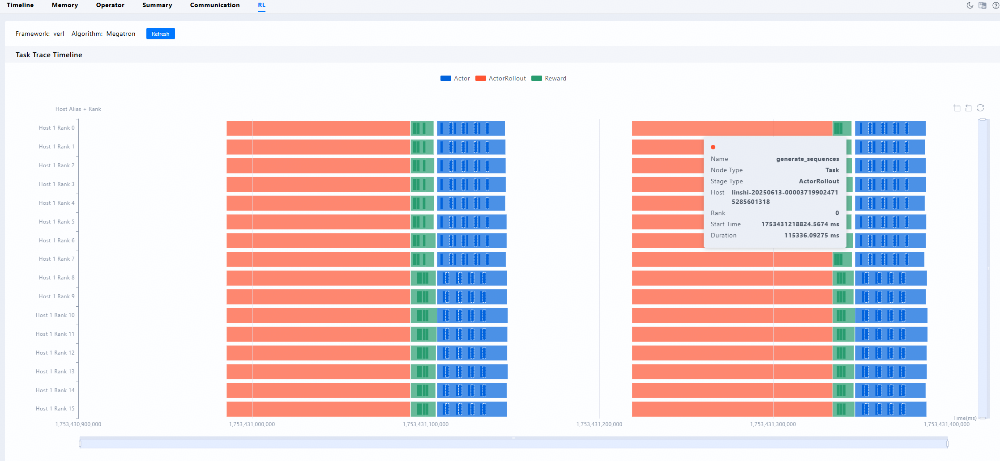

# Reinforcement Learning (RL)

## Function Description

**Introduction**

The **RL** tab page displays the pipeline of each phase in the RL process, enabling developers to fully understand the running status, identify issues, and improve RL performance.

**Precautions**

- The **Task Trace Timeline** area is displayed only when control flow data collected using mstx is imported. For details about how to collect data using mstx, see [Ascend PyTorch Profiling Tool](https://gitcode.com/Ascend/pytorch/blob/v2.7.1-26.1.0/docs/en/ascend_pytorch_profiler/ascend_pytorch_profiler_user_guide.md#profile-and-parse-performance-data-torch_npuprofilerprofile).
- When importing profile data of Volcano Engine Reinforcement Learning for LLMs (VerL) and MindSpeed, keep their files in different folders. Do not mix them together during import.

## GUI Description

The **RL** page consists of the parameter configuration area (area 1) and the task trace timeline (area 2), as shown in [**Figure 1** RL](rl.md#rl).

**Figure 1** RL 

- Area 1: In the parameter configuration area, the **Framework** and **Algorithm** of the imported data are automatically identified and displayed. If the data of more than 16 ranks is imported, the data may not be completely displayed on the **RL** tab page. You can click `Refresh` to parse all data and refresh the task trace timeline.
- Area 2: task execution timeline, which displays the execution time of each task on each rank. The horizontal axis is the time axis, and the vertical axis is the RankID corresponding to each device. Different colors represent different tasks. The blue blocks provide Forward and Backward micro batch markers to help locate fine-grained performance problems in the training phase.

    You can zoom in or out and move the timeline by dragging the sliders at the right and bottom of the timeline, or by holding down **Ctrl** and scrolling the mouse wheel.
