# Summary

## Function Description

The **Summary** tab page provides the communication group identification, division, and time breakdown and analysis functions. Communication groups can be automatically identified or configured by users. Users can compare the duration of stages, computation, and communication in a communication group to analyze whether the division in the same communication group is even and whether there are slow ranks and slow links, helping developers quickly identify problems.

**Precautions**

- To ensure that the communication time can be correctly split by communication group (TP-communication time, PP-communication time, MP-communication time, DP-communication time, and CP-communication time in the performance metrics), ensure that the parallel strategy parameter value is the same as the parallel parameter configuration during actual model training or inference. You can confirm the parallel parameters with the model developers.
- If a .db file is imported, the **Communication Detail (Rank ***ID***)** area is not displayed.
- Rule for setting the parallel strategy: Parallel strategy value = PP Size × TP Size × CP Size × DP Size ≥ Number of ranks imported.
- If data that has been imported is imported to MindStudio Insight, the parallel strategy value is remembered and the previously set parallel strategy value is displayed by default.
- When **CP Size** is set to 1, the **DP + PP** and **DP + PP + TP** parallel dimensions are displayed, and **Context Parallel Size** is not displayed in each dimension.

## GUI Description

The **Summary** tab page consists of **Base Info** (area 1), **Parallel Strategy Analysis** (area 2), and **MoE Expert Load Balancing Analysis** (area 3), as shown in [**Figure 1** Summary](summary.md#summary).

**Figure 1** Summary 

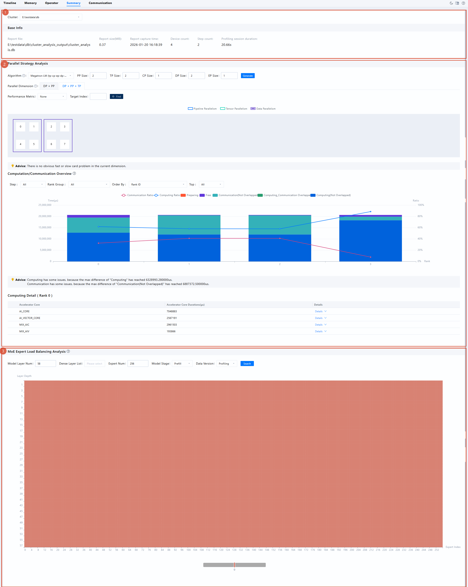

**Base Info**

Area 1: **Cluster** and **Base Info**. When cluster data is imported, you can select a cluster from the drop-down list. The basic information includes the device count, step count, report size, and profiling session duration.

**Parallel Strategy Analysis**

Area 2: **Parallel Strategy Analysis**, which includes the parallel strategy overview, **Computation/Communication Overview**, **Computing Details** (**Rank ID**), **Communication Details** (**Rank ID**), and parallel pipeline chart.

- The parallel strategy overview includes parallel strategy settings, parallel strategy charts, and advice, as shown in [**Figure 2** Parallel Strategy Overview](#parallel-strategy-overview). [**Table 1** Parallel strategy parameters](#parallel-strategy-parameters) describes the parameters for parallel strategies. After the parallel strategy is set, you can select **DP + PP**, **DP + PP + CP**, **DP + PP + TP**, or **DP + PP + CP + TP** to display the parallel strategy chart. You can select a target index in the graph to view its details. You can also right-click the target index and choose **Copy Attribute** from the shortcut menu to copy the details and paste it to the local PC for analysis.

    If the communication time can be correctly split by communication group, the advice is displayed.

    **Figure 2** Parallel strategy overview 

    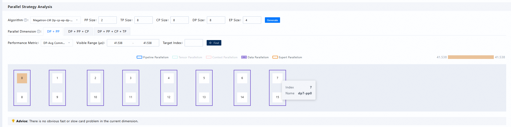

    **Table 1** Parallel strategy parameters 

    |Field|Description|
    |--|--|
    |Algorithm|- **Megatron-LM (tp-cp-ep-dp-pp)**: This arrangement is based on Megatron-Core. The priority order is TP > CP > DP > PP, with EP spanning above DP without participating in or affecting the priority (requiring that DP must be exactly divisible by EP). PP is located after DP and is most used for cross-node communication, which requires low bandwidth.  - **Megatron-LM (tp-cp-pp-ep-dp)**: This arrangement is also based on Megatron-Core and is rarely used. The priority order is TP > CP > PP > DP. It is used in scenarios where PP requires relatively high bandwidth.  - **MindSpeed (tp-cp-ep-dp-pp)**: This arrangement is based on MindSpeed-Core. The priority order is TP > CP > DP > PP. The EP spans across CP and DP and does not participate in or affect the priority (requiring that CP × DP must be exactly divisible by EP).  - **MindIE-LLM (tp-dp-ep-pp-moetp)**: This arrangement is based on MindIE-LLM (DeepSeek V3 uses a similar arrangement). For non-MoE layers, the priority order is TP > DP > PP. For MoE layers, the priority order is MOE_TP > EP > PP. When **MOE_TP=1**, an MoE EP solution that spans the same stage of PP is formed.  - **vLLM (tp-pp-dp-ep)**: This arrangement is based on vLLM. The priority order is TP > PP > DP. The EP spans TP and DP and does not participate in or affect the priority (requiring that TP × DP must be exactly divided by EP). An MoE EP solution is formed (that is, EP must be exactly divisible by TP). When the **vLLM (tp-pp-dp-ep)** algorithm is selected, PP size × TP size × DP size ≥ Number of imported ranks.|
    |PP Size|Pipeline parallel size. You can set it to a value ranging from 1 to 10000.  **Pipeline Parallel** distributes different layers of a model to different ranks for execution. When one rank executes the current batch of data, another rank can process the next batch of data.|
    |TP Size|Tensor parallel size. You can set it to a value ranging from 1 to 10000.  **Tensor Parallel** is a technique that divides model parameters into multiple parts and distributes them to different ranks for computation.|
    |CP Size|Context parallel size. You can set it to a value ranging from 1 to 10000.  **Context Parallel** divides training samples into different batches based on the sequence length and dimension and allocates the batches to different ranks for computation. **Context Parallel** (CP) splits the network input and all activations, which is an improved version of **Sequence Parallelism** (SP).|
    |DP Size|Data parallel size. You can set it to a value ranging from 1 to 10000.  **Data Parallel** divides the training dataset into multiple batches and allocates the batches to different ranks for calculation.|
    |EP Size|Expert parallel size. You can set it to a value ranging from 1 to 10000.  **Expert Parallel** is a parallel method designed for Mixture of Experts (MoE) models. Experts are allocated to different computing ranks. Each rank processes some training samples, and each rank can contain one or more experts.  - When the **Megatron-LM** algorithm is selected, the EP size must be less than or equal to the DP size, and the DP size must be exactly divisible by the EP size.  - When the **MindSpeed** algorithm is selected, DP x CP must be exactly divisible by EP.|
    |MoE-TP Size|This parameter is available only when the **MindIE-LLM (tp-dp-ep-pp-moetp)** algorithm is used.  TP size of the MoE layer in the inference parallel strategy, which is different from the TP of the non-MoE layer. You can set it to a value ranging from 1 to 10000. The values must meet the following requirements:  - PP Size × TP Size × DP Size = Number of imported ranks  - TP Size × DP Size = MoE-TP Size × EP Size|
    |Performance Metric|You can display the parallel strategy chart by performance metrics. The available performance metric parameters vary according to the selected domain dimension.  If **None** is selected, no performance metric is displayed. That is, the rank information on the parallel strategy chart is in the default state.  If you select other parameters, **Visible Range (μs)** and color bar of the parameter are displayed next to the check box. The filter range is the minimum and maximum values of the parameter. The rank on the parallel policy graph is rendered and filled with colors according to the corresponding values. You can view the performance of each rank.|
    |Target Index|Enter the target index in the selected dimension to accurately locate the required number.|
    |Advice|The built-in expert analysis function of MindStudio Insight analyzes data, provides suggestions, and lists the top 3 groups and slow ranks, making it easier for developers to spot performance issues.|

- **Computation/Communication Overview** displays the step time consumption data of computing or communication operators in a bar chart and the time consumption proportion data of computing or communication operators in a curve. **Advice** provides suggestions based on the analysis of the computation time, communication time (not overlapped), and free time of each rank in the computation and communication groups, helping developers quickly analyze the data, as shown in [**Figure 3** Computation/Communication Overview](#computation-communication-overview). For details about the parameters, see [**Table 2** Computation/Communication Overview parameters](#computation-communication-overview-parameters).

    The curve and advice are displayed in the **Computation/Communication Overview** area when **DP + PP + CP + TP** or **DP + PP + TP** is selected.

    **Figure 3** Computation/Communication Overview <

    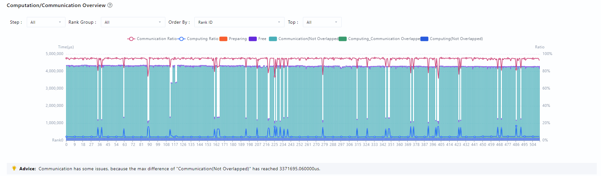

    **Table 2** Computation/Communication Overview parameters 

  |Field|Description|
  |--|--|
  |Step|Step ID. You can select a specific step or all steps from the drop-down list.|
  |Rank Group|Node ID. You can select one, multiple, or all nodes from the drop-down list.|
  |Order By|Set **Order By** to different dimensions.  - DP + PP + CP + TP and DP + PP + TP  **Rank ID**: rank ID.  **Computing(Not Overlapped)**: **Computing(Not Overlapped)** = **Computing** – **Computing_Communication Overlapped**.  **Computing_Communication Overlapped**: communication duration overlapped by computing.  **Communication(Not Overlapped)**: **Communication(Not Overlapped)** = **Communication** – **Computing_Communication Overlapped**.  **Free**: time when the device is not in communication or computing. The free time here is not included in the preparing time.  **Preparing**: time from the start of a step to the running of the first computing or communication operator. During this time, operations such as data loading and copying are performed. In the **Overlap Analysis** unit of **Timeline**, the time is considered as **Free**.  **Computing Ratio**: ratio of the computing time to the total time. Total time = **Computing(Not Overlapped)** + **Computing_Communication Overlapped** + **Communication(Not Overlapped)** + **Free** + **Preparing**.  **Communication Ratio**: ratio of the communication time to the total time.  - **DP + PP + CP Dimension**: **Order By** can be set to **Rank ID**, **Max Computing**, **Max Communication**, **Max Free**, and **Max Total Time (Computing + Communication (Not Overlapped) + Free)**. The maximum value of each parameter is the maximum value in each TP communication group.  - **DP + PP Dimension**: **Order By** can be set to **Rank ID**, **Max Computing**, **Max Communication**, **Max Free**, **Max Total Time (Computing + Communication (Not Overlapped) + Free)**, and **Max Communication(Not Overlapped)**. The maximum value of each parameter is the maximum value in the communication group of each **DP + PP + CP Dimension**.|
  |Top|You can set **Top** to display the top *N* records of **Order By**.|
  |Time(μs)|The vertical coordinate on the left indicates the duration, in microseconds. The calculation formula is as follows:  **Total** = **Computing(Not Overlapped)** + **Computing_Communication Overlapped** + **Communication(Not Overlapped)** + **Free** + **Preparing**. **Preparing** indicates the data preprocessing time.|
  |Ratio|The vertical coordinate on the right indicates the duration percentage, including the following information:  - **Computing Ratio**: **Computing Ratio** = **Total Computing**/**Time**.  - **Communication Ratio**: **Communication Ratio** = **Communication(Not Overlapped)**/**Time**.|
  |Advice|The analysis and suggestions of slow ranks based on the communication time under each parallel dimension help you to locate slow ranks.|

- **Computing Detail (Rank *ID*)**: When **DP + PP + CP + TP** and **DP + PP + TP** are selected, click the bar chart of a node in the **Computation/Communication Overview** area. The total time consumption and usage of the accelerator core of the node are displayed. Click `Details` to view the details about the computing operator, as shown in [**Figure 4** Computing operator details](#computing-operator-details). For details about the fields, see [**Table 3** Computing details](#computing-details). You can click  in the upper right corner of the table to copy the content displayed in the table and paste the content to an Excel file for analysis.

    **Figure 4** Computing operator details 

    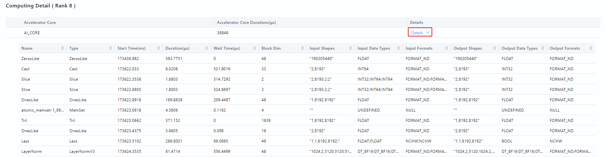

    **Table 3** Computing details 

  |Field|Description|
  |--|--|
  |Accelerator Core|AI accelerator core type, including AI Core and AICPU.|
  |Accelerator Core Durations(μs)|Total duration of the accelerator core.|
  |Name|Operator name.|
  |Type|Operator type.|
  |Start Time(ms)|Operator execution start time.|
  |Duration(μs)|Execution duration of the current operator.|
  |Wait Time(μs)|Waiting time for executing the operator.|
  |Block Num|Number of running splits, which corresponds to the number of cores during task running. In MindStudio Insight 8.3.0 and earlier versions, this field is displayed as **Block Dim**.|
  |Input Shapes|Operator input shape.|
  |Input Data Types|Input data type of the operator.|
  |Input Formats|Input format of the operator.|
  |Output Shapes|Operator output shape.|
  |Output Data Types|Output data type of the operator.|
  |Output Formats|Output format of the operator.|

- **Communication Detail (Rank *ID*)**: When **DP + PP + CP + TP** and **DP + PP + TP** are selected, click the bar chart of a node in the **Computation/Communication Overview** area. The total duration of the communication operator on the node (including communication duration overlapped and not overlapped) is displayed. Click `Details` to view the details about the communication operator, as shown in [**Figure 5** Communication operator details](#communication-operator-details). For details about the fields, see [**Table 4** Communication details](#communication-details). You can click  in the upper right corner of the table to copy the content displayed in the table and paste the content to an Excel file for analysis.

    **Figure 5** Communication operator details

    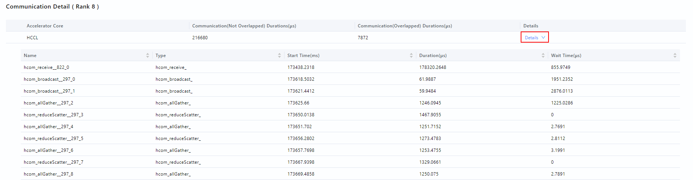

    **Table 4** Communication details 

  |Field|Description|
  |--|--|
  |Accelerator Core|AI accelerator core type, including AI Core and AICPU.|
  |Communication(Not Overlapped) Durations(μs)|Not overlapped communication time, which refers to the pure communication duration.|
  |Communication(Overlapped) Durations(μs)|Overlapped communication duration.|
  |Name|Communication operator name.|
  |Type|Communication operator type.|
  |Start Time(ms)|Start time of communication operator execution.|
  |Duration(μs)|Execution duration of the current communication operator.|
  |Wait Time(μs)|Waiting time for executing the communication operator.|

- When **DP + PP + CP + TP** or **DP + PP + TP** is selected, click a single rank icon in the parallel strategy chart, and a flow is displayed. Click the pipeline parallelism flow, and the pipeline parallelism chart is displayed, as shown in [**Figure 6** Pipeline parallelism chart](#pipeline-parallelism-chart).

    On the pipeline parallelism chart, you can drag either side of the slider below the graph to zoom in or zoom out. You can also move the slider leftward or rightward using the mouse, or press **Shift** + left or right arrow key to move the parallel graph leftward or rightward.

    **Figure 6** Pipeline parallelism chart 

    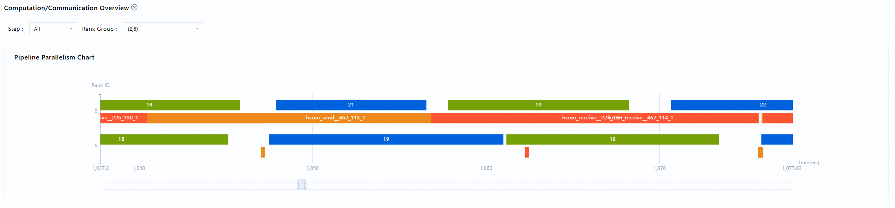

**MoE Expert Load Balancing Analysis**

Area 3: MoE expert load balancing analysis, which displays the expert activation heatmap and expert load balancing heatmap.

You can select **Profiling** or **Dump** for **Data Version** in the parameter configuration area. The two data types are statistical information of MoE models in different dimensions.

If **Profiling** is selected, the expert distribution heatmap is displayed. The heatmap is based on Profiling and collects statistics on the time consumed by the GroupedMatmul operator in each MoE layer. Since the GroupedMatmul operator is the core of MoE model computation, its performance directly affects how quickly experts respond.

If **Dump** is selected, the MoE model expert load balancing heatmap is displayed. The heatmap is based on Dump and collects statistics on the number of tokens processed by each expert in each MoE layer. You can select **Dump unbalanced** or **Dump Balance** and click  to import the corresponding file. The MoE model expert load balancing heatmap is displayed, as shown in [**Figure 7** MoE expert load balancing analysis](#moe-model-load-balancing-analysis). For details about the parameters, see [**Table 5** Parameters for MoE expert load balancing analysis](#parameters-for-moe-expert-load-balancing-analysis). For details about how to collect data files before and after dump balancing, see "Feature Introduction" \> "[Load Balancing](https://www.hiascend.com/document/detail/en/mindie/latest/mindiellm/llmdev/user_guide/feature/expert_parallelism_load_balancer.md)" in *MindIE LLM Development Guide*.

**Figure 7** MoE expert load balancing analysis

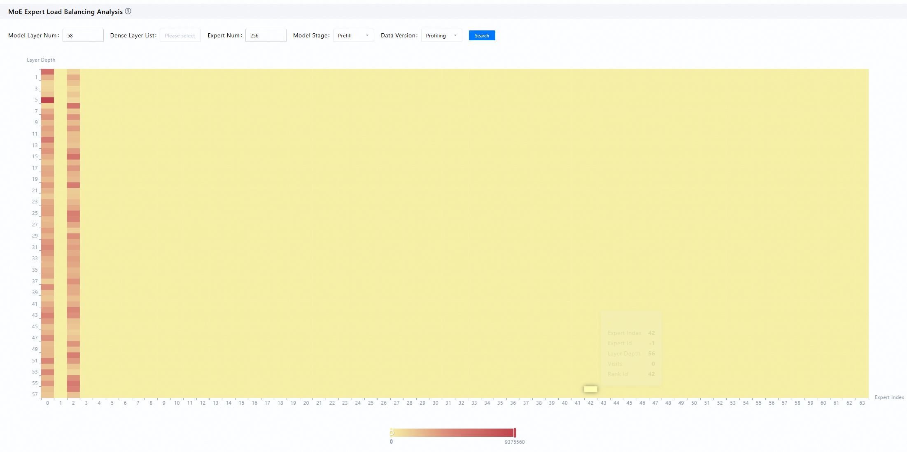

**Table 5** Parameters for MoE expert load balancing analysis 
**Table 5** Parameters for MoE expert load balancing analysis 

|Field|Description|
|--|--|
|Model Layer Num|You can set it to a value ranging from 1 to 500.|
|Dense Layer List|Select one or more layers.|
|Expert Num|You can set it to a value ranging from 1 to 500.|
|Model Stage|Two phases of model inference: Prefill and Decode|
|Data Version|The value can be **Profiling**, **Dump unbalanced**, or **Dump balanced**.|

## Usage Description

**Displaying the Parallel Policy**

The **Summary** tab page supports the management of parallel strategy settings, which can be distinguished based on the imported profile data.

- If the profile data contains the collected parallel strategy parameter values, the values can be automatically read and filled in the page. The page information is automatically updated based on the input values. If you need to reset the parallel parameter values, enter the correct values and click `Generate`. In the dialog box that is displayed, confirm the information and click `Confirm`. The page information is updated accordingly.
- If the profile data does not contain the collected parallel strategy parameter values, enter the correct values of **PP Size**, **TP Size**, **CP Size**, **DP Size**, **MoE-TP Size**, and **EP Size** as required and click `Generate`. The page information is updated accordingly.

Configure the parallel strategy as follows: **PP Size** = **4**, **TP Size** = **4**, **CP Size** = **4**, **DP Size** = **8**, and **EP Size** = **4**. Click `Generate`. The parallel strategy chart is updated based on the input values, as shown in [**Figure 1** Data parallel strategy](#data-parallel-strategy).

When selecting different dimensions, you can select pipeline parallelism, tensor parallelism, context parallelism, data parallelism, or expert parallelism as required. The parallel strategy chart displays the division policy check box based on the selected options. When you click the check box, the page below is updated accordingly.

You can also select **Performance Metric** and **Visible Range** to color the target in the parallel strategy chart. Select **Target Index** and click `Find` to quickly locate the target index.

You can set the selected performance metric of any target index as the minimum or maximum filter value to quickly locate and analyze issues. In all dimensions, select a performance metric, right-click a target index in the parallel strategy chart, and choose the minimum or maximum filter value setting from the shortcut menu. The rendering color of the chart and the filter range change accordingly.

**Figure 1** Data parallel strategy

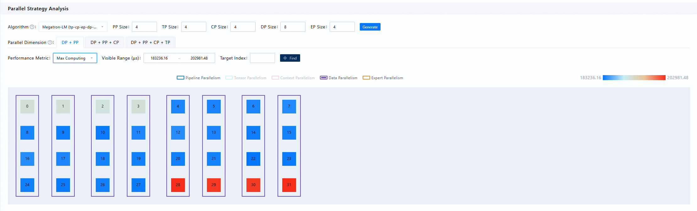

**Supporting Page Information Linkage**

- Flow linkage

    After the parallel strategy is set, if **DP + PP + CP + TP** is selected, you can click the target index in the strategy chart display area to show the related flow. When you click the flow, the lower part of the page changes accordingly, as shown in [**Figure 2** Linkage](#linkage). This function facilitates developers to view data differences.

    You can also click the target index in the **DP + PP + TP** or **DP + PP + CP + TP** dimension to display flows. Right-click a flow and choose the option for viewing communication duration analysis. Then, the communication page is displayed, showing details about the communication group to which the target index belongs.

    In the DP + PP + CP + TP area, click the tensor parallel flow related to rank 0 in the strategy chart. The **Computation/Communication Overview**, **Computing Detail (Rank** *ID***)**, and **Communication Detail (Rank** *ID***)** areas are updated. **Computation/Communication Overview** displays details about the communication groups (0, 1, 2, 3) related to rank 0. **Computing Detail (Rank ***ID***)** and **Communication Detail (Rank ***ID***)** display the computing details and communication details of the corresponding rank, respectively. When you click the bar chart of any rank in the **Computation/Communication Overview** area, the computing details and communication details of the corresponding rank are displayed.

    **Figure 2** Linkage

    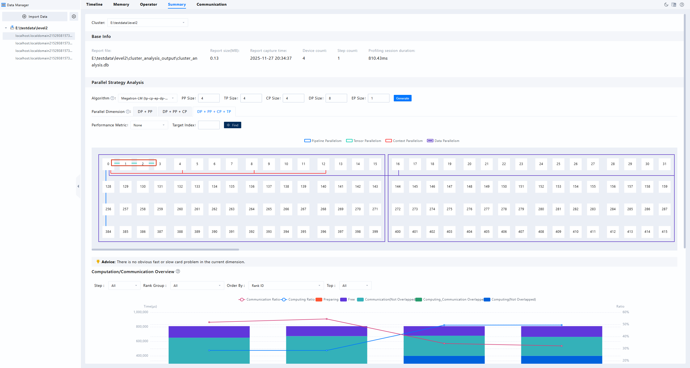

- Box selection linkage

    Select any dimension. When pipeline parallelism, tensor parallelism, context parallelism, or data parallelism is selected, the parallel strategy chart displays the division strategy according to the selected option. The box selection area is displayed. Click the box, and the lower part of the page changes accordingly, as shown in [**Figure 3** Box selection linkage](#box-selection-linkage).

    In the **DP + PP + CP** dimension, select **Pipeline Parallelism**. The parallel strategy chart is updated, and the box is displayed. Click the **Pipeline Parallelism** box, and the **Computation/Communication Overview** is updated.

    **Figure 3** Box selection linkage 

    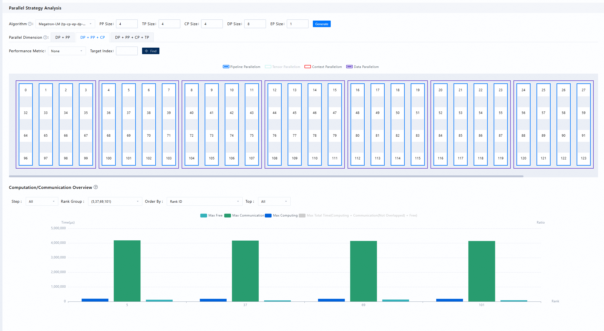

**Displaying Parallel Policies in Different Dimensions**

On the **Summary** page, after the parallel strategy value is set, you can select **DP + PP**, **DP + PP + CP**, **DP + PP + TP**, or**DP + PP + CP + TP** to display the parallel strategy chart.

You can select a dimension tab on the parallel strategy graph to expand the corresponding dimension, or right-click a target index to expand or collapse each dimension.

- Expand: In the **DP + PP** or **DP + PP + CP** dimension, right-click a target index and choose **Expand** from the shortcut menu.
- Collapse: In the **DP + PP**, **DP + PP + CP**, **DP + PP + TP**, or **DP + PP + CP + TP** dimension, right-click a target index and choose **Collapse** from the shortcut menu.

The details of each dimension are as follows.

- DP + PP

    If the **DP + PP** dimension is selected, you can select **Pipeline Parallelism** and **Data Parallelism**. When you click a box in the strategy chart, the **Computation/Communication Overview** bar chart changes accordingly. When you select performance metrics, the strategy chart is rendered accordingly to facilitate analysis, as shown in [**Figure 4** DP + PP dimension](#dp-+-ppdimension). You can set the visible range corresponding to a performance metric and enter the required index in the **Target Index** text box to accurately locate the target.

    You can click the icon of a data type on the top of the bar chart to hide or display the corresponding data in the bar chart.

    **Figure 4** DP + PP dimension 

    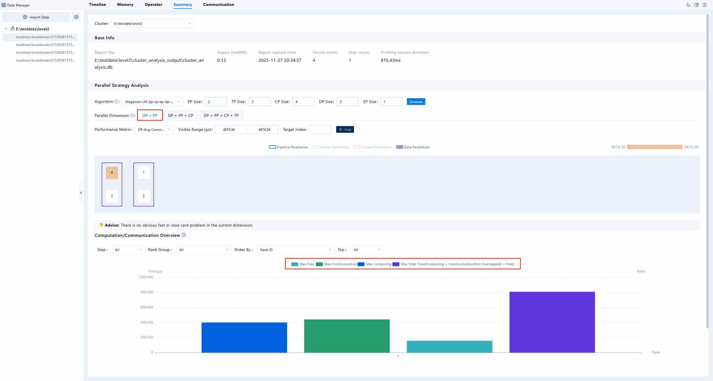

- DP + PP + CP

    When **Algorithm** is set to **Megatron-LM\(tp-cp-ep-dp-pp\)**, **Megatron-LM\(tp-cp-pp-ep-dp\)**, or **MindSpeed\(tp-cp-ep-dp-pp\)**, the **DP + PP + CP** dimension is displayed. You can select **Pipeline Parallelism**, **Context Parallelism**, and **Data Parallelism**. Click the check box in the strategy chart, and the **Computation/Communication Overview** bar chart changes accordingly. When you select performance metrics, the strategy chart is rendered accordingly to facilitate analysis, as shown in [**Figure 5** DP + PP + CP dimension](#dp-+-PP-+-CP-dimension). You can set the visible range corresponding to a performance metric and enter the required index in the **Target Index** text box to accurately locate the target.

    You can click the icon of a data type on the top of the bar chart to hide or display the corresponding data in the bar chart.

    **Figure 5** DP + PP + CP dimension 

    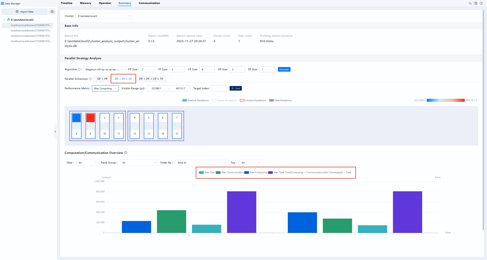

- DP + PP + TP

    When **Algorithm** is set to **MindIE-LLM\(tp-dp-ep-pp-moetp\)** or**vLLM\(tp-pp-dp-ep\)**, the **DP + PP + TP** dimension is displayed. You can select **Pipeline Parallelism**, **Tensor Parallelism**, **Data Parallelism**, and **Expert Parallelism**. Click the check box in the strategy chart, and the **Computation/Communication Overview** bar chart changes accordingly. When you select performance metrics, the strategy chart is rendered accordingly to facilitate analysis, as shown in [**Figure 6** DP + PP + TP dimension](#dp-+-pp-+-tp-dimension). You can set the visible range corresponding to a performance metric and enter the required index in the **Target Index** text box to accurately locate the target.

    You can click a rank and select the corresponding flow to display **Computation/Communication Overview**, **Computing Detail**, and **Communication Detail** under the strategy chart. You can also click a data type icon on the top of the bar chart to hide or display the data in the bar chart.

    **Figure 6** DP + PP + TP dimension <

    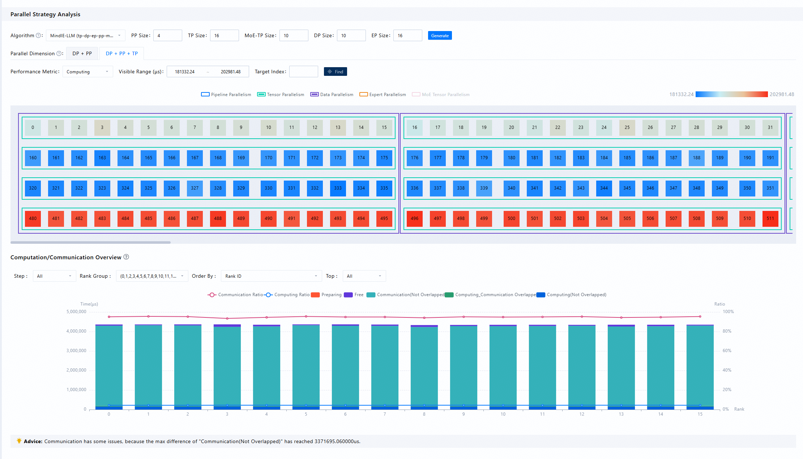

- DP + PP + CP + TP

    When **Algorithm** is set to **Megatron-LM\(tp-cp-ep-dp-pp\)**, **Megatron-LM\(tp-cp-pp-ep-dp\)**, or **MindSpeed\(tp-cp-ep-dp-pp\)**, the **DP + PP + CP + TP** dimension is displayed. You can select **Pipeline Parallelism**, **Tensor Parallelism**, **Context Parallelism**, and **Data Parallelism**. Click the check box in the strategy chart, and the **Computation/Communication Overview** bar chart changes accordingly. When you select performance metrics, the strategy chart is rendered accordingly to facilitate analysis, as shown in [**Figure 7** DP + PP + CP + TP dimension](#dp-+-pp-+-cp-+-tp-dimension). You can set the visible range corresponding to a performance metric and enter the required index in the **Target Index** text box to accurately locate the target.

    You can click a rank and select the corresponding flow to display **Computation/Communication Overview**, **Computing Detail**, and **Communication Detail** under the strategy chart. You can also click a data type icon on the top of the bar chart to hide or display the data in the bar chart.

    **Figure 7** DP + PP + CP + TP dimension 

    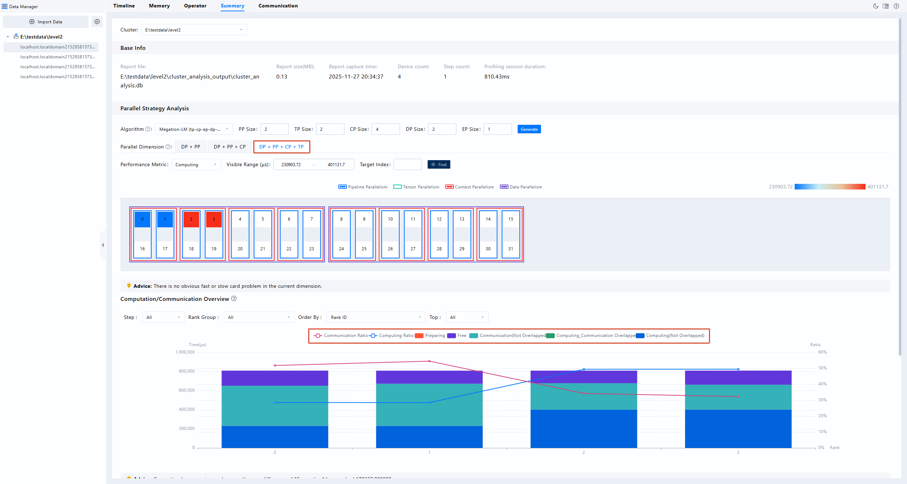

**Comparing Cluster Data**

MindStudio Insight allows developers to compare cluster data to intuitively and clearly view the data differences. For details about how to set baseline data and comparison data, see [Data Comparison](../basic_operations.md#managing-data).

In comparison mode, the **Base Info** area on the **Summary** tab page displays the comparison data and baseline data information.

In the **Parallel Strategy Analysis** area, the parallel strategy configuration parameters must be set according to the rules. The number of imported ranks is determined by the maximum number of devices in the comparison data or baseline data. When you select the target index in the parallel strategy chart, the details displayed indicate the comparison data and the data in the brackets indicates the difference.

In the bar chart details in the **Computation/Communication Overview** area, the difference between the comparison data and baseline data is displayed, as shown in [**Figure 8** Comparison mode on the overview page](#comparison-mode-on-the-overview-page).

**Figure 8** Comparison mode on the overview page 

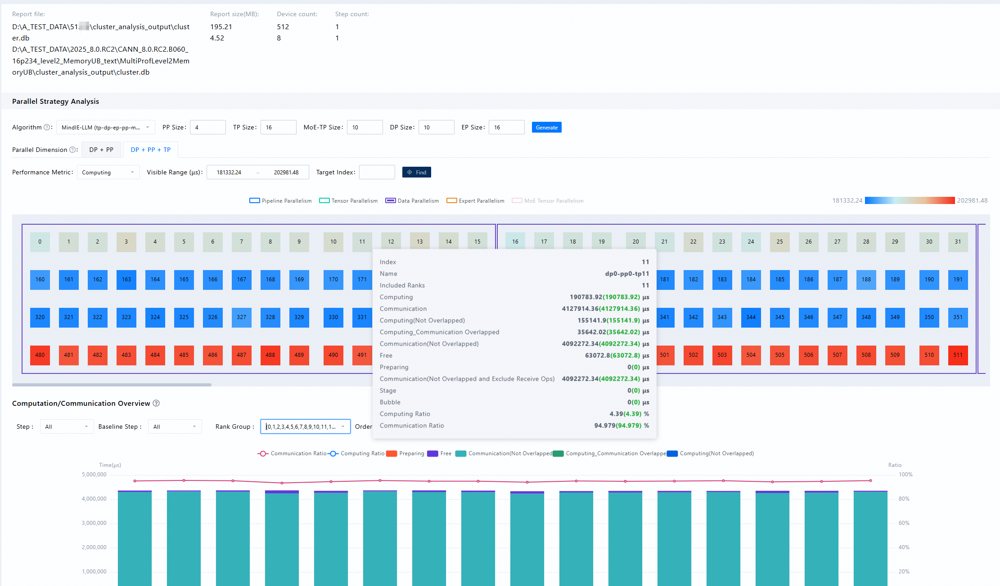

**Showing Expert Distribution Heatmap and Load Balancing Heatmap**

In the **MoE Expert Load Balancing Analysis** area, you can choose to display the expert distribution heatmap and the expert load balancing heatmap.

- Expert distribution heatmap

    If the imported profile data contains expert distribution heatmap data, set **Data Version** to **Profiling**, set other related parameters, and click `Search`. The expert distribution heatmap is displayed.

- Expert load balancing heatmap

    To import the balanced or unbalanced dump data, set **Data Version** to **Dump balanced** or **Dump unbalanced** and click  to import the corresponding file to display the MoE expert load balancing heatmap, as shown in [**Figure 9** MoE expert load balancing analysis](#moe-expert-load-balancing-analysis). After the file is imported successfully, the default values of the parameters are automatically set.

The vertical coordinate indicates the total number of model layers (MoE layers + non-MoE layers), and the horizontal coordinate indicates the expert sequence number. When you select a cell in the chart, the details of the cell are displayed, including the expert index, ID, layer ID, rank ID, and access traffic.

You can hold down **Ctrl** and scroll the mouse wheel to zoom in or out the heatmap.

**Figure 9** MoE expert load balancing analysis

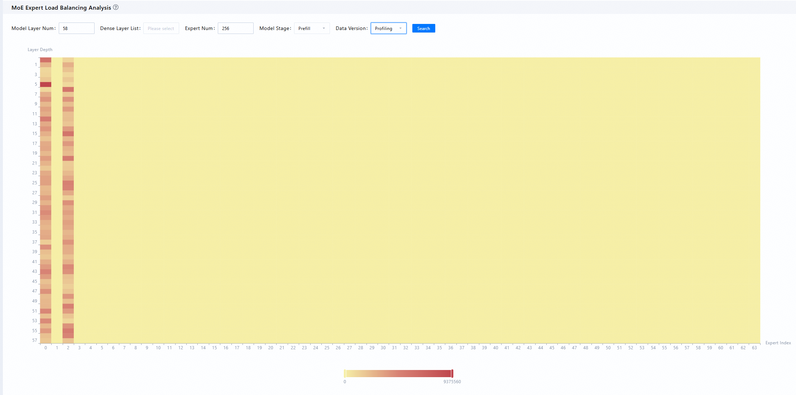
