# Timeline

## Function Description

In the Ascend heterogeneous compute architecture, MindStudio Insight displays the running details of the host and device during training or inference in the timeline view, displays the API time consumption on the host and the task time consumption on the device, and associates the host with the device. This helps you quickly identify host or device bottlenecks. In addition, the tool provides various filtering categories and advice to support in-depth tuning.

Check the time consumption and interval at each layer in the timeline view to determine whether the corresponding component and operator have performance problems. For example, check whether there is a bottleneck in operator delivery, whether there is a time-consuming kernel, and whether there are redundant conversion operators.

> [!NOTE]
>
> By default, the **Timeline** tab page displays a maximum of three minutes of data. If the imported data exceeds three minutes in duration, zooming out is not supported; you can only zoom in and pan left or right to view other data in time.

## GUI Description

**GUI Display**

The **Timeline** tab page consists of the toolbar (area 1), the timeline tree view (area 2), the graphical pane (area 3), and the data pane (area 4), as shown in [**Figure 1** Timeline page](#timeline-page).

**Figure 1** Timeline page

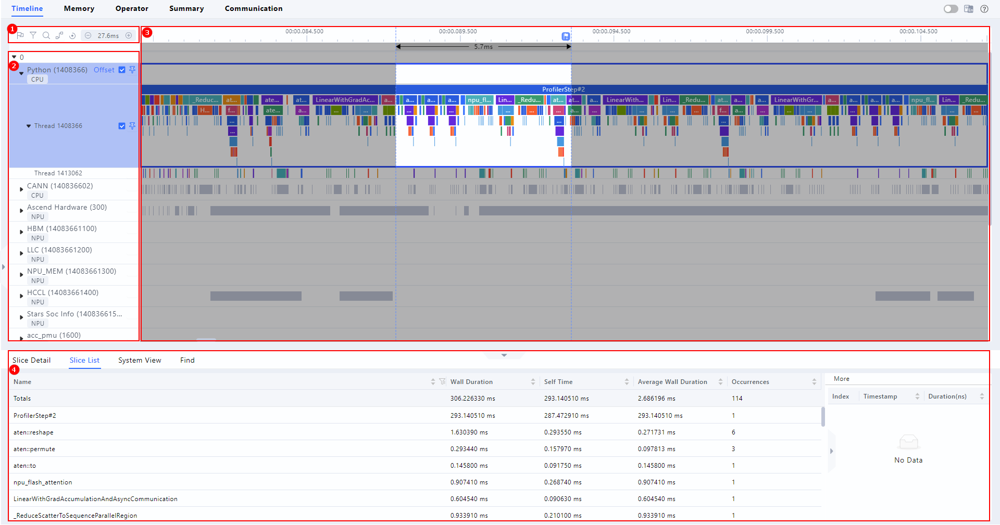

- Area 1: toolbar, which contains common shortcut keys. From left to right, the shortcut keys are **Marker List**, **Filter** (rank or unit), **Search**, **Flow Events**, **Reset** (page restoration), **Timeline Zoom Out**, and **Timeline Zoom In**.
- Area 2: timeline tree chart. The display in the TEXT scenario is different from that in the DB scenario. For details about the unit information, see [Unit Information](#unit-information).
    - TEXT scenario: displays the layer information of each device in the cluster scenario. The layer information is displayed by rank. The first layer is the rank ID, the second layer is the process or special layer, and the third layer is the thread name. The second layer includes the **Python** layer data (time consumption information of **PyTorch** and dotting data), **CANN** layer data (time consumption data of AscendCL, GE, and Runtime components), low-level **NPU** data (time consumption data and step trace data of each stream task flow under **Ascend Hardware**, communication data of **Communication** and **Overlap Analysis**, memory data, and other Ascend AI Processor system data), **AI Core Freq**, and other layers. The layer content varies with the imported data.
    - DB scenario: displays information about each host. The first layer is the host name, and the second layer is **Host** and **Rank ID**. The **Host** level displays **PyTorch** and **CANN** data by process and thread. The **Rank ID** level includes the bottom-layer **NPU** data (including time consumption data and step trace data of each stream task flow under **Ascend Hardware**, communication data of **Communication** and **Overlap Analysis**, memory data, and other Ascend AI Processor system data), **AI Core Freq**, and other layers. The content of the level under the rank varies with the imported data.

- Area 3: graphical pane, which displays data of a step. The graphical pane corresponds to the timeline tree chart, which graphically displays the timeline row by row, including the execution sequence and duration of upper-level application operators, components, and APIs.
- Area 4: data pane, which displays statistics or operator details. **Slice Detail** displays details about a selected operator. **Slice List** displays the operator list in the selected area of a unit. **System View** displays the summary information about a type of operators. **Find** displays the information about the searched operators.

**Unit Information**

The following table describes the unit information displayed on the **Timeline** tab page.

**Table 1** Unit information

<table class="tg"><thead>
  <tr>
    <th class="tg-0pky">Level-1 Unit Name</th>
    <th class="tg-0pky">Level-2 Unit Name</th>
    <th class="tg-0pky">Description</th>
  </tr></thead>
<tbody>
  <tr>
    <td class="tg-0pky">Process</td>
    <td class="tg-0pky">Thread</td>
    <td class="tg-0pky">This unit can be displayed only in DB files. The Thread unit contains the PyTorch, CANN, and MSTX units, which display the time consumed by upper-layer application threads in the PyTorch framework, time consumed by threads in the CANN framework, and dotting information, respectively.</td>
  </tr>
  <tr>
    <td class="tg-0pky">Python</td>
    <td class="tg-0pky">Thread</td>
    <td class="tg-0pky">Application layer data. Each sub-unit Thread contains the time consumed by the upper-layer application thread. The data is collected using PyTorch Profiler or `msprof_tx`. This unit can be displayed only in TEXT files.</td>
  </tr>
  <tr>
    <td class="tg-0pky">CANN</td>
    <td class="tg-0pky">Thread</td>
    <td class="tg-0pky">Data at the CANN layer. Each sub-unit Thread contains the time consumption data of AscendCL, GE, Runtime, and nodes (operators). For DB files, the level-2 unit name may contain **acl**, model, **node**, **hccl**, **runtime**, **op**, **queue**, **trace**, and **mstx**.</td>
  </tr>
  <tr>
    <td class="tg-0pky">MindSpore</td>
    <td class="tg-0pky">Thread</td>
    <td class="tg-0pky">In MindSpore, the time consumed by each phase of the current thread is displayed, used for analyzing network structure performance.</td>
  </tr>
  <tr>
    <td class="tg-0pky">Scope Layer</td>
    <td class="tg-0pky">Thread</td>
    <td class="tg-0pky">In MindSpore, the time consumed by each network layer of the current thread is displayed.</td>
  </tr>
  <tr>
    <td class="tg-0pky">Python GC</td>
    <td class="tg-0pky">Python GC</td>
    <td class="tg-0pky">In PyTorch scenarios, if the GC detection feature is enabled and a GC event occurs during the collection period, it will be displayed in the Python GC unit.</td>
  </tr>
  <tr>
    <td class="tg-0pky" rowspan="3">Ascend Hardware</td>
    <td class="tg-0pky">Stream &lt;id&gt;</td>
    <td class="tg-0pky">Low-level NPU data, task scheduling data, recording the execution duration of each task on different accelerators and AI Core performance metrics during AI task running.</td>
  </tr>
  <tr>
    <td class="tg-0pky">Stream &lt;id&gt; MSTX domain &lt;domainid&gt;</td>
    <td class="tg-0pky">MSTX device dotting data of stream id.</td>
  </tr>
  <tr>
    <td class="tg-0pky">Step Trace</td>
    <td class="tg-0pky">Step trace data. This unit is displayed only when the **step_trace_*.json** file exists.</td>
  </tr>
  <tr>
    <td class="tg-0pky">DPU / DPU &lt;id&gt;</td>
    <td class="tg-0pky">DPU Stream &lt;id&gt;</td>
    <td class="tg-0pky">DPU tasks are mounted under the corresponding Thread according to globalTid, at the same level as units such as CANN, and task execution intervals are displayed in the hierarchy DPU / DPU &lt;id&gt; / DPU Stream &lt;id&gt;. After a task is selected, you can view its details in the data pane. Global search and locked-range search by task name are supported, and you can locate the corresponding task from the search results. This unit is displayed only for db-format files.</td>
  </tr>
    <tr>
    <td class="tg-0pky">CCU</td>
    <td class="tg-0pky">Communication</td>
    <td class="tg-0pky">Contains collective communication instruction data, including the start and end times of CCU tasks and the start and end times of first-level index instructions of CCU tasks, as well as synchronization and data transfer duration. The CCU unit only supports displaying profile data exported from <term>Ascend 950PR&950DT products</term>.</td>
  </tr>
    <tr>
    <td class="tg-0pky" rowspan="4">Overlap Analysis</td>
    <td class="tg-0pky">Communication</td>
    <td class="tg-0pky">Communication time.</td>
  </tr>
  <tr>
    <td class="tg-0pky">Communication(Not Overlapped)</td>
    <td class="tg-0pky">Communication time not hidden by computation.</td>
  </tr>
  <tr>
    <td class="tg-0pky">Computing</td>
    <td class="tg-0pky">Computing time.</td>
  </tr>
  <tr>
    <td class="tg-0pky">Free</td>
    <td class="tg-0pky">Time when the device side is neither computing nor communicating. When broken down by the Step dimension, it is further distinguished as Preparing and Free, where Preparing involves data preprocessing, loading, copying, and other operations.</td>
  </tr>
  <tr>
    <td class="tg-0pky" rowspan="2">Communication</td>
    <td class="tg-0pky">Group &lt;id&gt; Communication</td>
    <td class="tg-0pky">Communication operators within a communication domain. A rank can exist in different communication groups, and a Group identifies the behavior of the current rank in the current communication domain.</td>
  </tr>
  <tr>
    <td class="tg-0pky">Plane &lt;id&gt;</td>
    <td class="tg-0pky">Collective communication operator information. Network plane ID, which schedules and executes multiple send/receive communication links in parallel. Each Plane represents a concurrent communication dimension.</td>
  </tr>
  <tr>
    <td class="tg-0pky" rowspan="22">NPU Metrics</td>
    <td class="tg-0pky">Low Power</td>
    <td class="tg-0pky">Low-power data, including power consumption, bandwidth, frequency, temperature, and other data. By presenting frequency variation curves, it accurately identifies frequency changes during operator execution. The Low Power unit only supports displaying profile data exported from <term>Ascend 950PR&950DT products</term>.</td>
  </tr>
  <tr>
    <td class="tg-0pky">Biu Perf</td>
    <td class="tg-0pky">Presents the execution time of instructions such as SU, VEC, CUBE, and MTE, as well as instrumentation data. The Biu Perf unit only supports displaying profile data exported from <term>Ascend 950PR&950DT products</term>.</td>
  </tr>
  <tr>
    <td class="tg-0pky">UB</td>
    <td class="tg-0pky">Presents the overall UB transmit and receive bandwidth for two data types: UDMA and UNIC. In DB-format files, each Port corresponds to one UB Port &lt;id&gt; unit, which displays both Rx Bandwidth and Tx Bandwidth. The UB unit only supports displaying profile data exported from <term>Ascend 950PR&950DT products</term>.</td>
  </tr>
  <tr>
    <td class="tg-0pky">Block Detail</td>
    <td class="tg-0pky">Displays the execution time of each operator on the earliest and latest AI Core or AI Vector Core. When the operator is of the Mix type, it executes on both AI Core and AI Vector Core simultaneously. The Block Detail unit only supports displaying profile data exported from <term>Ascend 950PR&950DT products</term>.</td>
  </tr>
  <tr>
    <td class="tg-0pky">HBM</td>
    <td class="tg-0pky">HBM memory read/write bandwidth, in MB/s.</td>
  </tr>
  <tr>
    <td class="tg-0pky">DDR</td>
    <td class="tg-0pky">DDR memory read/write bandwidth</td>
  </tr>
  <tr>
    <td class="tg-0pky">LLC</td>
    <td class="tg-0pky">For details, see the "LLC" unit description in <a href="#NPU Metrics Unit Information">Table 2 NPU Metrics unit information</a>.</td>
  </tr>
  <tr>
    <td class="tg-0pky">NPU_MEM</td>
    <td class="tg-0pky">For details, see the "NPU_MEM" unit description in <a href="#NPU Metrics Unit Information">Table 2 NPU Metrics unit information</a>.</td>
  </tr>
  <tr>
    <td class="tg-0pky">Stars Soc Info</td>
    <td class="tg-0pky">For details, see the "Stars Soc Info" unit description in <a href="#NPU Metrics Unit Information">Table 2 NPU Metrics unit information</a>.</td>
  </tr>
  <tr>
    <td class="tg-0pky">acc_pmu</td>
    <td class="tg-0pky">For details, see the "acc_pmu" unit description in <a href="#NPU Metrics Unit Information">Table 2 NPU Metrics unit information</a>.</td>
  </tr>
  <tr>
    <td class="tg-0pky">AI Core Utilization</td>
    <td class="tg-0pky">For details, see the "AI Core Utilization" unit description in <a href="#NPU Metrics Unit Information">Table 2 NPU Metrics unit information</a>.</td>
  </tr>
  <tr>
    <td class="tg-0pky">AI Core Freq</td>
    <td class="tg-0pky">Displays the frequency changes of the AI Core chip during AI task execution. When the DB-format file of <term>Ascend 950PR&950DT products</term> is imported, the AI Core Freq Die &lt;id&gt; unit is displayed for each Die ID. The AI Core Freq unit supports displaying profile data exported from <term>Atlas A2 training products/Atlas A2 inference products</term> and <term>Ascend 950PR&950DT products</term>.</td>
  </tr>
  <tr>
    <td class="tg-0pky">SIO</td>
    <td class="tg-0pky">For details, see the "SIO" unit description in <a href="#NPU Metrics Unit Information">Table 2 NPU Metrics unit information</a>.</td>
  </tr>
  <tr>
    <td class="tg-0pky">QoS</td>
    <td class="tg-0pky">Device QoS bandwidth information. When the DB-format file of <term>Ascend 950PR&950DT products</term> is imported, the QoS &lt;id&gt;:OTHERS/Die &lt;id&gt;/Bandwidth unit is displayed for each Die ID.</td>
  </tr>
  <tr>
    <td class="tg-0pky">NIC</td>
    <td class="tg-0pky">Text scenario: displays network information data at each time point. DB scenario: displays bandwidth information data. The unit name varies depending on the imported data.</td>
  </tr>
  <tr>
    <td class="tg-0pky">RoCE</td>
    <td class="tg-0pky">RoCE communication interface bandwidth data.</td>
  </tr>
  <tr>
    <td class="tg-0pky">NetDev Stats</td>
    <td class="tg-0pky">The hardware sampling bandwidth capability can partially identify communication problems. As an overview item, it helps preliminarily troubleshoot communication problems: if an abnormal communication duration occurs, check first whether network congestion is the cause. NetDev Stats data is displayed only for db-format files.</td>
  </tr>
  <tr>
    <td class="tg-0pky">PCIe</td>
    <td class="tg-0pky">For details, see the "PCIe" unit description in <a href="#NPU Metrics Unit Information">Table 2 NPU Metrics unit information</a>.</td>
  </tr>
  <tr>
    <td class="tg-0pky">HCCS</td>
    <td class="tg-0pky">HCCS collective communication bandwidth data, displaying receive bandwidth and send bandwidth, in MB/s.</td>
  </tr>
  <tr>
    <td class="tg-0pky">biu_group</td>
    <td class="tg-0pky">For details, see the "biu_group" unit description in <a href="#NPU Metrics Unit Information">Table 2 NPU Metrics unit information</a>.</td>
  </tr>
  <tr>
    <td class="tg-0pky">aic_core_group</td>
    <td class="tg-0pky">For details, see the "aic_core_group" unit description in <a href="#NPU Metrics Unit Information">Table 2 NPU Metrics unit information</a>.</td>
  </tr>
  <tr>
    <td class="tg-0pky">aiv_core_group</td>
    <td class="tg-0pky">For details, see the "aiv_core_group" unit description in <a href="#NPU Metrics Unit Information">Table 2 NPU Metrics unit information</a>.</td>
  </tr>
  <tr>
    <td class="tg-0pky">Stars Chip Trans</td>
    <td class="tg-0pky">For details, see the "Stars Chip Trans" unit description in <a href="#NPU Metrics Unit Information">Table 2 NPU Metrics unit information</a>.</td>
  </tr>
  <tr>
    <td class="tg-0pky" rowspan="5">CPU Metrics</td>
    <td class="tg-0pky">CPU Usage</td>
    <td class="tg-0pky">CPU usage data on the host side.</td>
  </tr>
  <tr>
    <td class="tg-0pky">CPU Freq</td>
    <td class="tg-0pky">Frequency data of each CPU on the host side, in kHz.</td>
  </tr>
  <tr>
    <td class="tg-0pky">Memory Usage</td>
    <td class="tg-0pky">Host-side memory utilization data.</td>
  </tr>
  <tr>
    <td class="tg-0pky">Disk Usage</td>
    <td class="tg-0pky">Host-side disk I/O utilization data.</td>
  </tr>
  <tr>
    <td class="tg-0pky">Network Usage</td>
    <td class="tg-0pky">Host-side network I/O utilization data.</td>
  </tr>
  <tr>
    <td class="tg-0pky">OS Runtime API</td>
    <td class="tg-0pky">Thread</td>
    <td class="tg-0pky">host-side syscall and pthreadcall data. The OS Runtime API unit is displayed only in text format files.</td>
  </tr>
</tbody></table>

**Table 2** NPU Metrics Unit Information

<table class="tg"><thead>
  <tr>
    <th class="tg-0pky">Second-level Unit Name</th>
    <th class="tg-0pky">Three-Level Unit Name</th>
    <th class="tg-0pky">Description</th>
  </tr></thead>
<tbody>
<tr>
    <td class="tg-0pky">Low Power</td>
    <td class="tg-0pky">-</td>
    <td class="tg-0pky">Low-power data, including power consumption, bandwidth, frequency, temperature, and other metrics, is presented through dynamic frequency scaling curves to accurately identify frequency changes during operator execution. This unit displays only the profile data exported from the Ascend 950PR&950DT products.</td>
  </tr>
  <tr>
    <td class="tg-0pky">Biu Perf</td>
    <td class="tg-0pky">Group&lt;id&gt;-aiv&lt;id&gt;</td>
    <td class="tg-0pky">Execution time of instructions such as SU, VEC, CUBE, and MTE, and dotting data. This unit displays only the profile data exported from the Ascend 950PR&950DT products.</td>
  </tr>
  <tr>
    <td class="tg-0pky">UB</td>
    <td class="tg-0pky">UDMA/UNIC-Ports&lt;id&gt; UB Port&lt;id&gt;</td>
    <td class="tg-0pky">Overall receive and transmit bandwidth of the UB for the UDMA and UNIC data types. In DB-format files, each Port corresponds to one UB Port &lt;id&gt; unit, which displays both Rx Bandwidth and Tx Bandwidth. This unit displays only the profile data exported from the Ascend 950PR&950DT products.</td>
  </tr>
  <tr>
    <td class="tg-0pky" rowspan="2">Block Detail</td>
    <td class="tg-0pky">AIC/AIV Earliest</td>
    <td class="tg-0pky">Time when each operator is executed on the earliest AI Core or AI Vector Core. If the operator is of the Mix type, it is executed on both the AIC and AIV. This unit displays only the profile data exported from the Ascend 950PR&950DT products.</td>
  </tr>
    <tr>
    <td class="tg-0pky">AIC/AIV Latest</td>
    <td class="tg-0pky">Time when each operator is executed on the latest AI Core or AI Vector Core. If the operator is of the Mix type, it is executed on both the AIC and AIV.</td>
  </tr>
  <tr>
    <td class="tg-0pky" rowspan="2">HBM</td>
    <td class="tg-0pky">HBM &lt;id&gt;/Read</td>
    <td class="tg-0pky">HBM read rate, in MB/s.</td>
  </tr>
  <tr>
    <td class="tg-0pky">HBM &lt;id&gt;/Write</td>
    <td class="tg-0pky">HBM write rate, in MB/s.</td>
  </tr>
  <tr>
    <td class="tg-0pky" rowspan="2">DDR</td>
    <td class="tg-0pky">Read</td>
    <td class="tg-0pky">DDR read rate.</td>
  </tr>
  <tr>
    <td class="tg-0pky">Write</td>
    <td class="tg-0pky">DDR write rate.</td>
  </tr>
  <tr>
    <td class="tg-0pky" rowspan="2">LLC</td>
    <td class="tg-0pky">LLC &lt;id&gt; Read/Hit Rate LLC &lt;id&gt; Write/Hit Rate</td>
    <td class="tg-0pky">L3 cache read and write hit rate.</td>
  </tr>
  <tr>
    <td class="tg-0pky">LLC &lt;id&gt; Read/Throughput LLC &lt;id&gt; Write/Throughput</td>
    <td class="tg-0pky">L3 cache read and write rate data, that is, the read and write throughput of the L3 cache.</td>
  </tr>
  <tr>
    <td class="tg-0pky" rowspan="6">NPU_MEM</td>
    <td class="tg-0pky">APP/DDR</td>
    <td class="tg-0pky">Process-level DDR memory usage, in KB.</td>
  </tr>
  <tr>
    <td class="tg-0pky">APP/HBM</td>
    <td class="tg-0pky">Process-level HBM memory usage, in KB.</td>
  </tr>
  <tr>
    <td class="tg-0pky">APP/MEMORY</td>
    <td class="tg-0pky">Total process-level DDR and HBM memory usage, in KB.</td>
  </tr>
  <tr>
    <td class="tg-0pky">Device/DDR</td>
    <td class="tg-0pky">Device-level DDR memory usage, in KB.</td>
  </tr>
  <tr>
    <td class="tg-0pky">Device/HBM</td>
    <td class="tg-0pky">Device-level HBM memory usage, in KB.</td>
  </tr>
  <tr>
    <td class="tg-0pky">Device/MEMORY</td>
    <td class="tg-0pky">Total device-level DDR and HBM memory usage, in KB.</td>
  </tr>
  <tr>
    <td class="tg-0pky" rowspan="2">Stars Soc Info</td>
    <td class="tg-0pky">L2 Buffer Bw Level</td>
    <td class="tg-0pky">SoC transmission bandwidth information and L2 buffer bandwidth level information.</td>
  </tr>
  <tr>
    <td class="tg-0pky">Meta Bw Level</td>
    <td class="tg-0pky">Meta bandwidth level information.</td>
  </tr>
  <tr>
    <td class="tg-0pky" rowspan="4">acc_pmu</td>
    <td class="tg-0pky">Accelerator {accId}/readBwLevel</td>
    <td class="tg-0pky">Read bandwidth of the DVPP and DSA accelerators This unit is not supported by the Ascend 950PR&950DT products.</td>
  </tr>
  <tr>
    <td class="tg-0pky">Accelerator {accId}/readOstLevel</td>
    <td class="tg-0pky">Concurrent read operations of the DVPP and DSA accelerators</td>
  </tr>
  <tr>
    <td class="tg-0pky">Accelerator {accId}/writeBwLevel</td>
    <td class="tg-0pky">Write bandwidth of the DVPP and DSA accelerators</td>
  </tr>
  <tr>
    <td class="tg-0pky">Accelerator {accId}/writeOstLevel</td>
    <td class="tg-0pky">Concurrent write operations of the DVPP and DSA accelerators.</td>
  </tr>
  <tr>
    <td class="tg-0pky" rowspan="2">AI Core Utilization</td>
    <td class="tg-0pky">Average</td>
    <td class="tg-0pky">Average percentage of AI Core instructions. AI Core Utilization units can be displayed only in text files.</td>
  </tr>
  <tr>
    <td class="tg-0pky">Core &lt;id&gt;</td>
    <td class="tg-0pky">Percentage of total execution cycles (counting from the first operator instruction executed by the AI Core to the completion of the last instruction executed) of a task on the AI Core.</td>
  </tr>
  <tr>
    <td class="tg-0pky">AI Core Freq</td>
    <td class="tg-0pky">AI Core Freq AI Core Freq Die &lt;id&gt;</td>
    <td class="tg-0pky">Frequency changes of AI Cores during AI task running. When the DB-format file of Ascend 950PR&950DT products is imported, the AI Core Freq Die &lt;id&gt; unit is displayed for each Die ID. This unit supports displaying the profile data exported from Atlas A2 products and Ascend 950PR&950DT products.</td>
  </tr>
  <tr>
    <td class="tg-0pky" rowspan="4">SIO</td>
    <td class="tg-0pky">dat_rx, dat_tx dat_rx/&lt;name&gt;, dat_tx/&lt;name&gt; (DB format)</td>
    <td class="tg-0pky">Rx and Tx bandwidths of the data stream channel. The SIO unit can be displayed in text-format files and, for <term>Ascend 950PR&950DT products</term>, also in DB-format files. In DB format, "/&lt;name&gt;" is appended to the end of each sub-unit name to distinguish SIO channels. The SIO unit supports displaying only the inter-die transmission bandwidth information of <term>Atlas A2 training products/Atlas A2 inference products</term> and <term>Ascend 950PR&950DT products</term>.</td>
  </tr>
  <tr>
    <td class="tg-0pky">req_rx, req_tx req_rx/&lt;name&gt;, req_tx/&lt;name&gt; (DB format)</td>
    <td class="tg-0pky">Rx and Tx bandwidths of the request stream channel.</td>
  </tr>
  <tr>
    <td class="tg-0pky">rsp_rx, rsp_tx rsp_rx/&lt;name&gt;, rsp_tx/&lt;name&gt; (DB format)</td>
    <td class="tg-0pky">Rx and Tx bandwidths of the response stream channel.</td>
  </tr>
  <tr>
    <td class="tg-0pky">snp_rx, snp_tx snp_rx/&lt;name&gt;, snp_tx/&lt;name&gt; (DB format)</td>
    <td class="tg-0pky">Rx and Tx bandwidths of the monitor stream channel.</td>
  </tr>
  <tr>
    <td class="tg-0pky">QoS</td>
    <td class="tg-0pky">QoS &lt;id&gt;:OTHERS QoS &lt;id&gt;:OTHERS/Die &lt;id&gt;/Bandwidth</td>
    <td class="tg-0pky">Device QoS bandwidth information. When the DB-format file of <term>Ascend 950PR&950DT products</term> is imported, the QoS &lt;id&gt;:OTHERS/Die &lt;id&gt;/Bandwidth unit is displayed for each Die ID.</td>
  </tr>
  <tr>
    <td class="tg-0pky">NIC</td>
    <td class="tg-0pky">For details about the units, see: 1. The "<a href="https://gitcode.com/Ascend/msprof/blob/master/docs/en/user_guide/profile_data_file_references_db.md#nic">NIC</a>" section, field name column of "Table 1 Format" in the *DB Format Performance Data File Reference* document; 2. The "<a href="https://gitcode.com/Ascend/msprof/blob/master/docs/en/user_guide/profile_data_file_references.md#nic-nic-summary">nic (NIC Summary)</a>" section of "Text Format Performance Data" in the *Performance Data File Reference* document, field name column of "Table 1 Field Description" and "Table 2 Field Description".</td>
    <td class="tg-0pky">For the meaning of the units, see: 1. The "<a href="https://gitcode.com/Ascend/msprof/blob/master/docs/en/user_guide/profile_data_file_references_db.md#nic">NIC</a>" section, meaning column of "Table 1 Format" in the *DB Format Performance Data File Reference* document; 2. The "<a href="https://gitcode.com/Ascend/msprof/blob/master/docs/en/user_guide/profile_data_file_references.md#nic-nic-summary">nic (NIC Summary)</a>" section of "Text Format Performance Data" in the *Performance Data File Reference* document, meaning column of "Table 1 Field Description" and "Table 2 Field Description".</td>
  </tr>
  <tr>
    <td class="tg-0pky">RoCE</td>
    <td class="tg-0pky">For details about the units, see: 1. The "<a href="https://gitcode.com/Ascend/msprof/blob/master/docs/en/user_guide/profile_data_file_references_db.md#roce">ROCE</a>" section, field name column of "Table 1 Format" in the *DB Format Performance Data File Reference* document; 2. The "<a href="https://gitcode.com/Ascend/msprof/blob/master/docs/en/user_guide/profile_data_file_references.md#roce-roce-bandwidth">roce (RoCE Bandwidth)</a>" section of "Text Format Performance Data" in the *Performance Data File Reference* document, field name column of "Table 1 Field Description" and "Table 2 Field Description".</td>
    <td class="tg-0pky">For the meaning of the units, see: 1. The "<a href="https://gitcode.com/Ascend/msprof/blob/master/docs/en/user_guide/profile_data_file_references_db.md#roce">ROCE</a>" section, meaning column of "Table 1 Format" in the *DB Format Performance Data File Reference* document; 2. The "<a href="https://gitcode.com/Ascend/msprof/blob/master/docs/en/user_guide/profile_data_file_references.md#roce-roce-bandwidth">roce (RoCE Bandwidth)</a>" section of "Text Format Performance Data" in the *Performance Data File Reference* document, meaning column of "Table 1 Field Description" and "Table 2 Field Description".</td>
  </tr>
  <tr>
    <td class="tg-0pky">NetDev Stats</td>
    <td class="tg-0pky">For details about the units, see the "<a href="https://gitcode.com/Ascend/msprof/blob/master/docs/en/user_guide/profile_data_file_references_db.md#netdev_stats">NETDEV_STATS</a>" section, field name column of "Table 1 Format" in the *DB Format Performance Data File Reference* document.</td>
    <td class="tg-0pky">For the meaning of the units, see the "<a href="https://gitcode.com/Ascend/msprof/blob/master/docs/en/user_guide/profile_data_file_references_db.md#netdev_stats">NETDEV_STATS</a>" section, meaning column of "Table 1 Format" in the *DB Format Performance Data File Reference* document.</td>
  </tr>
  <tr>
    <td class="tg-0pky" rowspan="4">PCIe</td>
    <td class="tg-0pky">PCIe_cpl</td>
    <td class="tg-0pky">Completion packets that receives write requests, in MB/s. `Tx` indicates transmit, and `Rx` indicates receive.</td>
  </tr>
  <tr>
    <td class="tg-0pky">PCIe_nonpost</td>
    <td class="tg-0pky">PCIe Non-Posted data transmission bandwidth, in MB/s. `Tx` indicates transmit, and `Rx` indicates receive.</td>
  </tr>
  <tr>
    <td class="tg-0pky">PCIe_nonpost_latency</td>
    <td class="tg-0pky">Transmission latency in PCIe Non-Posted mode, in μs. `Tx` indicates transmit, and `Rx` indicates receive. `PCIe_nonpost_latency` does not involve `Rx`. The value is fixed at `0`.</td>
  </tr>
  <tr>
    <td class="tg-0pky">PCIe_post</td>
    <td class="tg-0pky">PCIe Posted data transmission bandwidth, in MB/s. `Tx` indicates transmit, and `Rx` indicates receive. The unit name varies according to the imported data.</td>
  </tr>
  <tr>
    <td class="tg-0pky">HCCS</td>
    <td class="tg-0pky">txThroughput rxThroughput</td>
    <td class="tg-0pky">Transmit and receive bandwidths (MB/s) of HCCS collective communication.</td>
  </tr>
  <tr>
    <td class="tg-0pky" rowspan="4">biu_group</td>
    <td class="tg-0pky">Bandwidth Read</td>
    <td class="tg-0pky">Bandwidth for the bus interface unit (BIU) to read instructions. biu_group units can be displayed only in text files.</td>
  </tr>
  <tr>
    <td class="tg-0pky">Bandwidth Write</td>
    <td class="tg-0pky">Bandwidth for the BIU to write instructions.</td>
  </tr>
  <tr>
    <td class="tg-0pky">Latency Read</td>
    <td class="tg-0pky">Latency for the BIU to read instructions.</td>
  </tr>
  <tr>
    <td class="tg-0pky">Latency Write</td>
    <td class="tg-0pky">Latency for the BIU to write instructions.</td>
  </tr>
  <tr>
    <td class="tg-0pky" rowspan="4">aic_core_group</td>
    <td class="tg-0pky">Cube</td>
    <td class="tg-0pky">Cycle count and ratio of matrix operation instructions in the current sampling period. aic_core_group units can be displayed only in text files.</td>
  </tr>
  <tr>
    <td class="tg-0pky">Mte1</td>
    <td class="tg-0pky">Cycle count and ratio of L1-to-L0A/L0B transfer instructions in the current sampling period.</td>
  </tr>
  <tr>
    <td class="tg-0pky">Mte2</td>
    <td class="tg-0pky">Cycle count and ratio of on-chip memory to AI Core transfer instructions in the current sampling period.</td>
  </tr>
  <tr>
    <td class="tg-0pky">Mte3</td>
    <td class="tg-0pky">Cycle quantity and ratio of AI Core to on-chip memory movement instructions in the current sampling period.</td>
  </tr>
  <tr>
    <td class="tg-0pky" rowspan="5">aiv_core_group</td>
    <td class="tg-0pky">Mte1</td>
    <td class="tg-0pky">Cycle count and ratio of L1-to-L0A/L0B transfer instructions in the current sampling period. aiv_core_group units can be displayed only in text files.</td>
  </tr>
  <tr>
    <td class="tg-0pky">Mte2</td>
    <td class="tg-0pky">Cycle count and ratio of on-chip memory to AI Core transfer instructions in the current sampling period.</td>
  </tr>
  <tr>
    <td class="tg-0pky">Mte3</td>
    <td class="tg-0pky">Cycle quantity and ratio of AI Core to on-chip memory movement instructions in the current sampling period.</td>
  </tr>
  <tr>
    <td class="tg-0pky">Scalar</td>
    <td class="tg-0pky">Cycle count and ratio of scalar operation instructions in the current sampling period.</td>
  </tr>
  <tr>
    <td class="tg-0pky">Vector</td>
    <td class="tg-0pky">Cycle count and ratio of vector operation instructions in the current sampling period.</td>
  </tr>
  <tr>
    <td class="tg-0pky" rowspan="4">Stars Chip Trans</td>
    <td class="tg-0pky">PA Link Rx</td>
    <td class="tg-0pky">PA traffic receive level. When collective communication bandwidth is available, it is not recommended to refer to this field, as it provides only coarse-grained statistical data. Stars Chip Trans units are displayed only in text files and are not supported by the Ascend 950PR&950DT products.</td>
  </tr>
  <tr>
    <td class="tg-0pky">PA Link Tx</td>
    <td class="tg-0pky">PA traffic send level. When collective communication bandwidth is available, it is not recommended to refer to this field, as it provides only coarse-grained statistical data.</td>
  </tr>
  <tr>
    <td class="tg-0pky">PCIE Read Bandwidth</td>
    <td class="tg-0pky">PCIe read bandwidth. When PCIe bandwidth is available, it is not recommended to refer to this field, as it provides only coarse-grained statistical data.</td>
  </tr>
  <tr>
    <td class="tg-0pky">PCIE Write Bandwidth</td>
    <td class="tg-0pky">PCIe write bandwidth. When PCIe bandwidth is available, it is not recommended to refer to this field, as it provides only coarse-grained statistical data.</td>
  </tr>
</tbody></table>

**Table 3** CPU Metrics Unit Information

<table class="tg"><thead>
  <tr>
    <th class="tg-0pky">Second-level Unit Name</th>
    <th class="tg-0pky">Third-level Unit Name</th>
    <th class="tg-0pky">Description</th>
  </tr></thead>
<tbody>
<tr>
    <td class="tg-0pky">CPU Usage</td>
    <td class="tg-0pky">CPU &lt;id&gt;</td>
    <td class="tg-0pky">CPU usage on the host.</td>
  </tr>
  <tr>
    <td class="tg-0pky">CPU Freq</td>
    <td class="tg-0pky">CPU &lt;id&gt;</td>
    <td class="tg-0pky">Frequency data of each CPU on the host side, in kHz.</td>
  </tr>
  <tr>
    <td class="tg-0pky">Memory Usage</td>
    <td class="tg-0pky">Memory Usage</td>
    <td class="tg-0pky">Memory utilization data on the host side.</td>
  </tr>
  <tr>
    <td class="tg-0pky">Disk Usage</td>
    <td class="tg-0pky">Disk Usage</td>
    <td class="tg-0pky">Drive I/O usage on the host.</td>
  </tr>
  <tr>
    <td class="tg-0pky">Network Usage</td>
    <td class="tg-0pky">Network Usage</td>
    <td class="tg-0pky">Network I/O usage on the host.</td>
  </tr>
</tbody></table>

> [!NOTE]
>
>In a single-rank multi-process scenario, the streams of all processes are merged under one Ascend Hardware unit, and Overlap Analysis displays data by device. (This feature applies only to DB-format data.)

## Usage Description

### Basic Functions

**Floating Toolbar**

The **Timeline** interface supports adjusting the view through the mouse toolbar, as shown in [Figure 1 Floating toolbar](#Floating_Toolbar). The main functions are as follows:

1. Default mode: The mouse can be used to click flexibly and freely select units by dragging a box.
2. Drag mode: Freely drag the timeline chart horizontally to flexibly view and locate operators.
3. Auto-fit unit height: The view automatically compresses blank and invalid areas based on window changes, making the display clearer.
4. Floating toolbar guidance: Provides illustrated descriptions of the floating toolbar functions.
5. The floating toolbar can be hidden and shown using keyboard shortcuts.

    **Figure 1** Floating toolbar

    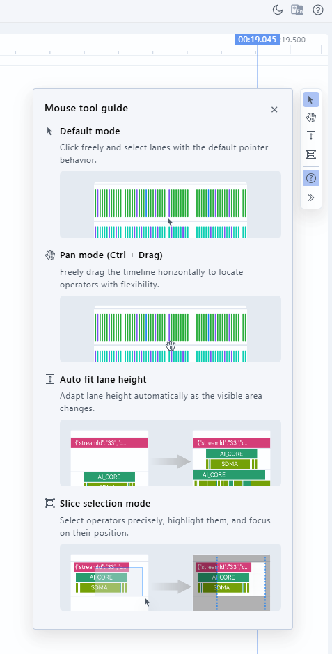

**Zooming In and Out on the GUI**

The **Timeline** tab page supports zooming in, zooming out, and moving left and right. The operations are as follows:

- Click any position in the tree chart or graphical pane on the **Timeline** tab page and press **W** (zoom in) or **S** (zoom out) on the keyboard. The maximum zoom-in precision is 1 ns.
- Click any position in the tree chart or graphical pane on the **Timeline** tab page and press **A** (move left), **D** (move right), left arrow (move left), or right arrow (move right) keys on the keyboard to move leftward or rightward, or press up arrow (move up) or down arrow (move down) on the keyboard to move upward or downward.
- In the graphical pane, hold down **Alt** and use the left mouse button to select an area. The selected area is zoomed in.
- Click  (zoom in) and  (zoom out) on the toolbar in the upper left corner of the page to zoom in or out.
- Click  on the toolbar in the upper left corner of the page to restore the graphical pane to display all timeline views.
- Move the pointer to any position in the tree chart or graphical pane on the **Timeline** tab page, and hold down **Ctrl** and scroll the mouse wheel to zoom in or out.
- In the graphical pane, hold down **Ctrl** and click the left mouse button to drag the unit chart leftward or rightward.

    > [!NOTE]
    >
    > On macOS, you need to press the Command key on the keyboard and scroll the mouse wheel to zoom in or out, and press the Command key and left mouse button to drag the unit chart left or right.

- In the graphical pane, right-click to zoom in or out. For details, see [**Table 1** Right-click menu functions](#right-click-menu-functions).

    **Table 1** Right-click menu functions 

    |Menu|Description|Operation|
    |--|--|--|
    |Fit to screen|Enlarges a single operator to the maximum width of the visible range of the screen. If no operator is selected, this parameter is not displayed.|Select an operator and right-click it. In the displayed menu, click `Fit to screen` to enlarge the selected operator to fit the maximum visible width of the screen.|
    |Zoom into selection|Zooms in on the selected area to the maximum width of the visible range of the screen. If no area is selected, this parameter is not displayed.|Select an area and right-click it. In the displayed menu, click `Zoom into selection` to enlarge the selected area to the maximum width of the visible range of the screen.|
    |Undo Zoom(0)|Undoes the zoom. The number in the parentheses changes with the number of zoom operations. The initial value is **0**.|On the zoomed-in **Timeline** page, right-click to display a shortcut menu. Click `Undo Zoom(0)` to cancel the zooming. The page is zoomed out once, and the number in the brackets decreases by one accordingly.|
    |Reset Zoom|Resets the zoom to restore the chart to the initial state.|On the zoomed-in Timeline page, right-click and choose **Reset Zoom** from the shortcut menu. The chart is reset to the initial state.|

**Search**

On the **Timeline** tab page, you can search for operators and APIs by name.

- Click  on the toolbar in the upper left corner of the page. In the text box that is displayed, enter the content to be searched for and press **Enter**. The corresponding operators or APIs are matched. The total number of matched operators and APIs is displayed. The matched operators or APIs are highlighted, as shown in [**Figure 1** Searching for operators](#searching-for-operators).

    Click the dropdown menu in front of the search box to select different ranks for viewing, or select "ALL" to view all ranks. The system selects the first rank by default, as shown in [**Figure 2** Rank selection function](#rank-selection-function).

    Click the switch button next to the search box to view the previous or next matched operator or API. Alternatively, enter a number next to the text box to search for the corresponding operator or API. The operator or API is selected.

    **Figure 1** Searching for operators

    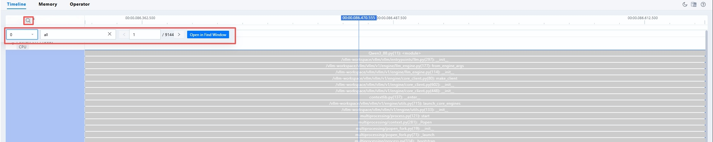

- Click  on the toolbar in the upper left corner of the page and click  and  on the left of the search box to enable case-sensitive matching and full-word matching, respectively.

    - Click the dropdown menu in front of the search box to select different ranks for viewing, or select "ALL" to view all ranks. The system selects the first rank by default, as shown in [**Figure 2** Rank selection function](#rank-selection-function).

      **Figure 2** Rank selection function

      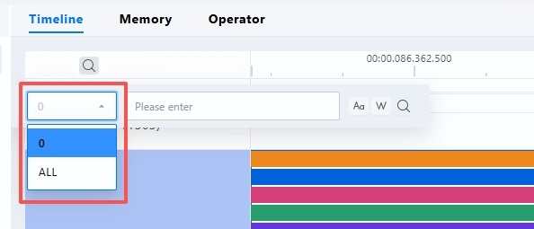

    - Click  to enable case-sensitive matching. In the pop-up input box, enter the content to be searched and press Enter. Operators or APIs whose names contain the search term will be matched, as shown in [**Figure 3** Enabling case-sensitive or whole-word matching](#enabling-case-sensitive-matching-or-full-word-matching).

      **Figure 3** Enabling case-sensitive matching or whole word matching

      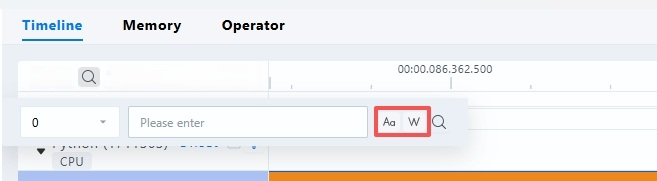

    - Click  to enable whole word matching. In the displayed text box, enter the search term and press **Enter**. The system will match operators or APIs with names corresponding to the search term, ignoring case, as shown in [**Figure 3** Enabling case-sensitive matching or whole word matching](#enabling-case-sensitive-matching-or-full-word-matching).
    - When both  and  are selected, case matching and whole word matching are enabled. Enter the content to search in the pop-up input box and press Enter; operators or APIs whose names exactly match the search term are then matched.

    - Click `Open in Find Window` next to the search box. The **Find** tab page is displayed in the lower part of the page, showing the information about the search term, as shown in [**Figure 4** Open in the Find Window](#open-in-the-find-window). For details about the fields, see [Table 2 Fields on the Find tab page](#fields-on-the-find-tab-page). Click `Click` in the **Click to Timeline** column to go to the specific location of the operator or API in the timeline view.

      **Figure 4** Open in the Find Window 

      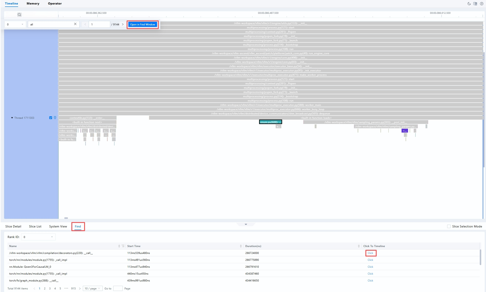

      **Table 2** Fields on the Find tab page 

      |Field|Description|
      |--|--|
      |Rank ID|Rank ID. You can select the rank to be viewed.|
      |Name|Operator name. Click the filter icon behind the name to filter data by name.|
      |Start Time|Start time of operator execution.|
      |Duration(ns)|Total time of running the operator.|
      |Click To Timeline|Click `Click` to go to the specific location of the operator or API in the timeline view.|

### Displaying Profile Data

**Previewing on the GUI**

- In a thread-level unit, if a unit contains multiple rows of data, the data distribution in the unit is displayed in thumbnail mode without expanding the unit, as shown by 1 in [**Figure 1** Timeline preview](#timeline-preview).
- If the process-level unit is not expanded, the data distribution within the thread-level unit is visualized by filling the process-level unit in gray, based on the data along the timeline at the thread level, as shown by 2 in [**Figure 1** Timeline preview](#timeline-preview).

    **Figure 1** Timeline preview

    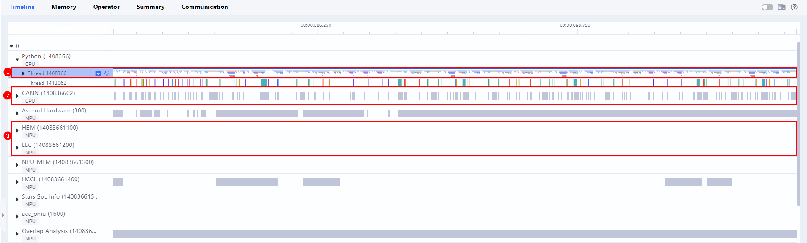

    > [!NOTE]
    >
    > CPU, Memory, and Network usage data, that is, numeric events, are displayed in bar charts on the timeline and cannot be previewed, as shown by 3 in [**Figure 1** Timeline preview](#timeline-preview).

**Displaying Data in the Cluster Scenario**

You can import and display cluster data to MindStudio Insight without manually merging multiple single-rank data. MindStudio Insight supports multiple hosts and ranks in the training scenario and multiple ranks in the inference scenario. It can automatically identify all **trace\_view.json** and **msprof\*******.json** files in the imported folder. [**Figure 2** Timeline data in the cluster scenario](#timeline-data-in-the-cluster-scenario) uses 16 ranks as an example.

**Figure 2** Timeline data in the cluster scenario

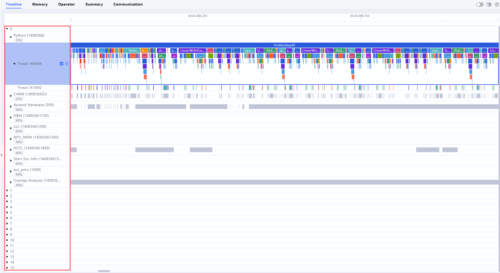

In a cluster scenario, you can hover the pointer over the rank number to quickly locate the file directory corresponding to the rank data. For example, if you hover the pointer over **0**, the file directory corresponding to the rank is displayed, as shown in [Figure 3 Locating a folder](#locating-a-folder).

**Figure 3** Locating a folder

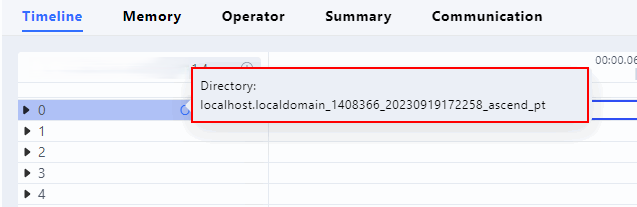

**Displaying and Comparing Data by Rank/Unit**

When cluster data is imported, a large amount of timeline information is displayed. To help users compare and analyze data, data can be filtered and displayed by rank or/and unit in MindStudio Insight.

> [!NOTE]
>
> When filtering data by rank and unit, you can select the rank and unit in sequence to display the filtering information.

- Display by rank: displays only one rank. Click  in the upper left corner of the page, select **Rank Filter**, click the text box, and select **1** from the drop-down list. The timeline information of rank 1 is displayed, as shown in [**Figure 4** Rank filtering](#rank-filtering).

    **Figure 4** Rank filtering 

    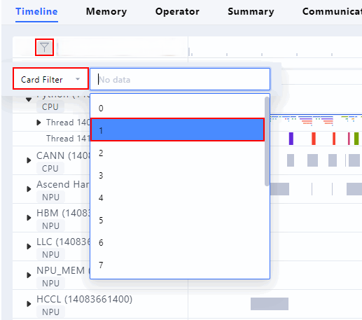

- Display by unit: [**Figure 5** Unit filtering](#unit-filtering) displays only the **Overlap Analysis** unit of a rank as an example. Click  on the toolbar in the upper left corner of the page, select **Units Filter**, click the text box, and select **Overlap Analysis** from the drop-down list box.

    **Figure 5** Unit filtering 

    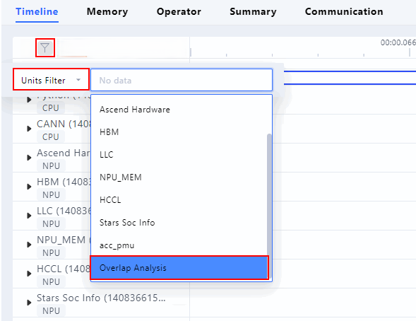

**Pinning and Comparing Data by Unit**

- MindStudio Insight supports fixing and pinning units. You can drag the collapsed units to freely sort them, facilitating comparison with other levels of the same type.

    > [!NOTE]
    >
    > If the level-2 and level-3 units in the pinned rank are also pinned, you can only drag and drop the rank-level units. Similarly, if the level-3 units in the pinned level-2 units are also pinned, you can only drag and drop the level-2 units.

    For example, click  next to a level-3 unit name in ranks 0, 1, and 2 to pin the unit name. Click  again to unpin the unit name, as shown in [**Figure 6** Pinning and comparing](#pinning-and-comparing).

    **Figure 6** Pinning and comparing

    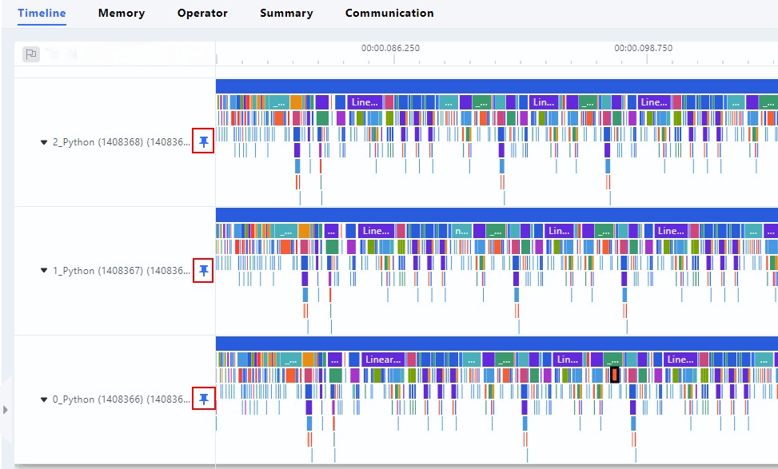

- MindStudio Insight also allows you to pin the communication units in the same communication group by one click.

  Select the units with the same name that you want to pin, right-click any unit with the same name, and choose **Pin Same-named Unit (*unit name*)**. All units with the same name will be pinned together, facilitating viewing, comparison, and analysis of units with the same name. The following is an operation example of this feature:

    Right-click on a child unit under a parent unit and select "Pin Same-named Unit (*unit name*)". All units with the same name under this communication group will be pinned to the top for easy viewing and comparison, as shown in [**Figure 7** Choosing Pin Same-named Unit](#pinning-units-with-the-same-name-to-top) and [**Figure 8** Pin Same-named Unit](#effect-of-pinning-units-with-the-same-name-to-top).

    **Figure 7** Choosing Pin Same-named Unit

    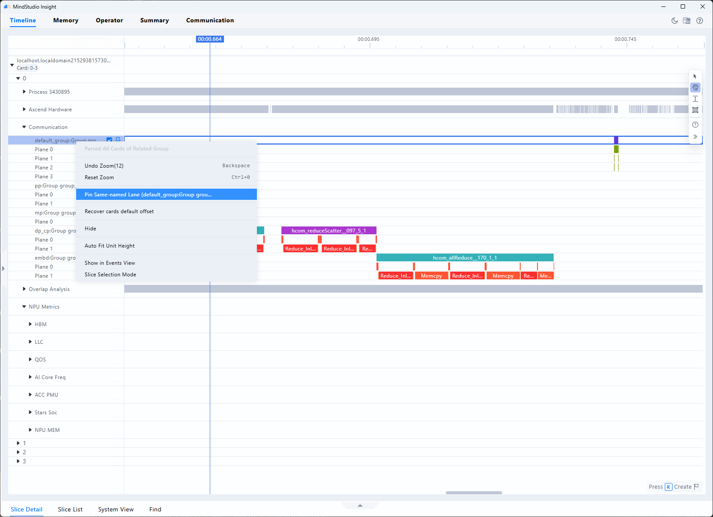

     **Figure 8** Pin Same-named Unit

    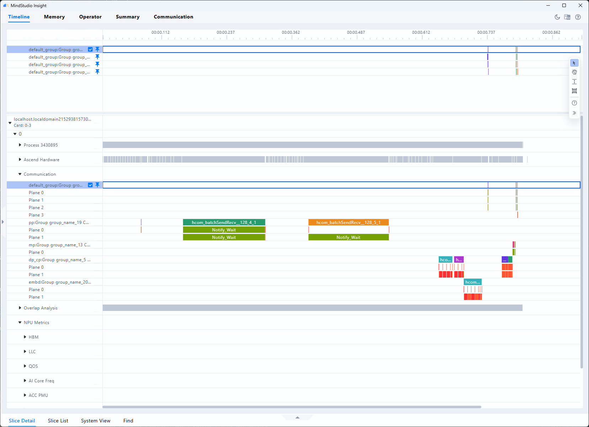

    Right-click on a pinned unit and select "Unpin Same-named Unit (*unit name*)" or "Unpin (All)" to cancel unit pinning, as shown in [**Figure 9** Unpinning units with the same name](#unpinning-units-with-the-same-name). "Unpin Units with Same Name (Unit Name)" unpins all units under this communication domain (group), while "Unpin (All)" unpins all pinned units.

    **Figure 9** Unpin Same-named Unit

    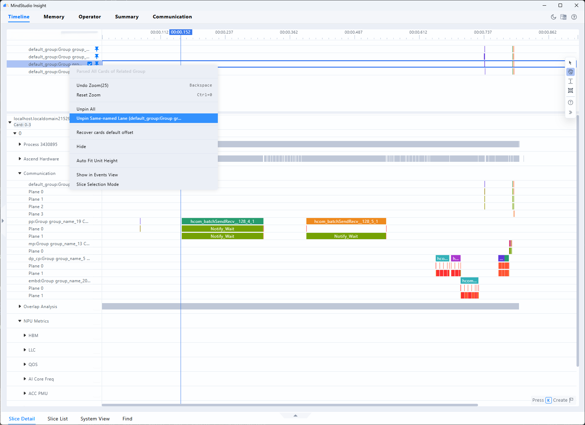

    > [!NOTE]
    >
    >This feature only supports pinning to top the innermost sub-unit with the same name.

**Aligning Single Rank and Unit Timeline**

> [!NOTE]
>
> - In the single-rank, cluster, and multi-model scenarios, the relative positions of timelines are automatically aligned. If automatic alignment is not required, right-click anywhere, choose **Recover ranks default offset** from the shortcut menu to restore the default offsets of all ranks and models, and manually align the relative positions.
> - If an offset is set for a unit and the offset is not 0, a highlighted blue dot is displayed after the unit name.

- Manually aligning the relative positions to the start position
    In the **Offset** dialog box, click  (**Align to Start**). The offset of the leftmost thread data in the rank from the initial position (00:00.000) of the timeline is displayed in the **Timestamp Offset\(ns\)** text box. Then press **Enter**. The **Timeline** tab page aligns the thread data with the initial position of the timeline.

    As shown in [**Figure 10** Initial position offset](#initial-position-offset), the offset between the leftmost thread data in rank 0 and the initial position of the timeline is 7293500 ns.

    **Figure 10** Initial position offset 

    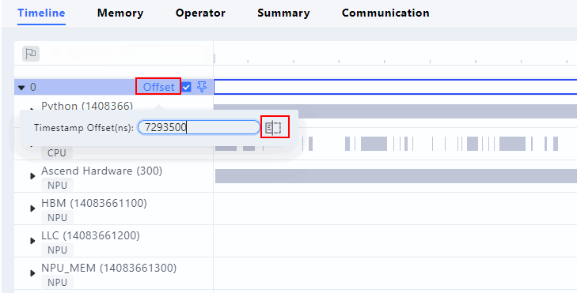

- Manually setting the offset

    In the multi-host multi-rank scenario, the time on the host may be inaccurate. As a result, the relative positions of timelines of multiple ranks may be inaccurate. MindStudio Insight supports time calibration in the single-rank dimension, as shown in [**Figure 11** Single-rank time adjustment](#single-device-time-adjustment). You can set the offset to move the timeline of a single rank leftward or rightward to calibrate the time. The unit of the offset is ns. A negative value indicates rightward movement, and a positive value indicates leftward movement.

    **Figure 11** Single-rank time adjustment 

    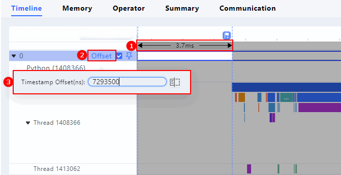

**Aligning Time**

To facilitate more intuitive data viewing and comparison, time alignment of operators across multiple units is supported. Select the unit operators you want to align, right-click, and choose "**Align Left**" or "**Align Right**" on the right side of the "**Time Alignment**" function in the function menu. This is shown in [**Figure 1 Time alignment**](#time-alignment).

**Figure 1**  Time alignment

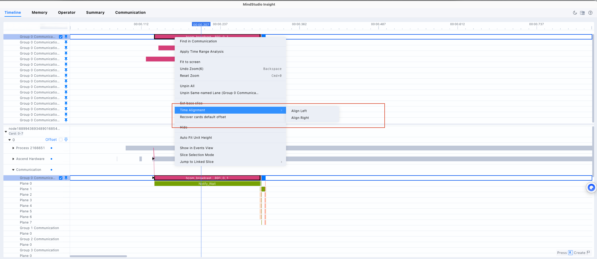

- After selecting "Align Left", the result is shown in [**Figure 2 Time left alignment**](#time-left-alignment).

  **Figure 2** Left alignment

  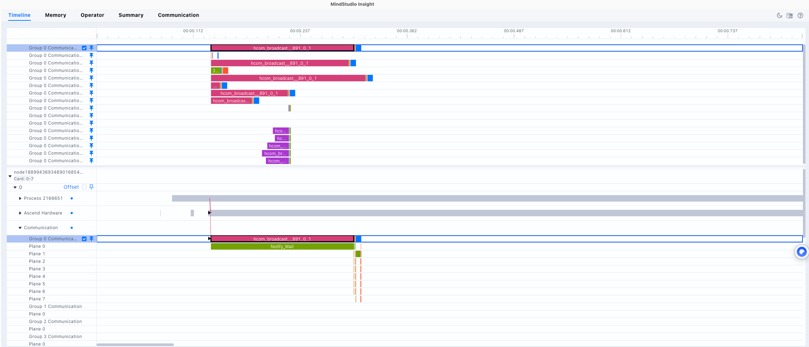

- After selecting "Align Right", the result is shown in [**Figure 3 Time right alignment**](#time-right-alignment).

  **Figure 3** Right alignment

  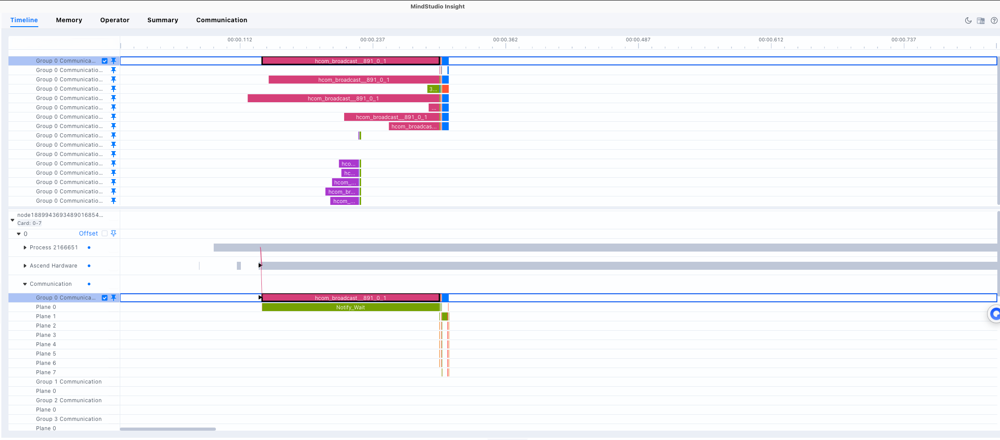

**Displaying Multiple Hosts and Ranks**

When multiple hosts and ranks are imported, data can be displayed by host in MindStudio Insight, as shown in [Figure 4 Displaying multiple hosts and ranks](#Displaying-multiple-hosts-and-ranks).

- In the figure, **1** indicates the host name, which consists of **hostName** and **hostUid**.
- In the figure, **2** indicates the rank layer, which displays the corresponding unit based on the rank sequence number of the current host.
- In the figure, **3** indicates the parameter configuration item. In the multi-host multi-rank scenario, you need to select **Host Name** and then select **Rank ID** under the host for configuration.

    If the imported DB file contains the **HOST\_INFO** table, this configuration item is displayed on the **System View** tab page (when **Stats System View** or **Expert System View** is selected) and the **Find** tab page on the **Timeline** tab page.

> [!NOTE]
>
> This function can be displayed only in the unified DB scenario.

**Figure 4** Displaying multiple hosts and ranks 

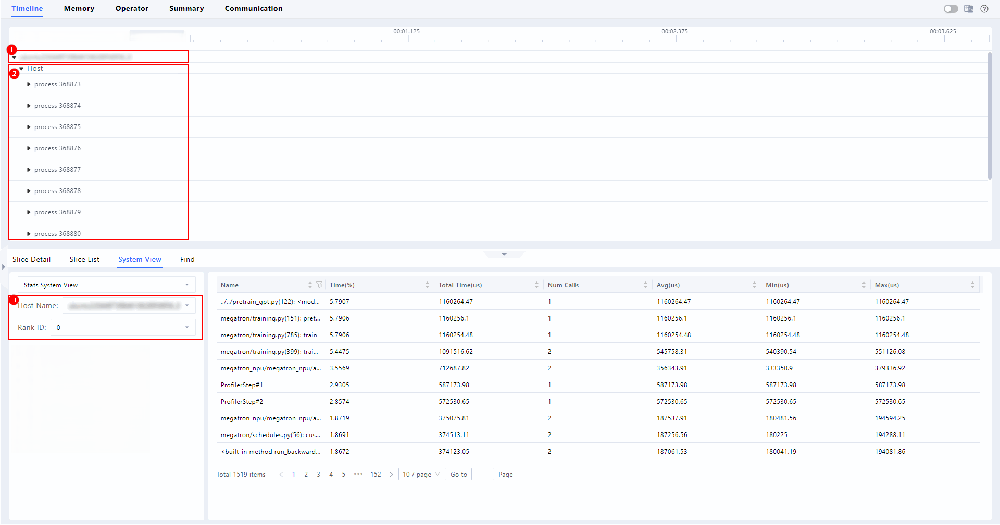

**Setting and Viewing Markers**

- Region marker

    On the **Timeline** tab page, select a region and click  or press **K** to mark and save the selected region, as shown in [Figure 5 Region marker](#Region-marker).

    **Figure 5** Region marker 

    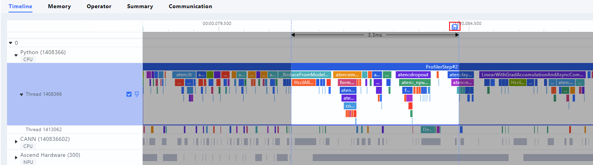

    Double-click a marker to set the marker pair attributes. You can modify the marker pair name and color, and delete the marker pair, as shown in [Figure 6 Modifying marker pair attributes](#Modifying-marker-pair-attributes).

    **Figure 6** Modifying marker pair attributes 

    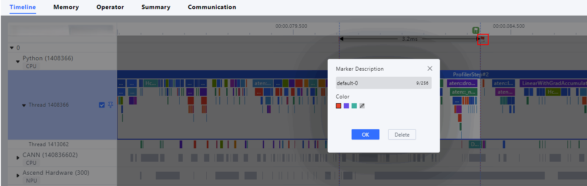

- Single-point marker

    Click anywhere in the uppermost empty unit or press **K** to generate a single-point marker, as shown in [**Figure 7** Single-point marker](#Single-point-marker).

    **Figure 7** Single-point marker 

    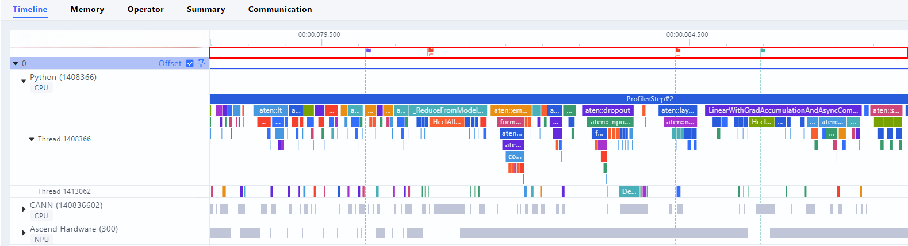

    Double-click a marker to set its attributes. You can modify the marker name and color, and delete the marker.

- Marker management

    Click  on the toolbar in the upper left corner to show all marker information, as shown in [**Figure 8** Viewing mark information](#Viewing-mark-information).

    **Figure 8** Viewing mark information 

    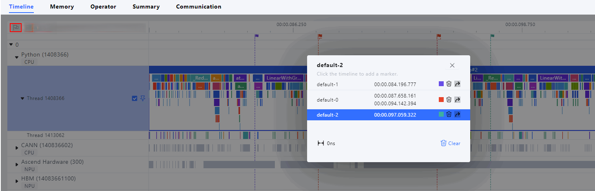

    - Click the  icon corresponding to a marker to delete the marker.
    - Click **Clear All** in the lower part of the dialog box to delete all markers.
    - Click a region marker. The **Slice Detail** tab page in the lower part of the page displays the duration information of the region.
    - If a marker is not in the current visualization view, click the  icon corresponding to the marker to jump directly to the marker view for easy viewing.
    - Click the color icon corresponding to a marker to set the color to facilitate marker category management.

**Displaying Operator Flows**

- MindStudio Insight displays the operator flows. You can click an operator with a flow to display the flow associated with the operator. Even if the process at the start point or end point of the flow is folded, the flow does not disappear. In addition, you can locate other operators associated with the operator and view their details.
    1. Click an operator with a flow to display the flow.
    2. Right-click and choose the option for going to the flowed operator from the shortcut menu. In the operator list, click the operator name or connection mode under the source or target to go to the corresponding operator. The operator is automatically highlighted, and the operator details are displayed on the **Slice Detail** tab page. See [**Figure 9** Operator flows](#operator-flows).

        **Figure 9** Operator flows

        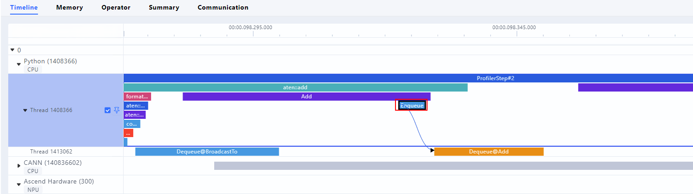

        > [!NOTE]
        >
        > - If the processes at the start point and end point of a flow are collapsed, the flow disappears.
        > - In MindStudio Insight, flows are connected only to the first operator delivered in the same batch. In the Ascend hardware unit, if you click an operator and find that the associated flow is connected to another operator, the two operators are delivered in the same batch.

- MindStudio Insight supports full flows. You can click  on the toolbar in the upper left corner of the page. In the dialog box that is displayed, you can select one or more flow types. Alternatively, you can search for a flow type by keyword in the search box and select the corresponding flow type. All flows of the corresponding type are displayed in the graphical pane, as shown in [**Figure 10** Full flows](#Full-flows).

    > [!NOTE]
    >
    > A maximum of 10 flow types can be selected.

    **Figure 10** Full flows

    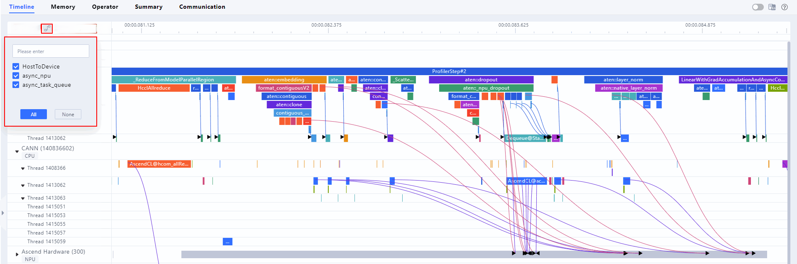

    The mappings between the application-layer operators and the NPU operators delivered and executed through flows are as follows:

    - HostToDevice
        - Delivery and execution mappings from CANN-layer nodes (operators) to NPU operators on Ascend Hardware (host to device).
        - Delivery and execution mappings from CANN-layer nodes (operators) to communication operators (host to device).

    - HostToDevice(Graph)
        - Delivery and execution mappings from CPU-side operators to `MODEL_EXECUTE` on Ascend Hardware (host to device).

    - async\_npu
        - Delivery and execution mappings from application-layer operators to NPU operators on Ascend Hardware.
        - Delivery and execution mappings from application-layer operators to communication operators.

    - async\_task\_queue: mappings from enqueue to dequeue at the application layer, which is used only in the PyTorch scenario.
    - fwdbwd: mappings from the forward API to the backward API, which is used only in the PyTorch scenario.
    - MSTX: delivery and execution mappings from dotting data to NPU operators on Ascend Hardware.

    > [!NOTE]
    >
    > - Whether mappings between layers are displayed depends on whether the data is collected in a specific scenario.
    > - The flow between layers is associated with whether the layers are expanded. If a flow type is selected and the corresponding layer is not expanded, the flow of this type is not displayed.

**Selectively Analyzing Multi-Rank Data**

When data of more than 16 ranks is imported to MindStudio Insight, you can selectively analyze the data on the **Timeline** tab page. You can perform one-click global analysis or partial analysis.

- One-click global analysis: On the **Timeline** tab page, click `Start Global Analysis` to analyze all rank data, as shown in [**Figure 11** Global analysis](#Global-analysis). After all rank data is analyzed, the **Start Global Analysis** button disappears.

    **Figure 11** Global analysis 

    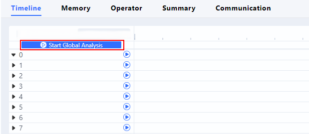

- Partial analysis: If you only need to analyze the data of some ranks, click  next to the rank number to analyze the data of the selected rank, as shown in [**Figure 12** Single-rank analysis](#Single-rank-analysis). After the rank data is analyzed, the button disappears, as shown in rank 0 and rank 1 in the figure.

    **Figure 12** Single-rank analysis 

    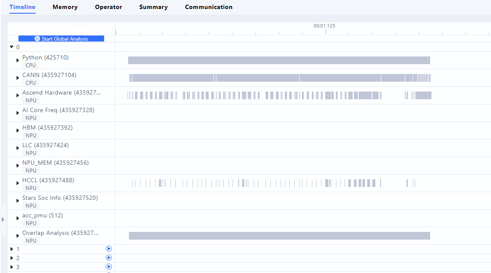

    If a large number of ranks are imported, you can use the rank filter function to locate the ranks whose data needs to be analyzed. On the toolbar of the **Timeline** tab page, click , select **Rank Filter**, click the text box next to it, and select the rank to be displayed from the drop-down list box. The corresponding information is displayed on the **Timeline** tab page. Click  next to the rank number to analyse the data. As shown in [**Figure 13** Filtering, displaying, and analyzing](#Filtering-displaying-and-analyzing), ranks 2, 5, and 7 are selected for analysis.

    **Figure 13** Filtering, displaying, and parsing 

    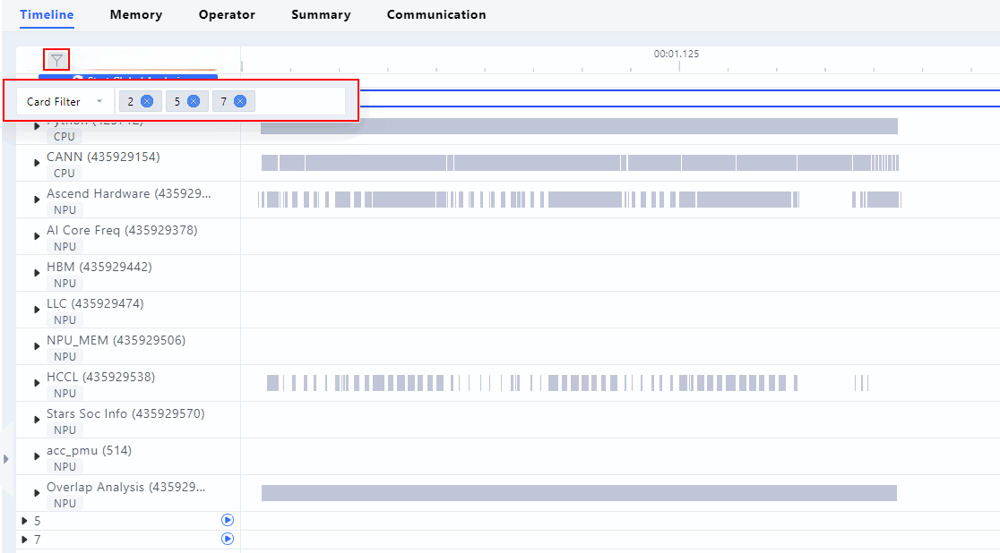

    > [!NOTE]
    >
    > In the partial analysis scenario, click `Start Global Analysis`. All rank data is parsed.

- Rank parsing in the same communication group: After a rank is parsed, right-click the **Group** sub-unit in the communication group and choose **Parse Ranks of Related Group** from the shortcut menu. All ranks related to the communication group of the unit are parsed, as shown in [**Figure 14** Parsing ranks in the related communication group](#parsing-ranks-in-the-related-communication-group). After the parsing is complete, the shortcut menu changes to **Parsed All Ranks of Related Group** and is dimmed.

    **Figure 14** Parsing ranks in the related communication group 

    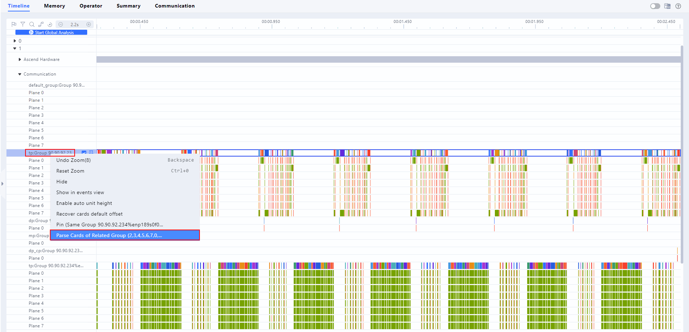

**Aligning Custom Operator Time**

MindStudio Insight supports aligning the time of selected operators using the shortcut keys, which facilitates operator information comparison.

- **Aligning the operator time**
    1. On the **Timeline** tab page, right-click an operator and choose **Set base slice** from the shortcut menu to set the selected operator as the base slice, as shown in [**Figure 15** Setting the base slice](#setting-the-base-slice).

        **Figure 15** Setting the base slice 

        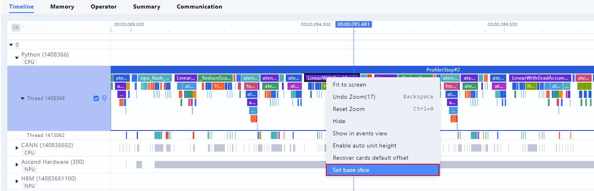

    2. Select the operator in the level-2 unit that is different from the base slice.
    3. Press **L** (left alignment) to align the selected operator with the left boundary of the base slice, as shown in [**Figure 16** Aligning the left boundary of the operator](#Aligning-the-left-boundary-of-the-operator).

        **Figure 16** Aligning the left boundary of the operator 

        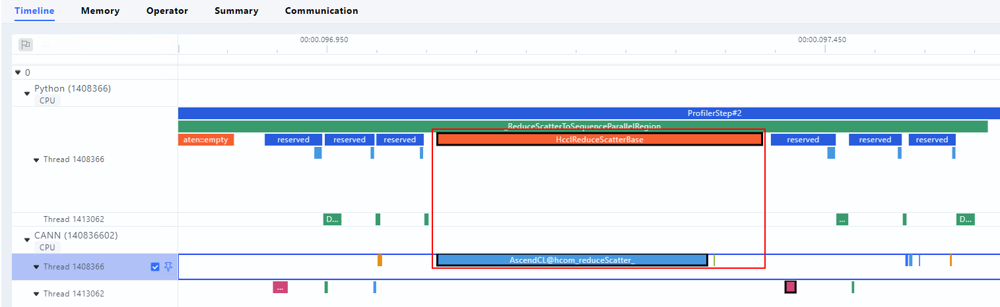

        Press **R** (right alignment) to align the selected operator with the right boundary of the base slice, as shown in [**Figure 17** Aligning the right boundary of the operator](#Aligning-the-right-boundary-of-the-operator).

        **Figure 17** Aligning the right boundary of the operator 

        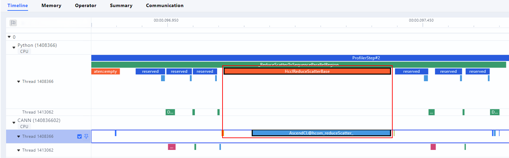

        > [!NOTE]
        >
        > Regardless of whether the selected operator is left-aligned or right-aligned, the operator in the **NPU** unit whose device is the same as that of the selected operator also shifts.

- **Clearing base slice**

    Right-click any position in the unit and choose **Clear base slice** from the shortcut menu to cancel the base slice, as shown in [**Figure 18** Clearing the base slice](#clearing-the-base-slice).

    **Figure 18** Clearing the base slice 

    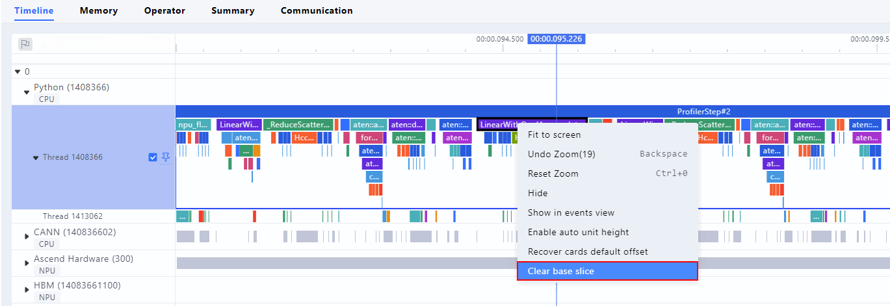

- **Recovering ranks default offset**

    If the operator time alignment operation has been performed, right-click any position in the unit and choose **Recover ranks default offset** from the shortcut menu to restore the default offset, as shown in [**Figure 19** Recovering ranks default offset](#recovering-ranks-default-offset).

    **Figure 19** Recovering ranks default offset 

    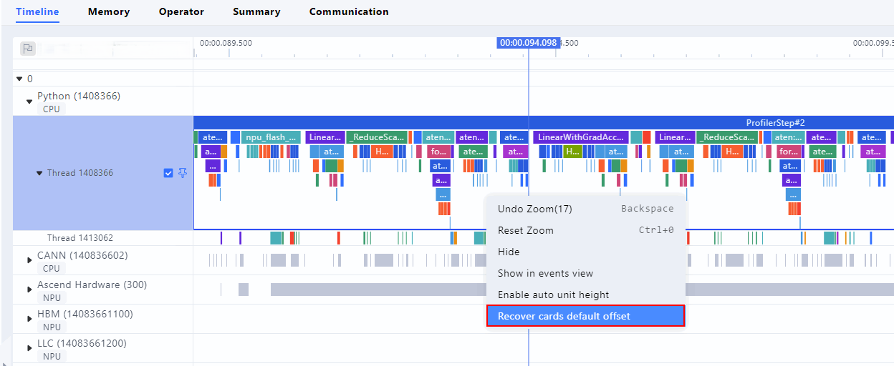

- **Support for Jump to Corresponding Stream**

    Click the selected operator `MODEL_EXECUTE`, right-click, and choose **Jump to Corresponding Stream** to jump directly to the corresponding unit and highlight it, as shown in [**Figure 20** Jump to Corresponding Stream](#jump-to-corresponding-stream) and [**Figure 21** Effect of Jump to Corresponding Stream](#effect-of-jump-to-corresponding-stream).

    **Figure 20** Jump to Corresponding Stream

    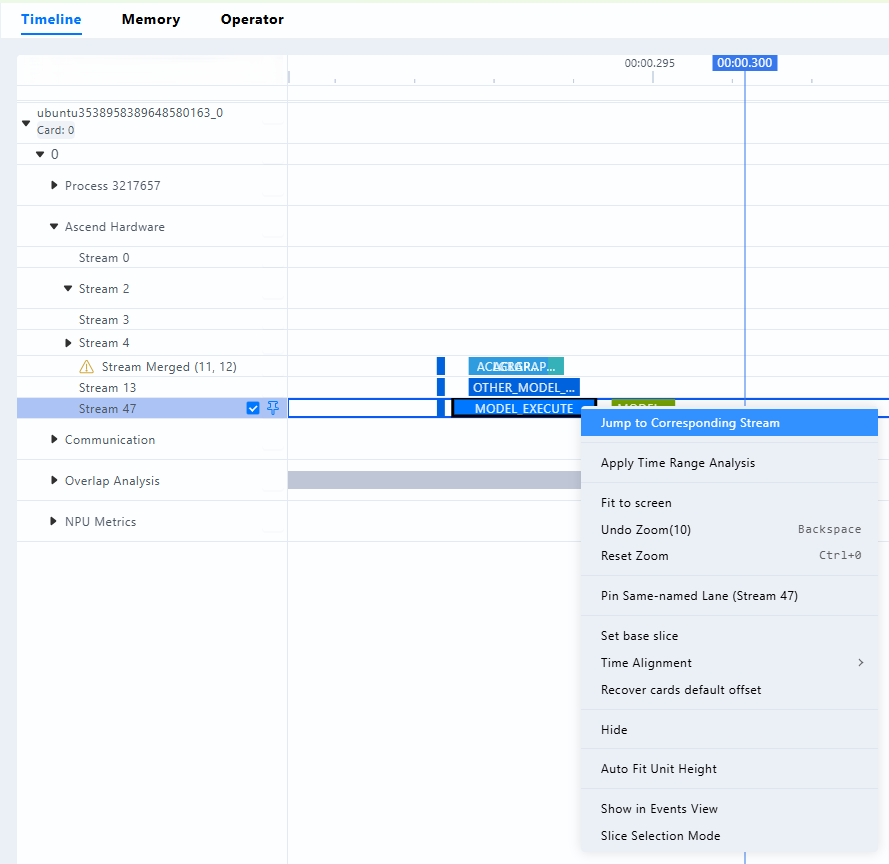

    **Figure 21** Effect of Jump to Corresponding Stream

    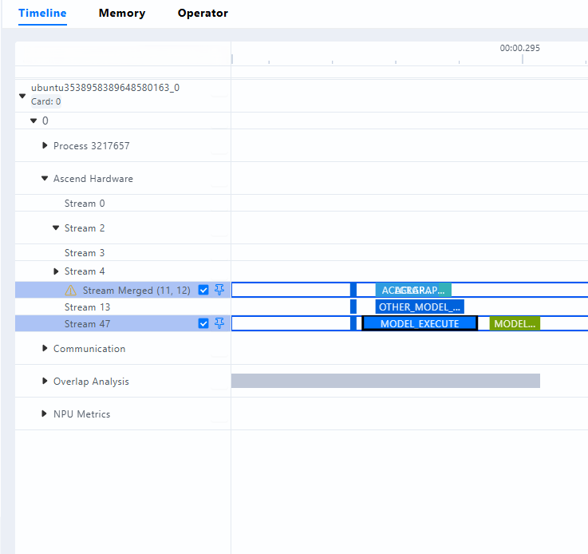

    > [!NOTE]
    >
    >Currently, only the `MODEL_EXECUTE` operator supports the **Jump to Corresponding Stream** function.

### Displaying Page Optimization

**Unit Hiding Function**

On the **Timeline** tab page, units can be hidden and expanded.

- Hide Unit

    On the **Timeline** tab page, hover the pointer over the unit to be hidden, select one or more units, or drag select multiple units. Automatically select the selected unit, right-click the unit, and choose **Hide** from the shortcut menu to hide the unit. The *x***units hidden** row is displayed under the layer, as shown in [**Figure 1** Hide](#Hide). *x* indicates the number of hidden units.

    **Figure 1** Hide Unit 

    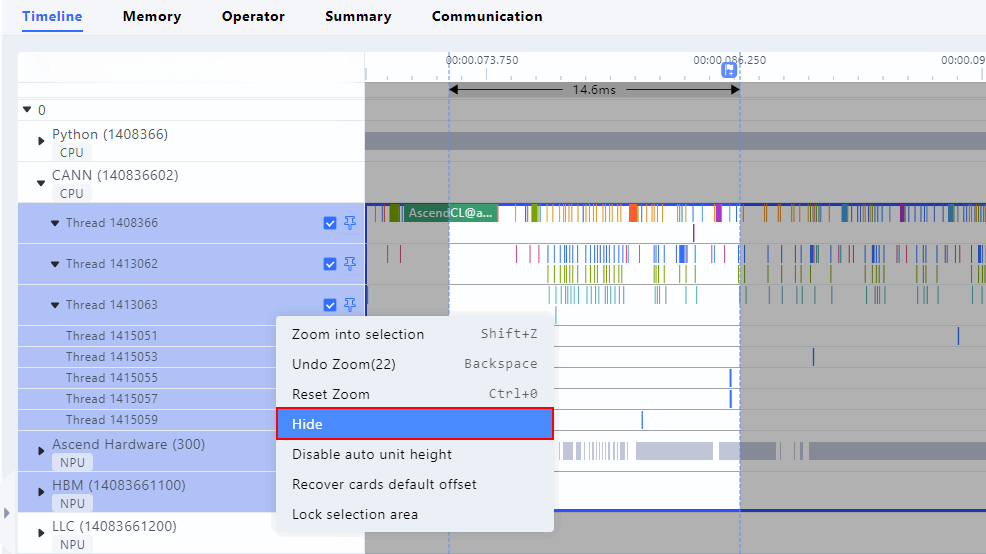

- Displaying all hidden units

    Right-click the **units hidden** row that contains hidden units and choose **Show All** from the shortcut menu to display all hidden units at the selected level.

    If hidden units exist at both the parent and child layers, right-click the **units hidden** row of the parent layer and choose **Show All** from the shortcut menu to display all hidden units at the parent layer, as shown in [**Figure 2** Showing hidden units](#Showing-hidden-units).

    **Figure 2** Showing hidden units 

    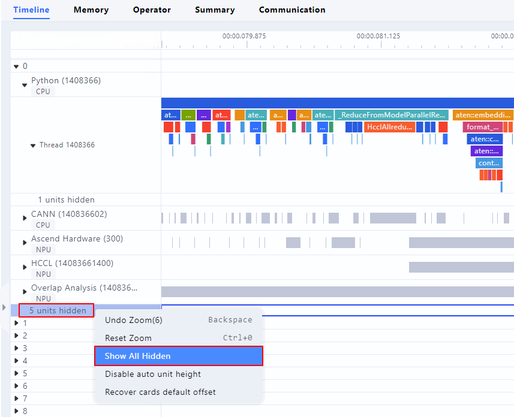

**Independent Displaying Python Call Stack Unit**

To facilitate detailed location of problematic code positions, the Python call stack is presented as an independent unit, as shown in [**Figure 3** Python call stack](#python-call-stack).

**Figure 3** Python call stack

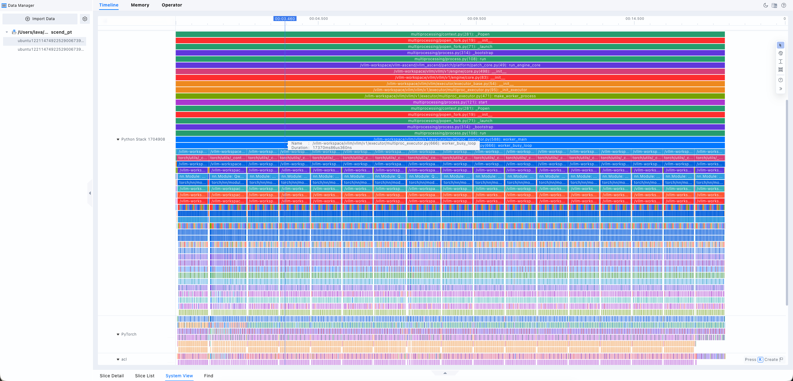

**Expanding All Units**

On the **Timeline** tab page, you can right-click to expand or collapse all units.

- Expand all units: Right-click the unit to be expanded and choose **Expand all** from the shortcut menu to expand all sub-units under the selected unit. As shown in [**Figure 4** Expand all](#Expand-all), all units of rank 0 are expanded.

    If the selected unit and sub-units are already expanded, the **Expand all** option is not displayed in the shortcut menu.

    **Figure 4** Expand all 

    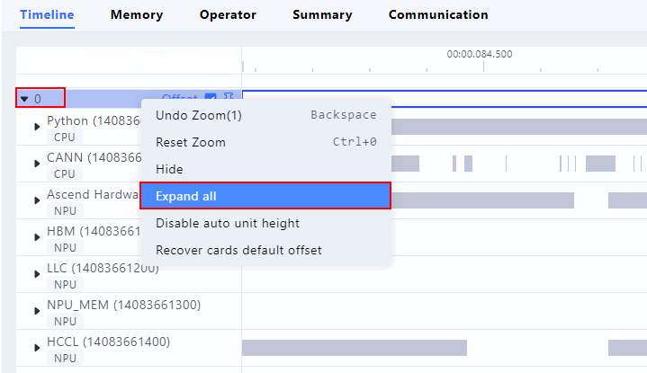

- Collapse all units: Right-click an expanded unit and choose **Collapse all** from the shortcut menu to collapse all sub-units under the selected unit. As shown in [**Figure 5** Collapse all](#Collapse-all), all units of rank 0 are collapsed.

    **Figure 5** Collapse all 

    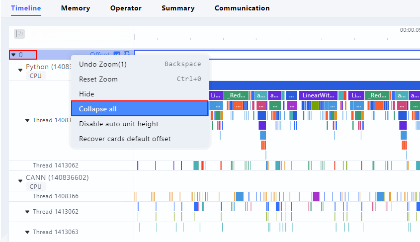

**Supporting Auto Unit Height**

On the **Timeline** tab page, you can right-click to enable or disable the auto unit height function.

- Enable auto unit height: Right-click the expanded unit and choose **Enable auto unit height** from the shortcut menu. The unit height is automatically adjusted to adapt to the current page, as shown in [**Figure 6** Enable auto unit height](#Enable-auto-unit-height).

    **Figure 6** Enable auto unit height 

    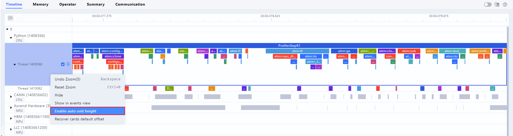

- Disable auto unit height: Right-click a unit where the auto unit height function is enabled and choose **Disable auto unit height** from the shortcut menu. The auto unit height function is disabled, and the unit height is restored to the initial height, as shown in [**Figure 7** Disable auto unit height](#disable-auto-unit-height).

    **Figure 7** Disable auto unit height 

    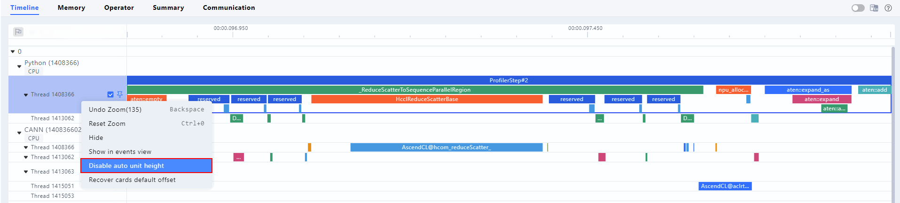

**Locking the Selected Area**

- Locking the selected area

    On the **Timeline** tab page, select some operators on a unit by drawing a rectangle, right-click the selected area, and choose **Lock selection area** from the shortcut menu. Operators in the selected area can be searched, and the flows of operators whose flow start or end point is in the selected area are displayed, as shown in [**Figure 8** Lock selection area](#Lock-selection-area). You can also select an area across multiple units at the single-rank level and lock the area.

    **Figure 8** Lock selection area 

    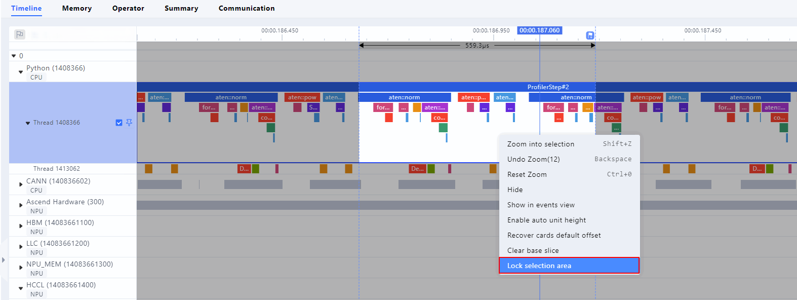

- Unlocking the selected area

    To cancel the selection, right-click the area and choose **Unlock selection area** from the shortcut menu, as shown in [**Figure 9** Unlock selection area](#Unlock-selection-area).

    **Figure 9** Unlock selection area 

    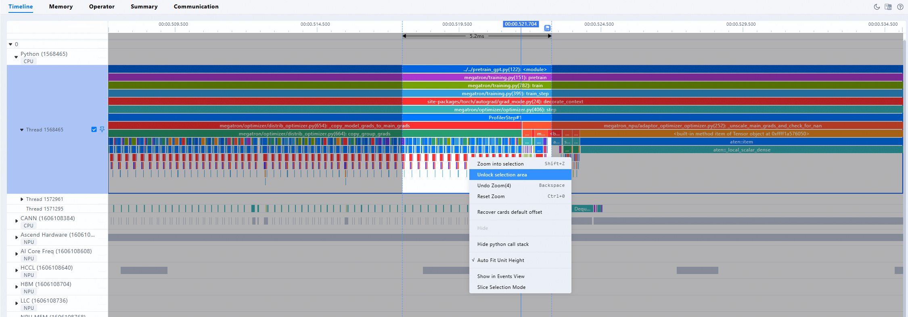

**Merging Stream Units**

On the **Timeline** page, you can merge multiple Stream units for data analysis.

- Merging units

    On the same rank, select multiple Stream units to be merged, right-click the selected units, and choose **Merge Units** from the shortcut menu. The selected units are merged into a new unit, as shown in [**Figure 10** Merge Units](#Merge-Units). After the Stream units are merged, the flow function, operator search function, and operator redirection function can be used properly.

    **Figure 10** Merge Units

    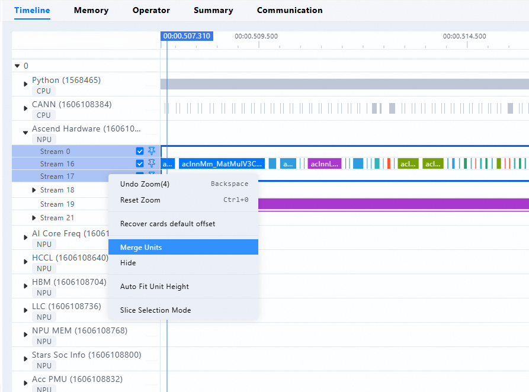

- Unmerging units

    To unmerge Stream units, right-click the merged Stream units and choose **Unmerge Units** from the shortcut menu, as shown in [**Figure 11** Unmerge Units](#Unmerge-Units).

    **Figure 11** Unmerge Units

    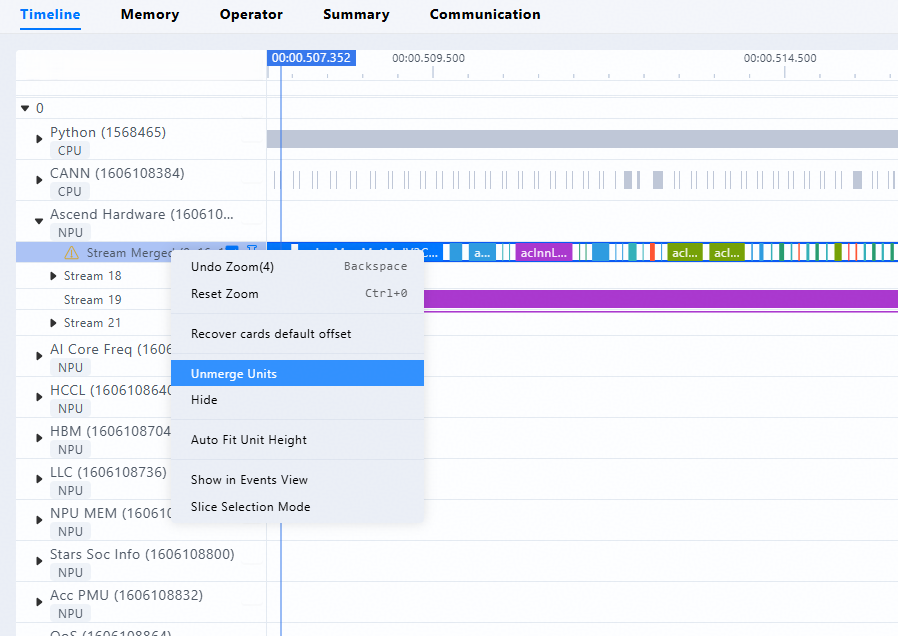

### Displaying System Functions

**Statistics**

MindStudio Insight allows you to view operator statistics and details about a single operator.

- After you selecting some operators in a single level-3 unit or selecting some operators across multiple units at the single-rank level, the operator statistics are displayed on the **Slice List** tab page in the lower part, as shown in [**Figure 1** Slice List](#slice-list). For details about the fields, see [**Table 1** Fields on the Slice List tab page](#fields-on-the-slice-list-tab-page).

    You can move the cursor to the **Slice List** tab page and click  in the upper right corner of the table to copy the content displayed in the **Slice List** tab page and paste the content to an Excel file for analysis.

    > [!NOTE]
    >
    > When operators are selected across multiple units under a single rank, the selected parts of the HBM, LLC, NPU\_MEM, Stars Soc Info, and acc\_pmu histogram units are not counted on the **Slice List** tab page.

    Click an operator in the**Slice List** column. All operators with the same name as the operator are displayed in the **More**list on the right. Click a row in the **More**list to locate the operator in the timeline view, and go to the **Slice Detail** page, where you can view the details about the operator.

    **Figure 1** Slice List

    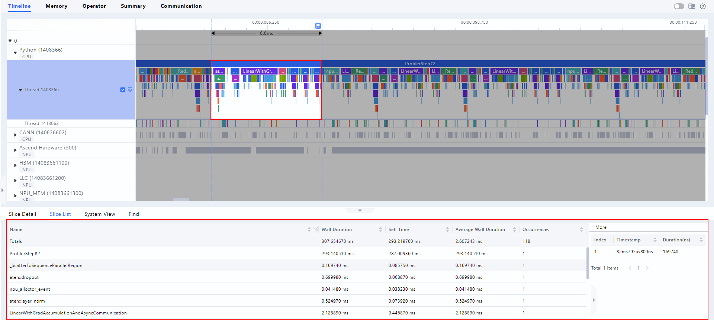

    **Table 1** Fields on the Slice List tab page

    |Field|Description|
    |--|--|
    |Name|Operator name.|
    |Wall Duration|Total duration of operator execution.|
    |Self Time|Operator execution time (excluding the time of the called sub-operator).|
    |Average Wall Duration|Average operator execution time.|
    |Max Wall Duration|Maximum operator execution duration.|
    |Min Wall Duration|Minimum operator execution duration.|
    |Occurrences|Number of operator calls.|
    |Index|Sequence number.|
    |Start Time|Timestamp in the graphical pane.|
    |Duration(ms)|Execution duration.|

    Select a level-3 unit. You can select operators by depth in the unit. The operators in the selected area are displayed on the **Slice List** tab page, as shown in [Figure 2 Operator Selection Mode](#Operator-Selection-Mode).

    1. Select and expand a level-3 unit, right-click any position, and select **Operator Selection Mode** to enable the function of selecting operators by depth.

        You can also select **Operator Selection Mode** on the right of the title bar in the data pane in the lower part of the **Timeline** tab page to enable the function of selecting operators by depth.

    2. In the expanded level-3 unit, select some operators in any position. The operator list in the selected area is displayed on the **Selected List** tab page.
    3. Right-click and deselect **Operator Selection Mode**, or deselect it on the right of the title bar in the data pane to disable the function of selecting operators by depth.

        **Figure 2** Operator Selection Mode 
        

- If you select a single operator, you can view the operator details in the **Slice Detail** area, as shown in [Figure 3 Slice Detail](#Slice-Detail). [Table 2 Slice Detail fields](#Slice-Detail-fields) describes the fields.

    Select a single operator and press **M** to select the **Timeline** area to which the operator belongs. Press **M** again to cancel the selection.

    **Figure 3** Slice Detail 
    

    **Table 2** Slice Detail fields 

    |Field|Description|
    |--|--|
    |Title|Name.|
    |Start|Start time.|
    |Start(Raw Timestamp)|Original start time of data collection.|
    |Wall Duration|Total duration.|
    |Wall Duration|Total duration.|
    |Transit Time(ms)|Transmission time of the HCCL Group communication operator recorded in Communication Analysis. This parameter is displayed only when the selected Group Slice can be uniquely associated with a communication analysis record.|
    |Wait Time(ms)|Wait time of the HCCL Group communication operator recorded in Communication Analysis. This parameter is displayed only when the selected Group Slice can be uniquely associated with a communication analysis record.|
    |Self Time|Total duration (excluding subclasses).|
    |Input Shapes|Input shape of the operator. When **task-time** is set to **l0** during data collection, this field is not collected and is displayed as **N/A**. This field is available only for operators collected on the NPU accelerator core.|
    |Input Data Types|Input data type of the operator. When **task-time** is set to **l0** during data collection, this field is not collected and is displayed as **N/A**. This field is available only for operators collected on the NPU accelerator core.|
    |Input Formats|Input format of the operator. When **task-time** is set to **l0** during data collection, this field is not collected and is displayed as **N/A**. This field is available only for operators collected on the NPU accelerator core.|
    |Output Shapes|Output shape of the operator. When **task-time** is set to **l0** during data collection, this field is not collected and is displayed as **N/A**. This field is available only for operators collected on the NPU accelerator core.|
    |Output Data Types|Output data type of the operator. When **task-time** is set to **l0** during data collection, this field is not collected and is displayed as **N/A**. This field is available only for operators collected on the NPU accelerator core.|
    |Output Formats|Output format of the operator. When **task-time** is set to **l0** during data collection, this field is not collected and is displayed as **N/A**. This field is available only for operators collected on the NPU accelerator core.|
    |Attr Info|Operator attributes. When **task-time** is set to **l0** or **l1** during data collection, this field is not collected and is displayed as **N/A**. This field is available only when **aclnn** is enabled and **task-time** is set to **l2**.|
    |Communication Bandwidth Info|Displays the RDMA, HCCS, PCIE, SDMA, and SIO communication bandwidth records that actually exist in Communication Analysis after the selected Group Slice is uniquely associated with a communication analysis record. Types that do not exist are not displayed.|
    |Transport Type|Type of the communication bandwidth record. The value can be RDMA, HCCS, PCIE, SDMA, or SIO.|
    |Transit Size(MB)|Transmitted data volume of the corresponding communication bandwidth record, in MB.|
    |Transit Time(ms)|Transmission time of the corresponding communication bandwidth record, in ms.|
    |Bandwidth(GB/s)|Bandwidth of the corresponding communication bandwidth record, in GB/s.|
    |Args|Related parameter information of the operator.|

**System View**

The **System View** tab page contains the **Stats System View**, **Expert System View**, and **Events View**.

- **Stats System View** displays the comprehensive metric information, memory overview, API type information, and operator details. For details, see [Stats System View](#stats-system-view).
- **Expert System View** displays the abnormal metric information in the unit and expert suggestions on various APIs and operators. For details, see [Expert System View](#expert-system-view).
- **Events View** displays details about all operators in the selected unit. For details, see [Event View](#event-view).

The information on the **System View** tab page can display only the information about the selected area. The procedure is as follows:

1. On the **Timeline** tab page, use the left mouse button to select some areas of the unit.
2. Right-click the mouse and choose a menu as required for analysis, as shown in [**Table 3** Time range analysis](#time-range-analysis) and [**Figure 4** Time range analysis](#time-range-analysis-1).

    **Table 3** Time range analysis 

    |Menu|Description|
    |--|--|
    |Time Range Analysis|Navigates to the **System View** tab page. The **System View** tab page will display the selected time range along with the information within that period.|
    |Time Range Analysis and Zoom in|Zooms the selected area to fit the current screen, and navigates to the **System View** tab page.|
    |Apply Time Range Analysis|After you select an operator or right-click an operator in the selected area, the **Apply Time Range Analysis** menu is displayed. After you select this menu, the **System View** tab page is displayed, showing the time range of the operator and the information about the time range.|

    **Figure 4** Time range analysis
    

3. After this function is enabled, you can right-click a unit and choose **Remove Time Range Analysis** from the shortcut menu to disable this function.

**Stats System View**

On the **System View** tab page, when you select **Stats System View**, the tab page contains **Rank ID**, **Overall Metrics**, **Memcpy Overall**, summary statistics of five types of operators, and **Kernel Details** (details about the operators on the NPU). You can select the rank to be viewed from the **Rank ID** selection box. In the DB scenario, select **Host Name** and **Rank ID** in sequence.

> [!NOTE]
>
> - When the imported data is non-Ftrace data, the statistical system view displays: overall metrics, memcpy overall, operator dispatch duration statistics, kernel details, and operator type (including Python API summary, CANN API summary, Ascend Hardware Task Summary, communication summary, and overlap analysis) data.
> - When the imported data is Ftrace data, the statistical system view displays only **Ftrace Task Statistics** data.

- Overall Metrics

  The **Overall Metrics** tab page displays the overall information about all operators, as shown in [**Figure 5** Overall Metrics](#overall-metrics). For details about the fields, see [**Table 4** Overall Metrics fields](#overall-metrics-fields). When you select a sub-layer in the **Computing Time** column, you can click any operator in the **More** area to go to the specific location of the operator in the timeline view.

  **Figure 5** Overall Metrics
  

  **Table 4** Overall Metrics fields 

  |Field|Description|
  |--|--|
  |Category|Category.  Multi-level information can be displayed.  Parent layers: **Computing Time**, **Communication(Not Overlapped) Time**, **Free Time**, and **E2E Time**.  Child layers: **Computing Time** is further divided into the disassembling results of computing stream operators such as Flash Attention, Conv, Matmul, Cube, and Vector. **Forward** and **Backward** are used to distinguish the forward and backward propagation. You can click the  icon after the **Computing Time** category to add custom operator classification rules (up to 50).  The child layers of **Communication(Not Overlapped) Time** are the grouping and disassembling results of each communication group. The waiting time and transmission time are the intersection results of the not-overlapped communication.|
  |Total Time(μs)|Total time of the category.|
  |Time Ratio|Duration percentage of the category.|
  |Number|Number of operators of the category.|
  |Avg(μs)|Average time of the category.|
  |Min(μs)|Minimum time of the category.|
  |Max(μs)|Maximum time of the category.|
  |Details|When you select a child layer from the **Computing Time** list, this area displays details about all operators at the selected layer. You can click any operator to go to the specific location of the operator in the timeline view.|

- Memcpy Overview

  > [!NOTE]
  >
  > The memory copy data can be collected only when the `profiler_level` parameter is set to `Level2`. For details, see [Ascend PyTorch profiling data collection](https://gitcode.com/Ascend/pytorch/blob/v2.7.1-26.1.0/docs/en/ascend_pytorch_profiler/ascend_pytorch_profiler_user_guide.md#profiling-and-automatic-parsing).

  The **Memcpy Overall** tab page displays details about the memory copy operator, as shown in [**Figure 6** Memcpy Overview](#memcpy-overview). For details about the fields, see [**Table 5** Memcpy Overview fields](#memcpy-overview-fields). When you select a category, you can click any memory copy operator in the **More** area to go to the specific location of the operator in the timeline view.

  **Figure 6** Memcpy Overview
  

  **Table 5** Memcpy Overview Fields

  |Field|Description|
  |--|--|
  |Category|Category of memory copy statistics.|
  |Total Time(μs)|Total time of the category.|
  |Total Size(Byte)|Total size of memory copy data of the category.|
  |Number|Number of memory copy operators of the category.|
  |Avg Time(μs)|Average time of memory copy of the category.|
  |Min Time(μs)|Minimum time of memory copy of the category.|
  |Max Time(μs)|Maximum time of memory copy of the category.|
  |Avg Size(Byte)|Average data volume of memory copy of the category.|
  |Min Size(Byte)|Minimum data volume of memory copy of the category.|
  |Max Size(Byte)|Maximum data volume of memory copy of the category.|
  |Details|Details about all operators of the selected memory copy data. You can click any operator to go to the location of the operator in the timeline view.|

- Operator type

  The operator types include **Python API Summary**, **CANN API Summary**, **Ascend HardWare Task Summary**, **Communication Summary**, and **Overlap Analysis**, as shown in [**Figure 7** Operator type summary tab page](#operator-summary-tab-page). For details about the fields, see [**Table 6** Stats System View fields](#stats-system-view-fields).

  **Figure 7** Operator type summary tab page
  

  **Table 6** Operator type fields 

  |Field|Description|
  |--|--|
  |Name|Name.|
  |Time(%)|Total time ratio = Total time of the category/Total time of all categories  When the statistical type is **Overlap Analysis**, **Time (%)** = **Total Time (μs)**/**(Total Communication(Not Overlapped)** + **Total Computing** + **Total Free**)|
  |Total Time(μs)|Total time of the category.|
  |Num Calls|Number of calls.|
  |Avg(μs)|Average time of the category.|
  |Min(μs)|Minimum time of the category.|
  |Max(μs)|Maximum time of the category.|

- Operator Trace

  Operator Trace includes Python API Trace, CANN API Trace, Ascend Hardware Task Trace, and Communication Trace. The operator information is shown in [**Figure 8** Operator Trace](#operator-trace), and the field descriptions are provided in [**Table 7** Operator Trace field description](#operator-trace-field-description).

  **Figure 8** Operator Trace
  

  **Table 7** Operator Trace field description

  |Field|Description|
  |--|--|
  |Name|Name.|
  |Start Time|Task start time.|
  |Duration (μs)|Task duration.|

- Operator Type Summary (by Type)

  The statistical results of the operator detail table summarized by type. The collected items are the same as those in the operator detail table. The operator information is shown in [**Figure 9** Operator Type Summary (by Type)](#operator-type-summary), and the field description is shown in [**Table 8** Operator Type Summary (by Type) field description](#operator-type-summary-field-description).

  **Figure 9** Operator Type Summary (by Type)
  ")

  **Table 8** Field description of operator type summary (by type)

  |Field|Description|
  |--|--|
  |Type|Operator type.|
  |Accelerator Core|AI accelerator core type, including AI Core, AICPU, etc.|
  |Count|Operator execution count.|
  |Total Time(μs)|Total operator execution time.|
  |Avg Time(μs)|Average operator execution time.|
  |Max Time(μs)|Maximum operator execution time.|
  |Min Time(μs)|Minimum operator execution time.|
  |Details|Click `View More` in the Details column to display specific information of a single compute operator. For details, see [**Table 1** Compute operator fields](operator.md#computing-operator-fields).|

- Kernel Details

  The **Kernel Details** area displays the details of the operator on the NPU, as shown in [**Figure 10** Kernel Details](#kernel-details). For details about the fields, see [**Table 9** Kernel Details fields](#kernel-details-fields). Click `Click` in the `Click to Timeline` column to go to the specific location of the operator in the timeline view. Area 4 (data pane) displays the details of the operator. You can click  next to a field name in the operator details table to perform fuzzy search on the related field.

  **Figure 10** Kernel Details
  

  **Table 9** Kernel Details fields 

  |Field|Description|
  |--|--|
  |Name|Operator name.|
  |Type|Operator type.|
  |Accelerator Core|Computing core type.|
  |Start Time|Start time of the task.|
  |Duration(μs)|Duration of the task.|
  |Wait Time(μs)|Interval between the end time of the previous task and the start time of the current task, in microseconds.|
  |Task ID|Task ID.|
  |Block Num|Number of task running splits, which corresponds to the number of cores during task running. In MindStudio Insight 8.3.0 and earlier versions, this field is displayed as **Block Dim**.|
  |Input Shapes|Input shape of the operator.|
  |Input Data Types|Input data type of the operator.|
  |Input Formats|Input format of the operator.|
  |Output Shapes|Output shape of the operator.|
  |Output Data Types|Output data type of the operator.|
  |Output Formats|Output format of the operator.|
  |Click To Timeline|Click `Click` to go to the specific location of the operator in the timeline view. The details about the operator are displayed in area 4 (data pane).|

- Ftrace Task Summary

  **Ftrace Task Summary** provides statistical information on scheduling, context switch count, interrupt preemption count, and duration from Ftrace-collected data. It is used to help quickly identify key metrics such as top CPU-side time-consuming processes, top interrupt sources, and process preemption frequency, as shown in [**Figure 11** Ftrace Task Summary](#ftrace-task-summary). For field descriptions, see [**Table 10** Ftrace Task Summary field description](#ftrace-task-statistics-field-description).

  **Figure 11** Ftrace Task Summary
  

  **Table 10** Ftrace task statistics field description

  |Field|Description|
  |--|--|
  |CPU|CPU on which the process runs.|
  |Comm|Process/thread name.|
  |PID/TID|Process/Thread ID|
  |Runnable(ns)|Total duration statistics of the process/thread in the Runnable state.|
  |Running(ns)|Total duration statistics of the process/thread in the Running state.|
  |Sleeping(ns)|Total duration statistics of the process/thread in the Sleeping state.|
  |Context Switch Count|Number of context switches of the process/thread.|
  |Soft IRQ Count|Number of times the process/thread is interrupted by soft IRQs.|
  |Soft IRQ Duration(ns)|Total duration of the process/thread being interrupted by soft IRQs.|
  |Hard IRQ Count|Number of times the process/thread is interrupted by hard IRQs.|
  |Hard IRQ Duration(ns)|Total duration of the process/thread being interrupted by hard IRQs.|

- Operator Dispatch Duration Statistics

  Operator dispatch issues are common and typical Host Bound problems. The tool supports breakdown analysis of primary and secondary pipeline durations, helping tuning personnel quickly locate dispatch anomalies, as shown in [**Figure 12** Operator dispatch duration statistics](#operator-dispatch-duration-statistics). For field descriptions, see [**Table 11** Operator dispatch duration statistics field description](#operator_dispatch_duration_statistics_fields).

  **Figure 12** Operator dispatch duration statistics
  

  **Table 11** Description of operator dispatch duration statistics fields

  |Field|Description|
  |--|--|
  |Operator|Operator name.|
  |Path|Operator dispatch path type: ACLOP or ACLNN.|
  |Prepare Time|PythonCall parent item: earliest enqueue start time among all leaf items - Python API start time; CANN API parent item/full-link leaf item: enqueue start time - Python API start time; Launch leaf item: empty.|
  |Python API Time|PythonCall parent item/CANN API parent item/full-link leaf item: Python API end time - Python API start time; Launch leaf item: empty.|
  |Enqueue Time|PythonCall parent item: aggregated enqueue duration of all leaf items; CANN API parent item/full-link leaf item: enqueue end time - enqueue start time; Launch leaf item: empty.|
  |Queue Time|PythonCall parent item: aggregated queue duration of all leaf items; CANN API parent item/full-link leaf item: dequeue start time - enqueue end time; Launch leaf item: empty.|
  |Pipeline2 Time|PythonCall parent item: aggregated Pipeline2 duration of all leaf items; CANN API parent item: aggregated Pipeline2 duration of child leaf items; full-link leaf item/Launch leaf item: Launch end time - dequeue start time (when Launch end time does not exist, dequeue end time is used as a fallback).|
  |Launch Time|PythonCall parent item: aggregated Launch duration of all leaf items; CANN API parent item: aggregated Launch duration of child leaf items; full-link leaf item/Launch leaf item: Launch end time - Launch start time (empty if no Launch).|
  |E2E Time|PythonCall parent item: maximum E2E duration among all leaf items; CANN API parent item: maximum E2E duration among child leaf items; full-link leaf item/Launch leaf item: Launch end time - Python API start time (when Launch end time does not exist, dequeue end time is used for calculation).|

- Operator MFU Analysis

  Operator MFU analysis analyzes the model FLOPs utilization (MFU) of operators from profiling data to help identify whether core compute operators make full use of the theoretical computing power of the chip. The data is generated by msprof-analyze and shows the OperatorMFU table of cluster_analysis.db, as shown in [**Figure 13** Operator MFU Analysis](#operator-mfu-analysis). For details about the fields, see [**Table 12** Operator MFU Analysis fields](#operator-mfu-analysis-fields).

  **Figure 13** Operator MFU Analysis

  

  **Table 12** Operator MFU Analysis fields

  |Field|Description|
  |--|--|
  |Rank ID|Rank ID.|
  |Operator Name|Operator name on the framework side.|
  |Kernel Name|Kernel name on the device side.|
  |Kernel Start Time(ns)|Kernel start time, in ns.|
  |Kernel End Time(ns)|Kernel end time, in ns.|
  |Kernel Duration(ns)|Kernel execution duration, in ns.|
  |MFU(ratio)|MFU ratio.|
  |Actual TFLOPS|Actual TFLOPS calculated based on the current kernel duration.|
  |Chip Peak TFLOPS|Theoretical chip peak matched according to the kernel input data type, in TFLOPS.|
  |FLOPs|Operator FLOPs recorded on the collection side.|
  |FLOPs Operator Name|Name of the operator corresponding to the FLOPs recorded on the collection side.|
  |Input Shape|Kernel input shape.|
  |Output Shape|Kernel output shape.|

**Expert System View**

On the **System View** tab, when **Expert System View** is selected, the page contains a rank selection box, an expert analysis tab, and six types of expert suggestion system tabs, and you can select the rank to view in the rank selection box. In the db scenario, select the machine name and then the rank ID in sequence.

The **Expert Analysis** tab page displays the abnormal metrics in the unit.

There are six types of expert advice systems: **Affinity API**, **Affinity Optimizer**, **AICPU Operators**, **ACLNN Operators**, **Operators Fusion**, and **Operators Dispatch**, as shown in [**Figure 13** Expert System View](#expert-system-view). For details about the fields, see [**Table 12** Expert System View fields](#expert-system-view-fields).

If you select any advice system, the details about the advice system are displayed in the right pane. Click `Click` in the **Click to Timeline** column to go to the specific location of the operator in the timeline view. The **Slice Detail** tab page in area 4 (data pane) displays the details about the operator.

**Figure 13** Expert System View 

**Table 12** Expert System View fields 

|Field|Description|
|--|--|
|Name|Operator name. This parameter is unavailable when the advice system is **Affinity Optimizer**.|
|Origin API|Used to fuse the API sequence. This parameter is available only when the advice system is **Affinity API**.|
|Replacement API|Equivalent to **Affinity API**. This parameter is available only when the advice system is **Affinity API**.|
|Origin Optimizer|Used to fuse the optimizer. This parameter is available only when the advice system is **Affinity Optimizer**.|
|Replacement Optimizer|Optimizer that can be replaced. This parameter is available only when the advice system is **Affinity Optimizer**.|
|Origin Operators|Operators that can be fused. This parameter is available only when the advice system is **Operators Fusion**.|
|Fused Operator|An operator that has been fused at the CANN layer. This parameter is available only when the advice system is **Operators Fusion**.|
|Start Time|Start time of the task.|
|Duration(μs)|Duration of the task.|
|Process Id|Process ID.|
|Thread Id|Thread ID.|
|Notes|Prompt information. This parameter is unavailable when the advice system is **Affinity Optimizer**.|
|Click To Timeline|Click `Click` to go to the specific location of the operator in the timeline view. The details about the operator are displayed in area 4 (data pane).|

**Events View**

On the **Timeline** tab page, operator information can be displayed in the event view.

On the **Timeline** tab page, right-click the required unit and choose **Show in Events View** from the shortcut menu. The **System View** tab page is displayed. By default, **Events View** is selected in the left pane. The details about all operators of the unit are displayed in the right pane, as shown in [**Figure 14** Events View](#events-view). For details about the fields, see [**Table 13** Events View fields](#events-view-fields).

**Figure 14** Events View 

**Table 13** Events View fields 

|Field|Description|
|--|--|
|Name|Operator name.|
|Start|Operator execution start time.|
|Duration(ns)|Total time of running the operator.|
|TID|Thread ID. This field is available when you select the **Python** and **CANN** units and their sub-units.|
|PID|Process ID. This field is available when you select the **Python** and **CANN** units and their sub-units.|
|Stream Name|Name of the stream task flow in the **Ascend Hardware** unit. This field is available only when you select the **Ascend Hardware** unit and its sub-units.|
|Group Name|Name of the communication operator cluster. This field is available only when you select the **Communication** unit and its **Group** sub-units.|
|Analysis Type|Analysis operator type. This field is available only when you select the **Overlap Analysis** unit or its sub-units.|
|Rank ID|Rank ID of the operator. This field is available when you select the **Ascend Hardware**, **Communication**, and **Overlap Analysis** units and their sub-units.|
|Click To Timeline|Click `Click` to go to the specific position of the operator in the timeline view. The operator details are displayed on the **Slice Detail** tab page.|

> [!NOTE]
>
> - This function is not supported at the rank level.
> - This function is not supported in the **HBM**, **LLC**, **NPU\_MEM**, **Stars Soc Info**, and **acc\_pmu** histogram units.
> - This function is not supported in the **Plane** sub-unit of the **Communication** unit.
