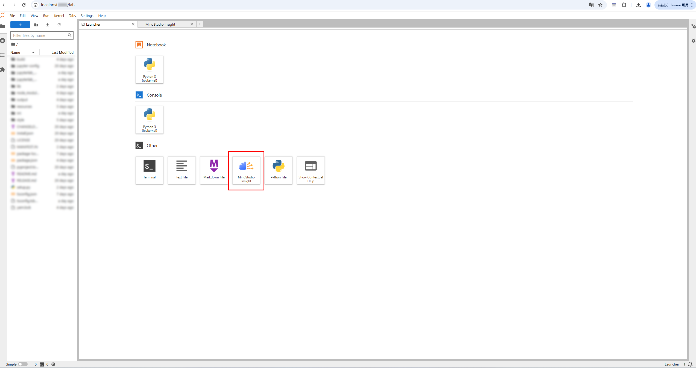
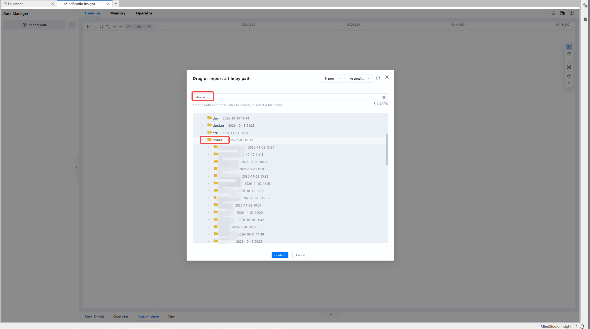

# 安装指南：JupyterLab插件

本文档介绍在Linux环境下通过JupyterLab插件安装MindStudio Insight的操作方法，涵盖环境准备、插件包安装、启用与默认目录配置，适用于需要在JupyterLab环境中查看大模型训练与推理数据的用户。

## 安装MindStudio Insight

<a id="安装操作jupyterlab插件"></a>

### 安装操作（JupyterLab插件）

**简介**

在Linux环境下，MindStudio Insight工具通过集成JupyterLab插件，提供更直观和交互性强的操作界面。JupyterLab插件的优势如[**表 1** JupyterLab插件优势](#JupyterLab插件优势)所示。

**表 1** JupyterLab插件优势<a id="JupyterLab插件优势"></a>

|优势|说明|
|--|--|
|无缝集成|支持在Jupyter环境中直接运行MindStudio Insight工具，无需切换平台，无需拷贝服务器上的数据，实现数据即采即用。|
|快速启动|通过JupyterLab的命令行或图形界面，可快速启动MindStudio Insight工具。|
|运行流畅|在Linux环境下，通过JupyterLab环境启动MindStudio Insight，相较于整包通信，有效解决了运行卡顿问题，操作体验显著提升。|
|远程连接|支持远程启动MindStudio Insight，可通过本地浏览器远程连接服务直接进行可视化分析，缓解了大模型训练或推理数据上传和下载的困难。|

**准备环境**

1. 执行以下命令，在Linux环境下安装JupyterLab环境，环境要求请参见[**表 2** 环境要求](#环境要求)。

    ```shell
    pip install jupyterlab
    ```

    > [!NOTE]
    >
    >如果需要打开集群场景数据，则需要参见[安装依赖](./mindstudio_insight_install_linux.md#安装依赖)章节中的内容安装Python依赖。

    **表 2** 环境要求<a id="环境要求"></a>

    |类别|要求|
    |--|--|
    |系统|Linux系统|
    |Python版本|Python >= 3.8<br>|
    |JupyterLab环境版本|JupyterLab >= 4.0，且 < 5.0|

2. 安装完成后，查看JupyterLab版本。

    ```shell
    jupyter --version
    ```

3. （可选）建议使用conda进行环境管理。

    执行以下命令，创建虚拟环境并激活。

    ```shell
    conda create -n {your_env_name} python={python version} jupyterlab={jupyterlab version}
    conda activate {your_env_name}  # 激活虚拟环境
    ```

**安装步骤**

1. 安装MindStudio Insight插件包。

    ```shell
    pip install mindstudio_insight_jupyterlab-{version}-py3-none-{platform}.whl
    ```

    > [!NOTE]
    >
    > 在安装插件包前，请先确认当前用户的umask设置，推荐设置为“0027”，具体建议请参见[安全声明](../legal/security_statement.md)。

2. 查看MindStudio Insight是否安装成功。

    ```shell
    jupyter labextension list
    ```

    回显中包含如下内容，表示安装成功。

    ```output
    mindstudio_insight_jupyterlab v{version} enabled  X (python, mindstudio_insight_jupyterlab)
    ```

3. 启用JupyterLab服务并打开MindStudio Insight工具。

    <a id="jupyter_3"></a>

    - 如果是非root用户，请执行以下命令。

        ```shell
        jupyter lab
        ```

    - 如果是root用户，请执行以下命令。

        ```shell
        jupyter lab --allow-root
        ```

    > [!NOTE]
    >
    > 建议使用非root用户执行命令。如果实际需要使用root用户启动，请严格执行root用户的命令，否则会存在安全风险。

    启用后，使用浏览器，输入http://\{_your\_server\_ip_\}:\{_your\_server\_port_\}/lab地址，打开JupyterLab环境首页，如[**图 1** JupyterLab环境首页](#JupyterLab环境首页)所示，单击MindStudio Insight图标，即可打开MindStudio Insight工具（端口号可在终端实时查看，端口号port默认值为“8888”）。

    **图 1** JupyterLab环境首页<a id="JupyterLab环境首页"></a>

    

4. 如果打开JupyterLab环境首页后，未发现MindStudio Insight图标，可执行以下命令，查看MindStudio Insight插件是否开启。

    ```shell
    jupyter server extension list
    ```

    - 回显如下，表示已开启。

        ```text
        mindstudio_insight_jupyterlab enabled
            - Validating mindstudio_insight_jupyterlab...
              mindstudio_insight_jupyterlab  OK
        ```

    - 如果未开启，可执行以下命令，开启MindStudio Insight插件。

        ```shell
        jupyter server extension enable --py mindstudio_insight_jupyterlab
        ```

5. 开启MindStudio Insight插件后，重复操作[3](#jupyter_3)，打开MindStudio Insight工具。

    **注意事项**

    - 如果本机未安装浏览器，或者大模型性能调优数据及JupyterLab存在于服务器上，需要在服务器上启用服务并加载数据，然后使用本地浏览器访问查看。启用JupyterLab服务的具体操作可参考以下步骤。
        1. 创建JupyterLab配置文件。此处的配置为JupyterLab官方配置，与MindStudio Insight插件无关。

            ```shell
            jupyter lab --generate-config
            ```

        2. 进入jupyter目录，打开jupyter\_lab\_config.py配置文件。
        3. 修改配置文件。搜索关键字“c.ServerApp.ip”和“c.ServerApp.open\_browser”，删除所在行前面的注释符号，并修改为如下配置后保存，使配置文件生效。

            ```text
            # 修改使其生效（去掉配置文件注释）
            c.ServerApp.ip = '0.0.0.0'
            c.ServerApp.open_browser = False
            ```

        4. 配置完成后，参见[3](#jupyter_3)重新启动JupyterLab服务并打开MindStudio Insight工具。

    - 如果您当前使用的云平台已经集成了JupyterLab服务，且需要在云平台上使用MindStudio Insight工具，那么可在云平台上安装Jupyter代理服务插件**jupyter-server-proxy**，即可正常使用MindStudio Insight工具。<br>
    如果云平台无法安装Jupyter代理服务插件，且公网未开放9000\~9099端口，则无法使用MindStudio Insight工具。
        1. 安装Jupyter代理服务插件。

            ```shell
            pip install jupyter-server-proxy
            ```

        2. 参见[3](#jupyter_3)重新启动JupyterLab服务并打开MindStudio Insight工具。

    - JupyterLab支持通过如下三种方式配置导入数据的默认目录（按照优先级排序），具体配置完成后，导入数据界面如[**图 2** JupyterLab配置默认目录](#JupyterLab配置默认目录)所示。

        1. 通过命令行显式配置默认目录，命令及回显如下：

            ```bash
            #通过命令行显式配置默认目录
            jupyter lab --MSInsight.initial_dir="/home"

            #回显如下
            MindStudio Insight file selector initial directory (MSInsight.initial_dir): '/home'
            ```

        2. 通过配置文件显式配置默认目录，命令及回显如下：

            ```bash
            # 通过jupyter_server_config.py配置文件配置默认目录
            c.MSInsight.initial_dir = "/home"

            #启动JupyterLab（注意，root用户启动需要增加“--allow-root”）
            jupyter lab

            #回显如下
            MindStudio Insight file selector initial directory (MSInsight.initial_dir): '/home'
            ```

        3. 通过环境变量配置默认目录，命令及回显如下：

            ```bash
            #通过环境变量配置默认目录
            export MINDSTUDIO_INSIGHT_INITIAL_DIR="/home"

            #启动JupyterLab（注意，root用户启动需要增加“--allow-root”）
            jupyter lab

            #回显如下
            MindStudio Insight file selector initial directory (MSInsight.initial_dir): '/home'
            ```

        若以上配置命令为空字符串，则按照MindStudio Insight默认路径导入数据。

        **图 2** JupyterLab配置默认目录<a id="JupyterLab配置默认目录"></a>

        

    - 在JupyterLab环境首页，可多次单击MindStudio Insight图标，打开多个MindStudio Insight页签，且可同时使用。

    - 请关注使用JupyterLab插件方式安装MindStudio Insight后，使用时的安全风险，具体可参见[安全声明](../legal/security_statement.md)。

## 升级MindStudio Insight

如果需要升级MindStudio Insight，需先卸载已安装的MindStudio Insight，再获取最新MindStudio Insight软件包重新安装。

请根据实际场景，参见[卸载MindStudio Insight](#卸载mindstudio-insight)章节内容完成卸载操作，并重新安装最新MindStudio Insight软件包。

## 卸载MindStudio Insight

<a id="卸载操作jupyterlab插件"></a>

### 卸载操作（JupyterLab插件）

卸载MindStudio Insight插件包。

```shell
pip uninstall mindstudio_insight_jupyterlab
```
