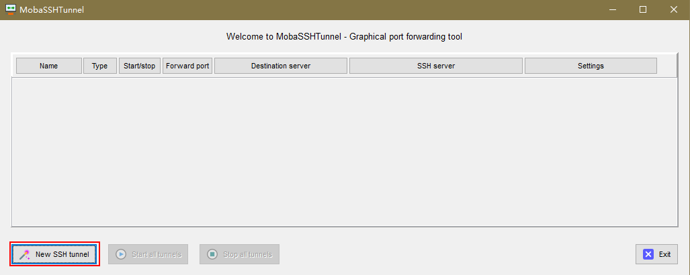
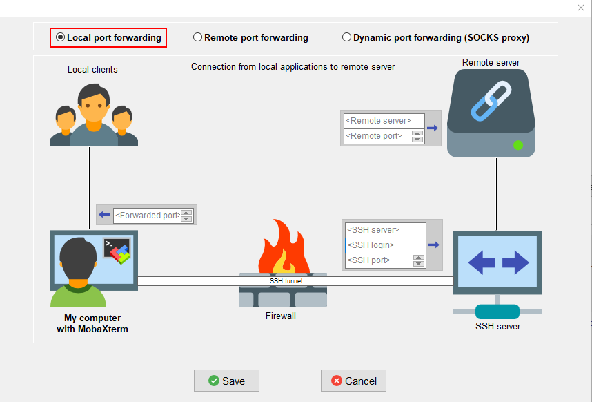
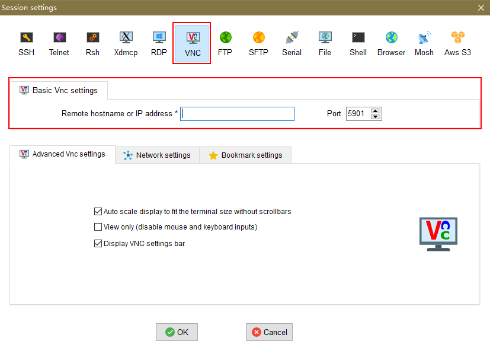

# 安装指南：Linux系统

本文档介绍Linux系统下MindStudio Insight的安装与卸载方法，涵盖X11和VNC两种转发方式的依赖安装、VNC Server设置及端口转发配置，适用于需要在Linux服务器上安装使用MindStudio Insight的开发者。

## 安装MindStudio Insight

<a id="安装操作linux"></a>

### 安装操作（Linux）

<a id="概述"></a>

#### 概述

在Linux环境下，MindStudio Insight工具可通过本地方式和转发方式进行使用。

- 本地方式

    本地安装Linux操作系统的服务器直接外接显示器，将工具界面直接展示在操作系统桌面上，跟日常本地Windows主机接显示器类似，此场景无工具界面的延迟。

- 转发方式

    当本地无Linux服务器时，可通过连接远端的Linux服务器，使用X11、VNC、xRDP等方式将远端Linux服务器中的桌面或软件界面转发到本地显示，例如，本地Windows桌面显示Linux服务器上的应用程序界面。MindStudio Insight可通过转发能力，在Linux服务器上实现界面转发，便于开发者使用。不过与本地方式相比，转发方式受网络性能影响，可能存在网络延迟，会造成工具安装使用过程中出现卡顿问题。

本文档主要介绍X11和VNC两种转发方式，开发者可根据实际情况选择其中一种转发方式，可参见[**表 1**  转发方式说明](#转发方式说明)进行选择。通过转发方式安装使用MindStudio Insight，首先需要安装转发方式和软件依赖，安装操作请参见[安装依赖](#安装依赖)章节。

> [!NOTE]
>
> 推荐使用VNC转发方式，可获得更为流畅的使用体验。

**表 1** 转发方式说明<a id="转发方式说明"></a>

|转发方式|网络延迟|安全性|备注|
|--|--|--|--|
|X11|相对较高|底层基于SSH安全协议。|多用于网络良好的本地局域网中。|
|VNC|相对较低|默认通过TCP方式，可借助SSH安全协议实现安全访问。|应用范围更广，可用在跨城网络、VPN网络等。|

**准备环境**

在Linux系统中，MindStudio Insight安装环境要求如[**表 2** MindStudio Insight安装环境要求](#Insight安装环境要求)所示。

**表 2** MindStudio Insight安装环境要求<a id="Insight安装环境要求"></a>

|类别|限制要求|
|--|--|
|硬件|- 内存：最小4GB，推荐8GB及以上<br> - 磁盘空间：最小6GB|
|系统要求|- glibc版本应大于或等于2.27<br> - 操作系统自带GUI桌面或具有X11或VNC转发功能|
|支持的操作系统|以apt作为包管理软件类型的操作系统：<br> - Ubuntu 18.04-x86_64/aarch64<br> - Ubuntu 20.04-x86_64/aarch64<br> - Ubuntu 22.04-x86_64/aarch64<br> - CentOS 8.2-x86_64/aarch64<br> - Debian 10.0<br> - Debian 10.8<br> 以yum/dnf作为包管理软件类型的操作系统：<br> - EulerOS 2.8-aarch64<br> - EulerOS 2.12-aarch64<br> - openEuler 20.03-x86_64/aarch64<br> - openEuler 22.03 LTS-x86_64/aarch64<br> - openEuler 22.03 LTS<br> - openEuler 22.03 LTS SP4<br> - HCE 2.0<br> - CULinux 3.0<br> - Kylin V10 SP3<br> - EulerOS 2.13-aarch64<br> - HCE 2.0.2503-x86<br> - Tlinux 3.1-内核版本5.4<br> - BClinux 21.10 U4<br> - TencentOS Server 4.4-x86|

> [!NOTE]
>
> 在直通虚拟机veLinux 5.15系统上安装和使用MindStudio Insight工具时，推荐使用JupyterLab插件的安装方式使用MindStudio Insight工具，JupyterLab插件安装请参见[安装操作（JupyterLab插件）](./mindstudio_insight_install_jupyterlab.md#安装操作jupyterlab插件)章节进行操作。

<a id="安装依赖"></a>

#### 安装依赖

**依赖列表**

在Linux环境下，安装MindStudio Insight前需要安装相关依赖，请参见[**表 3** 依赖列表](#依赖列表)安装对应依赖。

<a id="依赖列表"></a>

| 依赖名称 | 说明 |
| --- | --- |
| libwebkit2gtk-4.0-dev | Ubuntu系统中，MindStudio Insight显示运行依赖的库文件，必选。 |
| gtk3-devel webkit2gtk4.1-devel | CentOS系统中，MindStudio Insight显示运行依赖的库文件，必选。 |
| gtk3-devel webkit2gtk3-devel | EulerOS和openEuler系统中，MindStudio Insight显示运行依赖的库文件，必选。 |
| xterm | MindStudio Insight通过X11转发的依赖文件。当选择X11转发方式时，所有系统必选。 |
| x11-apps | Ubuntu系统中，MindStudio Insight通过X11转发的依赖文件。当选择X11转发方式时，必选。 |
| xorg-x11-xauth | CentOS、EulerOS和OpenEuler系统中，MindStudio Insight通过X11转发的依赖文件。当选择X11转发方式时，必选。 |
| xfce4 | Ubuntu、CentOS、OpenEuler系统中，MindStudio Insight通过VNC转发的依赖文件。当选择VNC转发方式时，必选。 |
| gnome-desktop | EulerOS系统中，MindStudio Insight通过VNC转发的依赖文件。当选择VNC转发方式时，必选。 |
| click | MindStudio Insight已集成msprof-analyze集群分析工具所依赖的Python库。版本要求见msprof-analyze工具的[build.txt文件](https://gitcode.com/Ascend/msprof-analyze/blob/master/requirements/build.txt)。 |
| networkx | MindStudio Insight已集成msprof-analyze集群分析工具所依赖的Python库。版本要求见msprof-analyze工具的[build.txt文件](https://gitcode.com/Ascend/msprof-analyze/blob/master/requirements/build.txt)。 |
| jinja2 | MindStudio Insight已集成msprof-analyze集群分析工具所依赖的Python库。版本要求见msprof-analyze工具的[build.txt文件](https://gitcode.com/Ascend/msprof-analyze/blob/master/requirements/build.txt)。 |
| PyYaml | MindStudio Insight已集成msprof-analyze集群分析工具所依赖的Python库。版本要求见msprof-analyze工具的[build.txt文件](https://gitcode.com/Ascend/msprof-analyze/blob/master/requirements/build.txt)。 |
| tqdm | MindStudio Insight已集成msprof-analyze集群分析工具所依赖的Python库。版本要求见msprof-analyze工具的[build.txt文件](https://gitcode.com/Ascend/msprof-analyze/blob/master/requirements/build.txt)。 |
| prettytable | MindStudio Insight已集成msprof-analyze集群分析工具所依赖的Python库。版本要求见msprof-analyze工具的[build.txt文件](https://gitcode.com/Ascend/msprof-analyze/blob/master/requirements/build.txt)。 |
| ijson | MindStudio Insight已集成msprof-analyze集群分析工具所依赖的Python库。版本要求见msprof-analyze工具的[build.txt文件](https://gitcode.com/Ascend/msprof-analyze/blob/master/requirements/build.txt)。 |
| xlsxwriter | MindStudio Insight已集成msprof-analyze集群分析工具所依赖的Python库。版本要求见msprof-analyze工具的[build.txt文件](https://gitcode.com/Ascend/msprof-analyze/blob/master/requirements/build.txt)。 |
| sqlalchemy | MindStudio Insight已集成msprof-analyze集群分析工具所依赖的Python库。版本要求见msprof-analyze工具的[build.txt文件](https://gitcode.com/Ascend/msprof-analyze/blob/master/requirements/build.txt)。 |
| numpy | MindStudio Insight已集成msprof-analyze集群分析工具所依赖的Python库。版本要求见msprof-analyze工具的[build.txt文件](https://gitcode.com/Ascend/msprof-analyze/blob/master/requirements/build.txt)。 |
| pandas | MindStudio Insight已集成msprof-analyze集群分析工具所依赖的Python库。版本要求见msprof-analyze工具的[build.txt文件](https://gitcode.com/Ascend/msprof-analyze/blob/master/requirements/build.txt)。 |
| psutil | MindStudio Insight已集成msprof-analyze集群分析工具所依赖的Python库。版本要求见msprof-analyze工具的[build.txt文件](https://gitcode.com/Ascend/msprof-analyze/blob/master/requirements/build.txt)。 |

**安装依赖**

1. 执行以下命令，安装Python相关依赖。

    ```shell
    pip3 install click
    pip3 install networkx
    pip3 install jinja2
    pip3 install PyYaml
    pip3 install tqdm
    pip3 install prettytable
    pip3 install ijson
    pip3 install "xlsxwriter>=3.0.6"
    pip3 install sqlalchemy
    pip3 install "numpy<=1.26.4"
    pip3 install "pandas<=2.3.2"
    pip3 install psutil
    ```

2. 安装MindStudio Insight软件包所需的转发方式和依赖，推荐安装VNC和X11转发方式。

<a id="安装vnc转发方式"></a>

#### 安装VNC转发方式

如果通过VNC转发方式启动MindStudio Insight，可获得更为流畅的体验，所以推荐使用VNC转发方式使用MindStudio Insight工具。

> [!NOTE]
>
> - EulerOS 2.12系统不支持使用VNC方式启动MindStudio Insight工具。
> - 本章节内容仅供参考，VNC的具体安装步骤请参见[VNC官方文档](https://docs.redhat.com/en/documentation/red_hat_enterprise_linux/6/html/deployment_guide/chap-tigervnc#s2-starting-vncserver)。

**安装依赖**

1. 执行以下命令，安装MindStudio Insight显示运行依赖的库文件。
    - Ubuntu等以apt作为包管理软件类型的操作系统

        ```shell
        sudo apt install -y libwebkit2gtk-4.0-dev
        ```

    - CentOS/EulerOS/openEuler等以yum/dnf作为包管理软件类型的操作系统

        1. 执行以下命令，查询webkit2gtk库文件。

            ```shell
            sudo yum search webkit2gtk
            ```

            回显信息如下：

            ```output
            = Name 和 Summary 匹配：webkit2gtk =====================================================================================
            webkit2gtk3-devel.aarch64 : Development files for webkit2gtk3
            webkit2gtk3-help.noarch : Documentation files for webkit2gtk3
            webkit2gtk3-jsc.aarch64 : JavaScript engine from webkit2gtk3
            webkit2gtk3-jsc-devel.aarch64 : Development files for JavaScript engine from webkit2gtk3
            ========================================================================================== Name 匹配：webkit2gtk ===========================================================================================
            webkit2gtk3.aarch64 : GTK+ Web content engine library
            ========================================================================================= Summary 匹配：webkit2gtk =========================================================================================
            libproxy-webkitgtk4.aarch64 : plugin for webkit2gtk3
            ```

        2. 根据回显信息，执行以下命令，安装webkit2gtk库文件。

            ```shell
            sudo yum install -y ${dependency_name}
            ```

            其中`dependency_name`为依赖文件名称，可参考回显信息确定。例如，如上回显信息所示，如果回显信息中存在webkit2gtk3-devel，则此处的依赖文件名称为webkit2gtk3-devel；如果回显信息中不存在webkit2gtk3-devel，则需要找到webkit2gtk3，此处的依赖文件名称为webkit2gtk3。

        > [!NOTE]
        >
        > EulerOS 2.12操作系统是基于openEuler 22.03 LTS SP1开发，需要先配置OpenEuler 22.03 LTS SP1的源，再执行安装命令。配置OpenEuler的源具体操作请参见[OpenEuler软件源配置](https://mirrors.huaweicloud.com/mirrorDetail/5ebe3408c8ac54047fe607f0?mirrorName=openeuler&catalog=os)。

2. 使用root用户，执行以下命令，安装MindStudio Insight通过VNC转发的桌面依赖。

    - Ubuntu等以apt作为包管理软件类型的操作系统

        ```shell
        apt-get install -y xfce4 xfce4-goodies
        ```

    - CentOS/EulerOS/OpenEuler等以yum/dnf作为包管理软件类型的操作系统
        1. 执行以下命令，查询是否存在xfce。

            ```shell
            yum search xfce
            ```

            如果回显中包含xfce相关信息，执行以下命令，安装xfce。

            ```shell
            yum install -y xfce4*
            ```

            如果回显为“未找到匹配项”，则执行[2](#2_b)。

        2. 执行以下命令，查询是否存在gnome。<a id="2_b"></a>

            ```shell
            yum search gnome
            ```

            如果回显中包含gnome相关信息，执行以下命令，安装gnome。

            ```shell
            yum install -y gnome*
            ```

3. 执行以下命令，安装VNC Server。
    - Ubuntu等以apt作为包管理软件类型的操作系统

        ```shell
        apt-get install -y tightvncserver
        ```

    - CentOS/EulerOS/OpenEuler等以yum/dnf作为包管理软件类型的操作系统

        ```shell
        yum install -y tigervnc-server
        ```

**设置VNC Server**

1. 执行以下命令，设置VNC首次连接时的密码。

    ```shell
    vncserver
    ```

2. 回显如下，按照提示输入密码。

    ```output
    You will require a password to access your desktops.
    Password:请输入密码
    Verify:请再次输入密码
    ```

3. 输入密码后，回显如下：<a id="3"></a>

    ```output
    Would you like to enter a view-only password (y/n)?
    ```

    按照提示输入n，回显如下，创建启动脚本、默认配置等，首行中的`x`值根据实际情况显示，表示显示序号。

    ```output
    New 'localhost.localdomain:x' desktop is localhost.localdomain:x
    Creating default startup script /home/xxx/.vnc/xstartup
    Creating default config /home/xxx/.vnc/config
    Starting applications specified in /home/xxx/.vnc/xstartup
    Log file is /home/xxx/.vnc/localhost.localdomain:3.log
    ```

4. 执行以下命令，停止已启用的VNC Server。

    ```shell
    vncserver -kill :x
    ```

    > [!NOTE]
    >
    > 此处的`x`值与[3](#3)中首行回显的`x`值一致。

5. 执行`vi ~/.vnc/xstartup`，打开xstartup启动脚本，并在脚本最后新增一行文本，配置脚本，需要增加的文本内容请参见[**表 4** 文本内容](#文本内容)。

    **表 4** 文本内容<a id="文本内容"></a>

    |已安装依赖|文本内容|
    |--|--|
    |xfce|startxfce4 &|
    |gnome|gnome-session &|

6. 执行`:wq!`命令，保存脚本并退出。

**启动VNC Server**

执行以下命令，启动VNC Server。

```shell
vncserver -localhost -geometry 1920x1080
```

> [!NOTE]
>
> - **localhost**：是启动本地主机的VNC服务，需要与[端口转发](#端口转发)配合使用。如果是安全的网络环境下，也可以不使用localhost，同时也不采用[端口转发](#端口转发)，可直接执行[本地连接VNC Server](#本地连接VNC)步骤（不推荐此方式）。
> - **geometry 1920x1080**：配置VNC桌面的分辨率为1920x1080，也可以根据用户显示器的分辨率自行配置。

**端口转发**<a id="端口转发"></a>

通过SSH通道安全地将Linux本地主机服务转发至Windows本地端口。

1. 打开远程登录工具，选择“Tools \> MobaSSHTunnel \(port forwarding\)”。此处以MobaXterm工具为例。
2. 单击“New SSH Tunnel”，新建一个SSH配置。

    **图 1** 新建SSH配置

    

3. 选择“Local port forwarding”，按照[**表 5** 配置Local port forwarding页面信息](#配置Local_port_forwarding页面信息)配置页面信息。

    **图 2** Local port forwarding

    

    **表 5** 配置Local port forwarding页面信息<a id="配置Local_port_forwarding页面信息"></a>

    |参数|说明|示例|
    |--|--|--|
    |Remote server|Linux服务器的地址。|127.0.0.1|
    |Remote port|Linux服务器的端口，值为5900加设置VNC Server中的x（显示序号）值。|5901|
    |SSH server|SSH连接时的IP或URL地址。|192.168.x.x|
    |SSH login|SSH登录的用户名/密码对。|-|
    |SSH port|SSH登录时使用的端口，一般为22。|22|
    |Forwarded port|端口转发到本地Windows对应的端口，可以与Remote port一致。|5901|

4. 单击“Save”，完成SSH配置。
5. 在MobaSSHTunnel弹窗中，选择已配置好的SSH Tunnel，单击，即可开启端口转发。

    如果SSH配置中的“SSH login”参数，填写的是用户名，首次启动SSH Tunnel的时候会弹出一个对话框，输入用户对应的密码即可启动SSH Tunnel。

**本地连接VNC Server**<a id="本地连接VNC"></a>

1. 在MobaXterm工具首页，单击“Session”，进入Session settings页面。
2. 单击“VNC”，根据实际情况配置“Remote hostname or IP address”和“Port”。

    > [!NOTE]
    >
    > - 如果使用了端口转发功能，“Remote hostname or IP address”为127.0.0.1，“Port”为端口转发中的Forwarded port。
    > - 如果未使用端口转发，“Remote hostname or IP address”为实际远端Linux的IP，“Port”为5900加设置VNC Server中的`x`（显示序号）值。<br>

    **图 3** 配置VNC

    

3. 配置完成后，单击“OK”，在弹窗中输入VNC的密码后，将桌面转发至本地进行后续操作。

    **图 4** 桌面

    

<a id="安装x11转发方式"></a>

#### 安装X11转发方式

**前提条件**

确保源可用。可在root用户下执行如下命令检查源是否可用。

- Ubuntu等以apt作为包管理软件类型的操作系统

    ```shell
    apt-get update
    ```

- CentOS/EulerOS/OpenEuler等以yum/dnf作为包管理软件类型的操作系统

    ```shell
    yum makecache
    ```

> [!NOTE]
>
> 如果OpenEuler及其衍生操作系统，在安装过程中提示找不到相关依赖，可能原因是系统配置的源没有相关依赖，可参见[配置源](https://www.hiascend.com/forum/thread-02101178181671140059-1-1.html)配置新的源，并重新安装对应依赖。

**操作步骤**

1. 执行以下命令，安装MindStudio Insight显示运行依赖的库文件。
    - Ubuntu等以apt作为包管理软件类型的操作系统

        ```shell
        sudo apt install -y libwebkit2gtk-4.0-dev
        ```

    - CentOS/EulerOS/OpenEuler等以yum/dnf作为包管理软件类型的操作系统

        1. 执行以下命令，查询webkit2gtk库文件。

            ```shell
            sudo yum search webkit2gtk
            ```

            回显信息如下：

            ```output
            = Name 和 Summary 匹配：webkit2gtk =====================================================================================
            webkit2gtk3-devel.aarch64 : Development files for webkit2gtk3
            webkit2gtk3-help.noarch : Documentation files for webkit2gtk3
            webkit2gtk3-jsc.aarch64 : JavaScript engine from webkit2gtk3
            webkit2gtk3-jsc-devel.aarch64 : Development files for JavaScript engine from webkit2gtk3
            ========================================================================================== Name 匹配：webkit2gtk ===========================================================================================
            webkit2gtk3.aarch64 : GTK+ Web content engine library
            ========================================================================================= Summary 匹配：webkit2gtk =========================================================================================
            libproxy-webkitgtk4.aarch64 : plugin for webkit2gtk3
            ```

        2. 根据回显信息，执行以下命令，安装webkit2gtk库文件。

            ```shell
            sudo yum install -y ${dependency_name}
            ```

            其中`dependency_name`为依赖文件名称，可参考回显信息确定。例如，如上回显信息所示，如果回显信息中存在webkit2gtk3-devel，则此处的依赖文件名称为webkit2gtk3-devel；如果回显信息中不存在webkit2gtk3-devel，则需要找到webkit2gtk3，此处的依赖文件名称为webkit2gtk3。

        > [!NOTE]
        >
        > EulerOS 2.12操作系统是基于OpenEuler 22.03 LTS SP1开发，需要先配置OpenEuler 22.03 LTS SP1的源，再执行安装命令。配置OpenEuler的源具体操作请参见[OpenEuler软件源配置](https://mirrors.huaweicloud.com/mirrorDetail/5ebe3408c8ac54047fe607f0?mirrorName=openeuler&catalog=os)。

2. 执行以下命令，安装MindStudio Insight通过X11转发的依赖文件。

    - Ubuntu等以apt作为包管理软件类型的操作系统

        ```shell
        sudo apt-get install -y xterm x11-apps
        ```

    - CentOS/EulerOS/OpenEuler等以yum/dnf作为包管理软件类型的操作系统

        ```shell
        sudo yum install -y xterm xorg-x11-xauth
        ```

<a id="安装mindstudio-insight"></a>

#### 安装MindStudio Insight

1. 使用MindStudio Insight的安装用户上传软件包至待安装环境。
2. 在软件包所在目录下，执行以下命令，解压MindStudio Insight软件包。
    - aarch64架构的软件包

        ```shell
        unzip MindStudio-Insight_{version}_linux-aarch64.zip
        ```

    - x86\_64架构的软件包

        ```shell
        unzip MindStudio-Insight_{version}_linux-x86_64.zip
        ```

3. 执行以下命令，启动MindStudio Insight。

    ```shell
    ./MindStudio-Insight
    ```

> [!NOTE]
>
> - 如果在EulerOS系统上运行MindStudio Insight，单击界面左上方工具栏中的，无法弹出导入选择框，解决方法可参见[EulerOS等系统上运行MindStudio Insight工具无法弹出数据导入选择框](../support/faq.md#faq-euleros-import-dialog)。
> - 在X11转发方式下运行MindStudio Insight时，如果出现输入框信息粘贴不符合预期，造成输入信息错误的情况，具体解决方法可参见[通过X11转发方式运行MindStudio Insight工具时，输入框信息粘贴有误](../support/faq.md#faq-x11-paste-error)。

## 升级MindStudio Insight

如果需要升级MindStudio Insight，需先卸载已安装的MindStudio Insight，再获取最新MindStudio Insight软件包重新安装。

请根据实际场景，参见[卸载MindStudio Insight](#卸载mindstudio-insight)章节内容完成卸载操作，并重新安装最新MindStudio Insight软件包。

## 卸载MindStudio Insight

<a id="卸载操作linux"></a>

### 卸载操作（Linux）

在Linux系统中，卸载MindStudio Insight工具有2种方式可选。

- 方式一：通过直接删除MindStudio Insight解压后的软件包进行卸载。该操作不会删除日志文件。
- 方式二：使用命令行方式进行卸载。
    1. 执行以下命令，卸载MindStudio Insight。

        ```shell
        rm -rf MindStudio-Insight resources
        ```

    2. 执行以下命令，删除MindStudio Insight的日志文件。

        ```shell
        rm -rf ${HOME}/.mindstudio_insight
        ```
