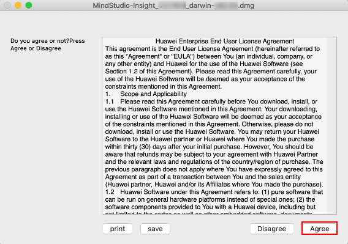
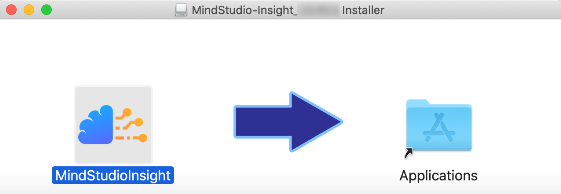

# 安装指南：macOS系统

## 安装MindStudio Insight

### 安装操作（macOS）

**准备环境**

请准备macOS Ventura 13.5及以上的版本系统。

**安装步骤**

1. 鼠标双击“MindStudio-Insight\__\{version\}_\_macos-_\{arch\}_.dmg”软件包，进入许可协议界面，单击“Agree”，如[**图 1** 许可协议](#许可协议)所示。

    **图 1** 许可协议

    

2. 弹出Installer弹窗，在Installer弹窗中，将MindStudio Insight应用拖拽至Applications文件夹中，如[**图 2** 拖拽应用至文件夹](#拖拽应用至文件夹)所示。

    **图 2** 拖拽应用至文件夹

    

3. 在应用程序中双击MindStudio Insight应用，即可打开MindStudio Insight工具。

> [!NOTE]
>
> - 当前适用于macOS系统的MindStudio Insight应用程序，在部分macOS系统上运行时，可能会出现无法打开“MindStudio Insight”的情况。  当运行MindStudio Insight时，如果出现无法打开“MindStudio Insight”的弹窗，需单击弹窗信息中的“好”，然后在“系统设置 \> 隐私与安全性 \> 安全性”中选择“App Store和被认可的开发者”，在出现的“已阻止使用MindStudio Insight”信息中单击“仍要打开”，授予执行权限，再次双击MindStudio Insight应用，出现无法打开“MindStudio Insight”弹窗时，单击弹窗中的“打开”，即可正常打开MindStudio Insight工具。
> - 如果需要在macOS系统上同时打开多个MindStudio Insight工具，可在cmd窗口中，执行`open -n /Applications/MindStudio Insight.app`命令。但是不建议在两个MindStudio Insight窗口中同时打开同一份数据，以免出现数据解析问题。

## 升级MindStudio Insight

如果需要升级MindStudio Insight，需先卸载已安装的MindStudio Insight，再获取最新MindStudio Insight软件包重新安装。

请根据实际场景，参见[卸载MindStudio Insight](#卸载mindstudio-insight)章节内容完成卸载操作，并重新安装最新MindStudio Insight软件包。

## 卸载MindStudio Insight

### 卸载操作（macOS）

1. 进入应用程序中，找到MindStudio Insight。
2. 鼠标右键单击MindStudio Insight应用，弹出菜单栏。
3. 单击“移到废纸篓”即可卸载。
