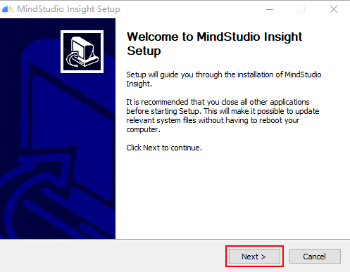
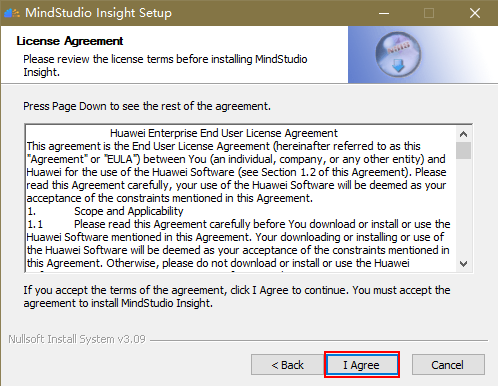
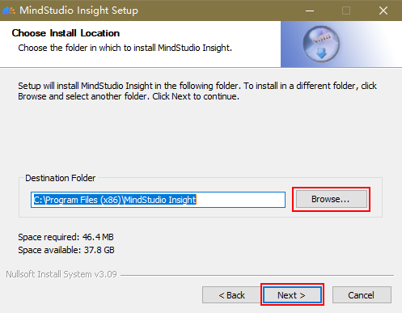
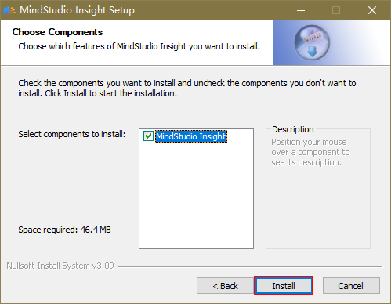
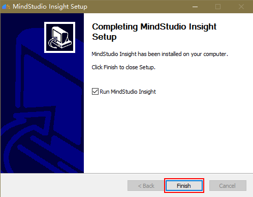
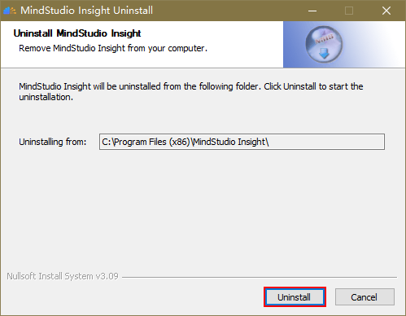
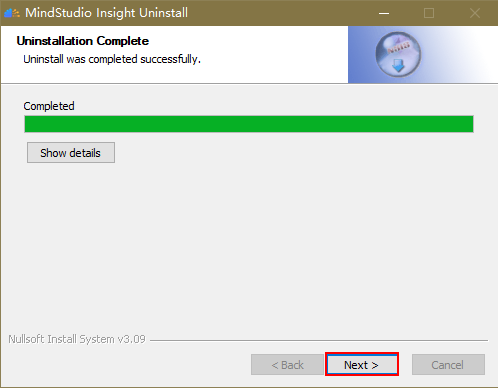
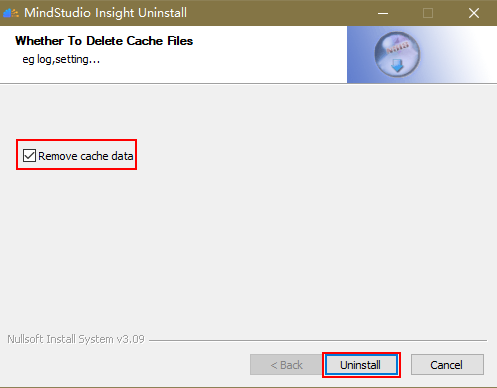
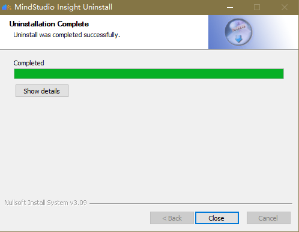

# 安装指南：Windows系统

本文档介绍MindStudio Insight在Windows系统下的安装操作，涵盖环境准备、安装步骤、升级与卸载流程，适用于需要在Windows系统部署MindStudio Insight的用户。

## 安装MindStudio Insight

<h3 id="安装操作windows">安装操作（Windows）</h3>

**准备环境**

MindStudio Insight工具的安装与可视化呈现对Windows系统及设备配置有一定要求，请参见[**表 1** 系统配置要求](#系统配置要求)。

**表 1** 系统配置要求

|类别|要求|说明|
|--|--|--|
|系统|Windows 10 64位操作系统|-|
|内存配置|推荐16GB或以上|针对大模型集群场景，加载的数据量较大。|
|磁盘空间|推荐可用空间30GB或以上|用于存放加载性能数据时生成的数据库文件。|

**安装步骤**

1. 双击**MindStudio-Insight\__\{version\}_\_win.exe**软件包，开始安装MindStudio Insight。
2. 进入MindStudio Insight Setup界面，单击“Next”，如[**图 1** Setup](#Setup)所示。

    **图 1** Setup

    

3. 进入许可协议界面，单击“I Agree”，如[**图 2** License-Agreement](#License-Agreement)所示。

    **图 2** License-Agreement

    

4. 选择MindStudio Insight的安装路径，单击“Next”，如[**图 3** 选择安装路径](#选择安装路径)所示。

    **图 3** 选择安装路径

    

    > [!NOTE]
    >
    > 默认安装目录为“C:\\Program Files \(x86\)\\MindStudio Insight”。如果选择安装到其他目录，为避免其他用户修改运行文件，需要取消普通用户的修改权限，可在所选文件夹右键选择“属性 \> 安全”，在“安全”页签下修改用户的权限。

5. 选择安装组件MindStudio Insight，单击“Install”，如[**图 4** 选择安装组件](#选择安装组件)所示。

    **图 4** 选择安装组件

    

6. 完成MindStudio Insight安装，单击“Finish”，如[**图 5** 完成安装](#完成安装)所示。

    **图 5** 完成安装 

    

7. 启动MindStudio Insight。

    - 如果在[6](#6)中，勾选了“Run MindStudio Insight”，单击“Finish”后会自动启动MindStudio Insight。
    - 如果未勾选“Run MindStudio Insight”，安装完成后，双击桌面的“MindStudio Insight”快捷方式图标，或安装目录下的“MindStudio-Insight.exe”，即可启动MindStudio Insight工具。

> [!NOTE]
>
> 安装完成后，运行MindStudio Insight工具时，如果出现Missing Dependencies报错弹窗，请参见[运行MindStudio Insight工具时出现Missing Dependencies报错弹窗](../support/faq.md#faq-missing-dependencies)解决。

## 升级MindStudio Insight

如果需要升级MindStudio Insight，需先卸载已安装的MindStudio Insight，再获取最新MindStudio Insight软件包重新安装。

请根据实际场景，参见[卸载MindStudio Insight](#卸载mindstudio-insight)章节内容完成卸载操作，并重新安装最新MindStudio Insight软件包。

## 卸载MindStudio Insight

<h3 id="卸载操作windows">卸载操作（Windows）</h3>

1. 进入MindStudio Insight安装目录，双击**Uninstall.exe**，弹出卸载界面，单击“Uninstall”后进行卸载，如[**图 6** MindStudio Insight卸载界面](#MindStudio-Insight卸载界面)所示。

    **图 6** MindStudio Insight卸载界面

    

2. 单击“Next”。

    **图 7** 卸载

    

3. 勾选“Remove cache data”清理缓存数据，单击“Uninstall”卸载。

    **图 8** 清理缓存数据

    

4. 完成卸载。

    **图 9** 卸载完成

    
