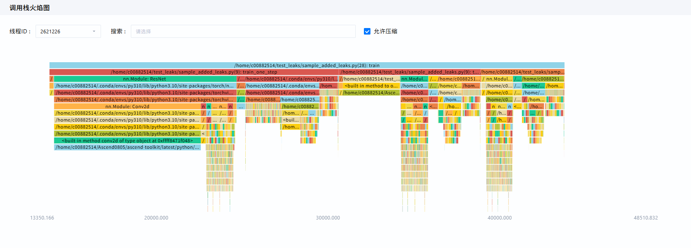
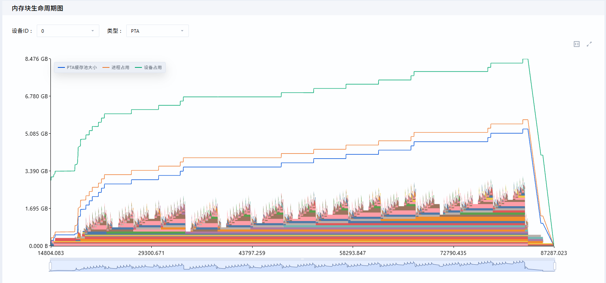
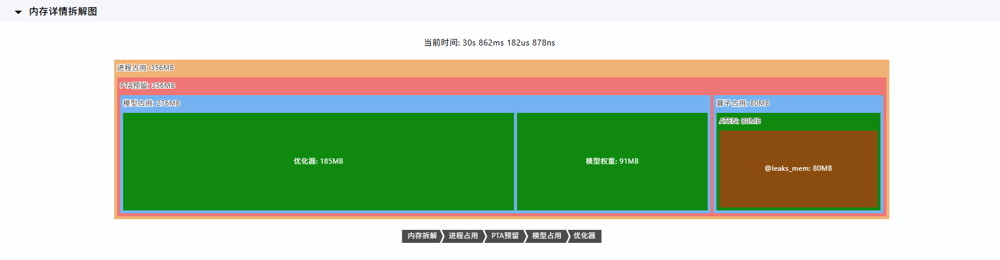
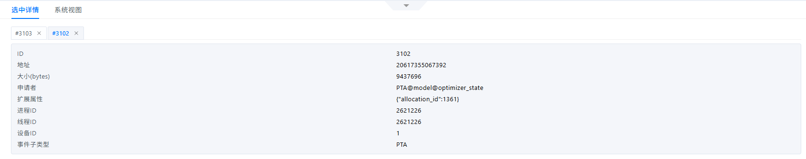
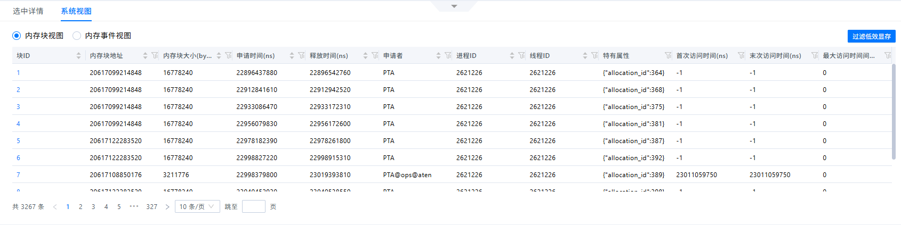
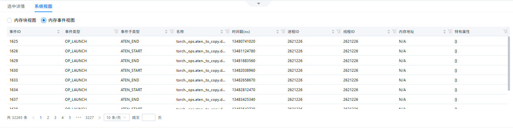

# **MindStudio Insight内存调优（MemScope）**

## 简介

MindStudio Insight工具以图形化形式呈现device侧内存详细分配情况，目前支持两种内存数据源：MemScope 数据源以及 PyTorch Snapshot 数据源。本文主要介绍MemScope 数据源，PyTorch Snapshot 数据源请参见《[MindStudio Insight内存调优（PyTorch Snapshot）](./pytorch_snapshot_memory_tuning.md)》。

### MemScope 数据源

基于内存申请释放生命周期可视化，结合**Python调用栈**及**自定义打点标签**标记各种内存申请使用详情，进行内存问题的详细定位、**峰值拆解**及**低效显存识别**达成调优目标。

## 使用前准备

### MemScope 数据采集

**环境准备**

请先安装MindStudio Insight工具，具体安装步骤请参见[MindStudio Insight安装指南](../../install_guide/mindstudio_insight_install_overview.md)。

安装msMemScope工具，安装前请确保已满足以下条件：

- 已安装CANN工具包（7.0及以上版本）并配置环境变量
- Python版本 >= 3.8

安装命令：

```shell
pip install msmemscope
```

更多安装方式请参见[msMemScope工具安装指南](https://gitcode.com/Ascend/msmemscope/blob/master/docs/zh/install%5Fguide/install%5Fguide.md)。

**数据采集**

内存调优场景的数据由msMemScope工具采集生成，支持以下采集方式：

| 采集方式 | 适用场景 | 采集命令示例 | 生成文件 |
| --- | --- | --- | --- |
| 命令行采集 | 通用命令行方式，适用于多种框架 | `msmemscope --output=./output python train.py` | memscope_dump_{timestamp}.db |
| Python接口采集 | 需要自定义采集范围和参数项 | 参见[msMemScope Python接口采集](https://gitcode.com/Ascend/msmemscope/blob/master/docs/zh/user%5Fguide/memory%5Fprofile.md#python接口采集功能介绍) | memscope_dump_{timestamp}.db |
| mstx打点采集 | 结合mstx打点能力 | 参见[msMemScope mstx打点采集](https://gitcode.com/Ascend/msmemscope/blob/master/docs/zh/user%5Fguide/memory%5Fprofile.md#mstx打点采集功能介绍) | memscope_dump_{timestamp}.db |

> [!NOTE]
>
> - `--events` 参数取值需至少包含 `alloc`、`free` 事件，否则无法生成内存块生命周期图。
> - `--analysis` 参数取值包含 `decompose` 时，才会生成内存详情拆解图。
> - 更多采集参数和用法请参见[msMemScope用户指南](https://gitcode.com/Ascend/msmemscope/blob/master/docs/zh/user%5Fguide/memory%5Fprofile.md)。

**数据导入**

采集完成后，将生成的db格式文件导入MindStudio Insight工具，数据导入操作请参见[导入数据](../basic_operations.md#导入数据)。

## 数据说明

### MemScope 数据说明

支持导入msMemScope工具采集到的db格式的内存结果文件，并以图形化形式呈现相关内容。db文件获取方式请参见《msMemScope内存采集》的“[命令行采集功能介绍](https://gitcode.com/Ascend/msmemscope/blob/master/docs/zh/user%5Fguide/memory%5Fprofile.md#%E5%91%BD%E4%BB%A4%E8%A1%8C%E9%87%87%E9%9B%86%E5%8A%9F%E8%83%BD%E4%BB%8B%E7%BB%8D)”，支持导入的内存数据详情请参见[**表 1**  数据可视化依赖说明](#数据可视化依赖说明)。

**表 1**  数据可视化依赖说明<a id="数据可视化依赖说明"></a>

<style type="text/css">

</style>
<table class="tg"><thead>
  <tr>
    <th class="tg-0lax">文件名</th>
    <th class="tg-0lax">说明</th>
    <th class="tg-0lax">界面呈现内容</th>
  </tr></thead>
<tbody>
  <tr>
    <td class="tg-0pky" rowspan="3">memscope_dump_{timestamp}.db</td>
    <td class="tg-0lax">--events参数取值需至少包含alloc、free事件。</td>
    <td class="tg-0pky">内存块生命周期图（内存申请/释放折线图、内存块图）</td>
  </tr>
  <tr>
    <td class="tg-0lax">--analysis参数取值包含decompose。</td>
    <td class="tg-0lax">内存详情拆解图</td>
  </tr>
  <tr>
    <td class="tg-0lax">通过Python接口开启tracer功能。</td>
    <td class="tg-0pky">Python调用栈图</td>
  </tr>
</tbody>
</table>

## 内存详情

### MemScope 数据内存详情

#### 功能说明

在内存调优过程中，MindStudio Insight工具通过Python调用栈图和内存块生命周期图，将内存情况直观地呈现出来，便于开发者分析定位内存问题，有效缩短定位时间。

#### 界面介绍

内存详情（MemScope）界面包含调用栈火焰图（区域一）、内存块生命周期图（区域二）、内存详情拆解图（区域三）和内存详情表（区域四）。

- 区域一：调用栈火焰图，通过选择线程ID，展示对应的Python调用栈图；在“搜索”输入框中输入要搜索的函数名，或单击下拉框选择函数名，可选多个函数名进行搜索，调用栈图中会高亮显示搜索的函数，如[**图 1** 调用栈火焰图](#调用栈火焰图)所示。

  > [!NOTE]
  >
  > 该区域视图默认勾选“允许压缩”，该状态下，工具在不影响整体数据的情况下，压缩数据展示，增加工具使用流畅度。

  **图 1**  调用栈火焰图<a id="调用栈火焰图"></a>

  

- 区域二：内存块生命周期图，展示内存申请/释放折线图和内存块图，选择内存块图上的色块，展示该内存块的详情，可通过选择设备ID和类型来展示对应的内存块生命周期图，如[**图 2** 内存块生命周期图](#内存块生命周期图)所示。

  图中包含三条折线图辅助用户进行数据分析，具体折线图介绍如下：
  1. **reserved折线图**：AI框架级别，从驱动申请的用于二次分配（如分配给tensor使用）的缓存池总大小；
  2. **process_used折线图**：进程级别总显存占用，包含reserved数据；
  3. **device_used折线图**：设备级别总显存占用，包含process_used数据。

  **图 2**  内存块生命周期图<a id="内存块生命周期图"></a>

  

- 区域三：内存详情拆解图，默认不显示，当鼠标置于“调用栈火焰图”或者“内存块生命周期图”中，会显示一条时间线，在“内存块生命周期图”区域，单击时间线，展示对应时间点的内存详情拆解图。当出现内存详情拆解图后，可以通过左上角按键隐藏/展示内存详情拆解图，如[**图 3** 内存详情拆解图](#内存详情拆解图)所示。

  **图 3**  内存详情拆解图<a id="内存详情拆解图"></a>

  

- 区域四：内存详情表，分为“内存块视图”和“内存事件视图”，可选择相应视图查看详情表，如[**图 4** 内存详情表](#内存详情表)所示，具体使用说明请参见[内存详情展示](#内存详情展示)。

  **图 4**  内存详情表<a id="内存详情表"></a>

  

#### 使用说明

**调用栈火焰图和内存块生命周期图支持查看指定时间范围内数据**

MindStudio Insight 调用栈火焰图和内存块生命周期图通过控制下方趋势图缩放条选择区域展示指定范围内数据，如[**图 5**  下方趋势图缩放条](#趋势图缩放条)所示。

**图 5**  趋势图缩放条<a id="趋势图缩放条"></a>


**趋势图缩放条支持趋势图可视化以及时间域选择多样化操作**

1. 趋势图可视化：

    MindStudio Insight 的趋势图缩放条所在背景呈现的是在整体时间范围下内存使用（Operator Allocated）情况的趋势图，直观地呈现选定时间范围内整个内存的使用情况趋势。

    > [!NOTE]
    >
    >Operator Allocated（算子分配）曲线表示算子在申请或释放内存时采集到的已分配内存的变化趋势，代表所有算子总的分配内存。

2. 时间域选择多样化操作：

  - 可通过平移缩放条的左右控制键选择时间起点以及终点，并展示对应内存情况。
  - 可选中整个趋势图范围内的任意范围以选中对应时间区间，并展示对应内存情况。
  - 可固定时间长度，拖拽左右平移查看固定时间长度下的对应内存情况。

**内存块生命周期图和内存详情拆解图支持拖拽移动和缩放**

内存块生命周期图的最大放大倍率由视口大小和数据坐标精度决定。达到上限后继续放大会保持当前视图，仍可缩小或重置；在缩略轴上选择过小的时间区间时，会自动扩展到可稳定显示的范围，并同步更新关联视图。

 - 内存块生命周期图和内存详情拆解图支持通过拖拽实现视图的移动，通过滚轮实现视图的缩放。
 - 内存块生命周期图支持通过视图右上角按键选择缩放模式，有横向缩放以及等比缩放两种模式，默认为等比缩放模式：

   - 横向缩放：只缩放横向时间轴，选择后可通过`Shift`键+`↑`键/`↓`键进行横向缩放。
   - 等比缩放：全视图等比例缩放，选择后可通过`Ctrl`键+`↑`键/`↓`键进行等比缩放。

**内存详情拆解图展示**

当鼠标置于“调用栈火焰图”或者“内存块生命周期图”中，会显示一条时间线，在“内存块生命周期图”区域，单击时间线，则会在“内存块生命周期图”下方展示对应时间点的内存详情拆解图，便于开发者查看内存占用情况。“内存详情拆解图”展示的内容会随所选择的类型而变化。

如果需要查看指定的内存层级，可单击“内存详情拆解图”下方的层级目录条进入所选层级。

- 当类型选择HAL时，“内存详情拆解图”中仅展示通过CANN级别分类分级的内存数据，如[**图 6**  CANN级别内存详情拆解图](#CANN级别内存详情拆解图)所示。

    **图 6**  CANN级别内存详情拆解图<a id="CANN级别内存详情拆解图"></a>

    

- 当类型选择除HAL之外的其它选项时，“内存详情拆解图”中展示对应框架侧内存池的内存分类分级情况。例如当类型选择PTA时，“内存详情拆解图”中仅展示PTA框架的内存情况，如[**图 7**  PTA框架内存详情拆解图](#PTA框架内存详情拆解图)所示。

    **图 7**  PTA框架内存详情拆解图<a id="PTA框架内存详情拆解图"></a>

    

> [!NOTE]
>
> “内存详情拆解图”支持左右上下拖拽和缩放展示。
>
> - 鼠标放置在图中，按住鼠标左键可实现左右上下拖拽。
> - 在“内存详情拆解图”上，使用鼠标滚轮实现缩放展示；或选择任一内存块，单击鼠标左键，可将选中的内存层级放大展示。

<a id="内存详情展示"></a>

**内存详情展示**

在内存详情表区域，通过“内存块视图”和“内存事件视图”分别展示内存的详细信息，默认展示所有内存相关信息。

> [!NOTE]
>
> - 系统默认隐藏内存详情展示。如需查看，需要点击上拉按键，将内存详情展示信息上拉展示。如无需查看内存详情信息，点击下拉按键，隐藏内存详情信息。
> - “内存块视图”中的“内存块大小”、“申请时间”和“释放时间”字段，“内存事件视图”中的“时间戳\(ns\)”字段，单击，支持筛选，可输入最小值和最大值进行区间筛选，只能输入整数，输入的数值最小为0，最大为当前展示的对应字段的最大值。

- 内存块视图：展示内存块的详细信息，如[**图 8**  内存块视图](#内存块视图)所示，字段解释如[**表 2**  内存块视图字段说明](#内存块视图字段说明)所示。

    当在“内存块生命周期图”中分别选择不同“设备ID”和“类型”时，内存块视图的展示信息也会随之更新；当框选“内存块生命周期图”中部分区域展示时，内存块视图的信息也会随之更新，展示的是所有与框选时间范围存在交集的内存块信息。

    在“内存块视图”表格右上方，单击“过滤低效显存”按钮，弹出筛选弹框，分别通过设置“提前申请阈值”、“延迟释放阈值”或“空闲过长阈值”，筛选低效显存。

    **图 8**  内存块视图<a id="内存块视图"></a>

    

    **表 2**  内存块视图字段说明<a id="内存块视图字段说明"></a>

    |中文字段|英文字段|说明|
    |--|--|--|
    |内存块ID|ID|内存块ID，内存块唯一标识，可支持点击跳转至调用栈火焰图对应的内存块并高亮。|
    |内存块地址|Addr|内存块地址，对应内存申请/释放/访问事件的地址。|
    |内存块大小（KB）|Size(KB)|内存块大小，对应内存申请事件，单位为KB。|
    |申请时间(ns)|Malloc Timestamp(ns)|内存块申请时间，对应内存申请事件的时间，单位ns。|
    |释放时间(ns)|Free Timestamp(ns)|内存块释放时间，对应内存释放事件的时间，单位ns。|
    |申请者|Owner|内存块持有者所属标签。|
    |进程ID|Process ID|内存块所属进程号，对应内存申请/释放事件的所属进程号。|
    |线程ID|Thread ID|内存块所属线程号，对应内存申请/释放事件的所属线程号。|
    |首次访问时间(ns)|First Access Timestamp(ns)|首次访问事件时间。|
    |末次访问时间(ns)|Last Access Timestamp(ns)|末次访问事件时间。|
    |最大访问时间间隔(ns)|Max Access Interval(ns)|访问事件的最大间隔时间。|
    |特有属性|Attr|扩展属性，包含以下信息：<br> - allocation_id：内存块所属的申请/访问/释放序列id，唯一标识一组内存事件。<br> - lazy_used：提前申请场景，取值为true或者false，true表示已识别到该场景。<br> - delayed_free：延迟释放场景，取值为true或者false，true表示已识别到该场景。<br> - long_idle：超长闲置场景，取值为true或者false，true表示已识别到该场景。|

  > [!NOTE]
  >
  > - 如果导入的数据是使用MindStudio 8.2.RC1之前版本的msMemScope工具采集的，或者数据中没采集到访问事件，那么allocation\_id显示为0，首次访问时间\(ns\)、末次访问时间\(ns\)显示为-1，最大访问时间间隔\(ns\)显示为0。
  > - 由于msMemScope工具当前仅支持采集ATB和Ascend for PyTorch算子场景的内存访问事件，则首次访问时间\(ns\)、末次访问时间\(ns\)和最大访问间隔\(ns\)也仅支持展示对应场景的详情，其余场景下，首次访问时间\(ns\)、末次访问时间\(ns\)显示为-1，最大访问时间间隔\(ns\)显示为0。

- 内存事件视图：展示内存事件的详细信息，如[**图 9**  内存事件视图](#内存事件视图)所示，字段解释如[**表 3**  内存事件视图字段说明](#内存事件视图字段说明)所示。

    当在“内存块生命周期图”中选择不同“设备ID”时，内存事件视图的展示信息也会随之更新；当框选“内存块生命周期图”中部分区域展示时，内存事件视图的信息也会随之更新，展示的是框选时间范围内的所有内存事件。

    **图 9**  内存事件视图<a id="内存事件视图"></a>

    

    **表 3**  内存事件视图字段说明<a id="内存事件视图字段说明"></a>

    |中文字段|英文字段|说明|
    |--|--|--|
    |事件ID|ID|事件ID，与Process ID共同标识唯一一个内存事件。|
    |事件类型|Event|msMemScope记录的事件。|
    |事件子类型|Event Type|事件子类型。|
    |名称|Name|事件名称，与Event值有关。|
    |时间戳(ns)|Timestamp(ns)|内存事件发生的时间。|
    |进程ID|Process ID|进程号。|
    |线程ID|Thread ID|线程号。|
    |内存地址|Addr|内存地址。|
    |特有属性|Attr|内存事件特有属性，每个事件类型有各自的属性项。|
    |调用栈(Python)|Call Stack(Python)|Python调用栈。仅当数据中采集到该信息时，则显示该字段。|
    |调用栈(C)|Call Stack(C)|C调用栈。仅当数据中采集到该信息时，则显示该字段。|

    > [!NOTE]
    >
    > 事件类型、事件子类型和名称字段的取值可参见《msMemScope内存采集》的“[命令行采集功能介绍](https://gitcode.com/Ascend/msmemscope/blob/master/docs/zh/user%5Fguide/memory%5Fprofile.md#%E5%91%BD%E4%BB%A4%E8%A1%8C%E9%87%87%E9%9B%86%E5%8A%9F%E8%83%BD%E4%BB%8B%E7%BB%8D)”章节的msmemscope\_dump\_\{timestamp\}.csv结果文件说明。

- 选中详情：展示内存块的详细信息，如[**图 10**  选中详情](#选中详情)所示。

    当在“内存块生命周期图”中单击任意时间点的视图，选中详情的展示信息也会随之更新。

    **图 10**  选中详情<a id="选中详情"></a>

    
