# **MindStudio Insight内存调优（PyTorch Snapshot）**

## 简介

MindStudio Insight工具以图形化形式呈现device侧内存详细分配情况，目前支持两种内存数据源：MemScope 数据源以及 PyTorch Snapshot 数据源。本文主要介绍PyTorch Snapshot 数据源，MemScope 数据源请参见《[MindStudio Insight内存调优（MemScope）](./memscope_memory_tuning.md)》。

### PyTorch Snapshot 数据源

基于内存申请释放生命周期可视化，结合**内存池分配状态**进行内存碎片问题的定位及调优。

> [!NOTE]
>
>PyTorch Snapshot功能，下文简称为内存快照功能。

## 使用前准备

### PyTorch Snapshot 数据采集

#### 基本采集流程

torch_npu提供了内存快照的采集 API，基本采集流程如下：

1. 启用内存历史记录：在运行模型代码前，调用 torch_npu.npu.memory._record_memory_history()启用内存历史记录功能，该功能会记录内存分配、释放的事件以及堆栈的信息。
2. 运行目标代码：执行需要分析内存使用场景的模型代码，例如模型训练或推理过程场景。
3. 导出内存快照：在代码执行完成后，调用 torch_npu.npu.memory._dump_snapshot("snapshot.pickle")将内存快照保存为 `pickle` 文件。

|核心API参数|说明|
|--|--|
|torch_npu.npu.memory._record_memory_history() 函数参数|- `enabled`：控制记录的内容范围。`None`禁用；`state`仅记录当前分配；`all`记录所有内存分配/释放事件（默认）<br>- `context`：控制记录的堆栈信息范围。`None`不记录；`state`仅记录当前分配；`alloc`额外记录分配操作堆栈；`all`额外记录释放操作堆栈（默认）<br>- `stacks`：控制堆栈深度。`python`包含Python/TorchScript/inductor；`all`额外包含C++（默认）<br>- `max_entries`：限制记录的内存事件数量，默认9223372036854775807（无实际限制）<br>- `device`：可选参数，指定要记录内存历史的设备|
|torch_npu.npu.memory._dump_snapshot(file_path) 函数参数|- `file_path`：保存内存快照的文件路径，文件格式为 `pickle`|

**PyTorch Snapshot（内存快照）** 数据采集示例代码如下：

```python
import torch
import torch_npu

# 启用内存历史记录，记录所有事件和堆栈信息
torch_npu.npu.memory._record_memory_history(stacks='python')

# 运行模型代码
def run_model():
    # 模型定义和训练/推理代码
    model = torch.nn.Linear(1000, 1000).cuda()
    input = torch.randn(1000, 1000).cuda()
    output = model(input)
    loss = output.sum()
    loss.backward()

run_model()

# 导出内存快照
torch_npu.npu.memory._dump_snapshot("model_memory_snapshot.pickle")
```

## 数据说明

### PyTorch Snapshot 数据说明

PyTorch Memory Snapshot是PyTorch提供的一种内存快照功能，用于记录和分析模型在运行过程中，PyTorch管理的内存池内存使用情况。 内存快照原始数据详细说明可参考**《内存快照》**文档的“[**内存快照使用场景**](https://gitcode.com/Ascend/pytorch/blob/v2.7.1-26.0.0/docs/zh/framework_feature_guide_pytorch/memory_snapshot.md#%E4%BD%BF%E7%94%A8%E5%9C%BA%E6%99%AF)”章节内容介绍。

**常见内存问题**

  - 内存泄漏/溢出/重整：模型训练/推理过程中，出现内存持续（如逐step/逐request）增长至出现“雪崩”（进程保留APP Reserved/算子保留PTA Reserved内存增长至某个点后陡然下降）或OOM(Out Of Memory)。

  - 内存碎片化：模型训练过程中，算子预留与算子分配曲线出现较大Gap。

  - 内存峰值优化：模型训练过程中，针对内存峰值，需要拆解分析，确定是哪些算子/tensor导致的内存峰值。并分析是否可以通过调整tensor申请顺序、算子执行顺序等方式，来削减内存峰值。

> [!NOTE]
>
>以上常见内存问题，是在采集Profiling数据后，系统调优-内存页签可视化时发生。

## 内存详情

### PyTorch Snapshot 数据内存详情（内存快照）

#### 功能说明

基于内存申请释放生命周期可视化，结合**内存池分配状态**进行内存碎片问题的定位及调优。

#### 界面介绍

内存快照详情（PyTorch Snapshot）界面包含内存块生命周期图（区域一）、内存池状态图（区域二）和内存详情表（区域三）。

- 区域一：如[**图 1**  内存快照内存块生命周期图](#内存快照内存块生命周期图)所示。包括分窗栏和内存块生命周期图。其中分窗栏用于做数据分窗使用，内存块生命周期图展示reserved折线图、内存申请/释放折线图和内存块图。选择内存块图上的色块，展示该内存块的详情，并统计缩放条选中区间内的**区间未释放总量**、**区间未释放最大块**以及**区间未释放最小块**，以上三个统计量含义如下：

  - 区间未释放总量：在缩放条区间内**申请，但未释放**的内存块大小总和。
  - 区间未释放最大块：在缩放条区间内**申请，但未释放**的**最大**内存块大小。
  - 区间未释放最小块：在缩放条区间内**申请，但未释放**的**最小**内存块大小。

  > [!NOTE]
  >
  >1. 数据分窗栏按固定事件数将每个 device 的快照拆分为多个分窗，当前默认每窗最多包含 500000 个原始 trace event。解析按事件 ID 从右向左倒序生成分窗，使最接近快照时刻的窗口优先可用。
  >2. reserved折线图：PTA缓存池总大小（Operator Reserved）情况的趋势图，表示PTA Caching缓存池总大小的变化趋势，直观呈现实际PTA从驱动处申请及管理的缓存池大小，为任意时刻所有segment大小的总和。

  **图 1**  内存快照内存块生命周期图<a id="内存快照内存块生命周期图"></a>

  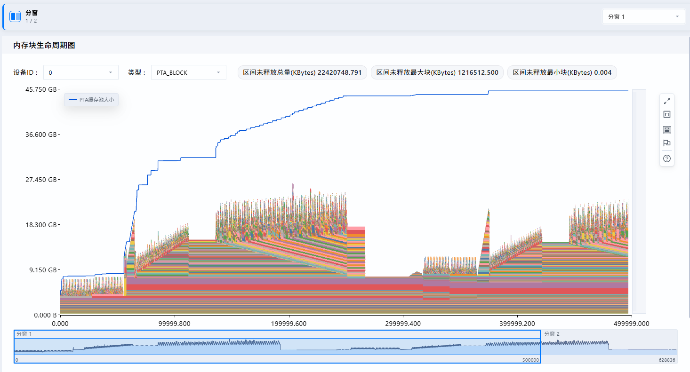

- 区域二：如[**图 2**  内存快照内存池状态图](#内存快照内存池状态图)所示。内存池状态图，当鼠标置于“内存块生命周期图”中，会显示一条时间线，在“内存块生命周期图”区域，单击时间线，会展示对应时间点的内存池状态图，具体使用说明请参见[内存池状态图展示](#内存池状态图展示)。

  **图 2**  内存快照内存池状态图<a id="内存快照内存池状态图"></a>

  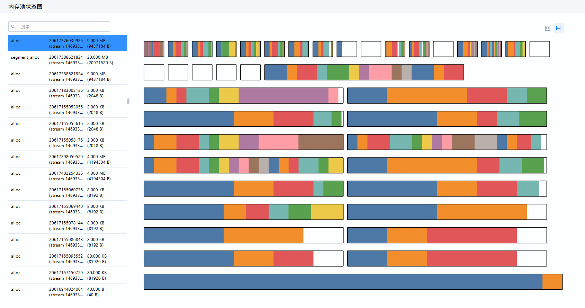

- 区域三：如[**图 3**  内存快照详情数据](#内存快照详情数据)所示。内存快照详情表，分为“内存块视图”和“内存事件视图”，可选择相应视图查看详情表，具体使用说明请参见[内存快照详情展示](#内存快照详情展示)。

  **图 3**  内存快照详情数据<a id="内存快照详情数据"></a>

  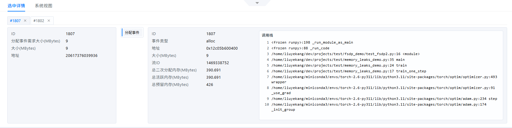

#### 使用说明

**通过选择分窗栏展示该分窗内数据**

通过点击分窗栏选择不同的分窗，显示对应分窗下的数据。选择分窗后，内存快照内存块生命周期图、内存快照内存池状态图、内存快照详情数据均展示该分窗下对应的数据，具体如[**图 4** 分窗栏选择](#分窗栏选择)所示。

**图 4**  分窗栏选择<a id="分窗栏选择"></a>

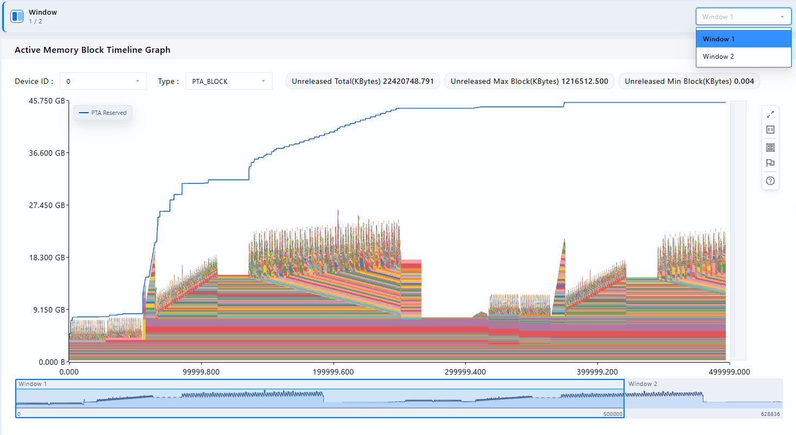

**内存块生命周期图支持查看指定时间范围内数据**

MindStudio Insight 内存块生命周期图通过控制下方内存快照趋势图缩放条选择区域展示指定范围内数据，如[**图 5**  下方内存快照趋势图缩放条](#内存快照趋势图缩放条)所示。

**图 5**  内存快照趋势图缩放条<a id="内存快照趋势图缩放条"></a>

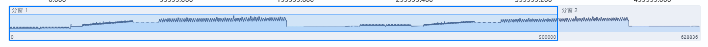

**趋势图缩放条支持趋势图可视化以及时间域选择多样化操作**

1. 趋势图可视化：

    MindStudio Insight 的内存快照趋势图缩放条所在背景呈现的是在整体时间范围下内存使用（Operator Allocated）情况的趋势图，直观地呈现选定时间范围内整个内存的使用情况趋势。

    > [!NOTE]
    >
    >Operator Allocated（算子分配）曲线表示算子在申请或释放内存时采集到的已分配内存的变化趋势，代表所有算子总的分配内存。

2. 时间域选择多样化操作：

    - 可通过平移缩放条的左右控制键选择时间起点以及终点，并展示对应内存情况。
    - 可选中整个趋势图范围内的任意范围以选中对应时间区间，并展示对应内存情况。
    - 可固定时间长度，拖拽左右平移查看固定时间长度下的对应内存情况。
    - 可通过趋势图缩放条选择不同分窗，展示不同分窗下的数据。

**支持标记差值对比功能**

鼠标悬停生命周期图内存块后点击`K`键或直接点击标记轴，完成内存块标记和取消标记，此时会在图右侧标记轴上展示或取消展示该标记，可同时标记多个内存块，并展示标记轴相邻两个标记的内存差值，如[**图 6** 差值比对](#差值比对)图例所示。

**图 6**  差值比对<a id="差值比对"></a>

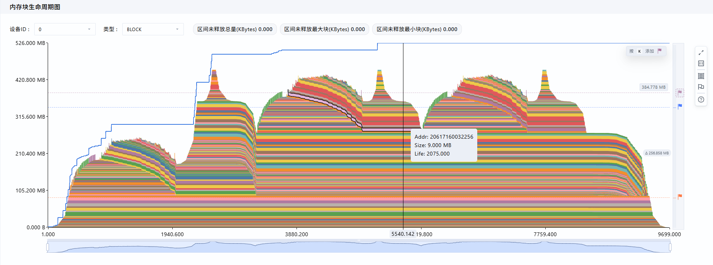

**生命周期图工具条使用说明**

- **缩放视图**：通过工具条切换等比或横向模式。滚轮按当前模式缩放；`W`键和`S`键横向缩放，`Ctrl`键 + `W`键/`S`键等比缩放。
- **平移视图**：拖拽图表完成平移，也可通过`A`键/`D`键或者方向键平移视图。
- **重置视图**：点击重置按钮，也可通过`R`键或者鼠标中键恢复完整视图。
- **图层管理**：点击分别显示或者隐藏**内存块图**、**reserved折线**以及**差值标记**，图层恢复显示时自动对齐当前视口。
- **差值标记**：点击右侧标记轴创建Flag；悬停内存块后点击`K`键添加或取消关联Flag。
- **标记管理**：集中重命名、隐藏、改色或删除Flag，隐藏差值标记不影响标记管理。

具体介绍也可通过界面右侧工具栏触发，如[**图 7** 生命周期图工具条指引](#生命周期图工具条指引)图例所示。

**图 7**  生命周期图工具条指引<a id="生命周期图工具条指引"></a>

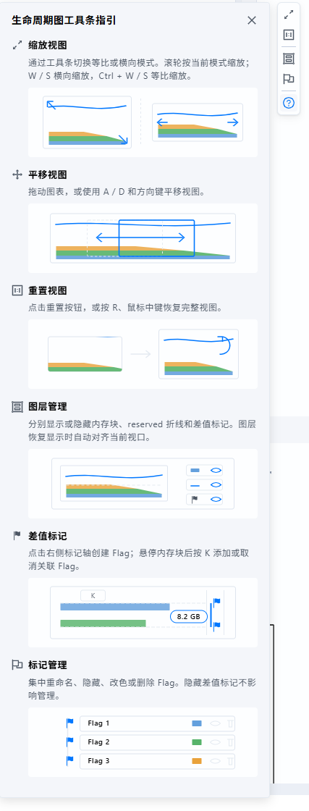

<a id="内存池状态图展示"></a>

**内存池状态图展示**

当鼠标置于“内存块生命周期图”中，在“内存块生命周期图”区域，单击内存色块，则会在“内存块生命周期图”下方展示对应时间点的事件总览以及内存池状态图。也可以通过搜索对应的地址精准定位事件详情，支持按照具体事件类型筛选数据，如[**图 8** 内存池状态图](#内存池状态图)所示。

> [!NOTE]
>
>若点击内存色块后内存池状态未更新，则说明该内存色块在生命周期中未被采集到申请事件。

**图 8**  内存池状态图<a id="内存池状态图"></a>

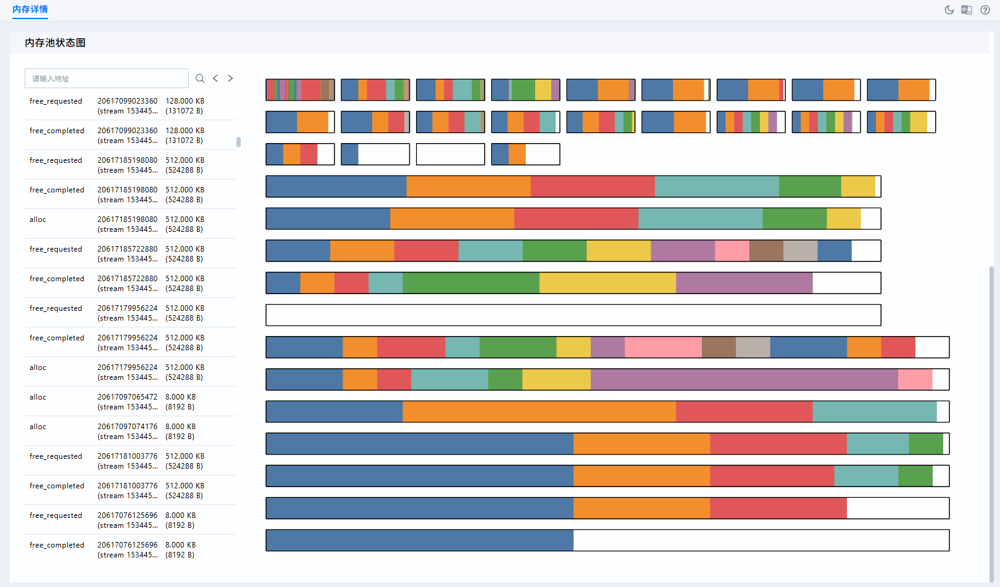

<a id="内存快照详情展示"></a>

**内存快照详情展示**

内存详情包含选中详情和系统视图两部分，其中选中详情展示该事件对应事件点的详情信息，系统视图下，通过“内存块视图”和“内存事件视图”分别展示内存的详细信息，默认展示所有内存相关信息。

> [!NOTE]
>
> - 系统默认隐藏内存详情展示。如需查看，需要点击上拉按键，将内存详情信息上拉展示。如无需查看内存详情信息，点击下拉按键，隐藏内存详情信息。
> - “内存块视图”中的“内存大小（KB）”和“分配事件需求大小（KB）”字段，“内存事件视图”中的“内存大小（KB）”、“总二次分配内存（KB）”、“总活跃内存（KB）”和“总预留内存（KB）”字段，单击，可输入最小值和最大值进行区间筛选。

- 内存块视图：展示缩放条选中区间内存块的详细信息，如[**图 9**  快照内存块视图](#快照内存块视图)所示，字段解释如[**表 1**  快照内存块视图字段说明](#快照内存块视图字段说明)所示。鼠标悬浮在视图中，右上角会浮现按钮，单击复制表中当前所展示的内容。

    **图 9**  快照内存块视图<a id="快照内存块视图"></a>

    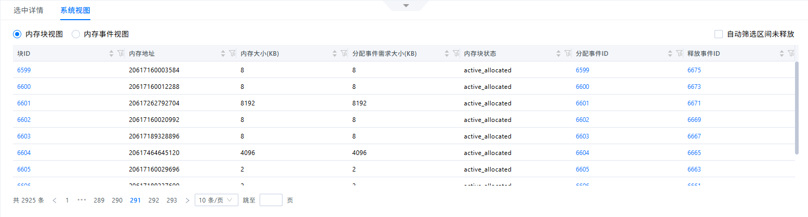

    **表 1**  快照内存块视图字段说明<a id="快照内存块视图字段说明"></a>

    |字段名称|可选/必选|释义|类型|示例值|额外说明|
    |--|--|--|--|--|--|
    |ID|必选|内存块ID，唯一标识内存块。|整数|0|可通过点击ID跳转至内存生命周期图对应的内存块并高亮。<ul><li>值为负数代表该内存块申请事件在内存快照采集生命周期中未被记录（负数大小无实际含义）</li><br><li>值为非负数时代表内存块申请事件ID。</li></ul>|
    |Requested Size(KB)|必选|内存块申请大小，单位为 KB 。|浮点数|12.5|分配事件需求的内存大小。PTA会基于申请大小进行padding和对齐，所以分配大小可能会大于申请大小。|
    |Size(KB)|必选|内存事件操作的内存大小，单位为 KB 。|浮点数|12.5|实际分配给内存块的内存大小，单位为 KB 。其值大于或等于申请大小。|
    |Address|必选|内存事件地址。|0x十六进制地址|0x7f9f00000000|内存块在内存中的地址。|
    |State|必选|内存块状态。|枚举中的一个，详情参考说明。|`active_allocated`|内存块的当前状态，包括：<br><ul><li>`active_allocated`：内存块已被分配且正在被使用，不可以被复用。</li><br><li>`active_pending_free`：内存块已被释放请求，但（可能因跨流依赖）尚未完成释放，仍然不可以被复用。</li><br><li>`inactive`：未被分配状态的内存块（或内存块已被释放完成），可以被复用。</li></ul>|
    |Alloc Event ID|可选|内存块申请事件ID。|整数|1|内存块申请事件ID，唯一标识内存块的申请事件。**值为-1代表该内存块的申请事件在内存快照采集生命周期中未被记录**。可点击内存块申请事件ID跳转至内存池状态图对应的事件并高亮。|
    |Free Event ID|可选|内存块释放完成事件ID。|整数|2|内存块释放完成事件ID，唯一标识内存块的释放事件。**值为-1代表该内存块的释放完成事件在内存快照采集生命周期中未被记录**。可点击内存块释放完成事件ID跳转至内存池状态图对应的事件并高亮。|

  内存块视图提供“**自动筛选区间未释放**”功能，该功能的筛选逻辑如下：

    - 未勾选该功能，展示所有申请释放区间与缩放条选中区间有交集的内存块详情，具体示意图如[**图 10** 自动筛选区间未释放展示逻辑示意图](#自动筛选区间未释放展示逻辑示意图)中“开启前”所示，实际效果图如[**图 11** 未勾选自动筛选区间未释放内存块视图](#未勾选自动筛选区间未释放内存块视图)。

    - 勾选该功能，展示所有在缩放条选中区间内存块申请但未释放的内存块详情；用于识别潜在的泄露 tensor 占用内存块，具体示意图如[**图 10** 自动筛选区间未释放展示逻辑示意图](#自动筛选区间未释放展示逻辑示意图)中“开启后”所示，实际效果图如[**图 12** 勾选自动筛选区间未释放内存块视图](#勾选自动筛选区间未释放内存块视图)。

      **图 10**  自动筛选区间未释放展示逻辑示意图<a id="自动筛选区间未释放展示逻辑示意图"></a>

      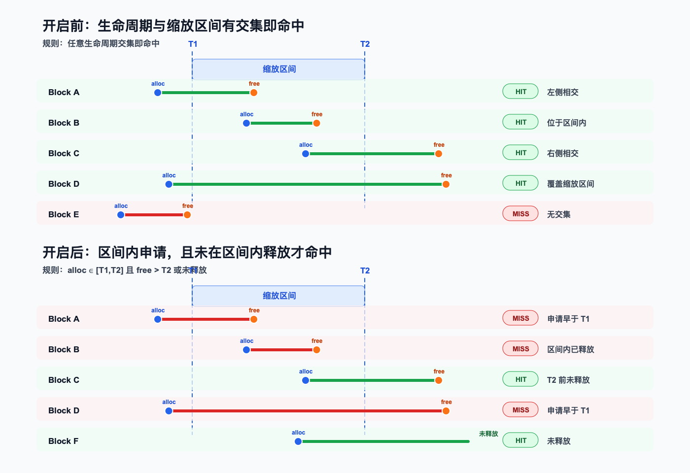

      **图 11**  未勾选自动筛选区间未释放内存块视图<a id="未勾选自动筛选区间未释放内存块视图"></a>

      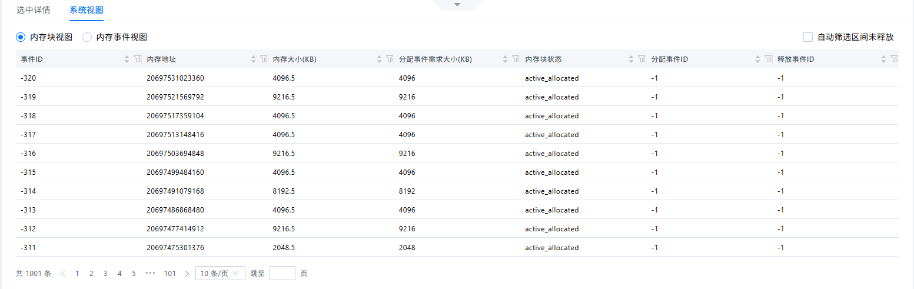

      **图 12**  勾选自动筛选区间未释放内存块视图<a id="勾选自动筛选区间未释放内存块视图"></a>

      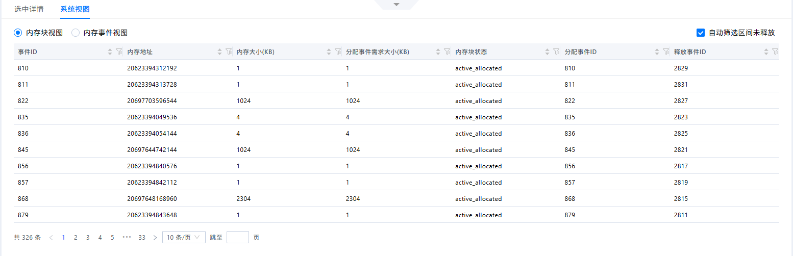

- 内存事件视图：展示缩放条选中区域内存事件的详细信息，如[**图 13**  快照内存事件视图](#快照内存事件视图)所示，字段解释如[**表 2**  快照内存事件视图字段说明](#快照内存事件视图字段说明)所示。鼠标悬浮在视图中，右上角会浮现按钮，单击复制表中当前所展示的内容。

    当在“内存块生命周期图”中选择不同“设备ID”时，内存事件视图的展示信息也会随之更新；当框选“内存块生命周期图”中部分区域展示时，内存事件视图的信息也会随之更新，展示的是框选时间范围内的所有内存事件。

    **图 13**  快照内存事件视图<a id="快照内存事件视图"></a>

    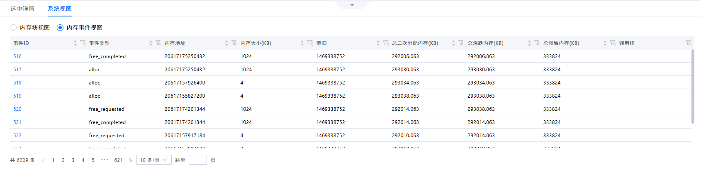

    **表 2**  快照内存事件视图字段说明<a id="快照内存事件视图字段说明"></a>

    |字段名称|可选/必选|释义|类型|示例值|额外说明|
    |--|--|--|--|--|--|
    |ID|必选|内存事件ID，唯一标识内存事件。|整数|0|可点击内存事件ID，跳转至内存池状态图对应的事件并高亮。|
    |Action|必选|内存事件操作类型。|枚举中的一个，详情参考说明。|alloc|<ul><li>内存段操作：</li><br><ul><li>`segment_alloc`：内存段申请事件，会触发PTA内存池从驱动申请物理内存，触发扩容。</li><br><li>`segment_free`：内存段释放事件，会触发PTA内存池释放物理内存，触发缩容。</li><br><li>`segment_map`：内存段映射事件，开启虚拟内存场景，会触发PTA内存池将物理内存映射到虚拟地址空间。</li><br><li>`segment_unmap`：内存段取消映射事件，开启虚拟内存场景，会触发PTA内存池取消将物理内存映射到虚拟地址空间。</li></ul><li>内存块操作：</li><br><ul><li>`alloc`：内存块申请事件，PTA从内存池中查找可用的inactive状态的内存块，进行二次分配。</li><br><li>`free_requested`：内存块释放请求事件，PTA内存池将内存块状态设置为active_pending_free，等待后续释放。</li><li>`free_completed`：内存块释放完成事件，PTA内存池将内存块状态设置为inactive，释放给内存池。</li></ul><li>算子workspace快照：`workspace_snapshot`。</li></ul>|
    |Address|必选|内存事件地址。|0x十六进制地址|0x7f9f00000000|内存事件操作的内存地址。|
    |Size(KB)|必选|内存事件操作的内存大小，单位为 KB 。|浮点数|12.5|无|
    |Stream|必选|内存事件所属的流ID。|整数|0|无|
    |Allocated(KB)|必选|事件发生后的PTA内存池总二次分配大小，单位为 KB 。|浮点数|12.5|所有Segment中所有的active_allocated状态的block总大小， 反映事件发生时刻，PTA内存池中已二次分配给tensor实际使用的内存大小。|
    |Active(KB)|必选|事件发生后的PTA内存池总活跃内存大小，单位为 KB 。|浮点数|12.5|所有Segment中所有的active_allocated状态的block总大小， 反映事件发生时刻，PTA内存池中已二次分配给tensor实际使用的内存大小。|
    |Reserved(KB)|必选|事件发生后的PTA内存池总保留内存大小，单位为 KB 。|浮点数|12.5|其值为所有内存段Segment的大小总和。反映事件发生时刻，PTA内存池中实际从驱动申请，预留的内存大小。|
    |Call Stack|可选|内存事件调用栈。|字符串|`/home/xxx/test/demo.py: 60 main`|内存事件的调用栈，展示了内存事件发生时的触发调用栈，若为空可能是以下几种情况之一：<br><ul><li>_record_memory_history时未启用stacks。</li><br><li>该事件发生在反向backward时的autograd中，可能无调用栈信息。</li></ul>|

    > [!NOTE]
    >
    > 事件类型、事件子类型和名称字段的取值可参见《msMemScope内存采集》的“[命令行采集功能介绍](https://gitcode.com/Ascend/msmemscope/blob/master/docs/zh/user%5Fguide/memory%5Fprofile.md#%E5%91%BD%E4%BB%A4%E8%A1%8C%E9%87%87%E9%9B%86%E5%8A%9F%E8%83%BD%E4%BB%8B%E7%BB%8D)”章节的memscope\_dump\_\{timestamp\}.csv结果文件说明。

- 选中详情：支持查看多个详情信息，可通过点击内存块生命周期图中的色块，内存池状态图左侧事件列表的事件以及内存池状态图中的色块查看详情信息。详情信息主要分为以下三类，包括：
  - 事件类型选中详情，如[**图 14**  事件类型选中详情](#事件类型选中详情)所示，字段解释如[**表 3**  事件类型选中详情字段说明](#事件类型选中详情字段说明)所示，基础事件信息在左侧区域呈现，具体事件信息可切换事件类型查看。

    当在“内存块生命周期图”中单击任意时间点的视图，快照选中详情的展示信息也会随之更新。

    **图 14**  事件类型选中详情<a id="事件类型选中详情"></a>

    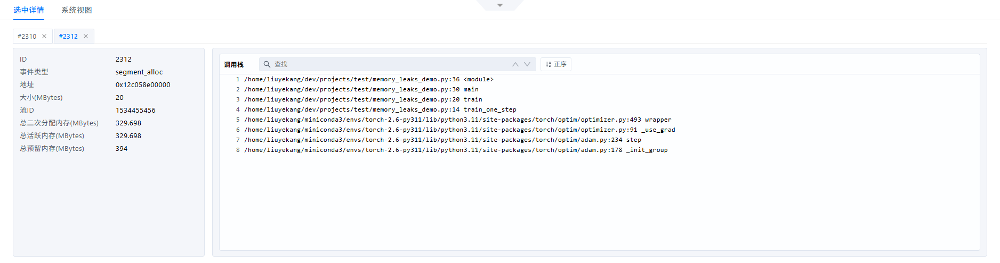

    **表 3**  事件类型选中详情字段说明<a id="事件类型选中详情字段说明"></a>

    |字段名称|可选/必选|释义|类型|示例值|额外说明|
    |--|--|--|--|--|--|
    |ID|必选|内存事件ID，唯一标识内存事件。可通过点击内存事件ID，跳转至内存池状态图对应的事件并高亮。|整数|0|可点击跳转至内存池状态图|
    |Action|必选|内存事件操作类型。|枚举中的一个，详情参考说明。|alloc|<ul><li>内存段操作：</li><br><ul><li>`segment_alloc`：内存段申请事件，会触发PTA内存池从驱动申请物理内存，触发扩容。</li><br><li>`segment_free`：内存段释放事件，会触发PTA内存池释放物理内存，触发缩容。</li><br><li>`segment_map`：内存段映射事件，开启虚拟内存场景，会触发PTA内存池将物理内存映射到虚拟地址空间。</li><br><li>`segment_unmap`：内存段取消映射事件，开启虚拟内存场景，会触发PTA内存池取消将物理内存映射到虚拟地址空间。</li></ul><li>内存块操作：</li><br><ul><li>`alloc`：内存块申请事件，PTA从内存池中查找可用的inactive状态的内存块，进行二次分配。</li><br><li>`free_requested`：内存块释放请求事件，PTA内存池将内存块状态设置为active_pending_free，等待后续释放。</li><li>`free_completed`：内存块释放完成事件，PTA内存池将内存块状态设置为inactive，释放给内存池。</li></ul><li>算子workspace快照：`workspace_snapshot`。</li></ul>|
    |Address|必选|内存事件地址。|0x十六进制地址|0x7f9f00000000|内存事件操作的内存地址。|
    |Size(MB)|必选|内存事件操作的内存大小，单位为 MB 。|浮点数|12.5|无|
    |Stream|必选|内存事件所属的流ID。|整数|0|无|
    |Caching Allocated(MB)|必选|事件发生后的PTA内存池总二次分配大小，单位为 MB 。|浮点数|12.5|所有Segment中所有的active_allocated状态的block总大小， 反映事件发生时刻，PTA内存池中已二次分配给tensor实际使用的内存大小。|
    |Caching Active(MB)|必选|事件发生后的PTA内存池总活跃内存大小，单位为 MB 。|浮点数|12.5|其值应为所有Segment中所有的active_allocated状态的block总大小与所有active_pending_free状态的block大小之和。反映事件发生时刻，PTA内存池中实际占用而无法被复用的内存大小。|
    |Caching Reserved(MB)|必选|事件发生后的PTA内存池总保留内存大小，单位为 MB 。|浮点数|12.5|其值为所有内存段Segment的大小总和。反映事件发生时刻，PTA内存池中实际从驱动申请，预留的内存大小。|
    |Call Stack|可选|内存事件调用栈。|字符串|`/home/xxx/test/demo.py: 60 main`|内存事件的调用栈，展示了内存事件发生时的触发调用栈，若为空可能是以下几种情况之一：<br><ul><li>_record_memory_history时未启用stacks。</li><br><li>该事件发生在反向backward时的autograd中，可能无调用栈信息。</li></ul>|

  - Block类型选中详情，如[**图 15**  Block类型选中详情](#Block类型选中详情)所示，字段解释如[**表 4**  Block类型选中详情字段说明](#Block类型选中详情字段说明)所示，基础事件信息在左侧区域呈现，具体事件信息可切换事件类型查看。

    **图 15**  Block类型选中详情<a id="Block类型选中详情"></a>

    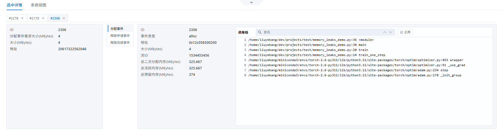

    **表 4**  Block类型选中详情字段说明<a id="Block类型选中详情字段说明"></a>

    |中文字段|英文字段|可选/必选|说明|
    |-|-|-|-|
    |ID|ID|必选|block id标识，若大于零则表示申请事件id，若小于零则表示该块未采集到申请事件，具体负值大小无含义。|
    |分配事件需求大小|Requested Size(MB)|必选|实际触发该block分配的申请事件所需内存大小，因对齐等原因，block实际大小会略大于申请事件所需大小，单位为MB。|
    |大小|Size(MB)|必选|块大小，单位为MB。|
    |地址|Address|必选|块内存地址，16进制。|

  - segment类型选中详情，如[**图 16**  segment类型选中详情](#segment类型选中详情)所示，字段解释如[**表 5**  segment类型选中详情字段说明](#segment类型选中详情字段说明)所示，基础事件信息在左侧区域呈现，具体事件信息可切换事件类型查看。

    **图 16**  segment类型选中详情<a id="segment类型选中详情"></a>

    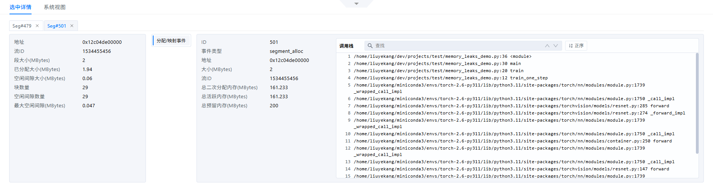

    **表 5**  segment类型选中详情字段说明<a id="segment类型选中详情字段说明"></a>

    |中文字段|英文字段|可选/必选|说明|
    |-|-|-|-|
    |地址|Address|必选|segment内存地址，16进制。|
    |流id|Stream|必选|stream id，与地址共同标识一个唯一的segment。|
    |段大小|Segment Size(MB)|必选|segment总大小，单位为MB。|
    |已分配大小|Allocated Size(MB)|必选|segment中已（以block的形式）二次分配出去的内存，即实际被占用，暂时无法被复用的内存大小，等于所有活跃内存块大小总和，单位为MB。|
    |空间间隙大小|Gap Size(MB)|必选|segment中块与块之间地址不连续而存在间隙gap，该值标识内存段中总的间隙大小，等于“段大小 - 已分配大小”的值，单位为MB。|
    |块数量|Block Count|必选|已二次分配的活跃block数量。|
    |空间间隙数量|Gap Count|必选|块与块之间gap的数量。|
    |最大空闲间隙|Max Gap Size(MB)|必选|最大gap的大小，单位为MB。|
