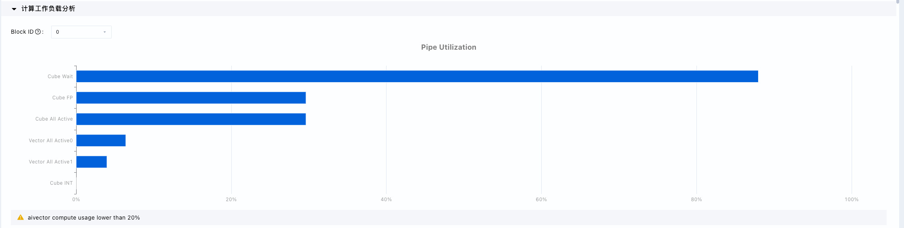
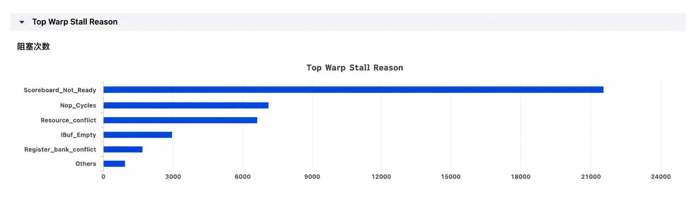
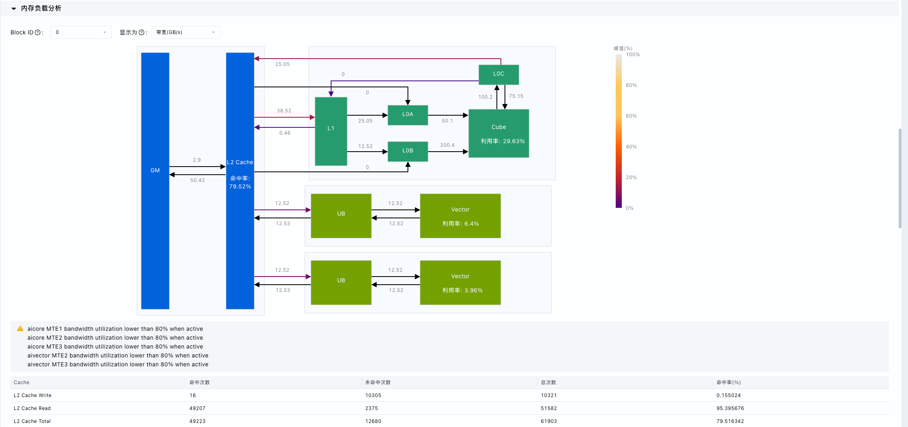

# 详情（Details）

## 功能说明

详情（Details）界面用于展示算子基础信息、计算负载分析、核间负载分析、Roofline瓶颈分析、Top Warp Stall Season和内存负载分析，并以图形和数据窗格呈现方式展示分析结果。

## 界面介绍

详情（Details）界面包含如下六个区域：

- 区域一：基础信息（Base Info），如[**图 1** 基础信息](#基础信息)所示。
- 区域二：核间负载分析（Core Occupancy），如[**图 2** 核间负载分析](#核间负载分析)所示。
- 区域三：Roofline瓶颈分析（Roofline），如[**图 3** Roofline瓶颈分析-内存单元](#内存单元)所示。
- 区域四：计算工作负载分析（Compute Workload Analysis），如[**图 7** 计算工作负载分析](#计算工作负载分析)所示。
- 区域五：Top Warp Stall Season，如[**图 8** Top Warp Stall Season](#TopWarpStallSeason)所示。
- 区域六：内存负载分析（Memory Workload Analysis），如[**图 9** 内存负载分析](#内存负载分析)所示。

**基础信息（Base Info）**

区域一是基础信息（Base Info），可查看算子基础信息，包含名称、时长、类型等内容，详细说明如[**表 1**  基础信息字段说明](#基础信息字段说明)所示。

**图 1**  基础信息

**表 1**  基础信息字段说明

|中文字段|英文字段|说明|
|--|--|--|
|名称|Name|算子名称。|
|时长 (μs)|Duration (μs)|算子总耗时。|
|算子类型|Op Type|算子类型。有mix、vector、cube和AiCore四种类型。|
|设备号|Device Id|设备id。|
|进程号|Pid|进程号。|
|Block数量|Block Dim|Sub Block的数量。当算子类型为vector、cube和AiCore时，为此参数名称。|
|混合Block数量|Mix Block Dim|Sub Block的数量。当算子类型为mix时，为此参数名称。|
|Block详情|Block Detail|Sub Block耗时详情。当算子类型为vector、cube和AiCore时，为此参数名称，其中字段解释如[**表 2**  Block详情字段说明](#Block详情字段说明)所示。|
|混合Block详情|Mix Block Detail|Sub Block耗时详情。当算子类型为mix时，为此参数名称，其中字段解释如[**表 3**  混合Block详情字段说明](#混合Block详情字段说明)所示。|

**表 2**  Block详情字段说明

|中文字段|英文字段|说明|
|--|--|--|
|Block ID|Block ID|Sub Block序号。当算子类型为AiCore时，无此参数。|
|计算核类型|Core Type|Sub Block类型。|
|时长(μs)|Duration (μs)|Sub Block耗时。|

**表 3**  混合Block详情字段说明

|中文字段|英文字段|说明|
|--|--|--|
|Block ID|Block ID|Sub Block序号。|
|Cube0时长(μs)|Cube0 Duration (μs)|AI Core的cube核耗时。|
|Vector0时长(μs)|Vector0 Duration (μs)|AI Core的其中一个vector核耗时。|
|Vector1时长(μs)|Vector1 Duration (μs)|AI Core的另外一个vector核耗时。|

**核间负载分析（Core Occupancy）**

区域二是核间负载分析（Core Occupancy），分别通过时钟周期数量、核总吞吐量、Cache命中率展示核间负载并进行分析，如[**图 2**  核间负载分析](#核间负载分析)所示。

可分别选择时钟周期（Cycles）、吞吐量（Throughput）或Cache命中率\(%\)（Cache Hit Rate\(%\)）显示Core的占用率，并展示分析结果，便于开发者定位分析异常点。

**图 2**  核间负载分析

> [!NOTE]
>
> - Atlas A3系列产品、Atlas A2系列产品和Ascend 950PR&950DT系列产品导出的性能数据支持此模块。
> - 核间负载均衡度分为10个等级，其中4至6级表示均衡度接近平均值，而0至3级和7至10级表示均衡度与平均值存在较大差异。

**Roofline瓶颈分析（Roofline）**

区域三是Roofline瓶颈分析（Roofline），通过Roofline模型图展示算子性能，并对其结果进行分析，为开发者提供性能优化依据。Roofline模型图中的x轴为算数强度，单位是Ops/Byte，表示每字节（Byte）内存支持的操作次数；y轴为性能，单位是TOps/s，表示每秒钟可进行多少万亿次操作。

Roofline模型图上会显示算力名称，用于描述计算最大算力的指令类型组成，例如Cube\_INT\(100.000000%\) + Vec\_FP16\(30.000000%\),Vec\_FP32\(70.000000%\)，代表此时cube计算单元处理的全是int类型指令，vector计算单元处理的指令30%是fp16类型，70%是fp32类型。

>[!NOTE]
>
> - 仅Ascend 950PR&950DT系列产品、Atlas A3系列产品、Atlas A2系列产品和Atlas推理系列产品支持此模块。
> - 当导入Ascend 950PR&950DT系列产品的数据时，Roofline模型图上将展示指令类型，可以结合图中参数进行筛选，以便查看Roofline模型图。

- 当硬件产品为Ascend 950PR&950DT系列产品、Atlas A3系列产品、Atlas A2系列产品时，Roofline性能模型分析包含内存单元、内存通路以及搬运单元页签。

    **内存单元**：显示HBM/L2和Memory Unit模型图，如[**图 3**  内存单元](#内存单元)所示，参数解释如[**表 4**  内存单元参数说明](#内存单元参数说明)所示。

    **图 3**  内存单元
    

    **表 4**  内存单元参数说明

    |参数|说明|
    |--|--|
    |HBM Read + Write|高带宽存储器单元的读与写。|
    |L2 Read + Write|L2的读与写。|
    |L1 Read + Write|L1内存单元的读与写。|
    |Write to L1|写至L1内存单元。|
    |Read from L1|从L1内存单元的读。|
    |Write to L0A|写至L0A内存单元。|
    |Write to L0B|写至L0B内存单元。|
    |Read from L0C|从L0C内存单元的读。|
    |UB Read + Write|UB内存单元的读与写。|
    |Read from UB|从UB内存单元的读。|
    |Write to UB|写至UB内存单元。|
    |Vector Read UB|Vector从UB内存单元的读。|
    |Vector Write UB|Vector写至UB内存单元。|

    **内存通路**：显示内存搬运通路图，如[**图 4**  内存通路](#内存通路)所示，参数解释如[**表 5**  内存通路参数说明](#内存通路参数说明)所示。

    **图 4**  内存通路
    

    **表 5**  内存通路参数说明

    |参数|说明|
    |--|--|
    |GM/L1 to L0A|GM/L1至L0A的内存通路。|
    |GM/L1 to L0B|GM/L1至L0B的内存通路。|
    |L0C to GM|L0C至GM的内存通路。|
    |L1 to GM|L1至GM的内存通路。|
    |L0C to L1|L0C至L1的内存通路。|
    |GM to UB|GM至UB的内存通路。|
    |UB to GM|UB至GM的内存通路。|

    **搬运单元**：显示Pipeline模型图，如[**图 5**  搬运单元](#搬运单元)所示，参数解释如[**表 6**  搬运单元参数说明](#搬运单元参数说明)所示。

    **图 5**  搬运单元
    

    **表 6**  搬运单元参数说明

    |参数|说明|
    |--|--|
    |MTE1|MTE1通路。|
    |MTE2|MTE2通路。|
    |MTE3|MTE3通路。|
    |FIXP|FIXP通路。|
    |MTE2 vector|Vector计算单元的MTE2通路。|
    |MTE3 vector|Vector计算单元的MTE3通路。|

- 当硬件产品为Atlas推理系列产品时，仅存在内存单元内容，如[**图 6**  内存单元模型图](#内存单元模型图)所示，参数解释如[**表 7**  内存单元参数说明](#内存单元参数说明-1)所示。

    **图 6**  内存单元模型图
    

    **表 7**  内存单元参数说明

    |参数|说明|
    |--|--|
    |L1 Read + Write|L1内存单元的读与写。|
    |Read from L0C|从L0C内存单元的读。|
    |Read from L1|从L1内存单元的读。|
    |Read from UB|从UB内存单元的读。|
    |UB Read + Write|UB内存单元的读与写。|
    |Vector Read UB|Vector从UB内存单元的读。|
    |Vector Write UB|Vector写至UB内存单元。|
    |Write to L0A|写至L0A内存单元。|
    |Write to L0B|写至L0B内存单元。|
    |Write to L1|写至L1内存单元。|
    |Write to UB|写至UB内存单元。|

**计算工作负载分析（Compute Workload Analysis）**

区域四是计算工作负载分析（Compute Workload Analysis），以柱状图和数据窗格呈现方式查看相应信息，便于开发人员分析。如[**图 7**  计算工作负载分析](#计算工作负载分析)所示，参数解释如[**表 8**  计算工作负载分析参数说明](#计算工作负载分析参数说明)所示，柱状图和数据窗格的参数是依据实际采集的数据进行展示。图标中的内容为各个Block的计算负载分析结果。

**图 7**  计算工作负载分析

**表 8**  计算工作负载分析参数说明

|中文参数|英文参数|说明|
|--|--|--|
|Block ID|Block ID|Sub Block序号。可通过切换Block ID来查看对应信息。当算子类型为AiCore时，此参数显示NA，展示的是多核平均值。|
|Pipe Utilization|Pipe Utilization|Pipe（指令队列）可视化，以柱状图方式展示。  - 横坐标：Cycles占比，计算方式为Cycles/总的Cycles。Cycles为该指令在Sub Block上执行消耗的时钟周期。  - 纵坐标：算子指令，由bin文件的数据中提供。|
|CUBE|CUBE|cube类型的指令名称。当算子类型为cube时，显示此参数。|
|CUBE0|CUBE0|cube类型的指令名称。当算子类型为mix时，显示此参数。|
|VECTOR|VECTOR|vector类型的指令名称。当算子类型为vector时，显示此参数。|
|VECTOR0|VECTOR0|vector类型的指令名称。当算子类型为mix时，显示此参数。|
|VECTOR1|VECTOR1|vector类型的指令名称。当算子类型为mix时，显示此参数。|
|AICORE|AICORE|AiCore类型的指令名称。当算子类型为AiCore时，显示此参数。|
|指令数|Instructions|算子指令数量。|
|时长(μs)|Duration(μs)|算子指令耗时。|
|数据搬运量(byte)|Data Volume(byte)|算子指令数据量。|

**Top Warp Stall Season**

区域五是Top Warp Stall Season图，主要展示指令在执行过程中，由于资源冲突、数据依赖等原因而产生的等待次数，包含active，如[**图 8**  Top Warp Stall Season](#TopWarpStallSeason)所示，参数解释见[**表 9**  Top Warp Stall Season参数说明](#TopWarpStallSeason参数说明)。

**图 8**  Top Warp Stall Season

**表 9**  Top Warp Stall Season参数说明

|中文参数|英文参数|说明|
|--|--|--|
|Nop阻塞|Nop_Cycles|空操作周期。|
|Divergence栈溢出阻塞|Divergence_Stack_Spill|分支发散栈溢出。在执行分支指令时，由于栈空间不足或分支路径导致的预测与实际路径不一致，从而引发的流水线阻塞周期。|
|IBuf空阻塞|IBuf_Empty|指令缓冲为空。指IBuf为空时，因无法获取下一条指令而导致的流水线阻塞周期。|
|寄存器冲突阻塞|Register_bank_conflict|寄存器Bank冲突。由于指令访问同一组寄存器时发生冲突，导致流水线暂停以避免数据错误的阻塞周期。|
|资源冲突阻塞|Resource_conflict|资源冲突。由于多个指令同时竞争同一硬件资源而无法并行执行，导致流水线暂停的阻塞周期。|
|ScoreBoard未准备阻塞|ScoreBoard_Not_Ready|记分牌未就绪。由于ScoreBoard状态尚未就绪（如前序指令仍在占用相关资源或寄存器），当前指令无法继续执行而导致的流水线阻塞。|
|Warp Level同步阻塞|Warp_Level_Sync|Warp级同步等待。在多线程执行中，为确保同Warp内线程的同步与一致性，在未满足同步条件时对指令执行进行的阻塞。|
|active|active|无阻塞成功发射指令的次数。|
|其他阻塞|Others|指除已明确分类的阻塞原因外，由其他异常或控制逻辑触发的流水线暂停周期。|

**内存负载分析（Memory Workload Analysis）**

区域六是内存负载分析（Memory Workload Analysis），以内存热力图和数据窗格呈现方式查看相应信息，如[**图 9**  内存负载分析](#内存负载分析)所示，参数配置如[**表 10**  参数配置说明](#参数配置说明)所示，内存热力图和数据窗格的参数是依据实际采集的数据进行展示。热力图右侧的“峰值\(%\)”为箭头颜色，值为峰值带占比（最大带宽占比）。图标中的内容为各个Block的内存负载分析结果。

**图 9**  内存负载分析

**表 10**  参数配置说明

|中文参数|英文参数|说明|
|--|--|--|
|Block ID|Block ID|Sub Block序号。在Block ID选框中可以选择想要查看的Sub Block。当算子类型为AiCore时，Block ID显示NA，展示的是多核平均值。|
|显示为|Show As|可选项，选择热力图连线箭头内容以请求数或者带宽展示。热力图箭头代表流向。  - 请求数（Num of Request）  - 带宽（Bandwidth）|

数据窗格呈现内容随算子类型而变化，其内容是基于bin文件的数据解析结果，具体呈现如下：

- 当算子类型为AiCore时，表格窗格参数解释如[**表 11**  AiCore类型参数说明](#AiCore类型参数说明)所示。

    **表 11**  AiCore类型参数说明

    |中文参数|英文参数|说明|
    |--|--|--|
    |Cache|Cache|L2缓存。|
    |Cube|Cube|cube计算单元。|
    |HBM|HBM|高带宽存储器单元。|
    |L0A|L0A|L0A储存单元。|
    |L0B|L0B|L0B储存单元。|
    |L0C|L0C|L0C储存单元。|
    |L1|L1|L1储存单元。|
    |Pipe|Pipe|计算通路。|
    |UB|UB|UB储存单元。|
    |Vector|Vector|vector计算单元。|
    |请求数|Requests|操作数量。|
    |吞吐量(GB/s)|Throughput(GB/s)|吞吐量，表示通路每秒的传输数据量，单位为GB/s。|

- 当算子类型为mix时，表格窗格参数解释如[**表 12**  mix类型参数说明](#mix类型参数说明)所示。

    **表 12**  mix类型参数说明

    |中文参数|英文参数|说明|
    |--|--|--|
    |Cache|Cache|L2缓存。|
    |命中次数|Hit|cache命中次数。|
    |未命中次数|Miss|cache未命中后重新分配缓存的次数。|
    |总次数|Total|cache请求总次数。|
    |命中率(%)|Hit Rate(%)|cache命中率。|
    |Cube|Cube|cube计算单元。|
    |HBM Cube|HBM Cube|cube单元的高带宽存储器单元。|
    |HBM Vector Core0|HBM Vector Core0|Aicore内core0的vector单元的高带宽存储器单元。|
    |HBM Vector Core1|HBM Vector Core1|Aicore内core1的vector单元的高带宽存储器单元。|
    |Scalar|Scalar|Scalar计算单元。|
    |Scalar Cube|Scalar Cube|cube单元的Scalar计算单元。|
    |Scalar Vector Core0|Scalar Vector Core0|Aicore内core0的vector单元的Scalar计算单元。|
    |Scalar Vector Core1|Scalar Vector Core1|Aicore内core1的vector单元的Scalar计算单元。|
    |L0A|L0A|L0A储存单元。|
    |L0B|L0B|L0B储存单元。|
    |L0C|L0C|L0C储存单元。|
    |L1|L1|L1储存单元。|
    |请求数|Requests|操作数量。|
    |吞吐量(GB/s)|Throughput(GB/s)|吞吐量，表示通路每秒的传输数据量，单位为GB/s。|
    |峰值（最大带宽占比）(%)|Peak(%)|与理论带宽的比率。|
    |Pipe Cube|Pipe Cube|cube单元的计算通路。|
    |Pipe Vector Core0|Pipe Vector Core0|Aicore内core0的vector单元的计算通路。|
    |Pipe Vector Core1|Pipe Vector Core1|Aicore内core1的vector单元的计算通路。|
    |指令数|Instructions|指令数量。|
    |时钟周期|Cycle|通路消耗的时钟周期。|
    |Time(μs)|Time(μs)|Scalar计算单元的运行时间。|
    |等待周期|Wait Cycles|对应pipe上被阻塞的cycle数。|
    |活跃率（%）|Active Rate(%)|运行cycle数占总的cycle的百分比。|
    |UB Core0|UB Core0|mix算子Aicore内core0的ub储存单元。|
    |UB Core1|UB Core1|mix算子Aicore内core1的ub储存单元。|
    |Vector Core0|Vector Core0|vector计算单元。|
    |Vector Core1|Vector Core1|vector计算单元。|

- 当算子类型为vector时，表格窗格参数解释如[**表 13**  vector类型参数说明](#vector类型参数说明)所示。

    **表 13**  vector类型参数说明

    |中文参数|英文参数|说明|
    |--|--|--|
    |Cache|Cache|L2缓存。|
    |命中次数|Hit|cache命中次数。|
    |未命中次数|Miss|cache未命中后重新分配缓存的次数。|
    |总次数|Total|cache请求总次数。|
    |命中率(%)|Hit Rate(%)|cache命中率。|
    |HBM|HBM|高带宽存储器单元。|
    |Scalar|Scalar|Scalar计算单元。|
    |请求数|Requests|操作数量。|
    |吞吐量(GB/s)|Throughput(GB/s)|吞吐量，表示通路每秒的传输数据量，单位为GB/s。|
    |Pipe|Pipe|计算通路。|
    |指令数|Instructions|指令数量。|
    |时钟周期|Cycle|通路消耗的时钟周期。|
    |Time(μs)|Time(μs)|Scalar计算单元的运行时间。|
    |等待周期|Wait Cycles|对应pipe上被阻塞的cycle数。|
    |活跃率（%）|Active Rate(%)|运行cycle数占总的cycle的百分比。|
    |UB|UB|ub储存单元。|
    |Vector|Vector|vector计算单元。|
    |峰值（最大带宽占比）(%)|Peak(%)|与理论带宽的比率。|

- 当算子类型为cube时，表格窗格参数解释如[**表 14**  cube类型参数说明](#cube类型参数说明)所示。

    **表 14**  cube类型参数说明

    |中文参数|英文参数|说明|
    |--|--|--|
    |Cache|Cache|L2缓存。|
    |命中次数|Hit|cache命中次数。|
    |未命中次数|Miss|cache未命中后重新分配缓存的次数。|
    |总次数|Total|cache请求总次数。|
    |命中率(%)|Hit Rate(%)|cache命中率。|
    |Cube|Cube|cube计算单元。|
    |HBM|HBM|高带宽存储器单元。|
    |Scalar|Scalar|Scalar计算单元。|
    |L0A|L0A|L0A储存单元。|
    |L0B|L0B|L0B储存单元。|
    |L0C|L0C|L0C储存单元。|
    |L1|L1|L1储存单元。|
    |请求数|Requests|操作数量。|
    |吞吐量(GB/s)|Throughput(GB/s)|吞吐量，表示通路每秒的传输数据量，单位为GB/s。|
    |峰值（最大带宽占比）(%)|Peak(%)|与理论带宽的比率。|
    |Pipe|Pipe|计算通路。|
    |指令数|Instructions|指令数量。|
    |时钟周期|Cycle|通路消耗的时钟周期。|
    |Time(μs)|Time(μs)|Scalar计算单元的运行时间。|
    |等待周期|Wait Cycles|对应pipe上被阻塞的cycle数。|
    |活跃率（%）|Active Rate(%)|运行cycle数占总的cycle的百分比。|

## 使用说明

**查看Cycles**

在“Pipe Utilization”柱状图区域，鼠标滚动至对应指令柱状图上，会显示真实Cycles信息。如[**图 10**  查看Cycles](#查看Cycles)所示。

**图 10**  查看Cycles

**在Roofline模型性能图中查看算子性能**

在“Roofline瓶颈分析”区域的内存单元、内存通路或搬运单元的任意一个视图中，选择视图中对应的参数点，可悬浮显示该内存单元实际的性能信息，如[**图 11**  显示算子性能信息](#显示算子性能信息)所示，参数解释如[**表 15**  性能信息参数说明](#性能信息参数说明)所示。

**图 11**  显示算子性能信息

**表 15**  性能信息参数说明

|中文参数|英文参数|说明|
|--|--|--|
|带宽|Bandwidth|硬件的带宽上限。|
|算术强度|Arithmetic Intensity|对应x轴，表示单位内存可以支持的操作次数。|
|性能|Performance|对应y轴，表示单位时间的操作次数，每秒钟可进行多少万亿次操作。|
|性能百分比|Performance Ratio|性能百分比 = 算子运行的实际性能 / 硬件最佳性能。|

**支持算子间性能对比**

MindStudio Insight支持两算子间详情对比，可帮助开发者直观明了地查看两个算子间的差异，便于分析。进行算子详情比对前需要先设置基线算子和对比算子，设置操作可参考[数据对比](../basic_operations.md#管理数据)。

在算子对比模式下，详情（Details）界面分别从基础信息（Base Info）、核间负载分析（Core Occupancy）、计算工作负载分析（Compute Workload Analysis）、内存负载分析（Memory Workload Analysis）方面呈现对比数据。算子对比功能仅支持同类型的算子进行对比。

- 基础信息（Base Info）：对算子间的基础信息进行对比。
- 核间负载分析（Core Occupancy）：以对比数据为基准，如果对比数据中有核间负载分析数据，则界面支持显示；如果对比数据中无核间负载分析数据，则界面不显示核间负载分析内容。
- Roofline瓶颈分析（Roofline）：此模块暂不支持对比，如果对比数据中有此模块，在算子对比模式下，会显示对比数据中的内容。
- 计算工作负载分析（Compute Workload Analysis）：以柱状图和数据窗格呈现方式查看相应信息，柱状图中蓝色为对比数据，绿色为基线数据，数据窗格显示算子间的对比差异，单击“详情”列中“查看更多”，可展示基线数据和对比数据的详情，如[**图 12**  计算工作负载分析对比](#计算工作负载分析对比)所示。

    **图 12**  计算工作负载分析对比
    

- 内存负载分析（Memory Workload Analysis）：以内存热力图和数据窗格呈现方式查看相应信息，热力图中括号里的数据为基线数据，括号外的数据为对比数据，数据窗格显示算子间的对比差异，单击“详情”列中“查看更多”，可展示基线数据和对比数据的详情，如[**图 13**  内存负载分析对比](#内存负载分析对比)所示。

    **图 13**  内存负载分析对比
    
