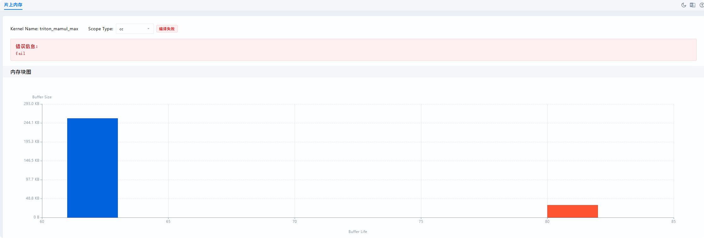
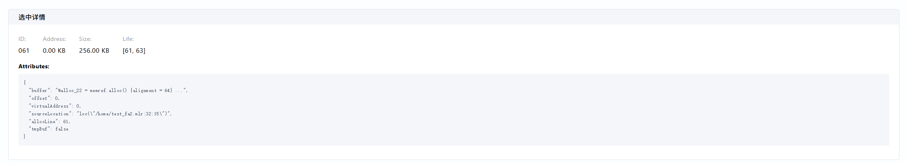
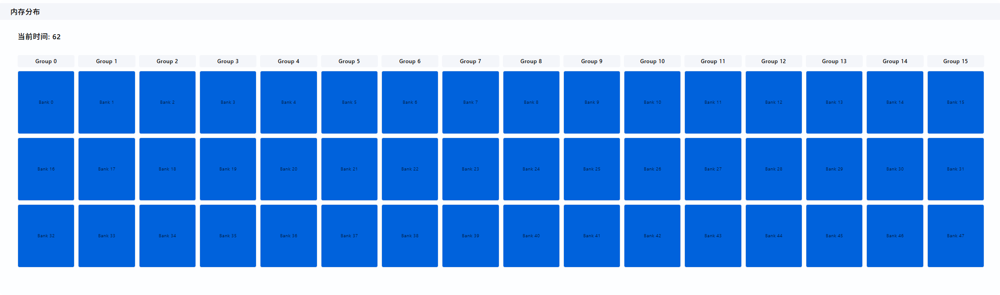

# 片上内存（On-Chip Memory）

## 功能说明

片上内存（On-Chip Memory）界面支持展示内存分布情况，便于用户了解内存分布情况以及对应的内存分布详情，分析UB（Unified Buffer）内存出现溢出的问题。

## 界面介绍

导入指定目录下的`memory_info.json`文件，出现片上内存（On-Chip Memory）界面，展示内存分布情况，如[**图 1** 片上内存-内存块图](#片上内存-内存块图)所示，点击内存块图中的色块，则会展现该内存块的内存详情以及内存分布，如[**图 2** 片上内存-选中详情](#片上内存-选中详情)以及[**图 3** 片上内存-内存分布](#片上内存-内存分布)所示。

 - [**图 1** 片上内存-内存块图](#片上内存-内存块图)，该图反映了随时间变化内存的使用情况，整体运行过程中内存的峰值以及碎片情况。横轴代表虚拟的执行顺序，每个时间单位相当于IR文件中的一行，纵轴代表片上内存的地址。图中每一个色块代表一块Tensor内存块。
 - [**图 2** 片上内存-选中详情](#片上内存-选中详情)，其中包括内存块大小、生命周期、申请位置以及是否为临时变量。
 - [**图 3** 片上内存-内存分布](#片上内存-内存分布)，反映内存在物理上的排布，便于用户进行内存调优，减少bank冲突。该图的布局理解，需要先了解昇腾芯片的内存布局，可以参考《Ascend C算子开发》文档中“[避免UB的bank冲突](https://www.hiascend.com/document/detail/zh/CANNCommunityEdition/910/programug/Ascendcopdevg/docs/guide/%E7%AE%97%E5%AD%90%E5%AE%9E%E8%B7%B5%E5%8F%82%E8%80%83/SIMD%E7%AE%97%E5%AD%90%E6%80%A7%E8%83%BD%E4%BC%98%E5%8C%96/%E5%86%85%E5%AD%98%E8%AE%BF%E9%97%AE/%E9%81%BF%E5%85%8DUB%E7%9A%84bank%E5%86%B2%E7%AA%81/%E6%A6%82%E8%BF%B0.md)”章节的内容介绍。

## 使用说明

导入指定目录下的`memory_info.json`文件，界面出现内存块图，如[**图 1** 片上内存-内存块图](#片上内存-内存块图)所示。基本信息将会在界面最上方展示，包括算子名称、内存类型、编译状态信息。可以通过切换内存类型查看对应的片上内存情况和编译状态。若编译失败，则会展示编译失败的错误信息，如[**图 4** 片上内存-基本信息](#片上内存-基本信息)所示。

点击[**图 1** 片上内存-内存块图](#片上内存-内存块图)中任意的内存块，则会展现该内存块的内存详情以及内存分布，如[**图 2** 片上内存-选中详情](#片上内存-选中详情)以及[**图 3** 片上内存-内存分布](#片上内存-内存分布)所示。

**图 1** 片上内存-内存块图

**图 2** 片上内存-选中详情

**图 3** 片上内存-内存分布

**图 4** 片上内存-基本信息

