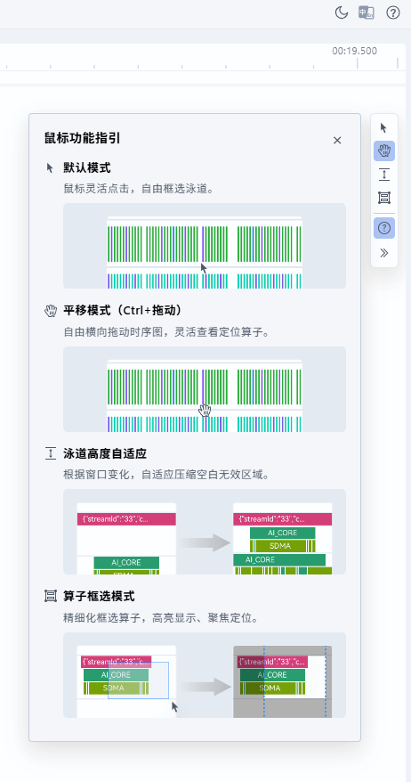

# 时间线（Timeline）

## 功能说明

在算子性能调优过程中，MindStudio Insight工具以时间线（Timeline）的呈现方式，将算子运行过程中，底层指令的详细执行情况平铺在时间轴上，直观呈现AI处理器每个Core上的每个Pipe中指令的调用顺序和耗时情况。通过分析时间线，用户可以通过查看指令详情、指令耗时等信息快速定位出性能瓶颈。

通过观察时间线视图各个层级上的耗时长短、间隙等判断对应指令和Pipe是否存在性能问题，如指令执行是否存在瓶颈、是否存在高耗时的指令等。

## 界面介绍

**界面展示**

时间线（Timeline）界面包含工具栏（区域一）、图形化展示（区域二）和数据窗格（区域三）三个部分，如[**图 1** 时间线界面](#时间线界面)所示。

**图 1** 时间线界面

- 区域一：工具栏，包含常用快捷按钮，从左至右依次为标记列表、过滤（支持按卡或按泳道过滤展示）、搜索、连线事件、重置缩放（页面复原）和时间轴缩小放大按钮。
- 区域二：图形化展示，左侧显示各Core的分层信息，一层级为Core，二层级为Pipe。右侧为时间线视图，逐行对时间线进行图形化展现，包括各指令执行序列和执行时长。具体泳道信息请参见[泳道信息](#泳道信息)。
- 区域三：数据窗格，统计信息或指令详情信息展示区，选中详情（Slice Detail）为选中单个指令的详细信息、选中列表（Slice List）为某一泳道选中区域的指令列表信息。

**泳道信息**

|泳道名称|说明|
|--|--|
|ALL|表示在这个通道的指令在所有通道都执行。|
|SCALAR|标量运算单元。|
|FLOWCTRL|控制流指令。|
|MTE1|数据搬运流水，数据搬运方向为：L1 ->{L0A/L0B, UB}。|
|CUBE|矩阵乘运算单元。|
|FIXP|数据搬运流水，数据搬运方向为：FIXPIPE L0C -> OUT/L1。  仅Atlas A2系列产品导出的性能数据支持展示。|
|MTE2|数据搬运流水，数据搬运方向为：{DDR/GM, L2} ->{L1, L0A/B, UB}。|
|VECTOR|向量运算单元。|
|MTE3|数据搬运流水，数据搬运方向为：UB -> {DDR/GM, L2, L1}、L1->{DDR/L2}。|
|CACHEMISS|未命中ICache。|
|USEMASK|自定义打点范围。|
|MTE Throughput|内存吞吐率信息。  - GM_TO_L1：GM往L1搬运的数据吞吐率。  - GM_TO_TOTAL：GM输出总数据吞吐率。  - GM_TO_UB：GM往UB搬运的数据吞吐率。  - L1_TO_GM：L1往GM搬运的数据吞吐率。  - TOTAL_TO_GM：GM输入总数据吞吐率。  - UB_TO_GM：UB往GM搬运的数据吞吐率。|

## 使用说明

### 基础功能

**悬浮工具栏**

时间线（Timeline）界面支持通过鼠标功能栏调整视图，界面如[图 2 悬浮工具栏](#悬浮工具栏)所示，主要功能如下：

1. 默认模式：鼠标可灵活点击，自由框选泳道。
2. 拖拽模式：自由横向拖拽时序图，灵活查看定位算子。
3. 泳道高度自适应：会根据窗口变化，自适应压缩空白无效区域，使视图展示更清晰。
4. 悬浮工具指引：对悬浮工具栏功能进行图文介绍。
5. 悬浮工具栏可以通过按键隐藏和展示。

    **图 2** 悬浮工具栏
    

**支持界面缩放**

时间线（Timeline）界面支持缩小、放大和左右移动等功能，具体操作如下所示：

- 单击时间线（Timeline）界面树状图或者图形化窗格任意位置，可以使用键盘中的W（放大）和S（缩小）键进行操作，支持放大的最大精度为1ns。
- 单击时间线（Timeline）界面树状图或者图形化窗格任意位置，使用键盘中的A（左移）、D（右移）键，或者方向键左键（左移）、右键（右移）进行左右移动，也可使用方向键上键（上移）、下键（下移）进行上下移动。
- 在图形化窗格中，使用键盘中的Alt键加鼠标左键可以使选中区域实现局部放大。
- 单击界面左上方工具栏中的（放大）和（缩小）实现缩放。
- 单击界面左上方工具栏中的可以一键恢复图形化窗格显示全部时间线视图。
- 将鼠标放置在时间线（Timeline）界面树状图或者图形化窗格任意位置，可以使用键盘中的Ctrl键加鼠标滚轮实现缩放操作。
- 在图形化窗格中，使用键盘中的Ctrl键加鼠标左键可以实现左右拖拽泳道图表。

    > [!NOTE]
    >
    > macOS系统中，需使用键盘上的Command键加鼠标滚轮实现缩放，Command键加鼠标左键实现左右拖拽泳道图表。

- 在图形化窗格中，可使用鼠标右键菜单进行缩放展示，具体功能参见[**表 1** 鼠标右键菜单功能](#鼠标右键菜单功能)。

    **表 1** 鼠标右键菜单功能

    |中文菜单|英文菜单|说明|操作|
    |--|--|--|--|
    |全屏显示|Fit to screen|将单个指令放大至屏幕可见范围最大宽度。如果未选中指令，则不显示该参数。|单击选中一个指令，单击鼠标右键，弹出菜单；单击全屏显示，可将选中指令放大至屏幕可见范围最大宽度。|
    |放大所选内容|Zoom into selection|将选定区域放大至屏幕可见范围最大宽度。如果无选定区域，则不显示该参数。|选定某个区域后，单击鼠标右键，弹出菜单；单击放大所选内容，可将选定区域放大至屏幕可见范围最大宽度。|
    |撤销缩放（0）|Undo Zoom(0)|撤销缩放，括号中的数字会随着缩放次数变化，初始状态为0。|在放大后的时间线（Timeline）界面，单击鼠标右键，弹出菜单；单击撤销缩放，界面缩小一次，括号中的数字会随之减一。|
    |重置缩放|Reset Zoom|重置缩放，将图表恢复至初始状态。|在放大后的时间线（Timeline）界面，单击鼠标右键，弹出菜单；单击重置缩放，图表重置，恢复至初始状态。|

**指令搜索功能**

MindStudio Insight在时间线（Timeline）界面支持指令搜索。

- 单击界面左上方工具栏中的，在弹出输入框中输入需要搜索的指令，然后按回车键，则会匹配对应的指令，搜索结果匹配指令总数，如[**图 3** 搜索指令总数](#搜索指令总数)所示，搜索到与名称中包含“mov”相关的指令总数为11754。

    **图 3** 搜索指令总数
    

- 单击界面左上方工具栏中的，可在搜索弹出输入框左侧分别单击和，开启大小写匹配和全词匹配功能，如[**图 4** 大小写匹配和全词匹配](#大小写匹配和全词匹配)所示。

    单击开启大小写匹配，输入需要搜索的信息，按回车键，则会匹配名称中包含搜索项的指令。

    单击开启全词匹配，输入需要搜索的信息，按回车键，则会匹配名称为搜索项的指令，但是会忽略大小写。

    当同时选中和时，开启大小写匹配和全词匹配功能，在输入框中输入需要搜索的指令名称，按回车键，则会精确匹配名称为搜索项的指令。

    **图 4** 大小写匹配和全词匹配
    

- 单击搜索框后方的切换按钮，可以查看上一个或者下一个匹配的指令，也可以在输入框后方输入具体的数字搜索其对应的指令，该指令将会被选中并显示在界面中部，如[**图 5** 定位指令](#定位指令)所示。

    **图 5** 定位指令
    

- 单击搜索框后方的“在查找窗口打开”，可跳转至界面下方的“查找”页签，展示所有搜索指令列表，如[**图 6** 在查找窗口打开](#在查找窗口打开-2)所示，字段解释如[**表 2** 字段说明](#字段说明)所示。单击“点击跳转Timeline”列的“点击”可跳转到指令在时间线视图上的具体位置。

    **图 6** 在查找窗口打开
    

    **表 2** 字段说明

    |中文字段|英文字段|说明|
    |--|--|--|
    |卡序号|Rank ID|卡序号，可以选择需要查看的数据文件。|
    |名称|Name|指令名称。|
    |开始时间|Start Time|指令执行起始时间。|
    |时长(ns)|Duration(ns)|指令运行总耗时。|
    |点击跳转Timeline|Click To Timeline|单击“点击”跳转到指令在时间线视图上的具体位置。|

### 性能数据展示

**设置和查看标记**

- 区域标记

  在时间线（Timeline）界面选中某个区域后，单击或敲击键盘K键将选中区域进行标记并保存，如[**图 7** 区域标记](#区域标记-4)所示。

  **图 7** 区域标记
  

  左键双击任一标记，可以设置该标记对的属性，支持修改标记对名称、颜色以及删除该标记对，如[**图 8** 修改标记对属性](#修改标记对属性-5)所示。

  **图 8** 修改标记对属性
  

- 单点标记

  在最上方空泳道的任意位置，单击鼠标左键或敲击键盘K键，将生成一个单点标记，如[**图 9** 单点标记](#单点标记-6)所示。左键双击标记，可以设置该标记的属性，支持修改标记的名称、颜色以及删除该标记。

  **图 9** 单点标记
  

- 标记管理

  单击左上方工具栏中的，将显示所有标记信息，如[**图 10** 查看标记信息](#查看标记信息-7)所示。

  **图 10** 查看标记信息
  

  - 单击某个标记对应的图标可删除标记。
  - 单击弹窗下方的“清空全部”可删除所有标记。
  - 单击区域标记，界面下方的“选中详情”页签会显示该区域的耗时信息详情。
  - 如果某一标记不在当前可视化界面，单击该标记对应的图标将直接跳转至标记界面，便于查看。
  - 单击某个标记对应的颜色图标可进行颜色设置，便于对标记进行分类管理。

**指令间同步连线功能**

- MindStudio Insight支持指令间同步连线关系（SET\_FLAG到WAIT\_FLAG）展示，单击有连线的指令，即可显示该指令关联的连线，即使折叠连线起点或者终点的Pipe，连线也不会消失，如[**图 11** 指令间连线](#指令间连线)所示。

    **图 11** 指令间连线
    

- MindStudio Insight支持全量连线的功能，单击界面左上方工具栏中的，在弹框中选择一个或多个连线类型，则在时间线视图中展示对应Pipe间的所有连线，如[**图 12** 全量连线](#全量连线-8)所示。

    > [!NOTE]
    >
    > 最多支持选择10个连线类型。

    **图 12** 全量连线
    

- 支持隐藏SET\_FLAG和WAIT\_FLAG指令。

    在算子展示区域，右键弹出菜单，选择“隐藏SET/WAIT事件”，可隐藏SET\_FLAG和WAIT\_FLAG指令，连线同时消失，如[**图 13** 隐藏SET/WAIT事件](#隐藏SET-WAIT事件)所示。

    **图 13** 隐藏SET/WAIT事件
    

    隐藏SET/WAIT事件后，再次右键弹出菜单，单击“显示SET/WAIT事件”，被隐藏的SET\_FLAG和WAIT\_FLAG指令随之出现，根据连线功能操作，可正常显示指令连线，如[**图 14** 显示SET/WAIT事件](#显示SET-WAIT事件)所示。

    **图 14** 显示SET/WAIT事件
    

### 页面调优展示

**泳道隐藏功能**

算子调优场景下的泳道隐藏功能可参见[泳道隐藏功能](../system_tuning/timeline.md#页面调优展示)执行操作。

**泳道高度自适应功能**

算子调优场景下的泳道高度自适应功能可参见[泳道高度支持自适应](../system_tuning/timeline.md#页面调优展示)执行操作。

### 统计信息展示

MindStudio Insight支持指令统计信息和单个指令详情信息查看。

- 使用鼠标左键可在单个Pipe级泳道，或跨多个Core泳道框选部分指令，框选部分区域指令后，可在下方选中列表显示指令的统计信息，如[**图 15** 选中列表](#选中列表-9)所示，字段解释如[**表 3** 选中列表字段说明](#选中列表字段说明)。

    当鼠标移入“选中列表”页签，单击按钮，可复制当前“选中列表”中所展示的内容，并粘贴至Excel表格中进行分析。

    单击“选中列表”列中的某个指令，在右侧“More”列表中将会显示此区域中与该指令同名的所有指令，单击“More”列表中某一行，则在时间线视图中定位出该指令的具体位置，并同时跳转至“选中详情”页面，可查看该指令的详情信息。

    **图 15** 选中列表
    

    **表 3** 选中列表字段说明

    |中文字段|英文字段|说明|
    |--|--|--|
    |名称|Name|指令名称。|
    |持续时间|Wall Duration|指令执行总耗时。|
    |平均持续时间|Average Wall Duration|指令平均执行时间。|
    |最大持续时间|Max Wall Duration|算子最大持续时间。|
    |最小持续时间|Min Wall Duration|算子最小持续时间。|
    |发生次数|Occurrences|指令调用次数。|
    |索引|Index|序号。|
    |开始时间|Start Time|在图形化窗格中的时间戳。|
    |时长(ms)|Duration(ms)|执行耗时。|

- 当选中单个指令时，可在下方选中详情显示该指令的详情信息，如[**图 16** 选中详情](#选中详情-10)所示，字段解释如[**表 4** 选中详情字段说明](#选中详情字段说明)所示。

    选中单个指令，使用M键，可框选该指令所属的时间线（Timeline）区域，再次按下M键，可取消框选。

    **图 16** 选中详情
    

    **表 4** 选中详情字段说明

    |中文字段|英文字段|说明|
    |--|--|--|
    |标题|Title|名称。|
    |开始|Start|起始时间。|
    |开始（原始时间戳）|Start(Raw Timestamp)|数据采集到的原始开始时间。|
    |持续时间|Wall Duration|总耗时。|
    |参数|Args|算子的相关参数信息，包括以下信息：  - code：代码调用栈。  - detail：指令源码。  - pc_addr：PC地址。|
