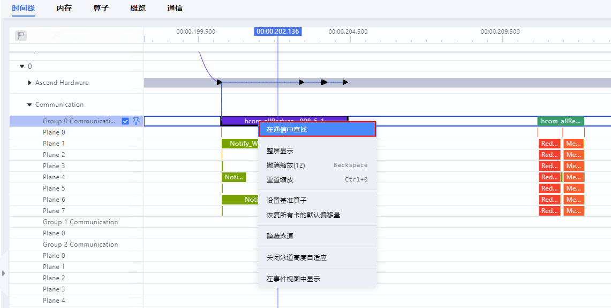

# 通信（Communication）

## 功能说明

通信（Communication）界面用于展示集群中全网链路性能以及所有节点的通信性能，通过集群通信与计算重叠时间的分析可以找出集群训练中的慢主机或慢节点。

## 界面介绍

通信（Communication）界面主要从两个维度来进行集群通信性能的展示，包括全网链路展示和以节点为粒度展示，分为通信矩阵（Communication Matrix）和通信耗时分析（Communication Duration Analysis）两部分进行数据展示。

**通信矩阵（Communication Matrix）**

通信矩阵（Communication Matrix），主要展示指定迭代通信域内通信算子的相关信息，包括带宽、通信时长、传输大小及链路方式等，如[**图 1** 通信矩阵](#通信矩阵)所示，参数解释请参见[**表 1** 通信矩阵字段说明](#通信矩阵字段说明)。

**图 1** 通信矩阵

**表 1** 通信矩阵字段说明

|中文字段|英文字段|说明|
|--|--|--|
|集群|Cluster|集群名称，当导入集群数据时，下拉框支持选择某一集群。|
|迭代ID|Step|迭代ID，下拉框支持选择某一个迭代。|
|通信域|Communication Group|通信域，下拉框支持选择一个、多个或者所有节点，对应纵坐标进行节点的展示。|
|算子名称|Operator Name|通信算子名称，下拉框支持选择“Total Op info”或某一类算子。  为方便查看，会对通信算子进行聚类统计，例如allreduce-total等分类。当分别选择top、bottom或middle等算子分类时，鼠标移至通信矩阵热力图中，选择任一窗格即可显示具体通信算子名称。  - Total Op info：为对选中的迭代ID和通信域中所有通信算子数据的统计和。  - total类：表示该类算子的平均带宽水平（某类通信算子的总传输量 / 总传输时间），推荐优先查看。  - top类：带宽最高的通信算子，topN即为前N高。  - middle类：带宽处于中位数的通信算子。  - bottom类：带宽最低的通信算子，bottomN即为前N低。|
|通信矩阵|Matrix Model|通信矩阵热力图。|
|通信矩阵类型|Communication Matrix Type|通信矩阵类型。  - 带宽(GB/s)（Bandwidth(GB/s)）：带宽。  - 传输大小（MB）（Transit Size(MB)）：通信尺寸。  - 链路方式（Transport Type）：链路类型。  - 传输时长(ms)（Transit Time(ms)）：通信时长。|
|显示卡内通信|Show Inner Communication|展示卡内通信数据。默认不勾选。|
|筛选范围|Visible Range|数据可视范围。默认为全量展示，可手动设置数据呈现区间。|
|Src Rank Id|Src Rank Id|Source Rank Id，横坐标为链路信息中源卡的Id。|
|Dst Rank Id|Dst Rank Id|Destination Rank Id，纵坐标为链路信息中目的卡的Id。|

**通信耗时分析（Communication Duration Analysis）**

通信耗时分析（Communication Duration Analysis），主要展示节点的通信性能，包括通信算子缩略图、通信时长、数据分析以及专家建议等，如[**图 2** 通信耗时分析](#通信耗时分析)所示，参数解释请参见[**表 2** 通信耗时分析字段说明](#通信耗时分析字段说明)。

**图 2** 通信耗时分析

**表 2** 通信耗时分析字段说明

|中文字段|英文字段|说明|
|--|--|--|
|集群|Cluster|集群名称，当导入集群数据时，下拉框支持选择某一集群。|
|迭代ID|Step|迭代ID，下拉框支持选择某一个迭代。必选。|
|通信域|Communication Group|通信域，可在下拉框选择或搜索支持选择一个、多个或者所有节点，对应纵坐标进行节点的展示。必选。|
|算子名称|Operator Name|通信算子名称，下拉框支持选择“Total Op info”或某一个算子；其中Total Op info为对选中的“迭代ID”和通信域中所有通信算子数据的统计和。必选。|
|通信矩阵|Communication Matrix|通信矩阵。必选，与通信耗时分析任选其一。|
|通信耗时分析|Communication Duration Analysis|通信耗时分析。必选，与通信矩阵任选其一。|
|通信算子缩略图|Communication|展示通信算子的执行顺序和执行时间，缩略图下方展示慢卡信息，具体信息请参见[支持快速分析并定位异常通信算子](#支持快速分析并定位异常通信算子)。|
|Rank ID|Rank ID|通信算子缩略图中的纵坐标表示卡序号。|
|Time(ms)|Time(ms)|通信算子缩略图中的横坐标表示算子运行时间，单位ms。|
|通信时长|Visualized Communication Time|可视化通信时长图。|
|Time(ms)|Time(ms)|通信时长图表中的左侧纵坐标表示时长，单位ms。|
|Ratio|Ratio|通信时长图表中的右侧纵坐标表示耗时占比。|
|通信时长数据分析|Data Analysis of Communication Time|算子的通信时长数据分析。鼠标移入表格中，单击按钮，一键复制表中当前所展示的内容，并粘贴至Excel表格中进行分析。|
|卡序号|Rank ID|卡序号。|
|总时间(ms)|Elapsed Time(ms)|通信算子所有事件总耗时。|
|传输时间(ms)|Transit Time(ms)|通信时长。表示通信算子的通信耗时，统计SDMA链路（server内通信）和RDMA链路（server间通信）的通信算子总耗时。如果通信耗时过长，可能是某条链路存在问题。|
|同步时间(ms)|Synchronization Time(ms)|同步时长。卡间第一次通信前节点之间进行同步需要的时长，用来区分等待时间过长是慢节点还是慢链路造成的。|
|等待时间(ms)|Wait Time(ms)|等待时长。节点之间通信前首先需要进行同步，确保通信的两个节点同步完成，再进行通信。|
|同步时间占比|Synchronization Time Ratio|同步时长占比。同步时长占比（Synchronization Time Ratio） = 同步时长（Synchronization Time） / (同步时长（Synchronization Time） + 通信时长（Transit Time）)，通信前的同步时长占比越大说明通信效率越低，可能存在慢卡的情况。|
|等待时间占比|Wait Time Ratio|通信算子的等待时长占比。等待时长占比（Wait Time Ratio） = 等待时长（Wait Time）/ (等待时长（Wait Time） + 通信时长（Transit Time）)，等待时长占比越大代表该节点的等待时长占总通信耗时越长，通信效率越低。|
|空闲时间(ms)|Idle Time(ms)|通信算子下发耗时。通信算子下发耗时（Idle Time）= 算子的通信总耗时（Elapsed Time）- 通信时长（Transit Time）- 等待时长（Wait Time）。|
|SDMA带宽(GB)|SDMA BW(GB)|SDMA带宽。|
|RDMA带宽(GB)|RDMA BW(GB)|RDMA带宽。|
|带宽分析|Bandwidth Analysis|带宽分析。单击对应的“查看更多”后可查看对应节点指定算子的带宽详情，如[**图 3** 带宽分析](#带宽分析)所示。|
|通信算子详情|Communication Operators Details|通信算子的详情，当“算子名称”选择“Total Op info”时可见。单击对应的查看更多后可查看对应节点通信算子的链路详情，如[**图 4** 通信算子详情](#通信算子详情)所示。|
|专家建议|Advice|对导入的数据进行分析并给出合理的专家建议。分别从带宽、字节对齐、通信重传，以及通信小包维度进行分析，并给出合理建议和优化策略，如[**图 5** 专家建议](#专家建议)所示。|

**图 3** 带宽分析

带宽分析页面是以全网链路为粒度展示通信性能，包括通信时长、通信量、带宽以及链路类型等，图中各字段解释如[**表 3** 带宽分析字段说明](#带宽分析字段说明)所示。

**表 3** 带宽分析字段说明

|中文字段|英文字段|说明|
|--|--|--|
|包数量|Packet Number|通信包数量。|
|包大小（MB）|Packet Size(MB)|通信包大小。|
|链路方式|Transport Type|链路方式。|
|SDMA|SDMA|SDMA链路（节点内Device间通信链路），包括HCCS、PCIE和SIO三种类型。|
|RDMA|RDMA|RDMA链路（跨节点Device间通信链路）。|
|UB|UB|UB链路（超节点内Device间通信链路）。|
|传输大小（MB）|Transit Size(MB)|一次通信包的大小。|
|传输时长(ms)|Transit Time(ms)|一次通信的时长。|
|带宽(GB/s)|Bandwidth(GB/s)|带宽。带宽一般为通信量除以通信时间。经验带宽参考值分别为RDMA_Bandwidth = 12.5，HCCS_Bandwidth = 18，PCIe_Bandwidth = 20。|
|大通信包占比|Large Packet Ratio|大通信包占比。通信包的大小足以使得通信链路能达到经验带宽的包的比率。|

**图 4** 通信算子详情

以算子粒度展示通信性能，包括该通信算子的通信时长、等待时长以及同步时长等，图中各字段解释可参考[**表 4** 通信算子详情字段说明](#通信算子详情字段说明)。

**表 4** 通信算子详情字段说明

|中文字段|英文字段|说明|
|--|--|--|
|算子名称|Operator Name|通信算子名称。|
|总时间(ms)|Elapsed Time(ms)|通信算子所有事件消耗时间之和，单位ms。|
|传输时间(ms)|Transit Time(ms)|通信时长，单位ms。通信时长的计算方式为统计SDMA链路和RDMA链路的通信算子总耗时。|
|同步时间(ms)|Synchronization Time(ms)|同步时长，单位ms。第一次传输数据前的等待时间。|
|等待时间(ms)|Wait Time(ms)|等待时长，单位ms。逻辑卡之间进行通信前，首先会进行同步，确保通信的两张卡同步完成，再进行通信。|
|同步时间占比|Synchronization Time Ratio|同步时长比例。计算公式为Synchronization Time / (Synchronization Time + Transit Time)。|
|等待时间占比|Wait Time Ratio|等待时长比例。计算公式为Wait Time / (Wait Time + Transit Time)。|
|空闲时间(ms)|Idle Time(ms)|通信算子下发耗时。通信算子下发耗时（Idle Time）= 算子的通信总耗时（Elapsed Time）- 通信时长（Transit Time）- 等待时长（Wait Time）。|
|SDMA带宽(GB)|SDMA BW(GB)|SDMA带宽。|
|RDMA带宽(GB)|RDMA BW(GB)|RDMA带宽。|
|操作|Operation|单击“在时间线中显示”，可跳转至时间线视图中对应的通信算子。单击“在缩略图中显示”，可跳转至通信算子缩略图中对应的算子位置。|

专家建议从带宽说明、字节对齐分析、通信重传分析、通信小包分析等方面进行数据分析，并给出合理建议。可结合概览界面“并行策略分析”中的专家建议，进一步定位慢卡及具体算子信息。

-

**通信链路类型说明**

> 以下内容来源于《性能调优工具指南》通信链路类型章节，如有更新请以源文档为准。

在通信分析中，数据传输通过不同的链路类型完成，各链路类型的说明如["表 5"  通信链路类型说明](#通信链路类型说明)所示。

**表 5  通信链路类型说明**

|链路类型|全称|说明|适用场景|经验带宽参考值(GB/s)|
|--|--|--|--|--|
|SDMA|Shared Direct Memory Access|节点内Device间通信链路，即同一服务器内不同NPU之间的数据传输。|单机多卡场景，同一服务器内的NPU间通信。|-|
|HCCS|Huawei Cache Coherence System|SDMA的子类型，基于华为缓存一致性系统的节点内通信链路。|同一服务器内通过HCCS互联的NPU间通信。|18|
|PCIe|Peripheral Component Interconnect Express|SDMA的子类型，基于PCIe总线的节点内通信链路。|同一服务器内通过PCIe连接的NPU间通信。|20|
|SIO|Serial Input/Output|SDMA的子类型，基于串行输入输出的节点内通信链路。|特定硬件拓扑下的节点内通信。|-|
|RDMA|Remote Direct Memory Access|跨节点Device间通信链路，即不同服务器间NPU的直接内存访问。|多机多卡场景，跨服务器的NPU间通信。|12.5|
|UB|Unified Bus|昇腾超节点专用高速互联链路，用于同一超节点内Device间通信。|同一超节点内通过UB互联的NPU间通信。|-|

> [!NOTE]
>
> - SDMA包含HCCS、PCIe和SIO三种子类型，MindStudio Insight工具会根据实际硬件拓扑自动识别使用的子类型。
> - 经验带宽参考值为理论峰值带宽的典型值，实际带宽受硬件配置、网络拓扑和通信模式等因素影响，仅供参考。
> - 当实际带宽远低于经验带宽参考值时，可能存在链路瓶颈，建议检查网络配置和通信模式。
> - 带宽计算方式：带宽 = 通信数据量 / 通信耗时。在带宽分析页面中，可通过对比实际带宽与经验带宽参考值来识别通信瓶颈。

带宽说明：以总览、SDMA和RDMA为维度，展示SDMA和RDMA带宽的最大值、最小值、平均值、最大值与最小值之间的差异等内容，便于开发者快速识别异常点。

- 字节、重传、小包分析：分别统计通信算子字节对齐数据、通信重传分析数据、通信小包数据以及通信带宽抢占数据，分析后给出合理建议，便于开发者参考优化。

**图 5** 专家建议

## 使用说明

**支持通信算子缩略图显示与缩放**

- 通信（Communication）界面支持通信算子缩略图显示：
    - 在通信（Communication）界面中，在上方筛选框中选择所需信息，可以展示出对应通信算子缩略图。
    - 单击通信算子缩略图中的单个算子，支持悬浮显示该算子所属卡序号、算子名称、开始时间和总耗时，如[**图 6** 通信算子缩略图](#通信算子缩略图)所示，图中各字段解释参考[**表 6** 算子悬浮显示字段说明](#算子悬浮显示字段说明)。

        **图 6** 通信算子缩略图

        

        **表 6** 算子悬浮显示字段说明

      |中文字段|英文字段|说明|
      |--|--|--|
      |卡序号|Rank ID|通信算子所属卡序号。|
      |算子名称|Operator Name|通信算子名称。|
      |开始时间|Start Time|通信算子开始时间。|
      |总时间|Elapsed Time|通信算子执行总耗时。|

- 通信算子缩略图支持缩放、左右移动、上下移动，具体操作如下：
    - 通过鼠标拖动缩略图下方滑动框和右侧滑动框实现缩放操作。
    - 将鼠标放置在通信算子缩略图任意位置，可以使用Ctrl键 + 鼠标滚轮实现缩放操作。
    - 在通信算子缩略图下方滑动框上，可以使用鼠标左右拖动实现缩略图左右移动操作。
    - 当通信算子缩略图不在默认显示状态时，可使用Shift键 + 左/右方向键实现缩略图左右移动操作。
    - 在通信算子缩略图右侧滑动框上，可以使用鼠标上下拖动实现缩略图上下移动操作，查看算子。

单击通信算子缩略图后，可使用以下快捷键。选中状态以圆角描边标识，标题后的问号提供操作说明。

|快捷键|操作|
|--|--|
|W / S|放大 / 缩小时间轴。|
|A / D|向左 / 向右移动当前可见时间范围。|
|Shift + W / Shift + S|放大 / 缩小 Rank 轴，显示更少 / 更多 Rank。|
|上 / 下方向键|按完整 Rank 行上下移动。|
|Esc|退出图表键盘操作。|

缩放以绘图区内的鼠标位置为中心；鼠标不在绘图区时，以视窗中心缩放。支持长按连续操作。时间轴每次按 1.2 倍缩放，平移步长为当前可见范围的 10%。单击右上方的重置缩放图标，可恢复完整时间范围和全部 Rank；全量视图下该图标置灰。

**支持通信算子联动**

在通信（Communication）界面，通信算子缩略图中的算子支持与时间线视图联动。

在通信（Communication）界面，在通信算子缩略图展示区域，选择单个算子，单击鼠标右键，单击“跳转至时间线视图”菜单，可跳转至时间线视图中对应算子位置，如[**图 7** 跳转至时间线视图](#跳转至时间线视图)所示。

**图 7** 跳转至时间线视图

在时间线（Timeline）界面，选择单个通信算子，单击鼠标右键，单击“在通信中查找”，可跳转至通信（Communication）界面的通信算子缩略图，筛选框会自动匹配该算子对应的信息，如[**图 8** 跳转至通信算子缩略图](#跳转至通信算子缩略图)所示。

> [!NOTE]
>
> Plane泳道中的通信算子无“在通信中查找”功能，不支持跳转至通信（Communication）界面的通信算子缩略图。

**图 8** 跳转至通信算子缩略图

**支持通信算子一键对齐**

在同一通信域的通信算子缩略图中，支持将通信算子名称一键对齐，便于查看相同算子在各卡的通信情况。

在通信（Communication）界面，选择所需的通信域，在通信算子缩略图展示区域，选择单个算子，单击鼠标右键，单击“根据选中算子对齐”菜单，可将该通信域中名称相同的算子进行时间对齐，对齐策略为与最后一个算子进行尾部时间对齐，如[**图 9** 算子对齐](#算子对齐)所示。

如果需要取消算子对齐，选择任一算子，单击鼠标右键，单击“恢复默认状态”，可取消算子对齐，呈现初始通信算子缩略图。

**图 9** 算子对齐

**支持筛选数据可视范围**

当选择通信矩阵（Communication Matrix）时，在“筛选范围”后面输入可视范围，单击“确认”，通信矩阵模型图会根据所选范围动态刷新，如[**图 10** 筛选范围](#筛选范围)所示。

**图 10** 筛选范围

**支持快速分析并定位异常通信算子**

当选择通信耗时分析（Communication Duration Analysis）时，可通过通信算子缩略图快速分析并定位异常算子。

当性能数据中存在慢卡及异常算子时，MindStudio Insight工具经过自动分析，可在通信算子缩略图中查看排名Top3的慢卡列表，以及该慢卡下Top3的异常算子信息，如[**图 11** 慢卡列表](#慢卡列表)所示，慢卡及异常算子的字段解释如[**表 7** 慢卡列表字段解释](#慢卡列表字段解释)所示，开发者可根据异常信息进一步进行分析优化算子性能。

**图 11** 慢卡列表

> [!NOTE]
>
> - 当“算子名称”选择“Total Op info”时，支持在“通信算子缩略图”中显示慢卡和异常算子列表，否则不显示。
> - 包含P2P算子或alltoallv算子的通信域不支持通信分析，不显示慢卡和异常算子列表。

**表 7** 慢卡列表字段解释

|中文字段|英文字段|说明|
|--|--|--|
|**慢卡参数**|||
|卡号|Rank ID|慢卡的卡序号。|
|耗时差值(ms)|Elapsed Time Difference(ms)|耗时差值 = 最快卡耗时 - 当前卡耗时，单位为ms。通信时间耗时差值在一定程度上代表可减少的通信时间。|
|耗时(ms)|Elapsed Time(ms)|当前卡通信算子耗时总和。|
|**异常算子参数**|||
|排序|Index|异常算子的Top排序。|
|算子名称|Operator Name|异常算子的算子名。|
|耗时差值(ms)|Elapsed Time Difference(ms)|耗时差值 = 该算子在最快卡的通信耗时 - 该算子在当前卡的通信耗时，单位为ms。算子耗时差值在一定程度上代表可减少的通信时间。|
|在当前卡中的耗时(ms)|Elapsed Time on Current Rank(ms)|该通信算子在当前卡的耗时。|
|在最快卡中的耗时(ms)|Elapsed Time on Fastest Rank(ms)|该通信算子在最快卡的耗时。|
|操作|Action|可单击在图中高亮，可在通信算子缩略图中高亮显示算子。|

**支持集群数据对比**

MindStudio Insight支持集群数据对比，可帮助开发者直观、清晰地查看数据之间的差异，便于分析，设置基线数据和对比数据的操作请参见[数据对比](../basic_operations.md#管理数据)。

- 通信矩阵（Communication Matrix）

    在对比模式下，当选择通信矩阵（Communication Matrix）时，通信矩阵模型图中会显示对比模式下的差异值，选择任一模型框，会展示对比数据和基线数据的信息，如[**图 12** 通信矩阵对比模式](#通信矩阵对比模式)所示。

    **图 12** 通信矩阵对比模式

    

- 通信耗时分析（Communication Duration Analysis）

    在对比模式下，当选择通信耗时分析（Communication Duration Analysis）时，通信（Communication）界面会显示对比迭代ID和基线迭代ID，“通信域”显示为对比数据和基线数据的并集，“算子名称”固定为“Total Op Info”。

    在通信算子缩略图中，选择对应算子，展示对比数据和基线数据的详情；在通信时长柱状图中，选择柱状图，展示对比数据和基线数据的差值，如[**图 13** 通信界面对比模式](#通信界面对比模式)所示。

    **图 13** 通信界面对比模式

    

    在“通信时长数据分析”区域，无“带宽分析”参数，显示对比数据和基线数据的差值，单击“通信算子详情”列的“查看更多”，显示对比数据和基线数据的详细信息，如[**图 14** 通信时长数据分析对比详情](#通信时长数据分析对比详情)所示。

    **图 14** 通信时长数据分析对比详情

    
