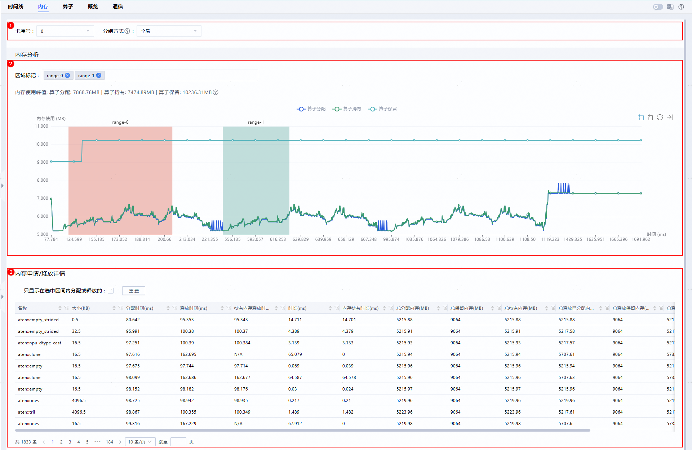
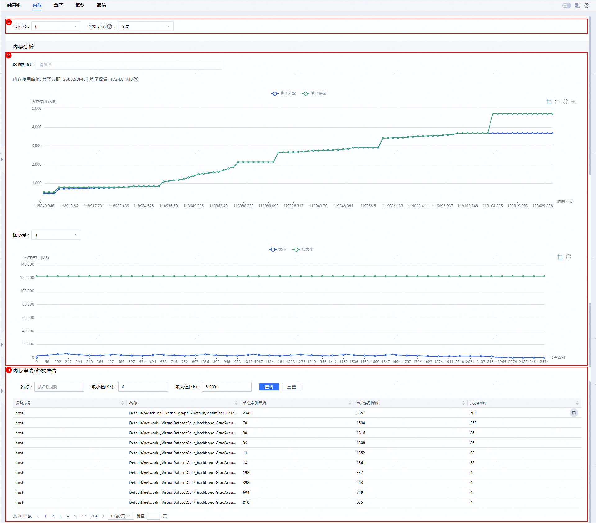
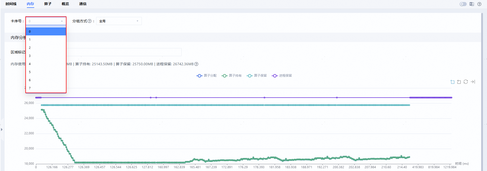
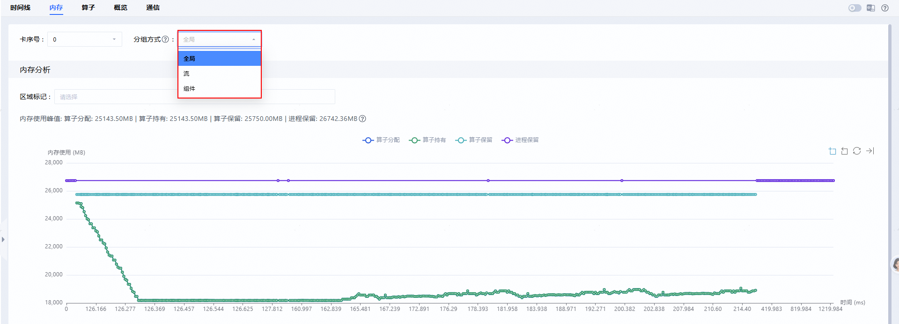
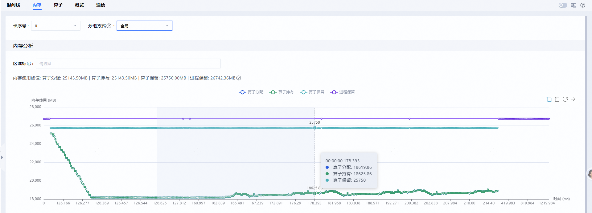
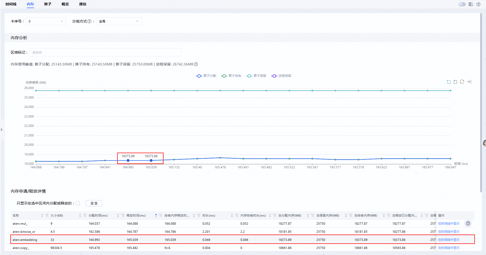
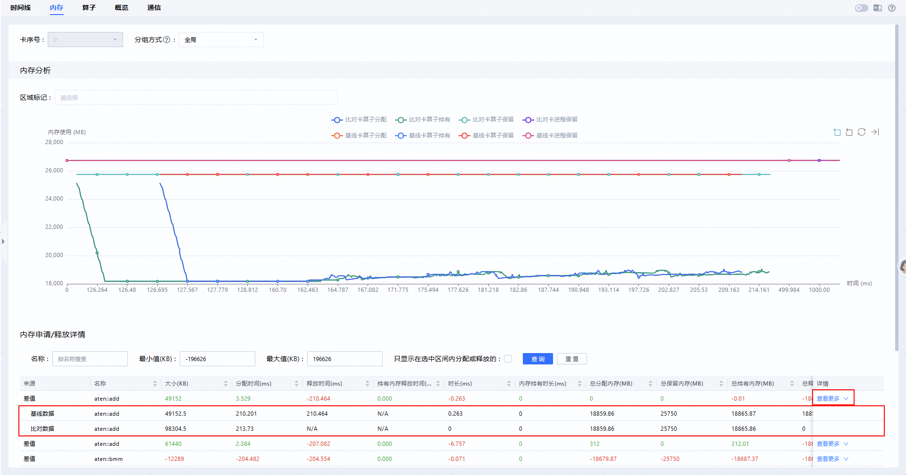

# 内存（Memory）

本文档介绍内存（Memory）界面的功能与使用方法，包括动态图和静态图场景下参数配置栏、算子内存折线图、内存申请/释放详情表的说明，以及切换卡序号、切换展示维度、折线图放大还原、搜索算子、高亮显示和卡间性能对比等操作，适用于需要分析内存采集信息、定位内存消耗大算子的用户。

## 功能说明

内存（Memory）界面提供了采集过程中内存信息的可视化呈现。用户可以通过内存折线图对整体内存趋势一目了然，也可以框选放大折线图中峰值区域并结合算子内存信息精准定位到内存消耗大的算子。

**注意事项**

对于超过300万条的数据，在内存折线图渲染时采用LTTB（Largest Triangle Three Buckets）算法进行降采样，以提升渲染性能，所以当数据量较大时，仅显示采样结果，将图表放大至较小范围时，可完整显示数据点。

## 界面介绍

**界面展示（动态图场景）**

内存（Memory）界面由参数配置栏（区域一）、算子内存折线图（区域二）、内存申请/释放详情表（区域三）三个部分组成，如[**图 1** 动态图内存界面](#动态图内存界面)所示。

**图 1** 动态图内存界面

- 区域一：参数配置栏。
    - 卡序号（Rank ID）：通过切换选项来查看不同卡的内存信息，切换之后整体界面即时刷新。
    - 分组方式（Group By）：通过切换不同的维度来展示内存信息，分为“全局”、“流”和“组件”维度。
    - 机器名称（Host Name）：仅当导入的db场景文件中存在名称为“HOST\_INFO”的表时，存在该选项。

- 区域二：算子内存折线图，图上方“区域标记”框中显示的是时间线（Timeline）中的区域标记名称，这些标记会根据设置的颜色在内存折线图上显示对应区域。在“区域标记”框中删除任一标记，该标记则会在内存折线图上相应地被移除，但不会从时间线（Timeline）中删除。
    - 算子分配（Operator Allocated）曲线表示算子在申请或释放内存时采集到的已分配内存的变化趋势，代表所有算子总的分配内存，此处采集到的内存数据由PyTorch和GE（Graph Engine，图引擎）申请。
    - 算子保留（Operator Reserved）曲线表示算子在申请或释放内存时采集到的保留内存的变化趋势，代表所有算子总的保留内存，此处采集到的内存数据由PyTorch和GE申请。
    - 算子持有（Operator Activated）曲线表示所持有的总内存，包括被其他流复用未释放的内存，此处采集到的内存数据由PyTorch中的流申请。如果没有“流”的信息，则没有算子持有曲线。
    - 进程保留（APP Reserved）曲线表示整个进程保留的内存趋势。
    - 当“分组方式”选择“组件”时，折线图中分别展示PyTorch的算子内存情况和GE的内存情况。

- 区域三：内存申请/释放详情表，详细展示了每个算子的内存信息，表格支持搜索、排序、分页和跳转功能。单击每列的表头，可根据当前列的升序、降序和默认排序呈现数据；还可单击表格右上角按钮，一键复制表中当前所展示的内容，并粘贴至Excel表格中进行分析。

**界面展示（静态图场景）**

内存（Memory）界面由参数配置栏（区域一）、算子内存折线图（区域二）、内存申请/释放详情表（区域三）三个部分组成，如[**图 2** 静态图内存界面](#静态图内存界面)所示。

**图 2** 静态图内存界面

- 区域一：参数配置栏，通过切换“卡序号”和“分组方式”的选项来查看不同卡的内存信息，切换之后整体界面即时刷新。
- 区域二：算子内存折线图，由动态折线图和静态折线图组成，但静态折线图仅在MindSpore数据场景下存在。
    1. 动态折线图：图上方“区域标记”框中显示的是时间线（Timeline）中的区域标记名称，这些标记会根据设置的颜色在内存折线图上显示对应区域。在“区域标记”框中删除任一标记，该标记则会在内存折线图上相应地被移除，但不会从时间线（Timeline）中删除。
        - 算子分配（Operator Allocated）曲线表示算子在申请或释放内存时采集到的已分配内存的变化趋势，代表所有算子总的分配内存，此处采集到的内存数据由PyTorch和GE（Graph Engine，图引擎）申请。
        - 算子保留（Operator Reserved）曲线表示算子在申请或释放内存时采集到的保留内存的变化趋势，代表所有算子总的保留内存，此处采集到的内存数据由PyTorch和GE申请。
        - 算子持有（Operator Activated）曲线表示所持有的总内存，包括被其他流复用未释放的内存，此处采集到的内存数据由PyTorch中的流申请。
        - 进程保留（APP Reserved）曲线表示整个进程保留的内存趋势。

    2. 静态折线图：

        仅在MindSpore数据场景下存在。通过切换图序号（Graph ID）查看所选卡的内存分配情况。

        - 大小（Size）：按节点索引（Index）动态申请的内存大小。
        - 总大小（Total Size）：自动预设的内存最大值。

- 区域三：内存申请/释放详情表，详细展示了静态图中每个算子的内存信息，表格支持搜索、排序、分页和跳转功能。单击每列的表头，可根据当前列的升序、降序和默认排序呈现数据；还可单击表格右上角按钮，一键复制表中当前所展示的内容，并粘贴至Excel表格中进行分析。

## 使用说明

**支持切换卡**

MindStudio Insight支持通过切换卡序号来查看不同卡的内存信息，单击界面上方卡序号的输入框，在下拉框选择需要查看的信息，切换之后界面将显示对应卡的算子内存折线图、内存申请/释放详情表，如[**图 3** 切换卡序号](#切换卡序号)所示。

**图 3** 切换卡序号

**支持切换展示维度**

MindStudio Insight支持通过切换分组方式来查看不同维度的算子内存折线图，单击界面上方分组方式的输入框，在下拉框选择需要查看的维度，如[**图 4** 切换维度](#切换维度)所示。该功能仅在动态图场景下支持。

- 全局：以全局为维度，统计算子在保留、分配和持有状态下的内存大小，以及PyTorch整体的保留内存大小。
- 流：以流为维度，统计处于保留、分配和持有状态的算子内存大小。
- 组件：以组件为维度，分别统计PyTorch的算子在保留、分配和持有状态下的内存大小，GE的内存在保留、分配和持有状态下的大小情况。

**图 4** 切换维度

**支持内存折线图局部放大和还原**

MindStudio Insight支持通过鼠标左键框选放大选中部分和右键还原进行折线图的展示。为提升显示性能，折线图在数据量较大时会隐藏大部分点，可在框选到足够精细区域时显示所有点位，也可单击鼠标右键还原最初整体展示效果。

在折线图中单击鼠标左键拖至需要放大的终点位置并松开鼠标左键，框选部分将会被放大；如果还存在点被隐藏，重复放大操作即可展示被隐藏的点，选中放大区域如[**图 5** 选中放大区域](#选中放大区域)所示。

**图 5** 选中放大区域

> [!NOTE]
>
> - 单击折线图右上角按钮，使其为置灰状态，则折线图将锁定，不再支持鼠标左键框选放大功能；再次单击此按钮，或者单击鼠标右键即可恢复。放大功能默认开启。
> - 单击折线图右上方按钮，折线图将会恢复最初状态。
> - 单击折线图右上方按钮，折线图将会回到上一步操作。
> - 单击折线图右上方按钮，将会跳转到对应时间域的时间线页签。

**支持搜索算子**

在内存申请/释放详情表中，动态图和静态图场景支持搜索算子，具体操作如下：

> [!NOTE]
>
> - 在MindSpore静态图场景下，显示为静态图算子内存申请/释放详情表。其它场景下，则显示的是动态图算子内存申请/释放详情表。
> - 当“分组方式”选择“组件”时，不支持算子搜索功能。

- 动态图场景

    在表格的表头，单击参数名称后的，可搜索相关信息。“名称”列支持模糊输入算子名称，进行搜索；“大小”、“时长”等其它参数支持区间搜索，如[**图 6** 搜索算子](#搜索算子-1)所示，参数说明如[**表 1** 动态图字段说明](#动态图字段说明)所示。

    如果在表格上方勾选了“只显示在选中区间内分配或释放的”选项，那么查询到的算子即是在折线图中框选区域内分配或释放的算子。

    **图 6** 搜索算子

    

    **表 1** 动态图字段说明

  |中文字段|英文字段|说明|
  |--|--|--|
  |名称|Name|算子名称。|
  |大小（KB）|Size(KB)|申请内存大小，单位KB。|
  |分配时间（ms）|Allocation Time(ms)|Tensor内存分配时间（从采集开始时计算，单位ms）。|
  |释放时间（ms）|Release Time(ms)|Tensor内存释放时间（从采集开始时计算，单位ms）。|
  |时长（ms）|Duration(ms)|内存持有时间。|
  |持有内存释放时间（ms）|Active Release Time(ms)|内存实际归还内存池时间。|
  |内存持有时长（ms）|Active Duration(ms)|内存实际占用时间。|
  |总分配内存（MB）|Allocation Total Allocated(MB)|算子内存分配时，PyTorch和GE内存实际分配总额。|
  |总保留内存（MB）|Allocation Total Reserved(MB)|算子内存分配时，PyTorch和GE内存保留总额。|
  |总持有内存（MB）|Allocation Total Active(MB)|算子内存分配时，当前流所申请的总内存（包括被其他流复用的未释放的内存）。|
  |总释放已分配内存（MB）|Release Total Allocated(MB)|算子内存释放后，内存池中PyTorch和GE正在使用的内存大小。|
  |总释放保留内存（MB）|Release Total Reserved(MB)|算子内存释放后，内存池中PyTorch和GE所占用的内存大小。|
  |总释放持有内存（MB）|Release Total Active(MB)|算子内存释放后，PyTorch和GE内存中被其他流复用的内存总额。|
  |流|Stream|AscendCL流的内存地址，用于标记不同的AscendCL流。|
  |操作|Operation|单击在时间线中显示，可跳转至时间线视图中对应算子。|

- 静态图场景

    在筛选条件栏中，输入算子名称和算子占用内存大小区间范围（最小值和最大值），单击“查询”后即可查询，单击“重置”将会重置查询条件。筛选条件栏中默认展示的是所选卡中算子占用内存大小的最小值和最大值，可根据实际需要进行调整。如[**图 7** 静态图搜索算子](#静态图搜索算子)所示，搜索算子名称中包含data相关且内存大小为0\~35KB的算子，表格中字段解释如[**表 2** 静态图字段说明](#静态图字段说明)所示。

    **图 7** 静态图搜索算子

    

    **表 2** 静态图字段说明

    |中文字段|英文字段|说明|
    |--|--|--|
    |设备序号|Device ID|申请内存的设备序号，默认host。|
    |名称|Name|算子名称。|
    |节点索引开始|Node Index Start|搜索开始节点。|
    |节点索引结束|Node Index End|搜索结束节点。  其中显示为“4294967295”的值为索引最终结束节点，该节点在静态图中表示为实际结束节点加1的节点，例如，实际结束节点为32，静态图中横坐标节点索引则显示33，表格中节点索引结束值显示为“4294967295”。|
    |大小（MB）|Size(MB)|申请内存大小，单位MB。|
    |操作|Operation|单击在时间线中显示，可跳转至时间线视图中对应算子。|

- 当“分组方式”选择“组件”时，不支持算子搜索功能。界面如[**图 8** 组件级内存申请/释放详情](#组件级内存申请/释放详情)所示，字段解释如[**表 3** 字段说明](#字段说明)所示。

    **图 8** 组件级内存申请/释放详情

    

    **表 3** 字段说明

  |中文字段|英文字段|说明|
  |--|--|--|
  |组件|Component|组件名称。|
  |保留内存峰值（MB）|Peak Memory Reserved(MB)|组件占用内存大小的峰值，单位MB。只显示占用内存峰值大于等于100MB的组件。|
  |时间戳(ms)|Timestamp(ms)|组件内存占用达到峰值的时刻，单位ms。|

**支持高亮显示**

当“分组方式”选择“全局”时，将鼠标移入表格中某条数据时（前提是折线图放大到足以展示表格中所有算子），若折线图上方显示了该条数据对应的点位（包括分配时间和释放时间），则折线图上对应点会有高亮效果出现，方便快速定位到该算子所在位置。

将鼠标放置在表格中红框位置，折线图立即高亮显示算子所在位置，如[**图 9** 算子高亮显示](#算子高亮显示)所示。

**图 9** 算子高亮显示

**支持卡间性能对比**

MindStudio Insight支持卡间内存性能对比，设置对比数据请参见[数据对比](../basic_operations.md#管理数据)。

在卡间性能对比模式下，“卡序号”是固定的，不能进行切换；“分组方式”仅支持选择“全局”和“组件”。算子内存折线图中将显示两个卡的内存变化，可直观地查看两卡间的内存对比趋势。内存申请/释放详情表中会显示两卡间的数据差异详情，当“分组方式”选择“全局”时，可按名称与内存大小搜索相关算子，此时，输入的内存最小值可为负值，且搜索条件仅限于对比结果，如[**图 10** 性能对比](#性能对比)所示。

单击内存申请/释放详情表中“详情”列的“查看更多”，可显示基线数据和对比数据的详情。

**图 10** 性能对比

