# 时间线（Timeline）

## 功能说明

在昇腾异构计算架构中，MindStudio Insight工具以时间线（Timeline）的呈现方式将训练/推理过程中的host、device上的运行详细情况平铺在时间轴上，直观呈现host侧的API耗时情况以及device侧的task耗时，并将host与device进行关联呈现，帮助用户快速识别host瓶颈或device瓶颈，同时提供各种筛选分类、专家建议等功能，支撑用户进行深度调优。

通过观察时间线视图各个层级上的耗时长短、间隙等判断对应组件和算子是否存在性能问题，如算子下发是否存在瓶颈、是否存在高耗时的kernel以及是否存在冗余的转换类算子。

> [!NOTE]
>
> 时间线（Timeline）界面默认最大展示三分钟的数据。如果导入的数据时间长度超过三分钟，则不支持缩小展示，仅可放大展示，通过左右平移查看其它时间数据。

## 界面介绍

**界面展示**

时间线（Timeline）界面由工具栏（区域一）、时间线树状图（区域二）、图形化窗格（区域三）和数据窗格（区域四）四个部分组成，如[**图 1**  时间线（Timeline）界面](#时间线（Timeline）界面)所示。

**图 1**  时间线（Timeline）界面

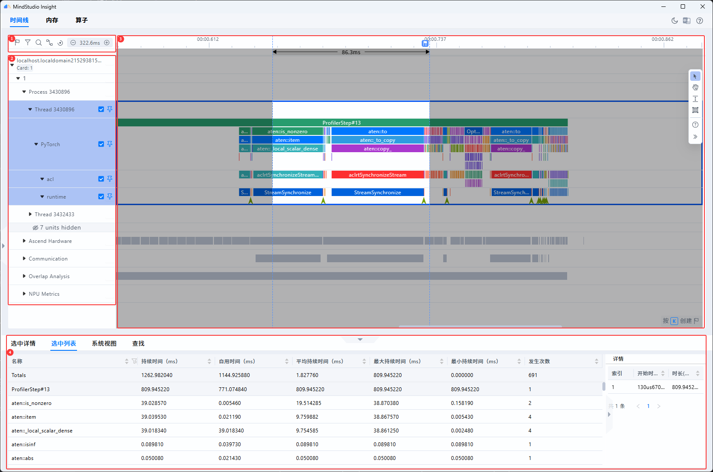

- 区域一：工具栏，包含常用快捷按钮，从左至右依次为标记列表、过滤（支持按卡或按泳道过滤展示）、搜索、连线事件、重置缩放（页面复原）和时间轴缩小放大按钮。
- 区域二：时间线树状图，text场景和db场景显示会有所不同，具体泳道信息请参见[泳道信息](#泳道信息)。
    - text场景：显示集群场景下各设备的分层信息，以Rank维度显示分层信息，一层级为Rank ID，二层级为进程或专项分层，三层级为线程等名称。二层级包括Python层数据（包含PyTorch和打点数据的耗时信息）、CANN层数据（包含AscendCL、GE和Runtime组件的耗时数据）、底层NPU数据（包含Ascend Hardware下各个Stream任务流的耗时数据和迭代轨迹数据、Communication和Overlap Analysis通信数据、Memory内存数据以及其他昇腾AI处理器系统数据）和AI Core Freq等层级，层级内容展示随导入的数据而变化。
    - db场景：显示各机器下的信息，一层级为机器名称，二层级为Host和Rank ID。Host层级是按照进程与线程级维度展示PyTorch和CANN的数据；Rank ID层级包括底层NPU数据（包含Ascend Hardware下各个Stream任务流的耗时数据和迭代轨迹数据、Communication和Overlap Analysis通信数据、Memory内存数据以及其他昇腾AI处理器系统数据）和AI Core Freq等层级，且卡下属层级内容的展示随导入的数据而变化。

- 区域三：图形化窗格，展示的数据是迭代内的数据，图形化窗格对应时间线树状图，逐行对时间线进行图形化展现，包括上层应用算子、各组件及接口的执行序列和执行时长。
- 区域四：数据窗格，统计信息或算子详情信息展示区，选中详情（Slice Detail）为选中单个算子的详细信息、选中列表（Slice List）为某一泳道选中区域的算子列表信息、系统视图（System View）为某类算子的汇总信息、以及查找（Find）为搜索的算子信息。

**泳道信息**

时间线（Timeline）界面上展示的泳道信息如下。

**表 1** 泳道信息

<table class="tg"><thead>
  <tr>
    <th class="tg-0pky">一层级泳道名称</th>
    <th class="tg-0pky">二层级泳道名称</th>
    <th class="tg-0pky">说明</th>
  </tr></thead>
<tbody>
  <tr>
    <td class="tg-0pky">Process</td>
    <td class="tg-0pky">Thread</td>
    <td class="tg-0pky">仅db格式文件支持展示此泳道，Thread层级泳道下还存在pytorch、CANN和MSTX，分别展示的是PyTorch框架下上层应用线程运行的耗时信息、CANN框架下线程运行的耗时信息和打点信息。</td>
  </tr>
  <tr>
    <td class="tg-0pky">Python</td>
    <td class="tg-0pky">Thread</td>
    <td class="tg-0pky">应用层数据，每个子泳道Thread包含上层应用线程运行的耗时信息，需要使用PyTorch Profiler或msprof_tx采集。仅支持在text格式文件下展示该泳道。</td>
  </tr>
  <tr>
    <td class="tg-0pky">CANN</td>
    <td class="tg-0pky">Thread</td>
    <td class="tg-0pky">CANN层数据，每个子泳道Thread主要包含AscendCL、GE、Runtime组件以及Node（算子）的耗时数据。 如果是db格式文件，二层级泳道名称可能包含acl，model，node，hccl，runtime，op，queue，trace，mstx等。</td>
  </tr>
  <tr>
    <td class="tg-0pky">MindSpore</td>
    <td class="tg-0pky">Thread</td>
    <td class="tg-0pky">在MindSpore场景下，展示当前Thread下运行的阶段耗时，用于分析网络结构性能。</td>
  </tr>
  <tr>
    <td class="tg-0pky">Scope Layer</td>
    <td class="tg-0pky">Thread</td>
    <td class="tg-0pky">在MindSpore场景下，展示当前Thread网络层级的执行耗时。</td>
  </tr>
  <tr>
    <td class="tg-0pky">Python GC</td>
    <td class="tg-0pky">Python GC</td>
    <td class="tg-0pky">在PyTorch场景下，若开启GC检测功能且采集周期内发生GC事件，则会在Python GC泳道中显示。</td>
  </tr>
  <tr>
    <td class="tg-0pky" rowspan="3">Ascend Hardware</td>
    <td class="tg-0pky">Stream &lt;id&gt;</td>
    <td class="tg-0pky">底层NPU数据，任务调度信息数据，记录AI任务运行时，各个Task在不同加速器下的执行耗时和AI Core的性能指标。</td>
  </tr>
  <tr>
    <td class="tg-0pky">Stream &lt;id&gt; MSTX domain &lt;domainid&gt;</td>
    <td class="tg-0pky">Stream &lt;id&gt;的MSTX device侧打点数据。</td>
  </tr>
  <tr>
    <td class="tg-0pky">Step Trace</td>
    <td class="tg-0pky">迭代轨迹数据。仅step_trace_*.json文件存在时展示该泳道。</td>
  </tr>
  <tr>
    <td class="tg-0pky">DPU / DPU &lt;id&gt;</td>
    <td class="tg-0pky">DPU Stream &lt;id&gt;</td>
    <td class="tg-0pky">DPU任务根据globalTid挂载到对应的Thread下，与CANN等泳道平级，并按DPU / DPU &lt;id&gt; / DPU Stream &lt;id&gt;层级展示任务执行区间；选中任务后，可在数据窗格查看任务详情。支持按任务名称进行全局搜索、锁定范围搜索，并从搜索结果定位到对应任务。仅db格式文件支持展示此泳道。</td>
  </tr>
    <tr>
    <td class="tg-0pky">CCU</td>
    <td class="tg-0pky">Communication</td>
    <td class="tg-0pky">包含集合通信指令数据，CCU任务的起止时间以及CCU任务的一级索引指令的起止时间，以及同步及数据搬运耗时。 CCU泳道仅支持展示Ascend 950PR&950DT系列产品导出的性能数据。</td>
  </tr>
    <tr>
    <td class="tg-0pky" rowspan="4">Overlap Analysis</td>
    <td class="tg-0pky">Communication</td>
    <td class="tg-0pky">通信时间。</td>
  </tr>
  <tr>
    <td class="tg-0pky">Communication(Not Overlapped)</td>
    <td class="tg-0pky">未被计算掩盖的通信时间。</td>
  </tr>
  <tr>
    <td class="tg-0pky">Computing</td>
    <td class="tg-0pky">计算时间。</td>
  </tr>
  <tr>
    <td class="tg-0pky">Free</td>
    <td class="tg-0pky">Device侧既不在计算也不在通信的时间。按Step维度拆解时，会被进一步区分为Preparing和Free，其中Preparing在做数据预处理，加载拷贝等操作。</td>
  </tr>
  <tr>
    <td class="tg-0pky" rowspan="2">Communication</td>
    <td class="tg-0pky">Group &lt;id&gt; Communication</td>
    <td class="tg-0pky">通信域下的通信算子。一个卡（Rank）可以存在于不同的通信域中，一个Group标识当前卡在当前通信域的行为。</td>
  </tr>
  <tr>
    <td class="tg-0pky">Plane &lt;id&gt;</td>
    <td class="tg-0pky">集合通信算子信息。网络平面ID，对多个收发通信链路的并行调度执行，每个Plane就是一个并发通信维度。</td>
  </tr>
  <tr>
    <td class="tg-0pky" rowspan="22">NPU Metrics</td>
    <td class="tg-0pky">Low Power</td>
    <td class="tg-0pky">低功耗数据，包含功耗、带宽、频率、温度等数据，通过呈现变频曲线，准确识别算子执行过程中的变频情况。 Low Power泳道仅支持展示Ascend 950PR&950DT系列产品导出的性能数据。</td>
  </tr>
  <tr>
    <td class="tg-0pky">Biu Perf</td>
    <td class="tg-0pky">呈现SU、VEC、CUBE、MTE等指令执行时间，以及打点数据。 Biu Perf泳道仅支持展示Ascend 950PR&950DT系列产品导出的性能数据。</td>
  </tr>
  <tr>
    <td class="tg-0pky">UB</td>
    <td class="tg-0pky">为UDMA和UNIC两种数据类型，呈现UB总体收发带宽情况。DB格式文件下，每个Port对应一条UB Port&lt;id&gt;泳道，泳道同时展示Rx Bandwidth和Tx Bandwidth。 UB泳道仅支持展示Ascend 950PR&950DT系列产品导出的性能数据。</td>
  </tr>
  <tr>
    <td class="tg-0pky">Block Detail</td>
    <td class="tg-0pky">展示各个算子在最早和最晚的AI core或AI Vector Core上的执行时间，当算子为Mix类型时，会同时执行在AIC和AIV上。 Block Detail泳道仅支持展示Ascend 950PR&950DT系列产品导出的性能数据。</td>
  </tr>
  <tr>
    <td class="tg-0pky">HBM</td>
    <td class="tg-0pky">HBM内存读写速率，单位为MB/s。</td>
  </tr>
  <tr>
    <td class="tg-0pky">DDR</td>
    <td class="tg-0pky">DDR内存读写速率</td>
  </tr>
  <tr>
    <td class="tg-0pky">LLC</td>
    <td class="tg-0pky">具体说明见<a href="#NPU Metrics泳道信息">表 2 NPU Metrics泳道信息</a>中“LLC”泳道说明</td>
  </tr>
  <tr>
    <td class="tg-0pky">NPU_MEM</td>
    <td class="tg-0pky">具体说明见<a href="#NPU Metrics泳道信息">表 2 NPU Metrics泳道信息</a>中“NPU_MEM”泳道说明</td>
  </tr>
  <tr>
    <td class="tg-0pky">Stars Soc Info</td>
    <td class="tg-0pky">具体说明见<a href="#NPU Metrics泳道信息">表 2 NPU Metrics泳道信息</a>中“Stars Soc Info”泳道说明</td>
  </tr>
  <tr>
    <td class="tg-0pky">acc_pmu</td>
    <td class="tg-0pky">具体说明见<a href="#NPU Metrics泳道信息">表 2 NPU Metrics泳道信息</a>中“acc_pmu”泳道说明</td>
  </tr>
  <tr>
    <td class="tg-0pky">AI Core Utilization</td>
    <td class="tg-0pky">具体说明见<a href="#NPU Metrics泳道信息">表 2 NPU Metrics泳道信息</a>中“AI Core Utilization”泳道说明</td>
  </tr>
  <tr>
    <td class="tg-0pky">AI Core Freq</td>
    <td class="tg-0pky">展示AI Core芯片在执行AI任务的过程中频率的变化情况。导入Ascend 950PR&950DT系列产品的DB格式文件时，按Die ID分别展示为AI Core Freq Die &lt;id&gt;泳道。 AI Core Freq泳道支持展示Atlas A2系列产品和Ascend 950PR&950DT系列产品导出的性能数据。</td>
  </tr>
  <tr>
    <td class="tg-0pky">SIO</td>
    <td class="tg-0pky">具体说明见<a href="#NPU Metrics泳道信息">表 2 NPU Metrics泳道信息</a>中“SIO”泳道说明</td>
  </tr>
  <tr>
    <td class="tg-0pky">QoS</td>
    <td class="tg-0pky">设备QoS带宽信息。导入Ascend 950PR&950DT系列产品的DB格式文件时，按Die ID分别展示为QoS &lt;id&gt;:OTHERS/Die &lt;id&gt;/Bandwidth泳道。</td>
  </tr>
  <tr>
    <td class="tg-0pky">NIC</td>
    <td class="tg-0pky">text场景：展示每个时间节点网络信息数据。 db场景：展示带宽信息数据。 泳道名称会根据导入的数据不同而变化。</td>
  </tr>
  <tr>
    <td class="tg-0pky">RoCE</td>
    <td class="tg-0pky">RoCE通信接口带宽数据。</td>
  </tr>
  <tr>
    <td class="tg-0pky">NetDev Stats</td>
    <td class="tg-0pky">通过硬件采样带宽能力，可以部分识别通信问题，作为总览项，初步排查通信问题，如出现通信耗时异常，即可优先排查是否为网络拥塞导致。NetDev Stats数据只支持在db格式文件下展示。</td>
  </tr>
  <tr>
    <td class="tg-0pky">PCIe</td>
    <td class="tg-0pky">具体说明见<a href="#NPU Metrics泳道信息">表 2 NPU Metrics泳道信息</a>中“PCIe”泳道说明</td>
  </tr>
  <tr>
    <td class="tg-0pky">HCCS</td>
    <td class="tg-0pky">HCCS集合通信带宽数据，展示接收带宽和发送带宽，单位MB/s。</td>
  </tr>
  <tr>
    <td class="tg-0pky">biu_group</td>
    <td class="tg-0pky">具体说明见<a href="#NPU Metrics泳道信息">表 2 NPU Metrics泳道信息</a>中“biu_group”泳道说明</td>
  </tr>
  <tr>
    <td class="tg-0pky">aic_core_group</td>
    <td class="tg-0pky">具体说明见<a href="#NPU Metrics泳道信息">表 2 NPU Metrics泳道信息</a>中“aic_core_group”泳道说明</td>
  </tr>
  <tr>
    <td class="tg-0pky">aiv_core_group</td>
    <td class="tg-0pky">具体说明见<a href="#NPU Metrics泳道信息">表 2 NPU Metrics泳道信息</a>中“aiv_core_group”泳道说明</td>
  </tr>
  <tr>
    <td class="tg-0pky">Stars Chip Trans</td>
    <td class="tg-0pky">具体说明见<a href="#NPU Metrics泳道信息">表 2 NPU Metrics泳道信息</a>中“Stars Chip Trans”泳道说明</td>
  </tr>
  <tr>
    <td class="tg-0pky" rowspan="5">CPU Metrics</td>
    <td class="tg-0pky">CPU Usage</td>
    <td class="tg-0pky">Host侧CPU利用率数据。</td>
  </tr>
  <tr>
    <td class="tg-0pky">CPU Freq</td>
    <td class="tg-0pky">Host侧各CPU的频率数据，单位为kHz。</td>
  </tr>
  <tr>
    <td class="tg-0pky">Memory Usage</td>
    <td class="tg-0pky">Host侧内存利用率数据。</td>
  </tr>
  <tr>
    <td class="tg-0pky">Disk Usage</td>
    <td class="tg-0pky">Host侧磁盘I/O利用率数据。</td>
  </tr>
  <tr>
    <td class="tg-0pky">Network Usage</td>
    <td class="tg-0pky">Host侧网络I/O利用率数据。</td>
  </tr>
  <tr>
    <td class="tg-0pky">OS Runtime API</td>
    <td class="tg-0pky">Thread</td>
    <td class="tg-0pky">Host侧syscall和pthreadcall数据。OS Runtime API泳道仅支持在text格式文件下展示。</td>
  </tr>
</tbody></table>

**表 2** NPU Metrics泳道信息

<table class="tg"><thead>
  <tr>
    <th class="tg-0pky">二层级泳道名称</th>
    <th class="tg-0pky">三级层级泳道名称</th>
    <th class="tg-0pky">说明</th>
  </tr></thead>
<tbody>
<tr>
    <td class="tg-0pky">Low Power</td>
    <td class="tg-0pky">-</td>
    <td class="tg-0pky">低功耗数据，包含功耗、带宽、频率、温度等数据，通过呈现变频曲线，准确识别算子执行过程中的变频情况。 Low Power泳道仅支持展示Ascend 950PR&950DT系列产品导出的性能数据。</td>
  </tr>
  <tr>
    <td class="tg-0pky">Biu Perf</td>
    <td class="tg-0pky">Group&lt;id&gt;-aiv&lt;id&gt;</td>
    <td class="tg-0pky">呈现SU、VEC、CUBE、MTE等指令执行时间，以及打点数据。 Biu Perf泳道仅支持展示Ascend 950PR&950DT系列产品导出的性能数据。</td>
  </tr>
  <tr>
    <td class="tg-0pky">UB</td>
    <td class="tg-0pky">UDMA/UNIC-Ports&lt;id&gt; UB Port&lt;id&gt;</td>
    <td class="tg-0pky">为UDMA和UNIC两种数据类型，呈现UB总体收发带宽情况。DB格式文件下，每个Port对应一条UB Port&lt;id&gt;泳道，泳道同时展示Rx Bandwidth和Tx Bandwidth。 UB泳道仅支持展示Ascend 950PR&950DT系列产品导出的性能数据。</td>
  </tr>
  <tr>
    <td class="tg-0pky" rowspan="2">Block Detail</td>
    <td class="tg-0pky">AIC/AIV Earliest</td>
    <td class="tg-0pky">展示各个算子在最早的AI core或AI Vector Core上的执行时间，当算子为Mix类型时，会同时执行在AIC和AIV上。 Block Detail泳道仅支持展示Ascend 950PR&950DT系列产品导出的性能数据。</td>
  </tr>
    <tr>
    <td class="tg-0pky">AIC/AIV Latest</td>
    <td class="tg-0pky">展示各个算子在最晚的AI core或AI Vector Core上的执行时间，当算子为Mix类型时，会同时执行在AIC和AIV上。</td>
  </tr>
  <tr>
    <td class="tg-0pky" rowspan="2">HBM</td>
    <td class="tg-0pky">HBM &lt;id&gt;/Read</td>
    <td class="tg-0pky">HBM内存读取速率，单位为MB/s。</td>
  </tr>
  <tr>
    <td class="tg-0pky">HBM &lt;id&gt;/Write</td>
    <td class="tg-0pky">HBM内存写入速率，单位为MB/s。</td>
  </tr>
  <tr>
    <td class="tg-0pky" rowspan="2">DDR</td>
    <td class="tg-0pky">Read</td>
    <td class="tg-0pky">DDR内存读取速率。</td>
  </tr>
  <tr>
    <td class="tg-0pky">Write</td>
    <td class="tg-0pky">DDR内存写入速率。</td>
  </tr>
  <tr>
    <td class="tg-0pky" rowspan="2">LLC</td>
    <td class="tg-0pky">LLC &lt;id&gt; Read/Hit Rate LLC &lt;id&gt; Write/Hit Rate</td>
    <td class="tg-0pky">三级缓存读写速率数据，三级缓存读取、写入时的命中率。</td>
  </tr>
  <tr>
    <td class="tg-0pky">LLC &lt;id&gt; Read/Throughput LLC &lt;id&gt; Write/Throughput</td>
    <td class="tg-0pky">三级缓存读取、写入时的吞吐量。</td>
  </tr>
  <tr>
    <td class="tg-0pky" rowspan="6">NPU_MEM</td>
    <td class="tg-0pky">APP/DDR</td>
    <td class="tg-0pky">进程级DDR内存占用，单位KB。</td>
  </tr>
  <tr>
    <td class="tg-0pky">APP/HBM</td>
    <td class="tg-0pky">进程级HBM内存占用，单位KB。</td>
  </tr>
  <tr>
    <td class="tg-0pky">APP/MEMORY</td>
    <td class="tg-0pky">进程级DDR和HBM内存占用和，单位KB。</td>
  </tr>
  <tr>
    <td class="tg-0pky">Device/DDR</td>
    <td class="tg-0pky">设备级DDR内存占用，单位KB。</td>
  </tr>
  <tr>
    <td class="tg-0pky">Device/HBM</td>
    <td class="tg-0pky">设备级HBM内存占用，单位KB。</td>
  </tr>
  <tr>
    <td class="tg-0pky">Device/MEMORY</td>
    <td class="tg-0pky">设备级DDR和HBM内存占用和，单位KB。</td>
  </tr>
  <tr>
    <td class="tg-0pky" rowspan="2">Stars Soc Info</td>
    <td class="tg-0pky">L2 Buffer Bw Level</td>
    <td class="tg-0pky">SoC传输带宽信息，L2 Buffer带宽等级信息。</td>
  </tr>
  <tr>
    <td class="tg-0pky">Meta Bw Level</td>
    <td class="tg-0pky">Meta带宽等级信息。</td>
  </tr>
  <tr>
    <td class="tg-0pky" rowspan="4">acc_pmu</td>
    <td class="tg-0pky">Accelerator {accId}/readBwLevel</td>
    <td class="tg-0pky">DVPP和DSA加速器读带宽。 Ascend 950PR&950DT系列产品不支持acc_pmu泳道。</td>
  </tr>
  <tr>
    <td class="tg-0pky">Accelerator {accId}/readOstLevel</td>
    <td class="tg-0pky">DVPP和DSA加速器读并发。</td>
  </tr>
  <tr>
    <td class="tg-0pky">Accelerator {accId}/writeBwLevel</td>
    <td class="tg-0pky">DVPP和DSA加速器写带宽。</td>
  </tr>
  <tr>
    <td class="tg-0pky">Accelerator {accId}/writeOstLevel</td>
    <td class="tg-0pky">DVPP和DSA加速器写并发。</td>
  </tr>
  <tr>
    <td class="tg-0pky" rowspan="2">AI Core Utilization</td>
    <td class="tg-0pky">Average</td>
    <td class="tg-0pky">AI Core指令占比数据的均值。AI Core Utilization泳道仅支持在text格式文件下展示。</td>
  </tr>
  <tr>
    <td class="tg-0pky">Core &lt;id&gt;</td>
    <td class="tg-0pky">各AI Core在执行Task的total cycle（从AI Core开始执行算子的第一条指令开始计数，到最后一条指令执行完成）占比情况。</td>
  </tr>
  <tr>
    <td class="tg-0pky">AI Core Freq</td>
    <td class="tg-0pky">AI Core Freq AI Core Freq Die &lt;id&gt;</td>
    <td class="tg-0pky">展示AI Core芯片在执行AI任务的过程中频率的变化情况。导入Ascend 950PR&950DT系列产品的DB格式文件时，按Die ID分别展示为AI Core Freq Die &lt;id&gt;泳道。 AI Core Freq泳道支持展示Atlas A2系列产品和Ascend 950PR&950DT系列产品导出的性能数据。</td>
  </tr>
  <tr>
    <td class="tg-0pky" rowspan="4">SIO</td>
    <td class="tg-0pky">dat_rx、dat_tx dat_rx/&lt;name&gt;、dat_tx/&lt;name&gt;（DB格式）</td>
    <td class="tg-0pky">数据流通道的接收、发送带宽。SIO泳道支持在text格式文件下展示；对于Ascend 950PR&950DT系列产品，还支持在DB格式文件下展示。DB格式下，各子泳道名称末尾会追加“/&lt;name&gt;”以区分SIO通道。 SIO泳道仅支持展示Atlas A2系列产品和Ascend 950PR&950DT系列产品DIE间传输带宽信息。</td>
  </tr>
  <tr>
    <td class="tg-0pky">req_rx、req_tx req_rx/&lt;name&gt;、req_tx/&lt;name&gt;（DB格式）</td>
    <td class="tg-0pky">请求流通道的接收、发送带宽。</td>
  </tr>
  <tr>
    <td class="tg-0pky">rsp_rx、rsp_tx rsp_rx/&lt;name&gt;、rsp_tx/&lt;name&gt;（DB格式）</td>
    <td class="tg-0pky">回应流通道的接收、发送带宽。</td>
  </tr>
  <tr>
    <td class="tg-0pky">snp_rx、snp_tx snp_rx/&lt;name&gt;、snp_tx/&lt;name&gt;（DB格式）</td>
    <td class="tg-0pky">侦听流通道的接收、发送带宽。</td>
  </tr>
  <tr>
    <td class="tg-0pky">QoS</td>
    <td class="tg-0pky">QoS &lt;id&gt;:OTHERS QoS &lt;id&gt;:OTHERS/Die &lt;id&gt;/Bandwidth</td>
    <td class="tg-0pky">设备QoS带宽信息。导入Ascend 950PR&950DT系列产品的DB格式文件时，按Die ID分别展示为QoS &lt;id&gt;:OTHERS/Die &lt;id&gt;/Bandwidth泳道。</td>
  </tr>
  <tr>
    <td class="tg-0pky">NIC</td>
    <td class="tg-0pky">具体泳道信息详见： 1. 《DB格式性能数据文件参考》文档中“<a href="https://gitcode.com/Ascend/msprof/blob/master/docs/zh/user_guide/profile_data_file_references_db.md#nic">NIC</a>”章节“表 1 格式”字段名列； 2. 《性能数据文件参考》文档“Text格式性能数据”章节中“<a href="https://gitcode.com/Ascend/msprof/blob/master/docs/zh/user_guide/profile_data_file_references.md#nic%E6%AF%8F%E4%B8%AA%E6%97%B6%E9%97%B4%E8%8A%82%E7%82%B9%E7%BD%91%E7%BB%9C%E4%BF%A1%E6%81%AF">nic（每个时间节点网络信息）</a>”章节“表 1 字段说明”字段名列和“表 2 字段说明”字段名列。</td>
    <td class="tg-0pky">具体泳道含义详见： 1. 《DB格式性能数据文件参考》文档中“<a href="https://gitcode.com/Ascend/msprof/blob/master/docs/zh/user_guide/profile_data_file_references_db.md#nic">NIC</a>”章节“表 1 格式”含义列； 2. 《性能数据文件参考》文档“Text格式性能数据”章节中“<a href="https://gitcode.com/Ascend/msprof/blob/master/docs/zh/user_guide/profile_data_file_references.md#nic%E6%AF%8F%E4%B8%AA%E6%97%B6%E9%97%B4%E8%8A%82%E7%82%B9%E7%BD%91%E7%BB%9C%E4%BF%A1%E6%81%AF">nic（每个时间节点网络信息）</a>”章节“表 1 字段说明”字段含义列和“表 2 字段说明”字段含义列。</td>
  </tr>
  <tr>
    <td class="tg-0pky">RoCE</td>
    <td class="tg-0pky">具体泳道信息详见： 1. 《DB格式性能数据文件参考》文档中“<a href="https://gitcode.com/Ascend/msprof/blob/master/docs/zh/user_guide/profile_data_file_references_db.md#roce">ROCE</a>”章节“表 1 格式”字段名列 2. 《性能数据文件参考》文档“Text格式性能数据”章节中“<a href="https://gitcode.com/Ascend/msprof/blob/master/docs/zh/user_guide/profile_data_file_references.md#roceroce%E9%80%9A%E4%BF%A1%E6%8E%A5%E5%8F%A3%E5%B8%A6%E5%AE%BD">roce（RoCE通信接口带宽）</a>”章节“表 1 字段说明”字段名列和“表 2 字段说明”字段名列。</td>
    <td class="tg-0pky">具体泳道含义详见： 1. 《DB格式性能数据文件参考》文档中“<a href="https://gitcode.com/Ascend/msprof/blob/master/docs/zh/user_guide/profile_data_file_references_db.md#roce">ROCE</a>”章节“表 1 格式”含义列 2. 《性能数据文件参考》文档“Text格式性能数据”章节中“<a href="https://gitcode.com/Ascend/msprof/blob/master/docs/zh/user_guide/profile_data_file_references.md#roceroce%E9%80%9A%E4%BF%A1%E6%8E%A5%E5%8F%A3%E5%B8%A6%E5%AE%BD">roce（RoCE通信接口带宽）</a>”章节“表 1 字段说明”字段含义列和“表 2 字段说明”字段含义列。</td>
  </tr>
  <tr>
    <td class="tg-0pky">NetDev Stats</td>
    <td class="tg-0pky">具体泳道信息详见《DB格式性能数据文件参考》文档中“<a href="https://gitcode.com/Ascend/msprof/blob/master/docs/zh/user_guide/profile_data_file_references_db.md#netdev_stats">NETDEV_STATS</a>”章节“表 1 格式”字段名列</td>
    <td class="tg-0pky">具体泳道含义详见《DB格式性能数据文件参考》文档中“<a href="https://gitcode.com/Ascend/msprof/blob/master/docs/zh/user_guide/profile_data_file_references_db.md#netdev_stats">NETDEV_STATS</a>”章节“表 1 格式”含义列</td>
  </tr>
  <tr>
    <td class="tg-0pky" rowspan="4">PCIe</td>
    <td class="tg-0pky">PCIe_cpl</td>
    <td class="tg-0pky">接收写请求的完成数据包，单位MB/s。Tx表示发送端，Rx表示接收端。</td>
  </tr>
  <tr>
    <td class="tg-0pky">PCIe_nonpost</td>
    <td class="tg-0pky">PCIe Non-Posted数据传输带宽，单位MB/s。Tx表示发送端，Rx表示接收端。</td>
  </tr>
  <tr>
    <td class="tg-0pky">PCIe_nonpost_latency</td>
    <td class="tg-0pky">PCIe Non-Posted模式下的传输时延，单位μs。Tx表示发送端，Rx表示接收端。PCIe_nonpost_latency无Rx，取固定值0。</td>
  </tr>
  <tr>
    <td class="tg-0pky">PCIe_post</td>
    <td class="tg-0pky">PCIe Posted数据传输带宽，单位MB/s。Tx表示发送端，Rx表示接收端。泳道名称会根据导入的数据不同而变化。</td>
  </tr>
  <tr>
    <td class="tg-0pky">HCCS</td>
    <td class="tg-0pky">txThroughput rxThroughput</td>
    <td class="tg-0pky">HCCS集合通信带宽数据，展示接收带宽和发送带宽，单位MB/s。</td>
  </tr>
  <tr>
    <td class="tg-0pky" rowspan="4">biu_group</td>
    <td class="tg-0pky">Bandwidth Read</td>
    <td class="tg-0pky">BIU总线接口单元读取指令时的带宽。biu_group泳道仅支持在text格式文件下展示。</td>
  </tr>
  <tr>
    <td class="tg-0pky">Bandwidth Write</td>
    <td class="tg-0pky">BIU总线接口单元写入指令时的带宽。</td>
  </tr>
  <tr>
    <td class="tg-0pky">Latency Read</td>
    <td class="tg-0pky">BIU总线接口单元读取指令时的时延。</td>
  </tr>
  <tr>
    <td class="tg-0pky">Latency Write</td>
    <td class="tg-0pky">BIU总线接口单元写入指令时的时延。</td>
  </tr>
  <tr>
    <td class="tg-0pky" rowspan="4">aic_core_group</td>
    <td class="tg-0pky">Cube</td>
    <td class="tg-0pky">矩阵类运算指令在本采样周期内的cycle数和占比。aic_core_group泳道仅支持在text格式文件下展示。</td>
  </tr>
  <tr>
    <td class="tg-0pky">Mte1</td>
    <td class="tg-0pky">L1-&gt;L0A/L0B搬运类指令在本采样周期内的cycle数和占比。</td>
  </tr>
  <tr>
    <td class="tg-0pky">Mte2</td>
    <td class="tg-0pky">片上内存-&gt;AICORE搬运类指令在本采样周期内的cycle数和占比。</td>
  </tr>
  <tr>
    <td class="tg-0pky">Mte3</td>
    <td class="tg-0pky">AICORE-&gt;片上内存搬运类指令在本采样周期内的cycle数和占比。</td>
  </tr>
  <tr>
    <td class="tg-0pky" rowspan="5">aiv_core_group</td>
    <td class="tg-0pky">Mte1</td>
    <td class="tg-0pky">L1-&gt;L0A/L0B搬运类指令在本采样周期内的cycle数和占比。aiv_core_group泳道仅支持在text格式文件下展示。</td>
  </tr>
  <tr>
    <td class="tg-0pky">Mte2</td>
    <td class="tg-0pky">片上内存-&gt;AICORE搬运类指令在本采样周期内的cycle数和占比。</td>
  </tr>
  <tr>
    <td class="tg-0pky">Mte3</td>
    <td class="tg-0pky">AICORE-&gt;片上内存搬运类指令在本采样周期内的cycle数和占比。</td>
  </tr>
  <tr>
    <td class="tg-0pky">Scalar</td>
    <td class="tg-0pky">标量类运算指令在本采样周期内的cycle数和占比。</td>
  </tr>
  <tr>
    <td class="tg-0pky">Vector</td>
    <td class="tg-0pky">向量类运算指令在本采样周期内的cycle数和占比。</td>
  </tr>
  <tr>
    <td class="tg-0pky" rowspan="4">Stars Chip Trans</td>
    <td class="tg-0pky">PA Link Rx</td>
    <td class="tg-0pky">PA流量接收等级。当有集合通信带宽时，不建议参考该字段值，该字段为粗粒度的统计值。Stars Chip Trans泳道仅支持在text格式文件下展示，且Ascend 950PR&950DT系列产品不支持该泳道。</td>
  </tr>
  <tr>
    <td class="tg-0pky">PA Link Tx</td>
    <td class="tg-0pky">PA流量发送等级。当有集合通信带宽时，不建议参考该字段值，该字段为粗粒度的统计值。</td>
  </tr>
  <tr>
    <td class="tg-0pky">PCIE Read Bandwidth</td>
    <td class="tg-0pky">PCIe读带宽。当有PCIe带宽时，不建议参考该字段值，该字段为粗粒度的统计值。</td>
  </tr>
  <tr>
    <td class="tg-0pky">PCIE Write Bandwidth</td>
    <td class="tg-0pky">PCIe写带宽。当有PCIe带宽时，不建议参考该字段值，该字段为粗粒度的统计值。</td>
  </tr>
</tbody></table>

**表 3** CPU Metrics泳道信息

<table class="tg"><thead>
  <tr>
    <th class="tg-0pky">二层级泳道名称</th>
    <th class="tg-0pky">三级层级泳道名称</th>
    <th class="tg-0pky">说明</th>
  </tr></thead>
<tbody>
<tr>
    <td class="tg-0pky">CPU Usage</td>
    <td class="tg-0pky">CPU &lt;id&gt;</td>
    <td class="tg-0pky">Host侧CPU利用率数据。</td>
  </tr>
  <tr>
    <td class="tg-0pky">CPU Freq</td>
    <td class="tg-0pky">CPU &lt;id&gt;</td>
    <td class="tg-0pky">Host侧各CPU的频率数据，单位为kHz。</td>
  </tr>
  <tr>
    <td class="tg-0pky">Memory Usage</td>
    <td class="tg-0pky">Memory Usage</td>
    <td class="tg-0pky">Host侧内存利用率数据。</td>
  </tr>
  <tr>
    <td class="tg-0pky">Disk Usage</td>
    <td class="tg-0pky">Disk Usage</td>
    <td class="tg-0pky">Host侧磁盘I/O利用率数据。</td>
  </tr>
  <tr>
    <td class="tg-0pky">Network Usage</td>
    <td class="tg-0pky">Network Usage</td>
    <td class="tg-0pky">Host侧网络I/O利用率数据。</td>
  </tr>
</tbody></table>

>[!NOTE]
>
>单卡多进程场景下，所有进程对应的Stream合入到一个Ascend Hardware泳道下，Overlap Analysis以统计卡维度展示数据（仅适配DB格式数据）。

## 使用说明

### 基础功能

**悬浮工具栏**

时间线（Timeline）界面支持通过鼠标功能栏调整视图，界面如[图 2 悬浮工具栏](#悬浮工具栏)所示，主要功能如下：

1. 默认模式：鼠标可灵活点击，自由框选泳道。
2. 拖拽模式：自由横向拖拽时序图，灵活查看定位算子。
3. 泳道高度自适应：会根据窗口变化，自适应压缩空白无效区域，使视图展示更清晰。
4. 悬浮工具指引：对悬浮工具栏功能进行图文介绍。
5. 悬浮工具栏可以通过按键隐藏和展示。

    **图 2**  悬浮工具栏

    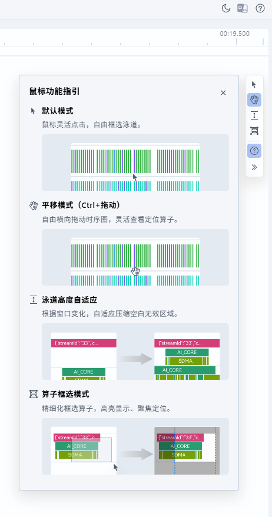

**支持界面缩放**

时间线（Timeline）界面支持缩小、放大和左右移动等功能，具体操作如下所示：

- 单击时间线（Timeline）界面树状图或者图形化窗格任意位置，可以使用键盘中的W（放大）和S（缩小）键进行操作，支持放大的最大精度为1ns。
- 单击时间线（Timeline）界面树状图或者图形化窗格任意位置，使用键盘中的A（左移）、D（右移）键，或者方向键左键（左移）、右键（右移）进行左右移动，也可使用方向键上键（上移）、下键（下移）进行上下移动。
- 在图形化窗格中，按住键盘中的Alt键，使用鼠标左键选中区域，即可实现选中区域的局部放大。
- 单击界面左上方工具栏中的（放大）和（缩小）实现缩放。
- 单击界面左上方工具栏中的可以一键恢复图形化窗格显示全部时间线视图。
- 将鼠标放置在时间线（Timeline）界面树状图或者图形化窗格任意位置，可以使用键盘中的Ctrl键加鼠标滚轮实现缩放操作。
- 在图形化窗格中，使用键盘中的Ctrl键加鼠标左键可以实现左右拖拽泳道图表。

    > [!NOTE]
    >
    > macOS系统中，需使用键盘上的Command键加鼠标滚轮实现缩放，Command键加鼠标左键实现左右拖拽泳道图表。

- 在图形化窗格中，可使用鼠标右键菜单进行缩放展示，具体功能参见[**表 4**  鼠标右键菜单功能](#鼠标右键菜单功能)。

    **表 4**  鼠标右键菜单功能

    |中文菜单|英文菜单|说明|操作|
    |--|--|--|--|
    |全屏显示|Fit to screen|将单个算子放大至屏幕可见范围最大宽度。如果未选中算子，则不显示该参数。|单击选中一个算子，单击鼠标右键，弹出菜单；单击全屏显示，可将选中算子放大至屏幕可见范围最大宽度。|
    |放大所选内容|Zoom into selection|将选定区域放大至屏幕可见范围最大宽度。如果无选定区域，则不显示该参数。|选定某个区域后，单击鼠标右键，弹出菜单；单击放大所选内容，可将选定区域放大至屏幕可见范围最大宽度。|
    |撤销缩放（0）|Undo Zoom(0)|撤销缩放，括号中的数字会随着缩放次数变化，初始状态为0。|在放大后的时间线（Timeline）界面，单击鼠标右键，弹出菜单；单击撤销缩放，界面缩小一次，括号中的数字会随之减一。|
    |重置缩放|Reset Zoom|重置缩放，将图表恢复至初始状态。|在放大后的时间线（Timeline）界面，单击鼠标右键，弹出菜单；单击重置缩放，图表重置，恢复至初始状态。|

**搜索功能**

MindStudio Insight在时间线（Timeline）界面支持算子、API等名称的搜索功能。

- 单击界面左上方工具栏中的，在弹出输入框中输入需要搜索的内容，然后按回车键，则会匹配对应的算子或API，搜索结果匹配算子和API总数，在界面中也会高亮显示匹配的算子或API，如[**图 3**  搜索算子](#搜索算子)所示。

    单击搜索框前方的下拉菜单可选择查看不同的卡，也可选择“ALL”查看所有卡，系统默认选择第一张卡，如[**图 4** 选卡功能](#选卡功能)。

    单击搜索框后方的切换按钮，可以查看上一个或者下一个匹配的算子或API，也可以在输入框后方输入具体的数字搜索其对应的算子或API，该算子或API将会被选中。

    **图 3**  搜索算子

    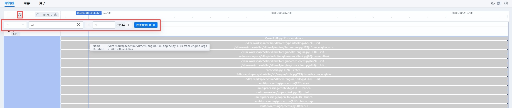

- 单击界面左上方工具栏中的，可在搜索弹出输入框左侧分别单击和，开启大小写匹配和全词匹配功能。

    - 单击搜索框前方的下拉菜单可选择查看不同的卡，也可选择“ALL”查看所有卡，系统默认选择第一张卡，如[**图 4** 选卡功能](#选卡功能)。

      **图 4**  选卡功能

      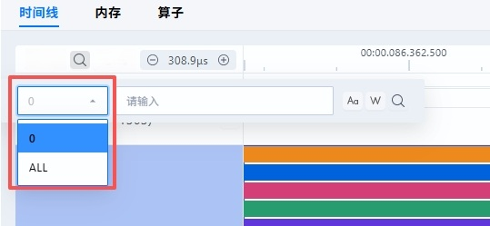

    - 单击开启大小写匹配，在弹出输入框中输入需要搜索的内容，然后按回车键，则会匹配名称中包含搜索项的算子或API，如[**图 5**  开启大小写匹配或全词匹配](#开启大小写匹配或全词匹配)所示。

      **图 5**  开启大小写匹配或全词匹配

      

    - 单击开启全词匹配，在弹出输入框中输入需要搜索的内容，然后按回车键，则会匹配名称为搜索项的算子或API，但是会忽略大小写，如[**图 5**  开启大小写匹配或全词匹配](#开启大小写匹配或全词匹配)所示。
    - 当同时选中和时，开启大小写匹配和全词匹配功能，在弹出输入框中输入需要搜索的内容，然后按回车键，则会精确匹配名称为搜索项的算子或API。

    - 单击搜索框后方的“在查找窗口打开”，可跳转至页面下方的“查找”页签，展示搜索项相关信息，如[**图 6**  在查找窗口打开](#在查找窗口打开)所示，字段解释如[**表 5**  查找页签字段说明](#查找页签字段说明)所示。单击“点击跳转Timeline”列的“点击”可跳转到算子或API在时间线视图上的具体位置。

      **图 6**  在查找窗口打开

      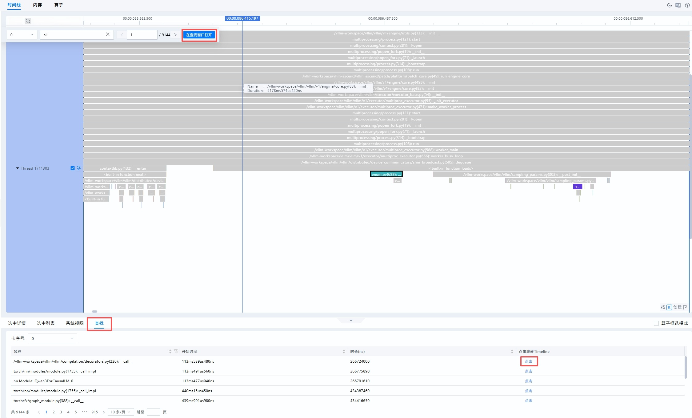

      **表 5**  查找页签字段说明

      |中文字段|英文字段|说明|
      |--|--|--|
      |卡序号|Rank ID|卡序号，可以选择需要查看的卡。|
      |名称|Name|算子名称。单击名称后面的筛选图标可通过名称筛选数据。|
      |开始时间|Start Time|算子执行起始时间。|
      |时长(ns)|Duration(ns)|算子运行总耗时。|
      |点击跳转Timeline|Click To Timeline|单击“点击”跳转到算子或API在时间线视图上的具体位置。|

### 性能数据展示

**支持界面预览**

- 在线程级泳道中，如果一个泳道中存在多行数据，则在不展开该泳道的情况下，将会以缩略图的形式展示该泳道中数据的分布情况，如[**图 7**  时间线（Timeline）界面预览](#时间线（Timeline）界面预览)中的1所示。
- 在不展开进程级泳道的情况下，根据线程级中时间轴上的数据，将以灰色填充进程级泳道来展示线程级泳道中的数据分布情况，如[**图 7**  时间线（Timeline）界面预览](#时间线（Timeline）界面预览)中的2所示。

    **图 7**  时间线（Timeline）界面预览

    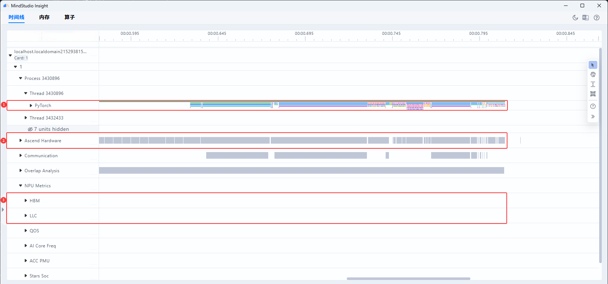

    > [!NOTE]
    >
    > CPU、Memory、Network相关利用率数据，也就是数值类型事件，在时间线（Timeline）中以柱状图形式呈现，暂不支持预览功能，如[**图 7**  时间线（Timeline）界面预览](#时间线（Timeline）界面预览)中的3所示。

**支持集群场景展示**

MindStudio Insight支持导入和展示集群场景数据，无需手动合并多个单卡数据。支持训练场景下的多机多卡和推理场景下多卡等场景，MindStudio Insight能够自动识别导入文件夹下所有的trace\_view.json和msprof\*.json文件。以16卡为例进行展示，如[**图 8**  集群场景时间线数据展示](#集群场景时间线数据展示)所示。

**图 8**  集群场景时间线数据展示

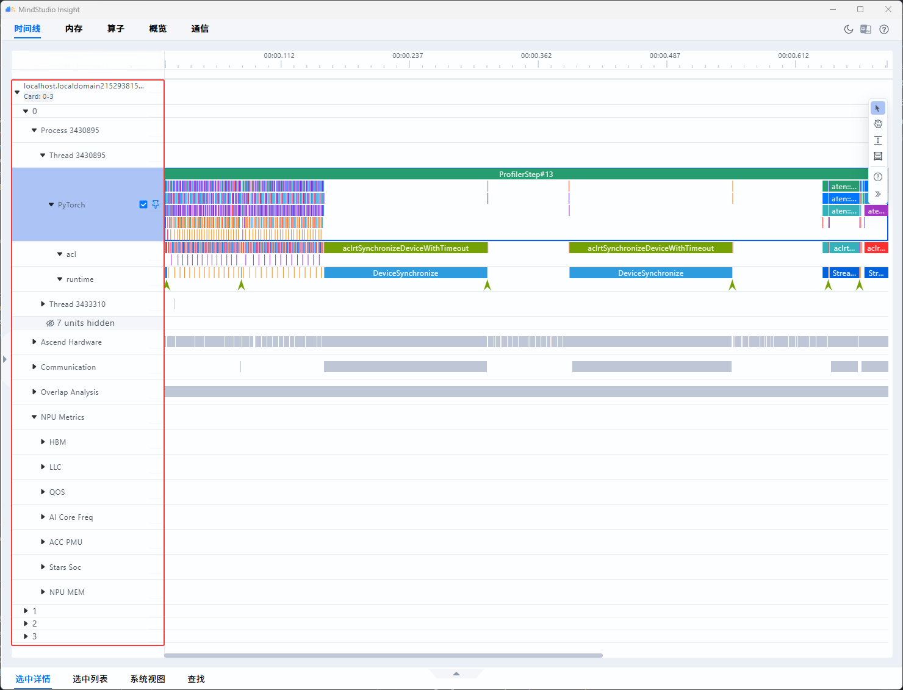

在集群场景中，为方便快速定位某卡的数据所对应的文件目录，可以将鼠标悬停在卡的序号上，则会显示该卡数据所对应的文件目录。例如将鼠标悬停在“0”上，则会在后方显示该卡所对应的文件目录，如[**图 9**  定位文件夹](#定位文件夹)所示。

**图 9**  定位文件夹

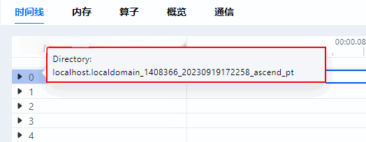

**支持分卡/泳道显示和对比**

当导入集群场景数据时，展示的时间线（Timeline）信息较多，为更好地帮助用户对比分析，MindStudio Insight支持按卡或按泳道过滤，也可联合卡和泳道一起过滤展示。

> [!NOTE]
>
> 当联合卡和泳道一起过滤时，可通过单独选择卡或泳道过滤的方式，依次选择对应卡和泳道，即可展示相应的过滤信息。

- 按卡显示：以只显示1卡为例，单击界面左上方，选择“卡过滤”，然后单击输入框，在下拉框选择“1”，即可显示1卡的时间线（Timeline）信息，如[**图 10**  卡过滤](#卡过滤)所示。

    **图 10**  卡过滤

    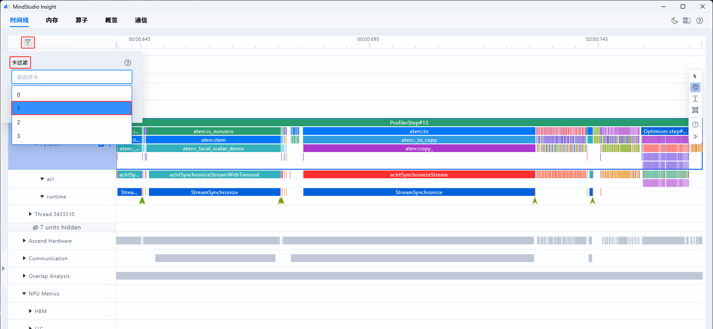

- 按泳道显示：以只显示每张卡的Overlap Analysis泳道为例，单击界面左上方工具栏，选择“泳道过滤”，然后单击输入框，在下拉框选择“Overlap Analysis”，即可显示Overlap Analysis泳道的时间线（Timeline）信息，如[**图 11**  泳道过滤](#泳道过滤)所示。

    **图 11**  泳道过滤

    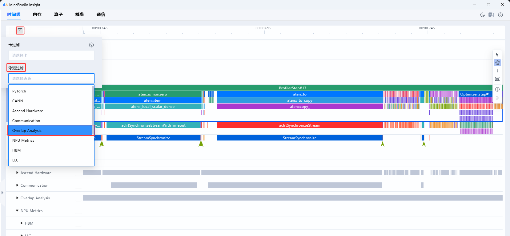

**支持泳道置顶和对比**

- MindStudio Insight支持固定并置顶泳道，且可以通过鼠标拖拽对收起状态的置顶泳道进行自由排序，方便同其他同类层级进行对比。

    > [!NOTE]
    >
    > 如果置顶的卡中同时也置顶了该卡中的二层级和三层级泳道，那么只能对卡层级泳道进行拖拽排序，不能对二层级和三层级泳道进行拖拽排序；同样的，如果置顶的二层级泳道中同时也置顶了三层级泳道，那么只能对二层级泳道进行拖拽排序。

    例：单击0、1、2卡中的某三层级名后方的，则可置顶，再次单击即可取消置顶，如[**图 12**  置顶对比](#置顶对比)所示。

    **图 12**  置顶对比

    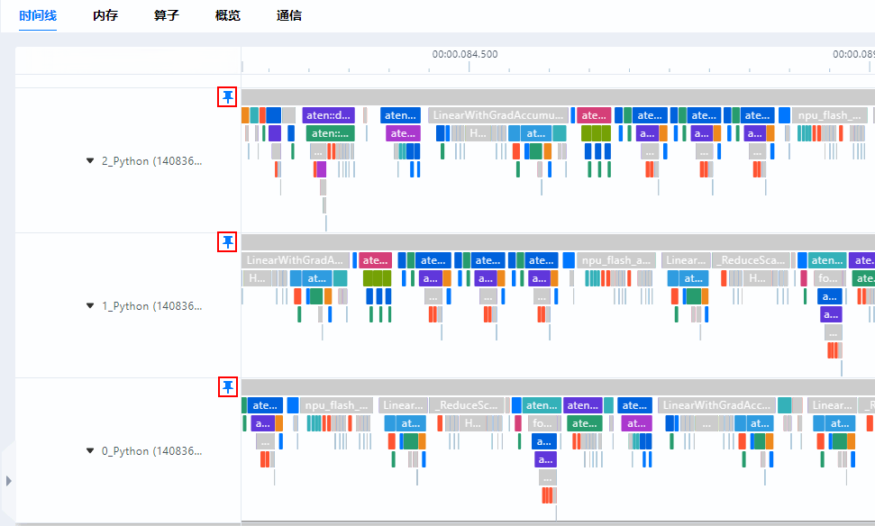

- MindStudio Insight支持一键置顶同一通信域的子级泳道。

  选择需要置顶的同名泳道，右键单击同名的任意泳道，选择“置顶同名泳道（泳道名称）”，则相同泳道名称的泳道会一并置顶，便于同名泳道的查看对比分析。以下为该功能的操作示例：

    在父泳道下的子泳道上单击鼠标右键，选择“置顶同名泳道（泳道名称）”，将置顶该通信域（组）下的所有同名泳道，便于查看对比，如[**图 13**  置顶同名泳道](#置顶同名泳道)所示，如[**图 14**  置顶同名泳道效果](#置顶同名泳道效果)所示。

    **图 13**  置顶同名泳道

    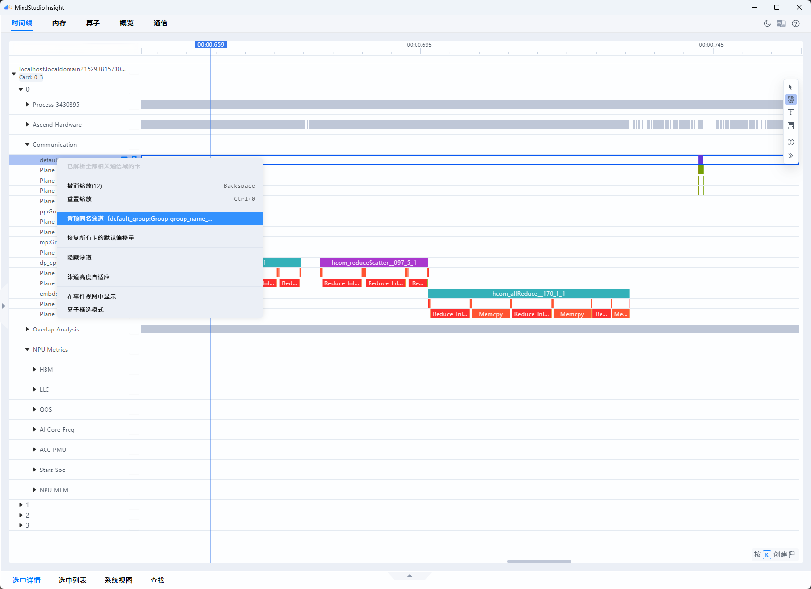

     **图 14**  置顶同名泳道效果

    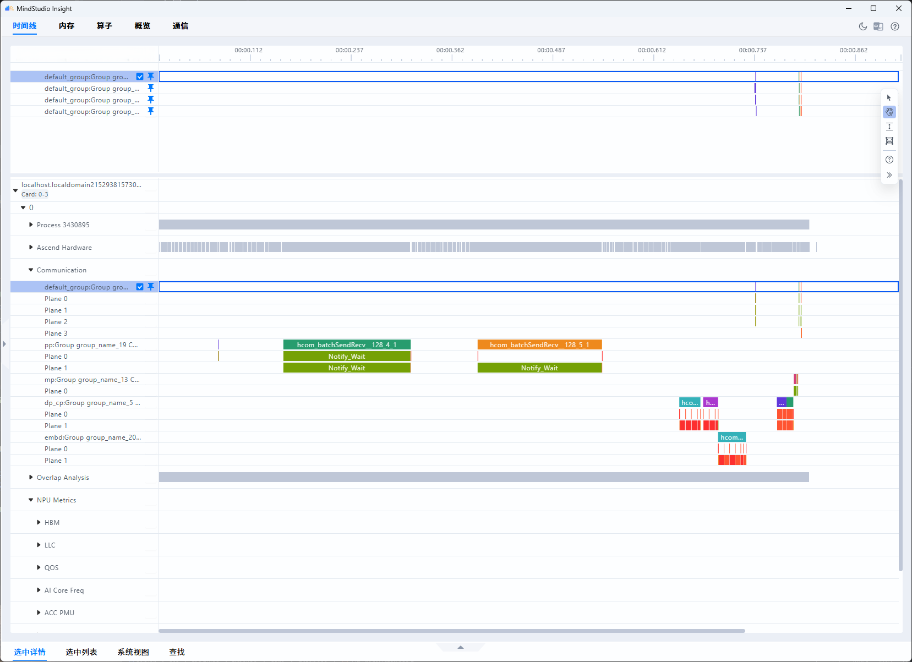

    在已置顶的泳道上单击鼠标右键，可选择“取消置顶同名泳道（泳道名称）”或者“取消置顶（全部）”，取消泳道置顶，如[**图 15**  取消置顶同名泳道](#取消置顶同名泳道)所示。“取消置顶同名泳道（泳道名称）”即取消该通信域（组）下的所有泳道，“取消置顶（全部）”即取消所有置顶泳道。

    **图 15**  取消置顶同名泳道

    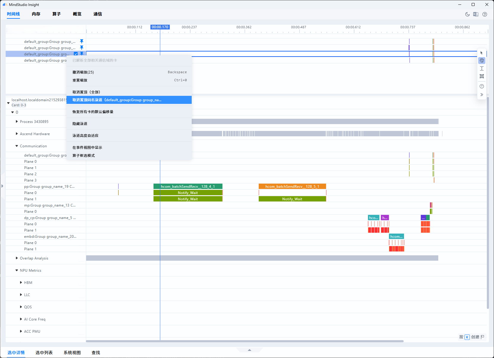

    >[!NOTE]
    >
    >该功能仅支持置顶最内层的同名子泳道。

**支持单卡和泳道时间对齐**

> [!NOTE]
>
> - 单卡场景、集群场景和多模型场景均已实现时间线（Timeline）相对位置自动对齐，如果无需自动对齐的话，请在任意位置单击鼠标右键，弹出菜单，选择“恢复所有卡的默认偏移量”，可恢复所有卡和模型的默认偏移量，参见如下操作手动设置相对位置对齐。
> - 若泳道设置了偏移量，且偏移量不为0，则会在泳道名称后方显示高亮蓝点。

- 手动设置对齐到起始位置

    在偏移量的弹窗中单击（对齐到起始位置）按钮，会在“时间戳偏移\(ns\)”输入框中显示该卡中最左侧的线程数据与时间轴初始位置（00：00.000）的偏移量，然后按回车键，时间线（Timeline）界面将会把该线程数据与时间轴初始位置对齐。

    如[**图 16**  初始位置偏移量](#初始位置偏移量)所示，0卡中最左侧线程数据与时间轴初始位置的偏移量如图所示为0。

    **图 16**  初始位置偏移量

    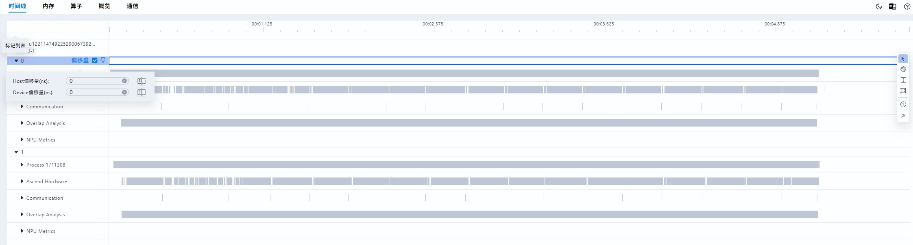

- 手动设置偏移量

    对于多机多卡场景，由于机器上时间不准，可能造成多卡间时间线（Timeline）相对位置不准确，如[**图 17**  设置偏移量](#设置偏移量)所示，通过以**Host**或者**Device**的维度设置偏移量，可以将对应泳道左右移动，从而达到时间“校准”的目的。偏移量的单位为ns，负值为右移，正值为左移。

    **图 17**  设置偏移量

    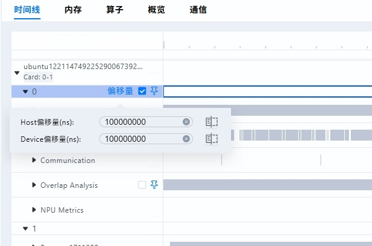

**支持时间对齐**

为方便数据查看对比更直观，支持多泳道算子的时间对齐，选择想要对齐的泳道算子，单击右键，在功能菜单中选择“**时间对齐**”功能右侧的“**左对齐**”或者“**右对齐**”即可实现。如[**图 18 时间对齐**](#时间对齐)所示。

**图 18**  时间对齐

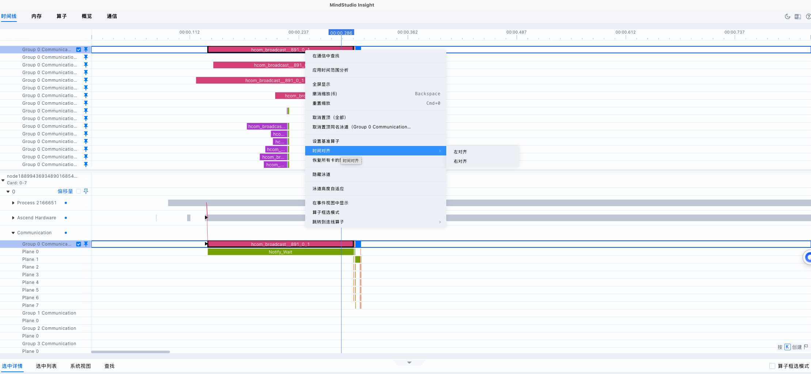

- 选择“左对齐”后，效果如[**图 19 时间左对齐**](#时间左对齐)所示。

  **图 19**  时间左对齐

  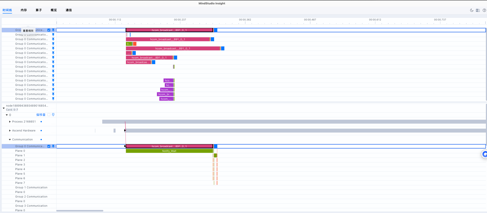

- 选择“右对齐”后，效果如[**图 20 时间右对齐**](#时间右对齐)所示。

  **图 20**  时间右对齐

  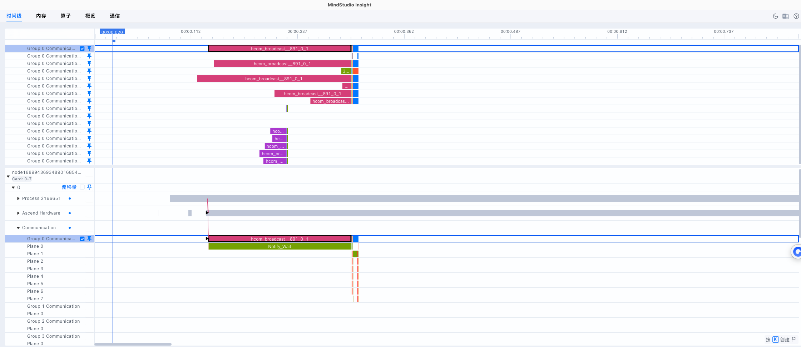

**支持多机多卡展示**

当导入多机多卡数据时，MindStudio Insight支持以机器维度展示数据，如[**图 21**  多机多卡展示](#多机多卡展示)所示。

- 图中1为机器名称，是由hostName和hostUid组成。
- 图中2为卡层级展示，按照当前机器的卡序号展示对应泳道。
- 图中3为参数配置项，在多机多卡场景下，需先选择“机器名称”，再选择该机器下的“卡序号”进行配置。

    当导入的db场景文件中存在名称为“HOST\_INFO”的表时，在时间线（Timeline）界面下的“系统视图”页签（选择“统计系统视图”和“专家系统视图”时）和“查找”页签下，存在该配置项。

> [!NOTE]
>
> 该功能仅支持在统一db场景下展示。

**图 21**  多机多卡展示

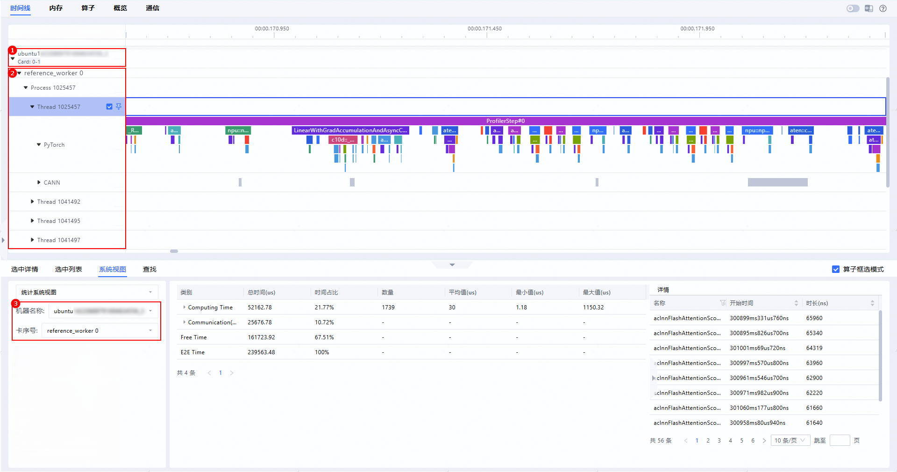

**设置和查看标记**

- 区域标记

    在时间线（Timeline）界面选中某个区域后，单击或敲击键盘K键将选中区域进行标记并保存，如[**图 22**  区域标记](#区域标记)所示。

    **图 22**  区域标记

    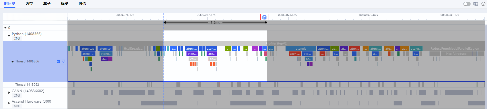

    左键双击任一标记，可以设置该标记对的属性，支持修改标记对名称、颜色以及删除该标记对，如[**图 23**  修改标记对属性](#修改标记对属性)所示。

    **图 23**  修改标记对属性

    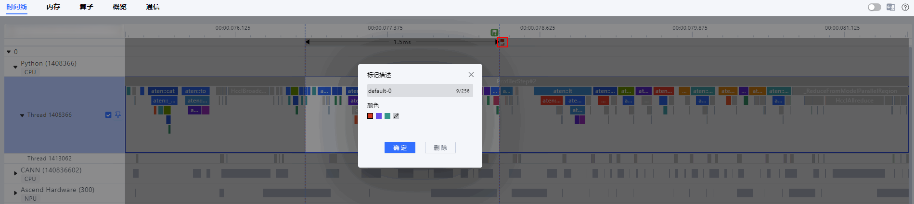

- 单点标记

    在最上方空泳道的任意位置，单击鼠标左键或敲击键盘K键，将生成一个单点标记，如[**图 24**  单点标记](#单点标记)所示。

    **图 24**  单点标记

    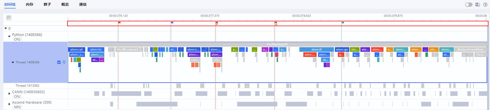

    左键双击标记，可以设置该标记的属性，支持修改标记的名称、颜色以及删除该标记。

- 标记管理

    单击左上方工具栏中的，将显示所有标记信息，如[**图 25**  查看标记信息](#查看标记信息)所示。

    **图 25**  查看标记信息

    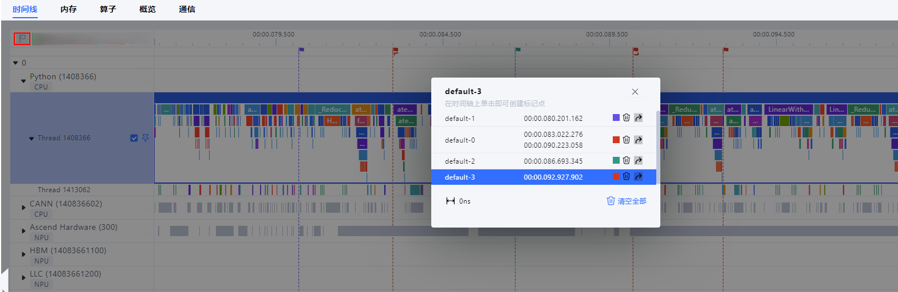

    - 单击某个标记对应的图标可删除标记。
    - 单击弹窗下方的“清空全部”可删除所有标记。
    - 单击区域标记，界面下方的“选中详情”页签会显示该区域的耗时信息详情。
    - 如果某一标记不在当前可视化界面，单击该标记对应的图标将直接跳转至标记界面，便于查看。
    - 单击某个标记对应的颜色图标可进行颜色设置，便于对标记进行分类管理。

**算子连线功能**

- MindStudio Insight支持算子连线关系展示，单击有连线的算子，即可显示该算子关联的连线，即使折叠连线起点或者终点的进程，连线也不会消失。并且支持定位到该算子关联连线的其它算子，并显示其详情。
    1. 单击有连线的算子，显示连线关系。
    2. 单击鼠标右键，选择“跳转到连线算子”，在算子列表中单击“来源”或“目标”下的具体算子名称或连线方式，即可跳转至对应算子，并自动高亮显示该算子，同时在“选中详情”页签中显示该算子的详细信息。如[**图 26**  算子连线关系](#算子连线关系)所示。

        **图 26**  算子连线关系

        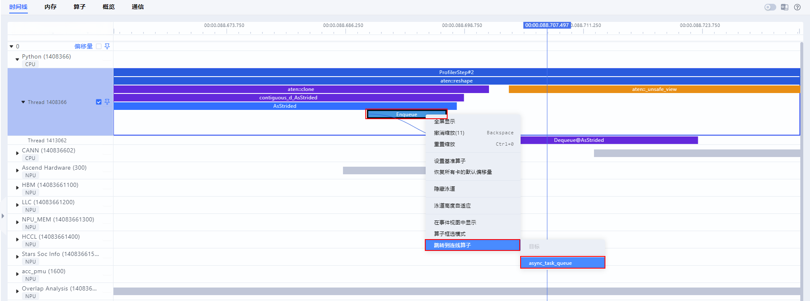

        > [!NOTE]
        >
        > - 如果同时折叠连线起点和终点的进程，连线就会消失。
        > - 在MindStudio Insight中连线仅会连接同一批下发的算子中的第一个。在Ascend Hardware泳道中，如果用户单击某一算子后，发现关联的连线显示在其它算子上，这表示当前单击的算子和连线的算子是同一批下发的。

- MindStudio Insight支持全量连线的功能，单击界面左上方工具栏中的，在弹框中选择一个或多个连线类型，也可在搜索框中搜索某一连线类型的关键字，勾选相应的连线类型，则在图形化窗格展示对应类型的所有连线，如[**图 27**  全量连线](#全量连线)所示。

    > [!NOTE]
    >
    > 最多支持选择10个连线类型。

    **图 27**  全量连线

    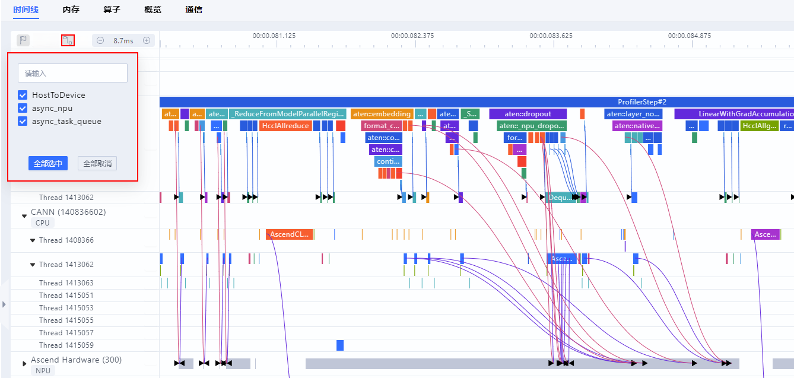

    应用层算子到NPU算子之间通过连线方式展示下发到执行的对应关系如下所示：

    - HostToDevice
        - CANN层Node（算子）到Ascend Hardware的NPU算子的下发执行关系（Host到Device）。
        - CANN层Node（算子）到Communication通信算子的下发执行关系（Host到Device）。

    - HostToDevice(Graph)
        - CPU侧算子到Ascend Hardware的`MODEL_EXECUTE`的下发执行关系（Host到Device）。

    - async\_npu
        - 应用层算子到Ascend Hardware的NPU算子的下发执行关系。
        - 应用层算子到Communication通信算子的下发执行关系。

    - async\_task\_queue：应用层Enqueue到Dequeue的入队列到出队列对应关系，仅PyTorch场景。
    - fwdbwd：前向API到反向API，仅PyTorch场景。
    - MSTX：打点数据到Ascend Hardware的NPU算子的下发执行关系。

    > [!NOTE]
    >
    > - 各层的对应关系是否呈现与对应采集场景是否采集该数据有关，请以实际情况为准。
    > - 各层之间的连线与各层是否展开呈联动关系，如果选择了某个连线类型，对应层没有展开，则不会显示该类型的连线。

**支持选择性解析多卡数据**

MindStudio Insight工具导入超过16卡的数据时，在时间线（Timeline）界面支持选择性解析数据，可一键全部解析或部分解析。

- 一键全部解析：在时间线（Timeline）界面，单击“开始全局解析”，将开始解析所有卡的数据，如[**图 28**  全局解析](#全局解析)所示。当所有卡的数据解析完成后，“开始全局解析”按钮消失。

    **图 28**  全局解析

    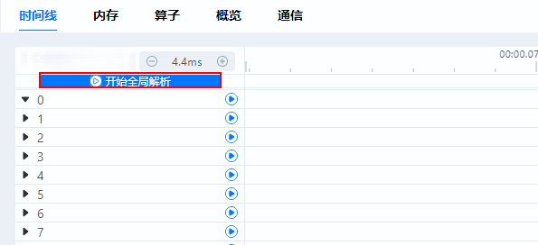

- 部分解析：当只需要解析部分卡的数据时，可逐个单击对应卡序号后面的，解析所选卡的数据，如[**图 29**  单卡解析](#单卡解析)所示。当对应卡数据解析完成后，按钮消失，如图中0卡和1卡所示。

    **图 29**  单卡解析

    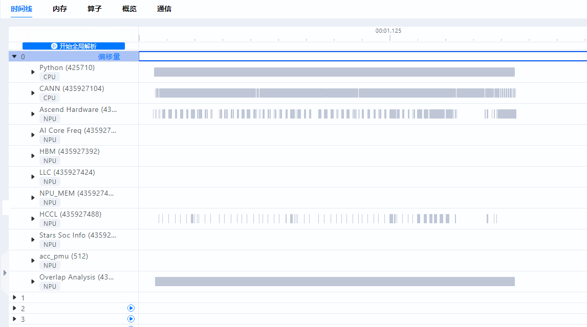

    如果导入的卡数量较多，可通过卡过滤功能定位所需解析数据的卡，进行数据解析操作。在时间线（Timeline）界面的工具栏中，单击，选择“卡过滤”，然后单击后方输入框，在下拉框选择所需呈现的卡，即可在时间线（Timeline）界面展示对应信息，单击卡序号后面的，进行数据解析，如[**图 30**  过滤展示并解析](#过滤展示并解析)所示，解析2、5、7卡数据。

    **图 30**  过滤展示并解析

    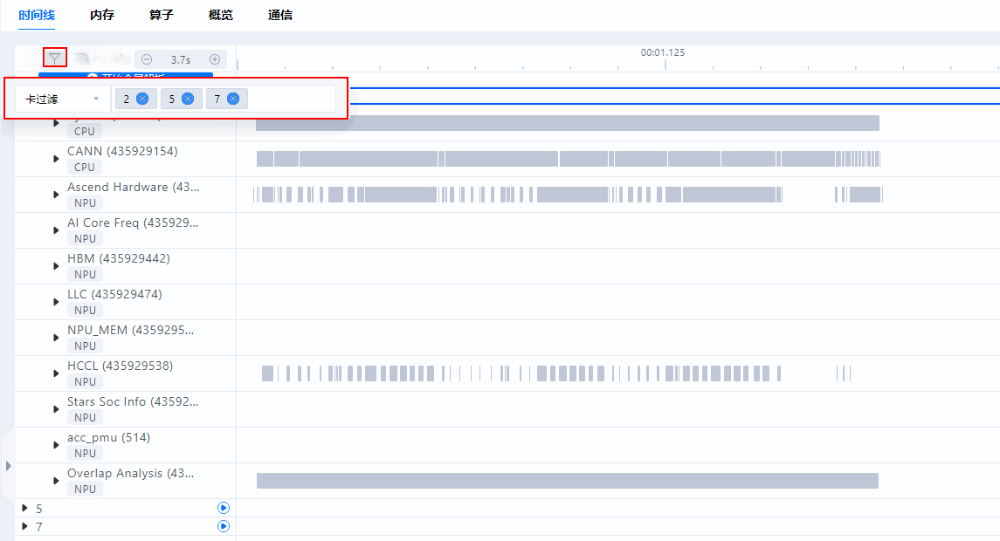

    > [!NOTE]
    >
    > 在部分解析场景下，单击“开始全局解析”按钮，此时会解析所有卡的数据。

- 相同通信域的卡解析：当解析完一个卡后，在通信的Group子泳道上，单击鼠标右键，选择“解析相关通信域的卡”，和该泳道通信域相关的卡都被解析，如[**图 31**  解析相关通信域的卡](#解析相关通信域的卡)，解析完成后，该鼠标右键菜单变为“已解析全部相关通信域的卡”并置灰。

    **图 31**  解析相关通信域的卡

    

**支持对齐自定义算子时间**

MindStudio Insight工具支持使用快捷键将选中算子进行时间对齐操作，便于比较算子信息。

- **算子时间对齐**
    1. 在时间线（Timeline）界面，选中任意一个算子，单击鼠标右键，选择“设置基准算子”，将选中算子设置为基准算子，如[**图 32** 设置基准算子](#设置基准算子)所示。

        **图 32** 设置基准算子

        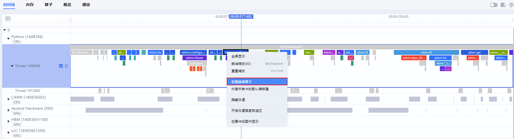

    2. 选中与基准算子不同的二级泳道中的算子。
    3. 使用键盘快捷键L（左对齐），将选中的算子与基准算子左边界对齐，如[**图 33** 算子左边界对齐](#算子左边界对齐)所示。

        **图 33** 算子左边界对齐

        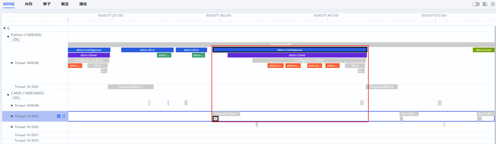

        使用键盘快捷键R（右对齐），则选中的算子与基准算子会右边界对齐，如[**图 34** 算子右边界对齐](#算子右边界对齐)所示。

        **图 34** 算子右边界对齐

        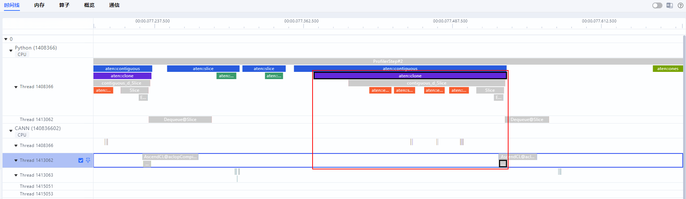

        > [!NOTE]
        >
        > 无论左对齐还是右对齐，与选中算子为相同类型NPU泳道中的算子也会随之一起偏移。

- **取消基准算子**

    在泳道任意位置，单击鼠标右键，选择“消除基准算子”，则取消基准算子，如[**图 35** 取消基准算子](#取消基准算子)所示。

    **图 35** 取消基准算子

    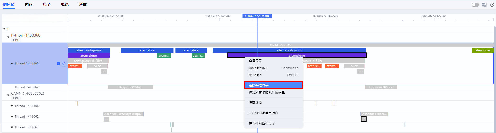

- **恢复默认偏移量**

    如果已经执行了算子时间对齐操作，可在泳道任意位置，单击鼠标右键，选择“恢复所有卡的默认偏移量”，恢复默认的偏移量，如[**图 36** 恢复所有卡的默认偏移量](#恢复所有卡的默认偏移量)所示。

    **图 36** 恢复所有卡的默认偏移量

    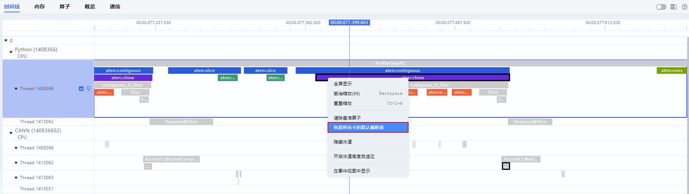

- **支持跳转到对应流**

    点击选中算子`MODEL_EXECUTE`，单击鼠标右键，选择“跳转到对应流”，可直接跳转对应的泳道并将对应泳道高亮显示，如[**图 37** 跳转到对应流](#跳转到对应流)和[**图 38** 跳转到对应流效果图](#跳转到对应流效果图)所示。

    **图 37** 跳转到对应流

    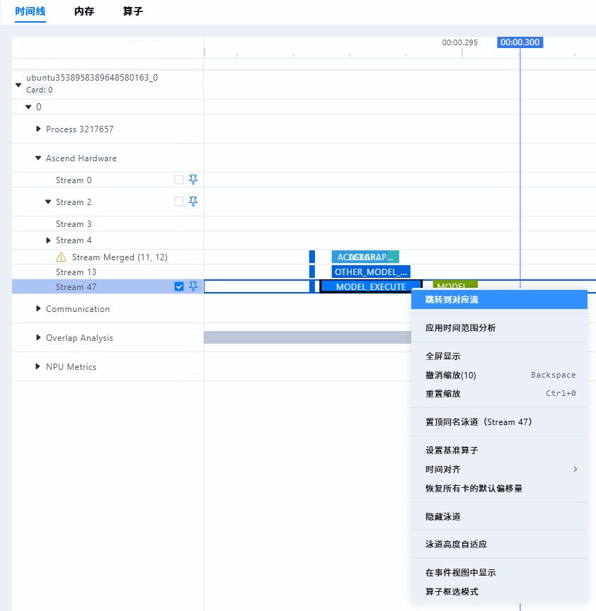

    **图 38** 跳转到对应流效果图

    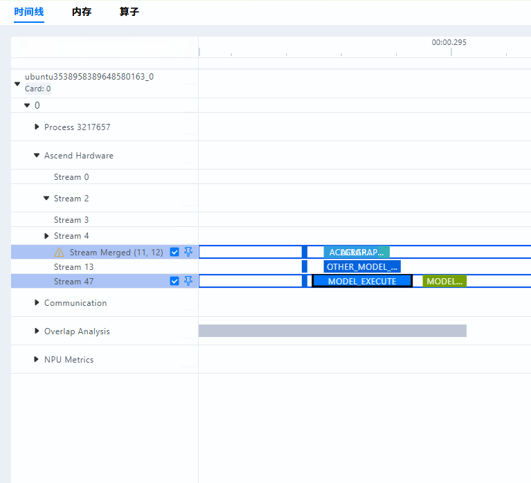

    >[!NOTE]
    >
    >当前仅算子`MODEL_EXECUTE`支持**跳转到对应流**功能。

### 页面调优展示

**泳道隐藏功能**

在时间线（Timeline）界面，可对泳道进行隐藏和展开。

- 隐藏泳道

    在时间线（Timeline）界面，鼠标放置在需要隐藏的泳道上，勾选单个泳道或多个泳道，或者框选多个泳道，自动勾选所框选的泳道，单击鼠标右键，在弹出菜单中选择“隐藏泳道”，隐藏该泳道，在该层级下会出现“_x_  units hidden”行，*x*表示隐藏的泳道数量，如[**图 39** 隐藏泳道](#隐藏泳道)所示。

    **图 39** 隐藏泳道 

    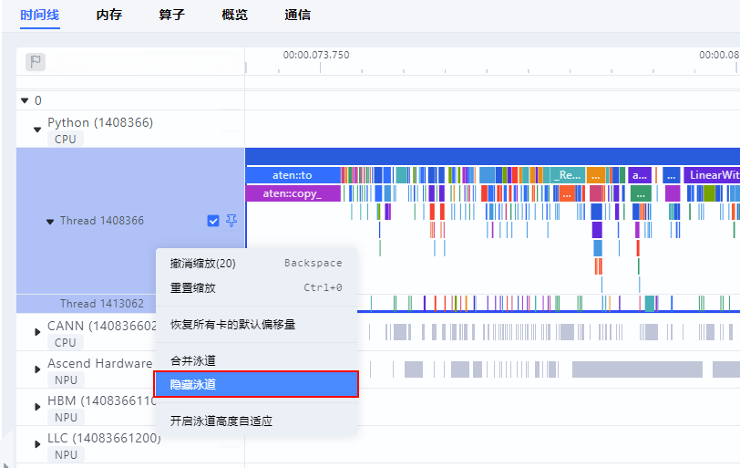

- 显示全部已隐藏的泳道

    选择存在隐藏泳道层级的units hidden行，单击鼠标右键，在弹出菜单中选择“显示全部泳道”，显示所选层级被隐藏的所有泳道。

    如果父层级和子层级都存在隐藏的泳道，在父层级泳道的units hidden行，选择“显示全部泳道”，将显示该父层级泳道下所有被隐藏的泳道。如[**图 40** 显示隐藏的泳道](#显示隐藏的泳道)所示。

    **图 40** 显示隐藏的泳道

    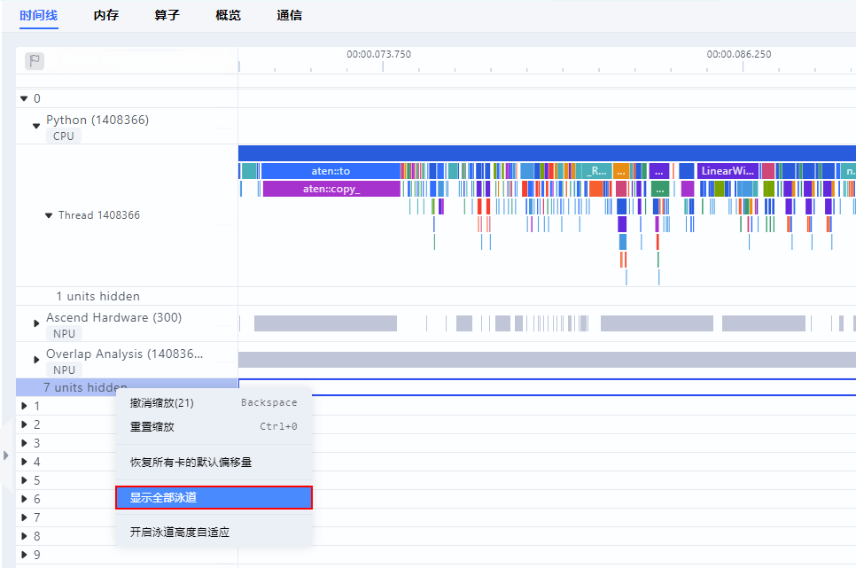

**Python调用栈泳道独立展示**

为方便详细定位问题代码位置，Python调用栈独立泳道呈现，如[**图 41** Python调用栈](#Python调用栈)所示。

**图 41** Python调用栈

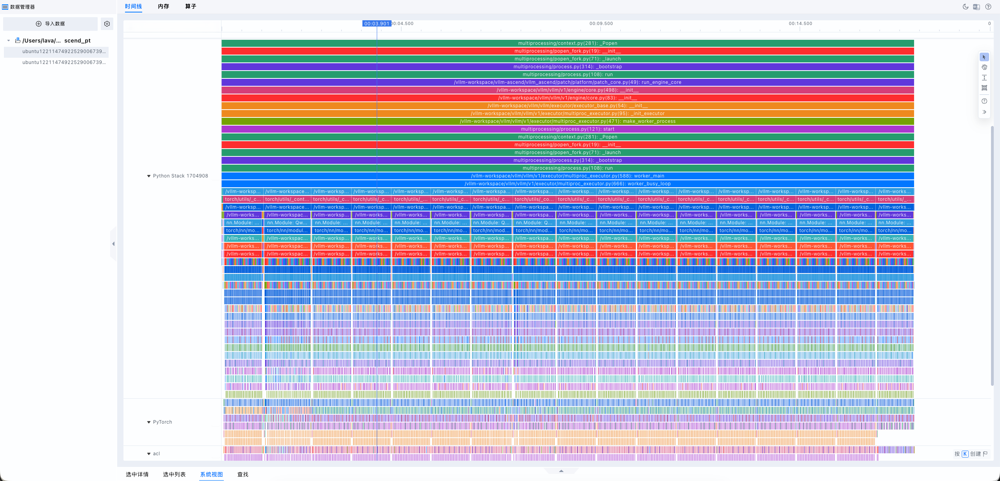

**支持展开全部泳道**

在时间线（Timeline）界面，可使用鼠标右键菜单展开全部泳道或收起全部泳道。

- 展开全部泳道：在需要展开的泳道上，单击鼠标右键，在弹出菜单中选择“展开全部子项”，将展开所选泳道下的全部子泳道，如[**图 42** 展开全部子项](#展开全部子项)所示，展开0卡的全部泳道。

    当所选泳道及子泳道已处于全部展开状态时，鼠标右键不显示“展开全部子项”选项。

    **图 42** 展开全部子项

    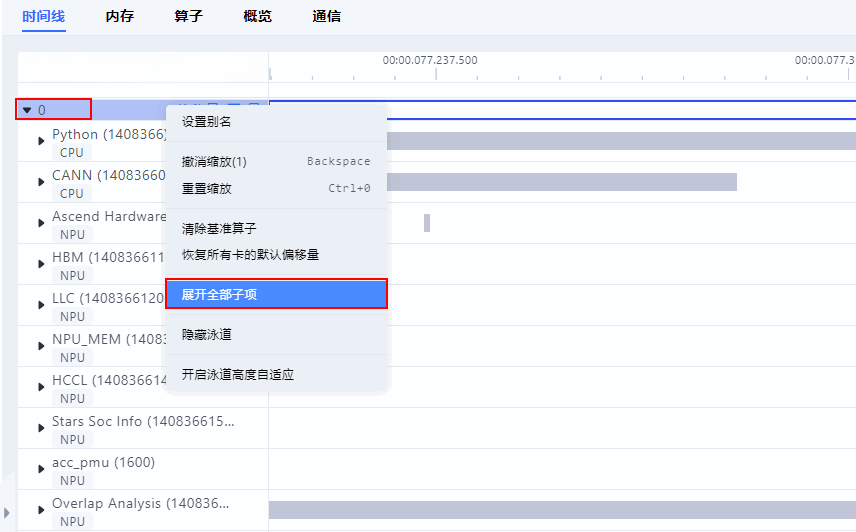

- 收起全部泳道：在已展开的泳道上，单击鼠标右键，在弹出菜单中选择“收起全部子项”，将收起所选泳道下的全部子泳道，如[**图 43** 收起全部子项](#收起全部子项)所示，收起0卡的所有泳道。

    **图 43** 收起全部子项

    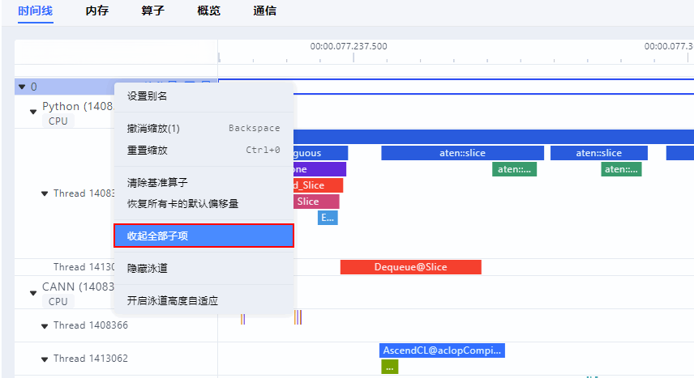

**泳道高度支持自适应**

在时间线（Timeline）界面，可使用鼠标右键菜单开启或关闭泳道高度自适应功能。

- 开启泳道高度自适应：在展开的泳道上，单击鼠标右键，在弹出菜单中选择“开启泳道高度自适应”，可自动调整泳道高度，以适配当前页面显示，如[**图 44** 开启泳道高度自适应](#开启泳道高度自适应)所示。

    **图 44** 开启泳道高度自适应

    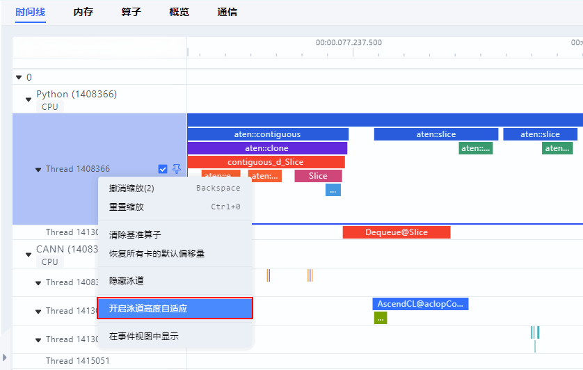

- 关闭泳道高度自适应：在已开启泳道高度自适应功能的泳道上，单击鼠标右键，在弹出菜单中选择“关闭泳道高度自适应”，关闭泳道高度自适应功能，泳道恢复初始高度，如[**图 45** 关闭泳道高度自适应](#关闭泳道高度自适应)所示。

    **图 45** 关闭泳道高度自适应

    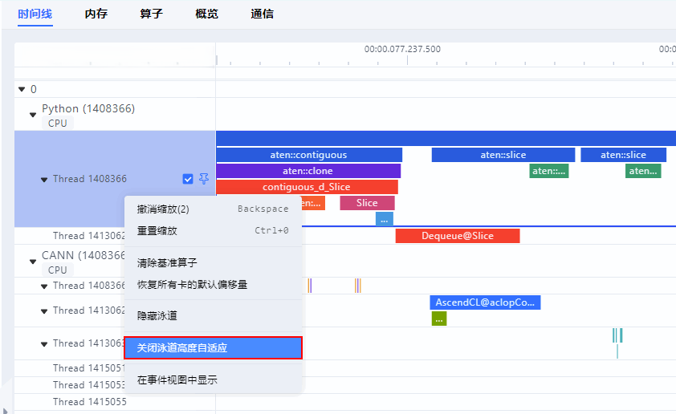

**支持锁定框选区域**

- 锁定框选区域

    在时间线（Timeline）界面，使用鼠标左键在泳道上框选部分算子区域后，单击鼠标右键，选择“锁定框选区域”，可在框选区域搜索相关算子，并展示连线起始点或终止点任意一个在框选区域的算子连线，如[**图 46** 锁定框选区域](#锁定框选区域)所示。也支持在单卡层级下跨多个泳道框选区域进行锁定。

    **图 46** 锁定框选区域

    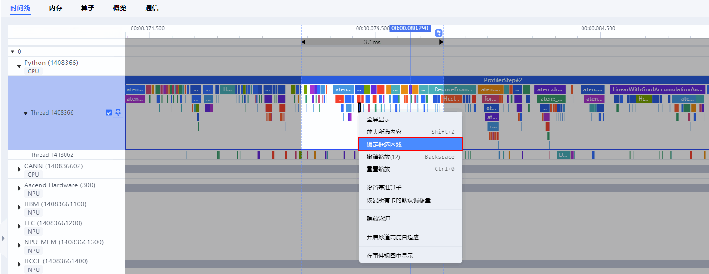

- 解锁框选区域

    如果需要取消框选，可单击鼠标右键，选择“解锁框选区域”，便可取消框选锁定，如[**图 47** 解锁框选区域](#解锁框选区域)所示。

    **图 47** 解锁框选区域

    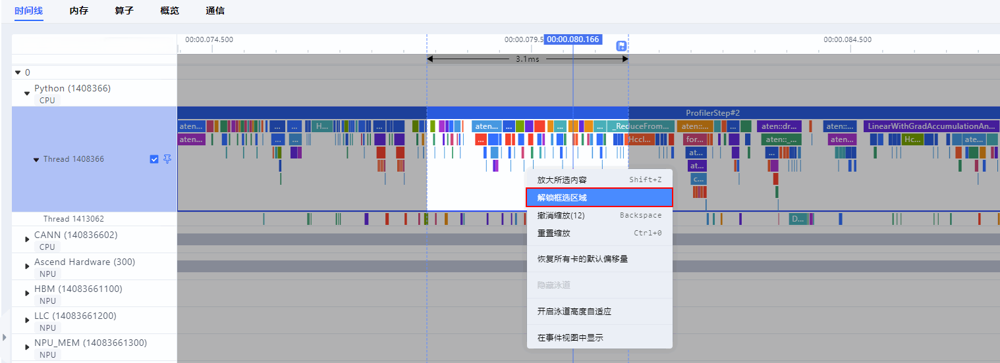

**支持合并Stream泳道**

在时间线（Timeline）界面，支持对多个Stream泳道进行合并，便于分析数据。

- 合并泳道

    在同一张卡内勾选多个需要合并的Stream泳道，单击鼠标右键，选择“合并泳道”，所选的泳道将被合并为一个新泳道，如[**图 48** 合并泳道](#合并泳道)所示。合并后的泳道连线功能、算子搜索功能以及算子跳转等功能均可正常使用。

    **图 48** 合并泳道

    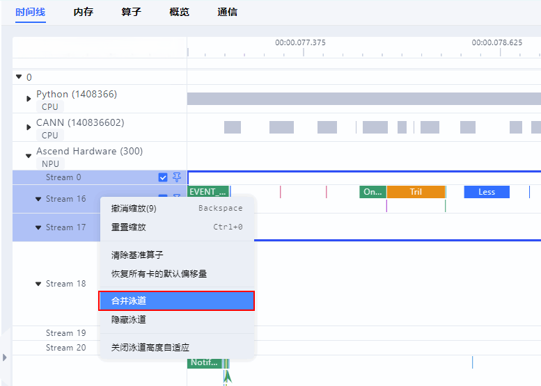

- 取消合并

    如果需要取消Stream泳道的合并，可在合并的Stream泳道上，单击鼠标右键，选择“取消合并泳道”，便可取消合并，重新展示各Stream泳道，如[**图 49** 取消合并泳道](#取消合并泳道)所示。

    **图 49** 取消合并泳道

    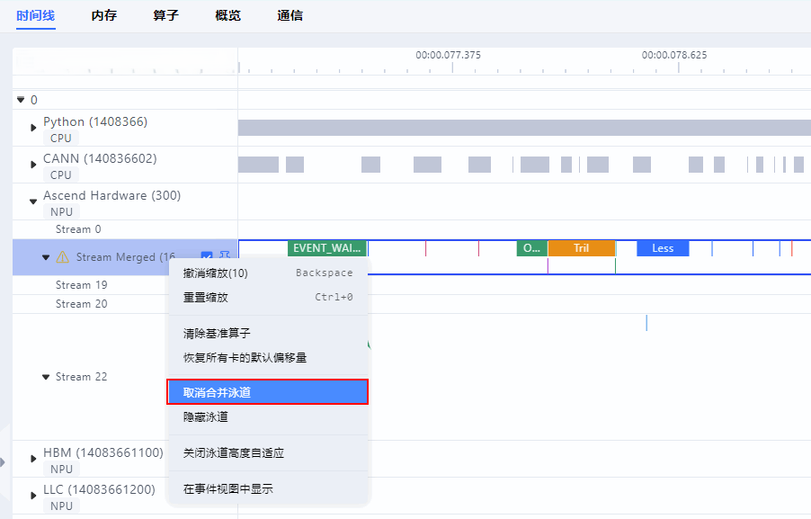

### 系统功能展示

**统计信息**

MindStudio Insight支持算子统计信息和单个算子详情信息查看。

- 使用鼠标左键在单个三层级泳道上框选部分区域的算子，或在单卡层级下跨多个泳道框选部分算子，框选部分区域算子后，可在下方“选中列表”页签中显示算子的统计信息，如[**图 50** 选中列表](#选中列表)所示，字段解释如[**表 6** 选中列表字段说明](#选中列表字段说明)所示。

    当鼠标移入“选中列表”页签，单击表格右上角按钮，一键复制当前“选中列表”中所展示的内容，并粘贴至Excel表格中进行分析。

    > [!NOTE]
    >
    > 在单卡下跨多个泳道框选算子的情况下，HBM、LLC、NPU\_MEM、Stars Soc Info、acc\_pmu等直方图泳道的框选部分不会在“选中列表”中统计。

    单击“选中列表”列中的某个算子，在右侧“详情”列表中将会显示此区域中与该算子同名的所有算子，单击“详情”列表中某一行，则在时间线视图中定位出该算子的具体位置，并同时跳转至“选中详情”页面，可查看该算子的详情信息。

    **图 50** 选中列表

    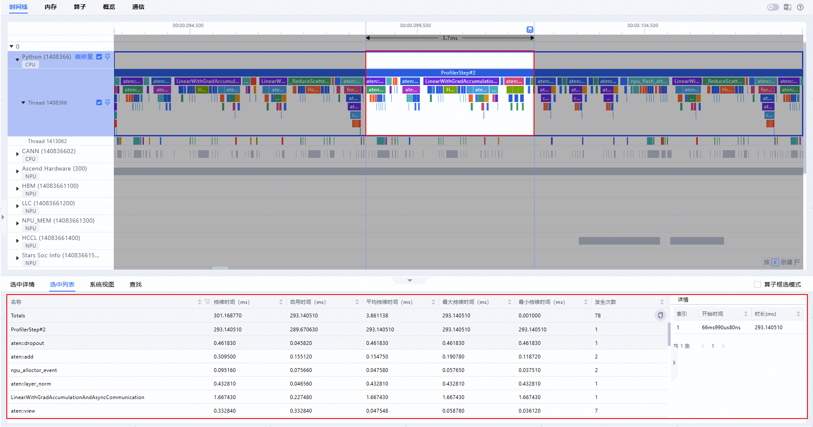

    **表 6** 选中列表字段说明

    |中文字段|英文字段|说明|
    |--|--|--|
    |名称|Name|算子名称。|
    |持续时间|Wall Duration|算子执行总耗时。|
    |自用时间|Self Time|算子执行时间（不包括调用的子算子时间）。|
    |平均持续时间|Average Wall Duration|算子平均执行时间。|
    |最大持续时间|Max Wall Duration|算子最大持续时间。|
    |最小持续时间|Min Wall Duration|算子最小持续时间。|
    |发生次数|Occurrences|算子调用次数。|
    |索引|Index|序号。|
    |开始时间|Start Time|在图形化窗格中的时间戳。|
    |时长(ms)|Duration(ms)|执行耗时。|

    选择一个三层级泳道，在泳道内可按照深度框选算子，在“选中列表”页签显示框选区域的算子，如[**图 51** 算子框选模式](#算子框选模式)所示。

    1. 选中并展开一个三层级泳道，在任意位置单击鼠标右键，勾选“算子框选模式”，表示开启按照深度框选算子开关。

        也可在时间线（Timeline）界面下方的数据窗格中，在标题行右侧勾选“算子框选模式”，开启框选开关。

    2. 在展开的三层级泳道中，选取任意位置框选部分算子，“选中列表”页签会显示框选区域的算子列表。
    3. 单击鼠标右键，取消勾选“算子框选模式”，或在数据窗格中标题行右侧，取消勾选“算子框选模式”，即可关闭按照深度框选算子开关。

        **图 51** 算子框选模式

        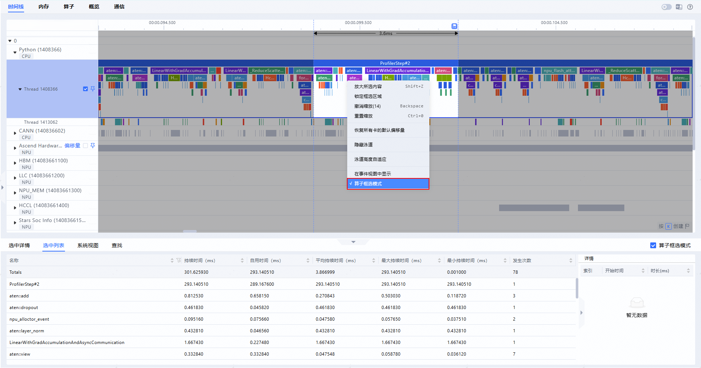

- 当选中单个算子时，可在下方“选中详情”页签中显示该算子的详情信息，如[**图 52** 选中详情](#选中详情)所示，字段解释如[**表 7** 选中详情字段说明](#选中详情字段说明)所示。

    选中单个算子，使用M键，可框选该算子所属的时间线（Timeline）区域，再次按下M键，可取消框选。

    **图 52** 选中详情

    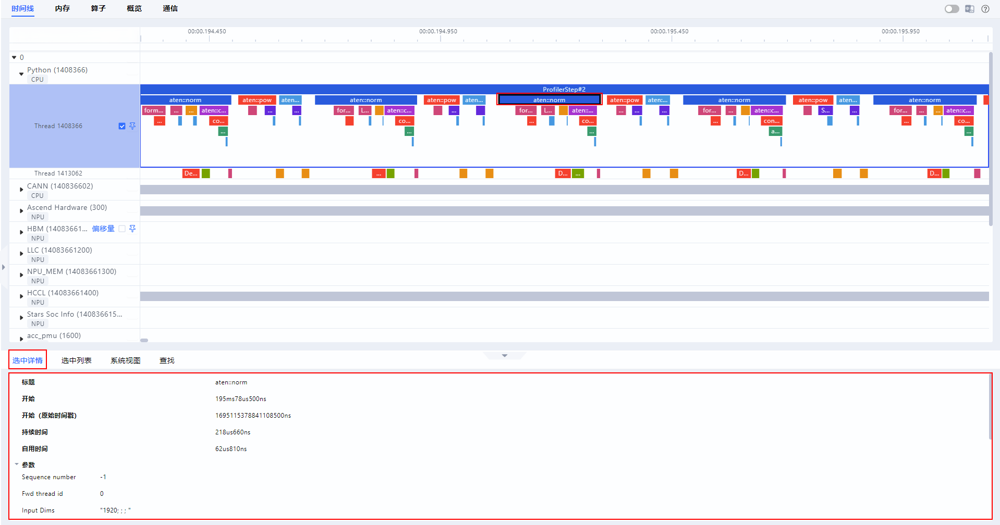

    **表 7** 选中详情字段说明

    |中文字段|英文字段|说明|
    |--|--|--|
    |标题|Title|名称。|
    |开始|Start|起始时间。|
    |开始（原始时间戳）|Start(Raw Timestamp)|数据采集到的原始开始时间。|
    |持续时间|Wall Duration|总耗时。|
    |传输时间(ms)|Transit Time(ms)|Communication Analysis记录的HCCL Group通信算子传输时间。仅在所选Group Slice能够与通信分析记录唯一关联时展示。|
    |等待时间(ms)|Wait Time(ms)|Communication Analysis记录的HCCL Group通信算子等待时间。仅在所选Group Slice能够与通信分析记录唯一关联时展示。|
    |自用时间|Self Time|总耗时（不包括子类）。|
    |输入Shapes|Input Shapes|算子输入维度。采集数据时task-time配置为l0时，不采集该字段，显示为N/A；NPU加速核上采集到的算子才有此字段。|
    |输入数据类型|Input Data Types|算子输入数据类型。采集数据时task-time配置为l0时，不采集该字段，显示为N/A；NPU加速核上采集到的算子才有此字段。|
    |输入格式|Input Formats|算子输入数据格式。采集数据时task-time配置为l0时，不采集该字段，显示为N/A；NPU加速核上采集到的算子才有此字段。|
    |输出Shapes|Output Shapes|算子的输出维度。采集数据时task-time配置为l0时，不采集该字段，显示为N/A；NPU加速核上采集到的算子才有此字段。|
    |输出数据类型|Output Data Types|算子输出数据类型。采集数据时task-time配置为l0时，不采集该字段，显示为N/A；NPU加速核上采集到的算子才有此字段。|
    |输出格式|Output Formats|算子输出数据格式。采集数据时task-time配置为l0时，不采集该字段，显示为N/A；NPU加速核上采集到的算子才有此字段。|
    |算子属性信息|Attr Info|算子属性信息。采集数据时task-time配置为l0或l1时，不采集该字段，显示为N/A；只有开启aclnn，task-time配置为l2时，才有此字段。|
    |通信带宽信息|Communication Bandwidth Info|所选Group Slice与通信分析记录唯一关联后，展示Communication Analysis中实际存在的RDMA、HCCS、PCIE、SDMA和SIO通信带宽记录。不存在的类型不展示。|
    |传输类型|Transport Type|通信带宽记录的类型，包括RDMA、HCCS、PCIE、SDMA或SIO。|
    |传输大小（MB）|Transit Size(MB)|对应通信带宽记录的传输数据量，单位为MB。|
    |传输时间(ms)|Transit Time(ms)|对应通信带宽记录的传输时间，单位为ms。|
    |带宽(GB/s)|Bandwidth(GB/s)|对应通信带宽记录的带宽，单位为GB/s。|
    |参数|Args|算子的相关参数信息。|

- 选中列表支持通过字段筛选算子，点击名称后面的筛选图标，在文本框输入筛选字段后，通过“回车”键或者“逗号”键确认筛选字段，点击“搜索”展示或者排除某个字段的算子，点击重置将会清空已输入的字段，如[**图 53** 算子筛选](#算子筛选)所示。

  > [!NOTE]
  >
  > - 筛选功能最多支持20个字段，字段总长度最多支持200字符。
  > - 字段筛选忽略大小写差异。
  > - 多字段筛选将满足某个字段的算子取交集展示或排除。

  **图 53** 算子筛选

  

**系统视图**

在“系统视图”页签，包含“统计系统视图”、“专家系统视图”和“事件视图”。

- 统计系统视图：展示综合指标信息、内存总览信息、API类型信息以及算子详情等信息，具体请参见[统计系统视图](#统计系统视图)。
- 专家系统视图：展示泳道中的异常指标信息，以及各类API和算子的专家建议详情，具体请参见[专家系统视图](#专家系统视图)。
- 事件视图：展示所选泳道的所有算子详情，具体操作与展示信息请参见[事件视图](#事件视图)。

“系统视图”页签下的信息支持仅展示选中区域的信息，具体操作如下。

1. 在“时间线”界面，使用鼠标左键框选泳道部分区域。
2. 单击鼠标右键，分别可按需选择菜单，进行分析，如[**表 8** 时间范围分析](#时间范围分析)和[**图 54** 时间范围分析](#时间范围分析-1)所示。

    **表 8** 时间范围分析

    |中文菜单|英文菜单|说明|
    |--|--|--|
    |时间范围分析|Time Range Analysis|跳转至“系统视图”页签，“系统视图”将会展示框选区域的时间段，以及该时间段内的信息。|
    |时间范围分析并放大|Time Range Analysis and Zoom in|所选区域放大至当前屏幕，并跳转至“系统视图”页签。|
    |应用时间范围分析|Apply Time Range Analysis|当选择一个算子，或框选后，在框选区域右键选择一个算子时，会出现“应用时间范围分析”菜单，选择该菜单后，跳转至“系统视图”页签，将会展示该算子所在的时间区间，以及该时间区间的信息。|

    **图 54** 时间范围分析

    

3. 开启该功能后，可在泳道上单击鼠标右键，选择“移除时间范围分析”，可关闭该功能。

**统计系统视图**

在“系统视图”页签，当选择“统计系统视图”时，页面包含卡序号（Rank ID）选框、综合指标（Overall Metrics）、内存拷贝总览（Memcpy Overall）、5种类型的算子汇总统计页签和算子详情（Kernel Details）（NPU上算子的详细信息），在卡序号选框中可以选择想要查看的卡。如果是db场景，需要依次选择“机器名称”和“卡序号”。

>[!NOTE]
>
> - 当所选卡为非Ftrace数据时，统计系统视图将展示：综合指标、内存拷贝总览、算子下发耗时统计、算子详情以及算子类型（包括Python API 汇总、CANN API 汇总、Ascend Hardware Task 汇总、通信汇总、覆盖分析）数据。
> - 当所选卡为具有统计能力的Ftrace数据时，统计系统视图展示**Ftrace任务统计**。

- 综合指标

  综合指标（Overall Metrics）展示所有算子的总体信息，如[**图 55** 综合指标](#综合指标)所示，字段解释如[**表 9** 综合指标字段说明](#综合指标字段说明)所示，当选择计算时间（Computing Time）列表中的子层级时，可单击“详情”区域任一算子，会跳转到该算子在时间线视图中的具体位置。

  **图 55** 综合指标

  

  **表 9** 综合指标字段说明

  |中文字段|英文字段|说明|
  |--|--|--|
  |类别|Category|类别。  可展示多层级信息：  一层级：包含Computing Time（计算时间）、Communication(Not Overlapped) Time（通信时间（未被覆盖））、Free Time（空闲时间）和E2E Time（端到端时间）。  子层级：Computing Time（计算时间）的子层级包括Flash Attention、Conv、Matmul、Cube、Vector等计算流算子的拆解结果。其中，Forward、Backward用于区分前向、反向传播。支持通过单击类别`Computing Time`后面的添加自定义算子分类规则（上限50条）。  Communication(Not Overlapped) Time（通信时间（未被覆盖））的子层级为各通信域的分组拆解结果。其中等待时间、传输时间为与通信未被覆盖取交集后的结果。|
  |总时间(μs)|Total Time(μs)|该类耗时总和。|
  |时间占比|Time Ratio|该类的耗时占比。|
  |数量|Number|该类算子数目。|
  |平均值(μs)|Avg(μs)|该类耗时的平均值。|
  |最小值(μs)|Min(μs)|该类耗时的最小值。|
  |最大值(μs)|Max(μs)|该类耗时的最大值。|
  |详情|Details|当选择Computing Time（计算时间）列表中的子层级时，该区域展示所选层级的所有算子详情，可单击任意一个算子，跳转至时间线视图中算子所在的具体位置。|

- 内存拷贝总览

  > [!NOTE]
  >
  > 当“profiler_level”参数设置为“Level2”时，才能采集到内存拷贝数据，具体使用方法请参见[Ascend PyTorch调优工具数据采集](https://gitcode.com/Ascend/pytorch/blob/v2.7.1-26.1.0/docs/zh/ascend_pytorch_profiler/ascend_pytorch_profiler_user_guide.md#%E9%87%87%E9%9B%86%E5%92%8C%E8%87%AA%E5%8A%A8%E8%A7%A3%E6%9E%90)。

  内存拷贝总览（Memcpy Overall）展示内存拷贝算子的详情，如[**图 56** 内存拷贝总览](#内存拷贝总览)所示，字段解释如[**表 10** 内存拷贝总览字段说明](#内存拷贝总览字段说明)所示，当选择任意一个类别时，可单击“详情”区域任意一个内存拷贝算子，会跳转到该算子在时间线视图中的具体位置。

  **图 56** 内存拷贝总览

  

  **表 10** 内存拷贝总览字段说明

  |中文字段|英文字段|说明|
  |--|--|--|
  |类别|Category|类别。显示内存拷贝数据统计的类型。|
  |总时间(μs)|Total Time(μs)|该类耗时总和。|
  |总大小（Byte）|Total Size(Byte)|该类内存拷贝数据总量。|
  |数量|Number|该类内存拷贝算子数目。|
  |平均时间(μs)|Avg Time(μs)|该类内存拷贝耗时的平均值。|
  |最小时间(μs)|Min Time(μs)|该类内存拷贝耗时的最小值。|
  |最大时间(μs)|Max Time(μs)|该类内存拷贝耗时的最大值。|
  |平均大小（Byte）|Avg Size(Byte)|该类内存拷贝数据的平均数据量。|
  |最小大小（Byte）|Min Size(Byte)|该类内存拷贝数据的最小数据量。|
  |最大大小（Byte）|Max Size(Byte)|该类内存拷贝数据的最大数据量。|
  |详情|Details|该区域展示所选内存拷贝数据的所有算子详情，可单击任意一个算子，跳转至时间线视图中算子所在的具体位置。|

- 算子类型汇总

  算子类型包括Python API 汇总（Python API Summary）、CANN API 汇总（CANN API Summary）、Ascend Hardware Task 汇总（Ascend Hardware Task Summary）、通信汇总（Communication Summary）、覆盖分析（Overlap Analysis），算子信息如[**图 57** 算子类型汇总](#算子类型汇总)所示，字段解释如[**表 11** 算子类型汇总字段说明](#算子类型汇总字段说明)所示。

  **图 57** 算子类型汇总

  

  **表 11** 算子类型汇总字段说明

  |中文字段|英文字段|说明|
  |--|--|--|
  |名称|Name|名称。|
  |时间(%)|Time(%)|总时间占比 = 该类的耗时总时间 / 所有耗时总时间。  当统计类型为覆盖分析（Overlap Analysis）时，时间占比 = 该类的耗时总时间 /（Communication(Not Overlapped)总时间 + Computing总时间 + Free总时间）。|
  |总时间(μs)|Total Time(μs)|该类耗时总和。|
  |调用数|Num Calls|被调用次数。|
  |平均值(μs)|Avg(μs)|该类耗时的平均值。|
  |最小值(μs)|Min(μs)|该类耗时的最小值。|
  |最大值(μs)|Max(μs)|该类耗时的最大值。|

- 空闲时间归因分析

  在“统计系统视图”中选择“空闲时间归因分析”，可查看当前卡的 Free 事件关联的 PyTorch Host API。分析通过 Overlap Analysis 中紧随 Free 的首个计算或通信行为，找到同开始时间的设备算子，再沿连线回溯 Host API。分析结果仅供参考，需结合 Timeline 中的实际执行情况进一步确认。展开分组可查看 API 和 Free 的开始时间、时长、后继行为及关联状态，并分别跳转至对应 API 或 Free。存在多个候选 API 时，可分别跳转查看。汇总与展开明细分别支持排序、分页和复制当前页数据。空闲时间归因分析[**图 58** 空闲时间归因分析](#空闲时间归因分析)所示，字段解释如[**表 12** 空闲时间归因分析字段说明](#空闲时间归因分析字段说明)所示。

  **图 58** 空闲时间归因分析

  

  **表 12** 空闲时间归因分析字段说明

  |字段|说明|
  |--|--|
  |Host API|按完整 API 名称归并。无法完成唯一关联的 Free 分别展示为未关联、关联不完整或关联不唯一分组。|
  |累计空闲时长（μs）|分组内关联 Free 事件的完整时长总和，不是 API 自身耗时。|
  |累计空闲区间数|当前分组包含的 Free 空闲区间数量，每个区间仅计数一次。|

  **二级表字段说明**

  单击一级表分组左侧的展开按钮，可查看该分组的二级表。每条明细对应一个 Free 空闲区间；即使存在多个候选 API，也不会将同一个 Free 拆分为多条明细。

  |中文字段|英文字段|说明|
  |--|--|--|
  |Host API 名称|Host API Name|关联的 PyTorch Host API 名称。无法唯一关联时，展示已找到的候选 API；未找到 API 时显示“--”。|
  |API 开始时间（μs）|API Start Time (μs)|关联或候选 Host API 在时间线中的开始时间，单位为 μs。未找到 API 时显示“--”。|
  |API 时长（μs）|API Duration (μs)|关联或候选 Host API 自身的执行时长，单位为 μs，不是对应 Free 的时长。未找到 API 时显示“--”。|
  |Free 开始时间（μs）|Free Start Time (μs)|当前 Free 空闲区间在时间线中的开始时间，单位为 μs。|
  |Free 时长（μs）|Free Duration (μs)|当前 Free 空闲区间的完整持续时间，单位为 μs。一级表的累计空闲时长由该分组内这些 Free 时长累加得到。|
  |后继行为类型|Next Behavior|Free 之后首个行为的类型，包括 Computing（计算）、Communication（通信），或同时包含两者。此列描述后继行为，不表示 API 的类型；无后继行为时为空。|
  |关联状态|Association Status|唯一关联时显示“已唯一关联”；关联不唯一、关联不完整或未关联时，显示具体原因，详见下方关联状态说明。|
  |操作|Actions|单击“跳转 API”定位关联或候选 API，单击“跳转 Free”定位当前 Free。多个候选 API 分别提供带序号的跳转按钮；没有 API 目标时隐藏“跳转 API”，仍可跳转 Free。|

  存在多个候选 API 时，Host API 名称、API 开始时间和 API 时长显示为“第一个值 等 N 个”的摘要形式，悬浮可查看完整内容，复制时保留全部候选值。N 表示候选 API 实例数；不同实例的名称、开始时间或时长可以相同。

  API 和 Free 的开始时间分别随相应的 Host、Device 时间偏移调整，时长不受平移影响。应用时间范围分析后，按 Free 区间与所选范围是否相交筛选记录；Free 时长仍为完整区间时长，不裁剪为相交部分，关联 API 的开始时间也可能在所选范围之外。

  **关联状态说明**

  |显示内容|含义|
  |--|--|
  |已唯一关联|关联链路完整，最终只找到一个 PyTorch Host API 实例。多个后继任务回溯到同一 API 实例时，仍视为唯一关联。|
  |存在多个候选 API 实例|关联链路完整，但最终找到多个不同的 PyTorch Host API 实例，无法确定唯一目标；同名的不同 API 实例也属于多个候选。|
  |部分候选链路缺失|已找到候选 API，但仍有部分关联链路缺失，不能确认完整关联结果。|
  |无后继行为|未找到 Free 之后的计算或通信行为。|
  |后继行为与 Free 不连续|找到后继行为，但其开始时间不等于 Free 的结束时间，无法按紧邻关系归因。|
  |未找到同开始时间的设备算子|找到后继行为，但未找到与其开始时间相同的对应计算或通信算子。|
  |缺少关联连线|找到对应设备算子，但缺少可用于回溯的关联连线。|
  |未找到 PyTorch Host API|已找到关联连线，但未找到对应的 PyTorch Host API。|

  原因缺失或无法识别时，关联状态回退显示“关联不唯一”“关联不完整”或“未关联”。存在候选 API 仅表示可供核查的关联线索，仍需结合时间线中的实际执行情况确认。

- 算子跟踪

  算子跟踪包括Python API 跟踪（Python API Trace）、CANN API 跟踪（CANN API Trace）、Ascend Hardware Task 跟踪（Ascend Hardware Task Trace）、通信跟踪（Communication Trace），算子信息如[**图 59** 算子跟踪](#算子跟踪)所示，字段解释如[**表 13** 算子跟踪字段说明](#算子跟踪字段说明)所示。

  **图 59** 算子跟踪

  

  **表 13** 算子跟踪字段说明

  |中文字段|英文字段|说明|
  |--|--|--|
  |名称|Name|名称。|
  |开始时间|Start Time|任务开始时间点。|
  |时长(μs)|Duration(μs)|任务耗时。|

- 算子类型汇总（按类型）

  对算子详情表按类型汇总的统计结果，采集项同算子详情表，算子信息如[**图 60** 算子类型汇总（按类型）](#算子类型汇总)所示，字段解释如[**表 14** 算子类型汇总（按类型）字段说明](#算子类型汇总字段说明)所示。

  **图 60** 算子类型汇总（按类型）

  

  **表 14** 算子类型汇总（按类型）字段说明

  |中文字段|英文字段|说明|
  |--|--|--|
  |类型|Type|算子类型。|
  |加速器核|Accelerator Core|AI加速核类型，包括AI Core、AI CPU等。|
  |数量|Count|算子执行次数。|
  |总耗时(μs)|Total Time(μs)|算子执行总时间。|
  |平均耗时(μs)|Avg Time(μs)|算子执行平均时间。|
  |最大耗时(μs)|Max Time(μs)|算子执行的最大时间。|
  |最小耗时(μs)|Min Time(μs)|算子执行的最小时间。|
  |详情|Details|单击详情列中查看更多，可以展示单个计算算子的具体信息，详情请参见[**表 2** 计算算子字段说明](operator.md#计算算子字段说明)。|

- 算子详情

  算子详情（Kernel Details）展示NPU上算子的详细信息，如[**图 61** 算子详情信息展示](#算子详情信息展示)所示，字段解释如[**表 15** 算子详情字段说明](#算子详情字段说明)所示，单击“点击跳转Timeline”列中的“点击”，会跳转到算子在时间线视图中的具体位置，区域四（数据窗格）将会展示选中详情，展示该算子的具体信息。单击算子详情表中字段名称后的，可对相关字段进行模糊搜索。

  **图 61** 算子详情信息展示

  

  **表 15** 算子详情字段说明

  |中文字段|英文字段|说明|
  |--|--|--|
  |名称|Name|算子名称。|
  |类型|Type|算子类型。|
  |加速器核|Accelerator Core|计算核类型。|
  |开始时间|Start Time|任务开始时间点。|
  |时长(μs)|Duration(μs)|任务耗时。|
  |等待时间(μs)|Wait Time(μs)|上一个任务的结束时间与当前任务的开始时间间隔，单位μs。|
  |任务ID|Task ID|任务的ID。|
  |Block数量|Block Num|任务运行切分数量，对应任务运行时核数。MindStudio Insight 8.3.0及之前版本中，“Block数量”对应的英文为“Block Dim”。|
  |输入Shapes|Input Shapes|算子的输入维度。|
  |输入数据类型|Input Data Types|算子输入数据类型。|
  |输入格式|Input Formats|算子输入数据格式。|
  |输出Shapes|Output Shapes|算子的输出维度。|
  |输出数据类型|Output Data Types|算子输出数据类型。|
  |输出格式|Output Formats|算子输出数据格式。|
  |点击跳转Timeline|Click To Timeline|单击“点击”，跳转到算子在时间线视图上的具体位置，并且在区域四（数据窗格）展示该算子的详情。|

- Ftrace任务统计

  Ftrace任务统计（Ftrace Task Summary）是对Ftrace采集数据的调度、上下文切换次数、被中断打断次数与时长的统计信息，用于帮助快速定位CPU侧Top 耗时进程、Top 中断源、进程抢占频次等关键指标，如[**图 62** Ftrace任务统计](#Ftrace任务统计)所示，字段说明见[**表 16** Ftrace任务统计字段说明](#Ftrace任务统计字段说明)。

  **图 62** Ftrace任务统计

  

  **表 16** Ftrace任务统计字段说明

  |中文字段|英文字段|说明|
  |--|--|--|
  |运行CPU|CPU|进程运行所在CPU|
  |进程/线程名|Comm|进程/线程名称|
  |进程/线程号|PID/TID|进程/线程号|
  |待运行时长(ns) |Runnable(ns)|进程/线程处于待运行（Runnable）的总耗时统计。|
  |运行时长(ns) |Running(ns)|进程/线程处于运行中（Running）的总耗时统计。|
  |睡眠时长（ns）|Sleeping(ns) |进程/线程处于休眠中（Sleeping）的总耗时统计。|
  |上下文切换次数 |Context Switch Count|进程/线程上下文切换的次数。|
  |软中断次数|Soft IRQ Count|进程/线程被软中断打断的次数。|
  |软中断时长（ns）|Soft IRQ Duration(ns) |进程/线程被软中断打断的总耗时。|
  |硬中断次数|Hard IRQ Count|进程/线程被硬中断打断的次数。|
  |硬中断时长（ns）|Hard IRQ Duration(ns) |进程/线程被硬中断打断的总耗时。|

- 算子下发耗时统计

  算子下发问题是常见典型的HOST Bound问题，支持提供拆解分析一、二级流水耗时，帮助调优人员快速找到下发异常点，如[**图 63** 算子下发耗时统计](#算子下发耗时统计)所示，字段说明见[**表 17** 算子下发耗时统计字段说明](#算子下发耗时统计字段说明)。

  **图 63** 算子下发耗时统计

  

  **表 17** 算子下发耗时统计字段说明

  |中文字段|英文字段|说明|
  |--|--|--|
  |算子|Operator|算子名称。|
  |路径|Path|算子下发路径类型：ACLOP 或 ACLNN。|
  |准备时间|Prepare Time|PythonCall 父项：所有叶子项中最早的入队开始时间 - Python API 开始时间；CANN API 父项/完整链路叶子项：入队开始时间 - Python API 开始时间；Launch 叶子项：空。|
  |Python API时间|Python API Time|PythonCall 父项/CANN API 父项/完整链路叶子项：Python API 结束时间 - Python API 开始时间；Launch 叶子项：空。|
  |入队耗时|Enqueue Time|PythonCall 父项：汇总所有叶子项入队耗时；CANN API 父项/完整链路叶子项：入队结束时间 - 入队开始时间；Launch 叶子项：空。|
  |排队耗时|Queue Time|PythonCall 父项：汇总所有叶子项排队耗时；CANN API 父项/完整链路叶子项：出队开始时间 - 入队结束时间；Launch 叶子项：空。|
  |二级流水耗时|Pipeline2 Time|PythonCall 父项：汇总所有叶子项二级流水耗时；CANN API 父项：汇总子叶子项二级流水耗时；完整链路叶子项/Launch 叶子项：Launch 结束时间 - 出队开始时间（Launch 结束时间不存在时，用出队结束时间兜底。）。|
  |Launch 耗时|Launch Time|PythonCall 父项：汇总所有叶子项 Launch 耗时；CANN API 父项：汇总子叶子项 Launch 耗时；完整链路叶子项/Launch 叶子项：Launch 结束时间 - Launch 开始时间（无 Launch 则为空）。|
  |端到端耗时|E2E Time|PythonCall 父项：所有叶子项端到端耗时最大值；CANN API 父项：子叶子项端到端耗时最大值；完整链路叶子项/Launch 叶子项：Launch 结束时间 - Python API 开始时间（Launch 结束时间不存在时，用出队结束时间计算。）。|

- 算子MFU分析

  算子 MFU 分析是通过 Profiling 数据分析算子的模型 FLOPs 利用率（Model FLOPs Utilization，MFU），帮助识别核心计算算子是否充分利用芯片理论算力的功能。数据由 msprof-analyze 生成，展示cluster_analysis.db的OperatorMFU表，如[**图 64** 算子 MFU 分析](#算子MFU分析)所示，字段说明见[**表 18** 算子 MFU 分析字段说明](#算子MFU分析字段说明)。

  **图 64** 算子 MFU 分析

  

  **表 18** 算子 MFU 分析字段说明

  |中文字段|英文字段|说明|
  |--|--|--|
  |卡序号|Rank ID|Rank ID。|
  |算子名称|Operator Name|框架侧算子名称。|
  |Kernel 名称|Kernel Name|Device 侧 Kernel 名称。|
  |Kernel 开始时间（ns）|Kernel Start Time(ns)|Kernel 开始时间，单位ns。|
  |Kernel 结束时间（ns）|Kernel End Time(ns)|Kernel 结束时间，单位ns。|
  |Kernel 执行时长（ns）|Kernel Duration(ns)|Kernel 执行时长，单位ns。|
  |MFU（比值）|MFU(ratio)|MFU 比值。|
  |实际算力（TFLOPS）|Actual TFLOPS|按当前 Kernel 时长计算的实际 TFLOPS。|
  |芯片峰值算力（TFLOPS）|Chip Peak TFLOPS|按 Kernel 输入数据类型匹配到的芯片理论峰值，单位 TFLOPS。|
  |浮点运算量（FLOPs）|FLOPs|采集侧记录的算子 FLOPs。|
  |FLOPs 算子名称|FLOPs Operator Name|采集侧记录 FLOPs 时对应的算子名称。|
  |输入 Shape|Input Shape|Kernel 输入 Shape。|
  |输出 Shape|Output Shape|Kernel 输出 Shape。|

**专家系统视图**

在“系统视图”页签，当选择“专家系统视图”时，页面包含卡序号选框、专家分析页签、6种类型专家建议系统页签，在卡序号选框中可以选择想要查看的卡。如果是db场景，需要依次选择“机器名称”和“卡序号”。

专家分析（Expert Analysis）页签展示泳道中的异常指标信息。

6种专家建议系统包括亲和 API（Affinity API）、亲和优化器（Affinity Optimizer）、AICPU 算子（AICPU Operators）、ACLNN 算子（ACLNN Operators）、算子融合（Operators Fusion）和算子下发（Operators Dispatch），如[**图 65** 专家系统视图](#专家系统视图)所示，字段解释如[**表 19** 专家系统视图字段说明](#专家系统视图字段说明)所示。

选择任一专家建议系统，右侧区域会显示该类专家建议系统的详细信息，单击“点击跳转Timeline”列中的“点击”，会跳转到算子在时间线视图中的具体位置，区域四（数据窗格）“选中详情”页签将会展示该算子的具体信息。

**图 65** 专家系统视图

**表 19** 专家系统视图字段说明

|中文字段|英文字段|说明|
|--|--|--|
|名称|Name|算子名称。当专家建议系统为亲和优化器（Affinity Optimizer）时无此参数。|
|原始API|Origin API|可融合API序列。仅当专家建议系统为亲和 API（Affinity API）时存在。|
|替换API|Replacement API|等效亲和API。仅当专家建议系统为亲和 API（Affinity API）时存在。|
|原始优化器|Origin Optimizer|可融合优化器。仅当专家建议系统为亲和优化器（Affinity Optimizer）时存在。|
|替换优化器|Replacement Optimizer|可替换的优化器。仅当专家建议系统为亲和优化器（Affinity Optimizer）时存在。|
|原始算子|Origin Operators|可融合的算子。仅当专家建议系统为算子融合（Operators Fusion）时存在。|
|融合算子|Fused Operator|CANN层已融合的算子。仅当专家建议系统为算子融合（Operators Fusion）时存在。|
|开始时间|Start Time|任务开始时间点。|
|时长(μs)|Duration(μs)|任务耗时。|
|进程Id|Process Id|进程ID。|
|线程Id|Thread Id|线程ID。|
|备注|Notes|提示信息。当专家建议系统为亲和优化器（Affinity Optimizer）时无此参数。|
|点击跳转Timeline|Click To Timeline|单击“点击”，跳转到算子在时间线视图中的具体位置，并且在区域四（数据窗格）展示该算子的详情。|

**事件视图**

在时间线（Timeline）界面，支持在事件视图中显示算子信息。

在时间线（Timeline）界面，选择所需泳道，单击鼠标右键，单击“在事件视图中显示”菜单，跳转至“系统视图”页签，左侧区域选项默认选择“事件视图”，右侧区域显示该泳道所有算子详情，如[**图 66** 事件视图](#事件视图)所示，字段解释如[**表 20** 事件视图字段说明](#事件视图字段说明)所示。

**图 66** 事件视图

**表 20** 事件视图字段说明

|中文字段|英文字段|说明|
|--|--|--|
|名称|Name|算子名称。|
|开始时间|Start|算子执行开始时间。|
|时长(ns)|Duration(ns)|算子运行总耗时。|
|线程ID|TID|线程ID。当选择Python和CANN泳道及其子泳道时存在。|
|进程ID|PID|进程ID。当选择Python和CANN泳道及其子泳道时存在。|
|任务流名称|Stream Name|Ascend Hardware泳道下的Stream任务流名称。仅当选择Ascend Hardware泳道及其子泳道时存在。|
|通信域名称|Group Name|通信算子集群名称。仅当选择Communication泳道及其Group子泳道时存在。|
|分析算子类型|Analysis Type|分析算子类型。仅当选择Overlap Analysis泳道及其子泳道时存在。|
|卡序号|Rank ID|算子所在卡序号。当选择Ascend Hardware、Communication和Overlap Analysis泳道及其子泳道时存在。|
|点击跳转Timeline|Click To Timeline|单击“点击”，跳转到算子在时间线视图上的具体位置，并且在选中详情页签展示该算子的详情。|

> [!NOTE]
>
> - Card层级不支持此功能。
> - HBM、LLC、NPU\_MEM、Stars Soc Info、acc\_pmu等直方图泳道不支持此功能。
> - Communication泳道下的Plane子泳道不支持此功能。
